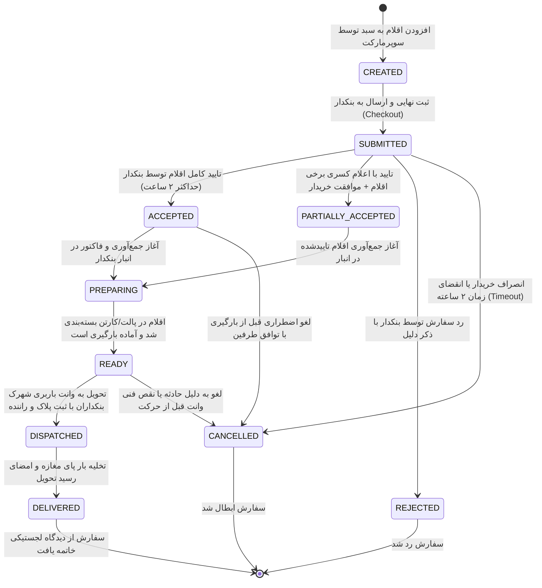
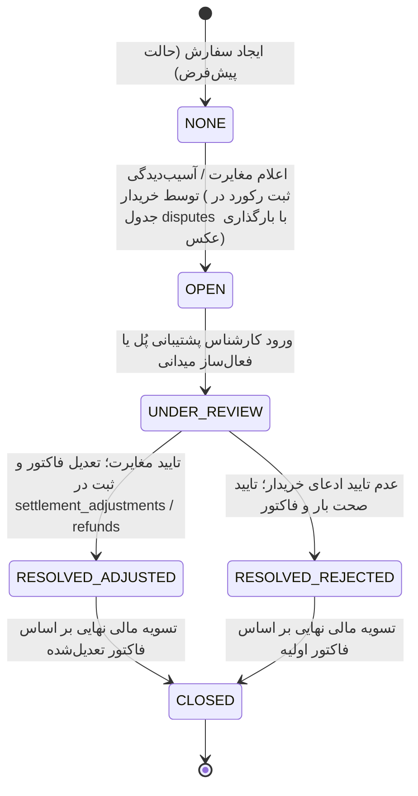

# چرخه حیات سفارش و معماری ماشین وضعیت دوگانه (Dual State Machine Spec)
## پروژه پُل (POL) — B2B FMCG Platform
**شناسه سند:** `PROD-SPEC-002`  
**وضعیت:** مصوب و نهایی  
**نسخه:** ۲.۰ (معماری تفکیک ماشین وضعیت سفارش و اختلاف)  
**مرجع تصمیم‌گیری:** بخش ۲۱ مستر پرامپت (جداسازی Order State از Dispute State)  
**تاریخ به‌روزرسانی:** سپتامبر ۲۰۲۶  

---

### ۱. اصل راهبردی معماری: تفکیک ماشین وضعیت سفارش از مغایرت (Orthogonal State Machines)
در سیستم‌های سنتی یا با طراحی ضعیف، «مغایرت (Dispute)» به عنوان یکی از وضعیت‌های خطی سفارش در نظر گرفته می‌شود. این یک خطای معماری است؛ زیرا سفارش ممکن است از نظر فیزیکی «تحویل داده شده (DELIVERED)» باشد اما هم‌زمان یک «اختلاف باز (Dispute = OPEN)» روی یکی از اقلام آن وجود داشته باشد.  
در پلتفرم پُل، دو ماشین وضعیت کاملاً مستقل اما مرتبط با هم طراحی شده‌اند:
1. **ماشین وضعیت لجستیک و جریان کالا (`Order Status Machine`)**
2. **ماشین وضعیت دعاوی و حل اختلاف بازرگانی (`Dispute Status Machine`)**

---

### ۲. ماشین وضعیت سفارش (Order State Machine)



#### پروتکل دوطرفه پذیرش ناقص (Partial Acceptance Protocol)

وضعیت `PARTIALLY_ACCEPTED` فقط پس از موافقت خرده‌فروش ایجاد می‌شود؛ بنکدار نمی‌تواند با یک command یک‌طرفه از `SUBMITTED` به `PARTIALLY_ACCEPTED` عبور کند.

```text
SUBMITTED
   │
   ├── Vendor proposes shortage ──> SUBMITTED + PENDING Proposal
   │                                  │
   │                                  ├── Retailer approves ──> PARTIALLY_ACCEPTED
   │                                  │
   │                                  └── Retailer declines ──> SUBMITTED
   │
   ├── Full accept ──> ACCEPTED
   └── Full reject  ──> REJECTED
```

قواعد کانونیکال:
- proposal صرفاً یک پیشنهاد تجاری است و در زمان ایجاد آن هیچ mutation روی سفارش، اقلام سفارش یا موجودی انجام نمی‌شود.
- proposal فقط زمانی قابل تایید است که order در `SUBMITTED` و proposal در `PENDING` باشد.
- اقلامی که در proposal نیامده‌اند در زمان approval با مقدار کامل سفارش پذیرفته می‌شوند.
- در approval، مقدار رزروشده کامل از `reserved_quantity` آزاد و مقدار پذیرفته‌شده از `physical_quantity` کسر می‌شود؛ `consumed_quantity` مصرف واقعی را ثبت می‌کند.
- مبلغ `order`, `order_items` و `order_group` بر مبنای مقدار پذیرفته‌شده بازمحاسبه می‌شود.
- در صورت decline، سفارش، مبلغ و موجودی دست‌نخورده می‌مانند و proposal به `DECLINED` تبدیل می‌شود.
- وجود proposal در `PENDING` مسیرهای full accept/full reject را تا تصمیم خریدار مسدود می‌کند.
- timeout ممکن است proposal را غیرقابل‌اجرا کند، چون approval فقط برای `SUBMITTED` مجاز است؛ automation تایم‌اوت در slice مستقل lifecycle اجرا خواهد شد.

#### جدول تشریح وضعیت‌های سفارش (Order States):

| نام وضعیت | تعریف و رخداد محرک | بازیگر مجاز (Actor) | پنجره زمانی / SLA | رویداد خروجی |
| :--- | :--- | :---: | :---: | :--- |
| `CREATED` | سبد خرید در اپلیکیشن ایجاد و اقلام ذخیره شده است. | سوپرمارکت | نامحدود (تا پیش از ثبت) | `basket_created` |
| `SUBMITTED` | سفارش ثبت نهایی شده و در صف بررسی بنکدار است. | سوپرمارکت | تارگت < ۴۵ دقیقه / سقف تایم‌اوت سخت ۲ ساعت | `order_submitted` |
| `ACCEPTED` | بنکدار تمامی اقلام و مقادیر درخواستی را تایید کرد. | بنکدار | میانه تارگت < ۴۵ دقیقه | `order_accepted` |
| `PARTIALLY_ACCEPTED` | بنکدار کسری برخی اقلام را اعلام کرده و سوپرمارکت پذیرفته است. | بنکدار + سوپرمارکت | سقف ۲ ساعت | `order_partially_accepted` |
| `REJECTED` | بنکدار به علت اتمام موجودی کل، سفارش را رد کرده است. | بنکدار | سقف ۲ ساعت | `order_rejected` |
| `PREPARING` | بارچین انبار در حال جمع‌آوری اقلام از قفسه‌ها است. | انباردار بنکدار | ۲ تا ۴ ساعت | `order_preparing` |
| `READY` | بسته‌بندی کامل شده، فاکتور چاپ شده و آماده وانت است. | انباردار بنکدار | قبل از پنجره بارگیری | `order_ready` |
| `DISPATCHED` | بار به وانت باربری شهرک تحویل داده شد و خودرو حرکت کرد. | بنکدار | طبق پنجره تحویل روزانه | `order_dispatched` |
| `DELIVERED` | وانت به مغازه رسیده، تخلیه شده و رسید امضا شده است. | راننده / سوپرمارکت | پنجره صبح یا عصر | `order_delivered` |
| `CANCELLED` | سفارش پیش از تحویل با ذکر دلیل مشخص باطل شده است. | خریدار / بنکدار / سیستم | پیش از وضعیت `DISPATCHED` | `order_cancelled` |

---

### ۲.۱. قوانین رسمی تایم‌اوت تایید سفارش بنکدار (Vendor Acceptance Rules)

تفکیک بنیادین بین «تارگت عملکردی» و «تایم‌اوت سخت سیستمی»:

* **زمان هدف تایید (Target Acceptance Time):** میانه زمان مطلوب پلتفرم کمتر از ۴۵ دقیقه (و تارگت عملکرد ماه اول کمتر از ۶۰ دقیقه طبق KPIهای پایلوت) است.
* **تایم‌اوت سخت تایید (Hard Acceptance Timeout):** دقیقاً **۲ ساعت کاری (۱۲۰ دقیقه کاری)** بر مبنای تقویم تجاری شهرک بنکداران اهواز (شنبه تا پنج‌شنبه، ساعت ۸:۰۰ الی ۱۸:۰۰).
* **اقدام پس از تایم‌اوت (Timeout Action):** در صورت سپری شدن ۱۲۰ دقیقه کاری بدون پاسخ بنکدار:
  1. سفارش به صورت خودکار به وضعیت `CANCELLED` با دلیل `VENDOR_TIMEOUT` منتقل می‌شود.
  2. موجودی رزروشده اقلام بلافاصله در `vendor_inventory` آزاد می‌گردد (`reserved_quantity` کسر می‌شود).
  3. به خریدار از طریق رویداد `ORDER_CANCELLED` و صندوق پیام اطلاع‌رسانی می‌شود؛ SMS/Push به‌صورت worker جداگانه تحویل می‌شوند و امکان ثبت مجدد سفارش با بنکدار دیگر فراهم می‌گردد.
  4. تیکت هشدار بحرانی برای فعال‌ساز میدانی و تیم عملیات پُل جهت پیگیری حضوری صادر می‌شود.
* **رویداد خروجی (Timeout Event):** انتشار رویداد `order_cancelled` با متادیتای `cancellation_reason: "VENDOR_TIMEOUT"` و صدور رویداد داخلی دامنه `vendor_acceptance_timed_out`.
* **پیامد اعتباری (Timeout Reputation Impact):** در MVP موجود، جریمه به‌صورت رکورد `ACCEPTANCE_LATE` با `impact_score = -0.25` در `vendor_reliability_events` ثبت می‌شود. Projection امتیاز تجمیعی بنکدار یک قابلیت جداگانه است و این worker آن را به‌صورت مستقل محاسبه نمی‌کند.

---

### ۳. ماشین وضعیت حل اختلاف (Dispute State Machine)

ماشین وضعیت اختلاف به صورت مستقل بر روی موجودیت مستقل `disputes` و فیلد هم‌گام `orders.dispute_status` عمل می‌کند:



#### جدول وضعیت‌های اختلاف (Dispute States):

| نام وضعیت | شرح فرآیند | مجری تغییر وضعیت | پیامد عملیاتی و مالی |
| :--- | :--- | :---: | :--- |
| `NONE` | هیچ شکایتی ثبت نشده و فرآیند عادی در جریان است. | سیستم | تسویه خودکار طبق تقویم مالی |
| `OPEN` | سوپرمارکت ظرف مهلت ۴ ساعته پس از تحویل، مغایرت یا خرابی را گزارش کرد. | سوپرمارکت | توقف موقت تسویه مالی سفارش |
| `UNDER_REVIEW` | تیم پشتیبانی پُل شواهد تصویری را بررسی کرده و با بنکدار و راننده تماس گرفت. | کارشناس پُل | استماع نظرات طرفین و بررسی بارنامه |
| `RESOLVED_ADJUSTED` | مغایرت تایید شد؛ اقلام معیوب از فاکتور کسر و مبلغ بازپرداخت مستقیم فروشنده / نتیجه تسویه ثبت شد. | داور پُل | کسر نمره تعهد بنکدار + تعدیل فاکتور |
| `RESOLVED_REJECTED` | ادعای خریدار با شواهد بارنامه رد شد و فاکتور بدون تغییر تایید گردید. | داور پُل | بدون تغییر فاکتور + کسر نمره اعتماد خریدار در صورت تکرار |
| `CLOSED` | پرونده حل اختلاف مختومه شد و نتایج در گزارشات ثبت گردید. | مدیر عملیات | ادامه فرآیند تسویه حساب مالی |

---

### ۴. سلسله‌مراتب کانونی موجودیت‌های سفارش (Canonical Order Entity Hierarchy)
چرخه حیات سفارش در پُل بر پایه سلسله‌مراتب کانونی مستند در `08_DATA/DOMAIN_MODEL.md` و `08_DATA/MULTI_VENDOR_ORDERING_MODEL.md` است:

```
Basket -> AllocationPlan -> OrderGroup -> Order -> OrderItem
```

* **Basket (سبد):** تقاضای اولیه سوپرمارکت، پیش از هر تخصیصی.
* **AllocationPlan (برنامه تخصیص):** خروجی قطعی موتور تخصیص چندبنکدار (D-014).
* **OrderGroup:** تراکنش یکپارچه والد، متعلق به یک سوپرمارکت.
* **Order (سفارش فرزند):** قرارداد مستقل با یک بنکدار — همان ماشین وضعیت بخش ۲ این سند.
* **OrderItem (قلم سفارش):** کوچک‌ترین واحد تحویل، تسویه و مغایرت (disputes).

هر تغییر وضعیت در بخش ۲ همیشه در سطح `Order` رخ می‌دهد و هرگز `OrderGroup` یا `Basket` را به‌صورت اتمیک جابه‌جا نمی‌کند؛ تفکیک اختلاف نیز همیشه در سطح `OrderItem` (مستند در `disputes`) اعمال می‌شود.

---

### ۵. ماتریس نگاشت داده‌های تغییر وضعیت (State Transition Payload Contract)
هر رویداد تغییر وضعیت در دیتابیس باید شامل فیلدهای زیر باشد:

```json
{
  "order_id": "ord_8829a10f",
  "from_order_status": "READY",
  "to_order_status": "DISPATCHED",
  "dispute_status": "NONE",
  "actor": {
    "user_id": "usr_vendor_104",
    "role": "VENDOR_OWNER"
  },
  "transition_metadata": {
    "driver_name": "احمد رضایی",
    "driver_mobile": "09161112233",
    "vehicle_plate": "14ب256-ایران24",
    "carrier_agency": "باربری صداقت شهرک بنکداران"
  },
  "timestamp": "2026-09-11T10:30:00.000Z"
}
```
