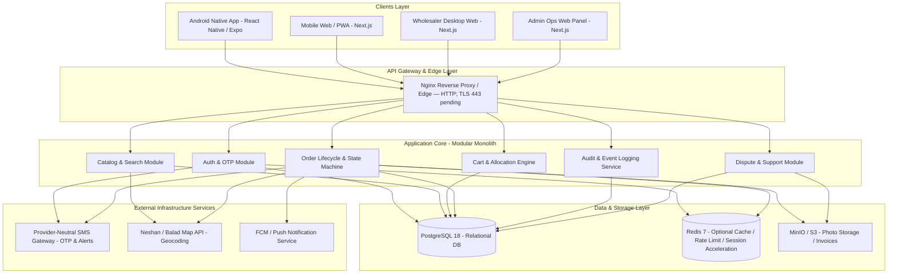
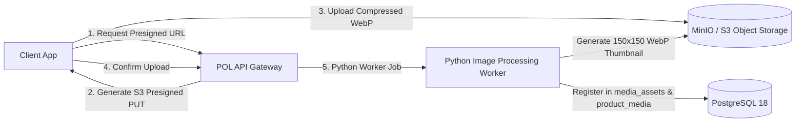

# مشخصات معماری فنی و مهندسی نرم‌افزار پُل (POL Technical Architecture Specification)

> **سند معماری فنی:** انتخاب پشته فناوری (Tech Stack)، معماری کلاینت-سرور، طراحی ماژولار، مدل احراز هویت OTP، یکپارچه‌سازی با سامانه‌های پیامکی و نقشه داخلی، و استراتژی استقرار ابری در ایران  
> **نسخه:** ۱.۰ (تثبیت‌شده برای آغاز پیاده‌سازی)  
> **اصل طراحی مهندسی:** ماژولار یکپارچه (Modular Monolith)، توسعه سریع، کم‌هزینه و مقیاس‌پذیر تا ۱۰۰٬۰۰۰ تراکنش ماهانه بدون پیچیدگی بیهوده میکروسرویس‌ها  

---

## ۱. دیاگرام کلان معماری سامانه (High-Level Architecture Diagram)



---

## ۲. پشته فناوری مصوب (Approved Technology Stack)

| لایه معماری | فناوری منتخب | دلایل توجیهی و مزیت فنی |
|---|---|---|
| **محیط اجرایی بک‌اند (Runtime)** | **Python** | D-019:uthoritative production backend runtime. Ecosystem maturity, psycopg2/asyncpg native PostgreSQL driver, asyncio-native I/O. No Node/Python dual runtime. Concrete interpreter version (≥3.11) enforced by `verify_environment.py` and CI. |
| **فریم‌ورک بک‌اند (Framework)** | **FastAPI (thin transport adapter over modular monolith)** | D-020:uthoritative HTTP framework. Thin adapter layer over `authentication/session → ApplicationContext → POLApplicationBoundary → canonical domain service → PostgreSQL → outbox → worker`. Modular monolith maintained via Python module boundaries. |
| **پایگاه داده اصلی (Database)** | **PostgreSQL 18** | پشتیبانی کامل از تراکنش‌های مالی ACID، جستجوی متنی فازی زبان فارسی با افزونه `pg_trgm`، ایندکس‌های B-Tree روی بارکدها و فیلدهای JSONB. |
| **کش / Rate Limit** | **Redis 7 (Optional)** | در صورت استقرار، فقط برای cache / rate-limit / acceleration؛ canonical business state و outbox به Redis وابسته نیست. |
| **موتور worker / event processing** | **Python workers + PostgreSQL Outbox** | Canonical per D-019/D-015: workers claim durable PostgreSQL work with `FOR UPDATE SKIP LOCKED` and leases; no BullMQ/Redis Streams dependency. See `POL_00_PROJECT_CONTROL/WORKER_ARCHITECTURE.md`. |
| **ذخیره‌سازی فایل و تصاویر (Storage)** | **S3-compatible Object Storage (MinIO یا سرویس ابری)** | ذخیره‌سازی فایل‌های باینری و تصاویر با ساختار کلیدهای پایدار (`products/{id}/canonical/{uuid}.webp`) و حذف EXIF؛ در deployment اولیه VPS، object storage بیرونی است و روی root disk سرور قرار نمی‌گیرد. |
| **فرانت‌اند وب و دسکتاپ (Web)** | **Next.js 15 (App Router) با استایل‌دهی Tailwind CSS** | ساختار فوق‌العاده سبک، رندر سریع سمت سرور (SSR) برای گوشی‌های ضعیف، و قابلیت PWA روی گوشی سوپرمارکت. |
| **اپلیکیشن موبایل (Mobile)** | **React Native با فریم‌ورک Expo** | اشتراک بیش از ۸۰٪ کدهای تجاری با نسخه وب؛ ماژول اسکنر دوربین برای اسکن پیوسته بارکد (Continuous Scan). |
| **رصد و مانیتورینگ (Observability)** | **Pino JSON Logger به همراه متریک‌های Prometheus و داشبورد Grafana** | ثبت ساختاریافته خطاها و متریک‌ها؛ observability stack مستقل یک گیت عملیاتی جداست. process supervision فعلاً توسط Docker Compose و container restart policy انجام می‌شود و در VPS runtime تأیید شده است. |
| **زیرساخت سرور و استقرار (Deployment)** | **Docker Compose روی سرورهای ابری داخل ایران (ابر آروان یا پارس‌پک)** | تضمین دسترسی ۱۰۰٪ پایدار درون کشور حتی در زمان اختلالات اینترنت بین‌الملل؛ استقرار ایزوله و مستقل. |

---

## ۳. قراردادهای احراز هویت و امنیت (Authentication & Security Contracts)

```
[ کاربر شماره موبایل وارد می‌کند ]
               │
               ▼
[ ایجاد چالش OTP چهاررقمی در PostgreSQL (otp_challenges) با انقضای ۱۲۰ ثانیه ]
               │
               ▼
[ ارسال پیامک از طریق خط خدماتی (بدون مسدودی بلک‌لیست تبلیغاتی) ]
               │
               ▼
[ کاربر کد را وارد می‌کند ] ──► [ راستی‌آزمایی در سرور ]
                                         │
                                         ▼
[ صدور دو توکن امنیتی JWT ]:
  ۱. Access Token (عمر ۱۵ دقیقه - در هدر Bearer)
  ۲. Refresh Token (عمر ۳۰ روز - HttpOnly Secure Cookie یا حافظه امن گوشی)
```

**矿别 توکن‌ها (D-018 تفسیر رسمی):**
- **Access Token:** JWT stateless با `exp` claim ۱۵ دقیقه‌ای. کتابخانه JWT در هر درخواست اعتبارسنجی می‌کند. عمر آن در `user_sessions.expires_at` ذخیره نمی‌شود.
- **Refresh Session:** سشن سرور-ردیابی‌شده در `user_sessions`. فیلد `expires_at` برابر با **۳۰ روز** (عمر refresh token) است. `refresh_token_hash` متعلق به این سشن است.
- **Refresh Token Rotation:** هنوز تصمیم‌گیری نشده (D-018).

### کنترل‌های امنیتی ضد تقلب:
1. **محدودسازی ارسال پیامک (Rate Limiting):** حداکثر ۳ درخواست OTP در هر ۵ دقیقه به ازای هر شماره تلفن و آی‌پی؛ اجرای فعلی برای جلوگیری از race condition با PostgreSQL `pg_advisory_xact_lock` سریال‌سازی می‌شود و بر `LOGIN`/ `REGISTER` اعمال می‌شود.
2. **مجوزهای مبتنی بر نقش (RBAC Guards):** هر کنترلر API با گارد امنیتی `@Roles('RETAILER')` یا `@Roles('WHOLESALER')` محافظت می‌شود.

---

## ۴. استانداردهای طراحی API (RESTful API Standards)

تمام اندپوینت‌ها از ساختار استاندارد نسخه ۱ استفاده می‌کنند (`/api/v1/...`):

### ۴.۱. اندپوینت‌های احراز هویت (`/api/v1/auth`)
* `POST /api/v1/auth/request-otp` — ایجاد چالش OTP ورود
* `POST /api/v1/auth/verify-otp` — اعتبارسنجی OTP و صدور access/refresh token
* `POST /api/v1/auth/refresh` — تمدید access token با refresh session
* `POST /api/v1/auth/switch-organization` — تغییر tenant فعال و صدور JWT جدید
* `DELETE /api/v1/auth/sessions/current` — ابطال سشن جاری
* `DELETE /api/v1/auth/sessions/{id}` — ابطال یک سشن متعلق به کاربر احراز‌شده

### ۴.۲. اندپوینت‌های کاتالوگ، بارکد و تطبیق کالا (`/api/v1/catalog`)
* `GET /categories` — درخت دسته‌بندی اقلام با آیکون‌ها
* `GET /products/search?q={query}&category={id}` — جستجوی سریع فازی با `pg_trgm` در کاتالوگ مرجع
* `POST /products/match-barcode` — جستجوی فوری بر اساس بارکد اسکن‌شده (`raw_barcode` $\to$ بازگرداندن وضعیت `EXACT`, `HIGH_CONFIDENCE`, `AMBIGUOUS`, `NO_MATCH`)
* `GET /products/{id}/vendors` — لیست بنکداران ارائه‌دهنده، قیمت هر کارتن و شرایط تحویل
* `POST /candidates` — ثبت کالای ناشناخته جدید در صورت عدم تطبیق (`product_candidates`)
* `POST /candidates/{id}/approve` — تایید کاندیدا و ارتقا به محصول مرجع توسط ادمین

### ۴.۳. اندپوینت‌های انبار و ورود سریع بنکدار (`/api/v1/vendor`)
* `POST /inventory/continuous-scan` — جلسه اسکن پیوسته (ارسال بارکد، تعداد کارتن و قیمت فروش واحد به تومان)
* `PATCH /inventory/{vendor_sku}/price` — تغییر آنی قیمت واحد کارتن کالا
* `PATCH /inventory/{vendor_sku}/quantity` — تعدیل دستی موجودی فیزیکی انبار
* `POST /inventory/publish` — انتشار جمعی اقلام جلسه اسکن در مارکت‌پلیس

### ۴.۴. اندپوینت‌های رسانه و آپلود تصویر (`/api/v1/media`)
* `POST /media/presigned-url` — دریافت URL امضاشده جهت آپلود مستقیم به MinIO/S3 با کنترل اندازه فایل و نوع محتوا
* `POST /media/confirm-upload` — تایید بارگذاری، تولید تامبنیل WebP و پیوند به کالا یا بنکدار

### ۴.۵. اندپوینت‌های سبد و سفارش (`/api/v1/orders`)
* `POST /orders/quote` — دریافت پیش‌فاکتور، محاسبه مجموع قیمت و کارمزد
* `POST /orders` — ثبت قطعی سفارش توسط سوپرمارکت با شناسه یکتای Idempotency
* `GET /orders` — لیست سفارش‌های جاری و تاریخی (با فیلتر نقش)
* `GET /orders/{id}` — مشاهده فاکتور کامل، وضعیت اقلام لجستیکی و وضعیت اختلاف
* `PATCH /orders/{id}/status` — تغییر وضعیت لجستیکی سفارش توسط بنکدار (`ACCEPTED`, `PARTIALLY_ACCEPTED`, `PREPARING`, `READY`, `DISPATCHED`)
* `POST /orders/{id}/dispute` — ثبت گزارش مغایرت تجاری، خرابی یا کسری توسط سوپرمارکت (`dispute_status = OPEN`)
* `PATCH /orders/{id}/dispute` — بررسی و بستن پرونده مغایرت تجاری توسط پشتیبانی پُل

### ۴.۶. سرویس‌های پروفایل، بافت پرسونا و معرفی همکاران (`/api/v1/profile` و `/api/v1/referrals`)
* **وضعیت ران‌تایم:** سرویس‌های دامنه در ماژول‌های پایتون `scripts/user_profiles.py` و `scripts/vendor_referral.py` بر بستر PostgreSQL 18 عملیاتی و اعتبارسنجی شده‌اند. استقرار در لایه HTTP در وضعیت `CONTRACT_SPECIFIED / NOT_YET_DEPLOYED_AT_HTTP` قرار دارد.
* `GET /profile` — دریافت پروفایل انسانی فراگیر یکتا (`user_profiles`)
* `PUT /profile` — به‌روزرسانی مشخصات فردی، تصویر آواتار و زبان ترجیحی
* `GET /profile/completion` — محاسبه درصد تکمیل اطلاعات کاربری
* `GET /profile/context` — استخراج بافت مرکب ۵ لایه (هویت + سازمان + نقش + پرسونای عملیاتی)
* `POST /referrals/redeem` — ثبت انتساب معرف بنکدار برای سوپرمارکت (D-016 بدون پاداش نقدی)

---

## ۵. پایپ‌لاین ذخیره‌سازی رسانه و موتور جستجوی کاتالوگ (Media Pipeline & Search Engine)



* **موتور جستجوی فازی تری‌گرام (Trigram Fuzzy Search):** با استفاده از اکستنشن `pg_trgm` و ایندکس‌های `GIN (canonical_name_fa gin_trgm_ops)`، سوپرمارکت‌ها با تایپ حتی بخشی از نام کالا، برند یا نگارش‌های مختلف فارسی (ی/ي و ک/ك) به سرعت زیر ۵۰ میلی‌ثانیه نتایج منطبق را مشاهده می‌کنند.

---

## ۶. استراتژی استقرار و پایداری در ایران (Deployment & Disaster Recovery)

1. **مدیریت زیرساخت با Docker Compose:**
   لایه اجرایی POL با Docker Compose بسته‌بندی می‌شود. در deployment اولیه VPS، Nginx، FastAPI، Next.js، PostgreSQL و Python workers کانتینری هستند؛ Redis اختیاری است و object storage بیرونی S3-compatible است.
2. **پشتیبان‌گیری خودکار (Automated Daily Backups):**
   اسکریپت خودکار در ساعت ۳:۰۰ بامداد هر شب خروجی فشرده پایگاه داده (`pg_dump`) و متادیتای S3 را تهیه کرده و روی فضای ابری مجزا ذخیره می‌کند.
3. **مانیتورینگ و ثبت خطا (Logging & Observability):**
   لاگ تمام خطاها و هشدارهای سرور با فرمت JSON در ابزارهای رصد محلی ثبت می‌شود تا تیم مهندسی در لحظه از هرگونه خطای سفارش‌گیری مطلع گردد.

---

## وضعیت فعلی اجرای معماری — 2026-09-28

معماری پیش‌بینی‌شده این سند اکنون در لایه runtime روی VPS با IP `85.198.50.29` به‌صورت عملیاتی تأیید شده است: PostgreSQL 18.6، FastAPI/Uvicorn، Python transactional-outbox worker، Next.js 15 standalone و Nginx در Docker Compose اجرا می‌شوند. 76 migration forward-only و 108 base tables در PostgreSQL تأیید شده‌اند و health/readiness و API smoke عمومی HTTP 200 بوده‌اند.

تفکیک مهم: این snapshot مربوط به **IP-stage deployment** است. TLS/443، دامنه `polmarket.ir`، exact HTTPS CORS origin و گذار عمدی به `ENVIRONMENT=production` هنوز gateهای جداگانه هستند. جزئیات evidence در `deploy/VPS_RUNTIME_VERIFICATION_2026-09-28.md` ثبت شده است.

## وضعیت سند و گام بعدی

* **وضعیت:** مصوب؛ source و VPS IP-stage runtime پیاده‌سازی و تأیید شده است. HTTPS/domain cutover و برخی provider/observability gates همچنان جداگانه پیگیری می‌شوند.
* **اسناد وابسته:** `06_PRODUCT/PRD.md`, `08_DATA/Data_Schema.md`, `08_DATA/Event_Architecture.md`.
* **آمادگی برای ساخت (Build Readiness):** تأیید قطعی جهت آغاز فاز پیاده‌سازی.

