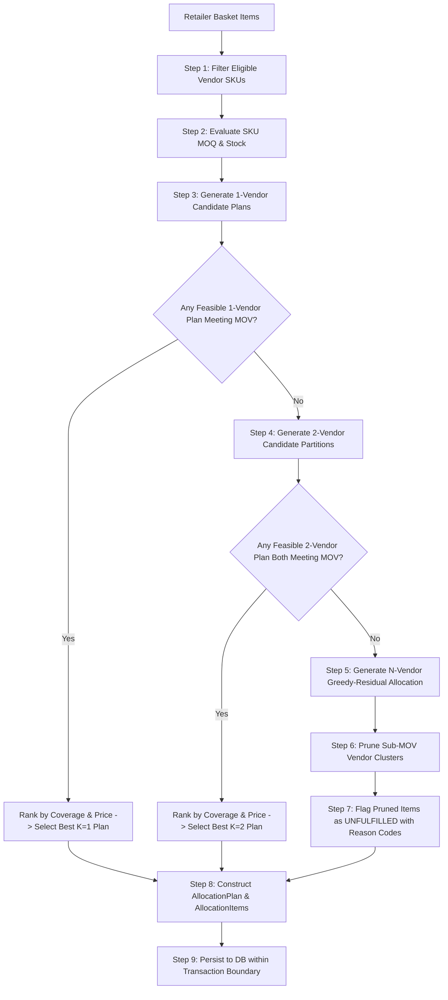

# POL MVP MULTI-VENDOR ALLOCATION ALGORITHM SPECIFICATION

**Document ID:** `POL-ALG-002`  
**Version:** 2.0 (Canonical MVP)  
**Status:** `LOCKED / IMPLEMENTATION-READY`  
**Governance:** Lead Algorithm Architect / Founder Approved  
**Associated Decision:** `D-014` (Multi-Vendor Basket in MVP), `D-005` (Open Vendor Count), `D-010` (Order Entity Separation)  
**Reference Code:** `scripts/allocation_engine.py`  

---

## 1. Executive Summary & Design Principles

The POL MVP Multi-Vendor Allocation Engine resolves the central tension of wholesale FMCG e-commerce:
> **"How can a supermarket retailer place ONE unified order across specialized wholesalers without POL incurring physical cross-docking inventory risk, and without violating wholesaler minimum commercial thresholds?"**

### Core Principles
1. **Deterministic & Reproducible:** Given identical catalog state, inventory levels, and buyer basket, the algorithm ALWAYS outputs the exact same allocation plan. No random tie-breakers, no non-deterministic heuristic jumps.
2. **Transparent & Explainable:** Every item allocation or non-allocation carries an explicit machine-readable reason code (`ALLOCATED`, `OUT_OF_STOCK`, `SKU_MOQ_NOT_MET`, `VENDOR_MOV_NOT_MET`, `GEOGRAPHIC_OUT_OF_BOUNDS`, etc.).
3. **Minimum Fragmentation by Default:** Supermarkets dislike receiving 5 different delivery trucks for 5 items. The algorithm actively prioritizes solutions with fewer vendors ($K=1$, then $K=2$, then $K=N$), without arbitrarily capping $N$ (D-005).
4. **Strict Vendor Autonomy (MOV & MOQ):** Wholesalers cannot be forced to deliver below their economic threshold. Every allocated vendor sub-basket MUST strictly satisfy that vendor's Minimum Order Value (`MOV`). If a vendor's assigned subtotal is below MOV, that vendor assignment is invalid.
5. **Preservation of Unfulfilled Demand:** If an item cannot be feasibly routed to any vendor meeting all constraints, it is NOT dropped silently; it is persisted as an unfulfilled allocation item (`status = 'UNFULFILLED'`, `vendor_id = NULL`) so the buyer and platform retain visibility over lost demand.

---

## 2. Formal Mathematical Formulation

### 2.1. Inputs
- **Basket** $\mathcal{B} = \{(p_i, q_i, u_i)\}_{i=1}^M$, where:
  - $p_i \in \mathcal{P}$: Master Product ID.
  - $q_i \in \mathbb{N}^+$: Requested quantity.
  - $u_i \in \text{PackagingUnit}$: Requested packaging unit (e.g., `CARTON`, `BOX`, `BUNDLE`).
- **Retailer Context** $\mathcal{R}$:
  - $\text{loc}_{\mathcal{R}}$: Delivery coordinates/zone in Ahvaz.
- **Vendor Catalog Universe** $\mathcal{V} = \{V_j\}_{j=1}^V$, where each vendor $V_j$ provides:
  - $\text{active}_j \in \{\text{TRUE}, \text{FALSE}\}$: Account status.
  - $\text{zone}_j \subseteq \text{Geography}$: Delivery service area.
  - $\text{MOV}_j \in \mathbb{R}^+$: Minimum Order Value (in Toman).
  - $\text{Reputation}_j \in [0, 5]$: Historical fulfillment score / fill rate.
  - Set of sellable SKUs $\mathcal{S}_j = \{(p_{jk}, \text{price}_{jk}, \text{inv}_{jk}, \text{moq}_{jk})\}$.
    - $\text{inv}_{jk} = \text{physical}_{jk} - \text{reserved}_{jk}$: Net available inventory.
    - $\text{moq}_{jk} \in \mathbb{N}^+$: Minimum order quantity for product $p_{jk}$.

### 2.2. Decision Variables
For each item $i \in \{1 \dots M\}$ and vendor $j \in \{1 \dots V\}$:
- $x_{ij} \in [0, q_i]$: Quantity of item $i$ allocated to vendor $j$.
- In MVP v1.0, **Line-Item Allocation Only (Prohibition of Intra-Line Quantity Splitting)**: An individual basket line item $i$ is routed entirely to a single vendor $j$ ($x_{ij} = q_i$) or remains unfulfilled ($x_{ij} = 0$). Splitting a single line item's quantity across multiple vendors is strictly forbidden in MVP (e.g., if 10 cartons are requested, and Vendor A has 6 while Vendor B has 4, POL does NOT split 6 to A and 4 to B; the item remains unfulfilled if no single vendor has $\ge 10$). This eliminates split-shipment receiving friction, partial carton handling, and warehouse picking disputes during Pilot.
- Binary indicator $y_j \in \{0, 1\}$: $y_j = 1 \iff \sum_{i=1}^M x_{ij} > 0$ (Vendor $j$ is utilized).

### 2.3. Two-Stage Allocation Architecture

The engine executes in two distinct sequential stages:

#### Stage 1: Candidate Vendor Universe Filtering (Pre-Optimization)
Before combinatorial optimization begins, POL prunes the vendor universe per item:
1. **Vendor Eligibility Filter:** Vendor must be active (`is_active = TRUE`), verified, and serving the retailer's geographic zone in Ahvaz (`loc_R in zone_j`).
2. **Catalog & Inventory Filter:** Vendor must offer the exact Master Product SKU in the requested packaging unit, have net available inventory $\text{inv}_{ij} = (\text{physical} - \text{reserved}) \ge q_i$, and satisfy SKU MOQ ($q_i \ge \text{moq}_{ij}$).
Vendors failing Stage 1 checks for item $i$ are completely excluded from the candidate pool for item $i$, reducing the search space for Stage 2.

#### Stage 2: Combinatorial Allocation & Minimum Fragmentation Optimization
Using only Stage 1-eligible candidate vendors, the algorithm searches for the minimum-vendor partition ($K=1 \to K=2 \to K=N$) that maximizes fulfilled basket coverage and satisfies all hard constraints (including MOV).

### 2.4. Hard Constraints
1. **Single Vendor per Line Item (No Intra-Line Splitting):**
   $$\sum_{j=1}^V \mathbb{I}(x_{ij} > 0) \le 1 \quad \forall i \in \{1 \dots M\}$$
2. **Inventory Availability:**
   $$x_{ij} \le \text{inv}_{ij} \quad \forall i, j$$
3. **SKU Minimum Order Quantity (MOQ):**
   $$x_{ij} > 0 \implies x_{ij} \ge \text{moq}_{ij} \quad \forall i, j$$
4. **Vendor Geographic Eligibility:**
   $$y_j = 1 \implies \text{loc}_{\mathcal{R}} \in \text{zone}_j \quad \text{and} \quad \text{active}_j = \text{TRUE}$$
5. **Vendor Minimum Order Value (MOV) Feasibility:**
   $$y_j = 1 \implies \sum_{i=1}^M (x_{ij} \cdot \text{price}_{ij}) \ge \text{MOV}_j \quad \forall j \in \{1 \dots V\}$$
   *(Crucial: Any candidate allocation that assigns items to Vendor $j$ totaling less than $\text{MOV}_j$ is strictly FEASIBILITY-VIOLATING and cannot be committed).*

### 2.5. Delivery Semantics (MVP Operational Simplification)
- In POL MVP, **1 Vendor Child Order = 1 Independent Delivery**.
- This is explicitly designated as an **MVP Operational Simplification**: each wholesaler packs and dispatches their order via an independent local hub pickup (وانت بومی).
- POL does NOT perform multi-stop cross-docking, intermediate warehouse consolidation, or co-loading across different wholesalers in MVP. Consolidated delivery routes are deferred to post-pilot scale.

---

## 3. Objective Hierarchy (Priority-Ranked Multi-Criteria)

Candidate allocation plans that satisfy all hard constraints are evaluated and ranked according to the following strict hierarchical lexicographic order:

1. **Priority 1: Hard Constraint Feasibility**
   - $100\%$ of utilized vendors meet MOV.
   - $100\%$ of allocated items meet MOQ and available inventory.
   - Plans failing feasibility are immediately pruned.

2. **Priority 2: Minimize Vendor Count ($K = \sum_j y_j$)**
   - A single-vendor feasible plan ($K=1$) is strictly preferred over a 2-vendor feasible plan ($K=2$).
   - A 2-vendor feasible plan ($K=2$) is strictly preferred over a 3-vendor feasible plan ($K=3$).
   - *Rationale:* Minimizes buyer logistics friction, reduces delivery coordination overhead, and prevents arrival of multiple disparate trucks.

3. **Priority 3: Maximize Total Fulfilled Basket Value / Coverage**
   - Total Fulfilled Lines: $\sum_{i} \mathbb{I}(\sum_j x_{ij} = q_i)$
   - Total Fulfilled Value: $\sum_{i, j} (x_{ij} \cdot \text{price}_{ij})$
   - *Rationale:* Ensure the retailer gets as much of their requested stock as possible.

4. **Priority 4: Minimize Total Purchase Cost to Retailer**
   - Total Price: $\sum_{i, j} (x_{ij} \cdot \text{price}_{ij})$
   - *Rationale:* If two plans cover the same items with the same number of vendors, pick the cheaper one for the supermarket owner.

5. **Priority 5: Vendor Reliability Score / Fill Rate**
   - Mean Reputation: $\frac{1}{K} \sum_{j: y_j=1} \text{Reputation}_j$
   - *Rationale:* When price and coverage are tied, award allocation to the wholesaler with higher historical on-time and complete delivery performance.

6. **Priority 6: Deterministic Tie-Breaking**
   - Lexicographical ordering by Vendor IDs: sorted tuple of `(vendor_id_1, vendor_id_2, ...)`.
   - *Rationale:* Guarantees 100% test reproducibility and mathematical determinism across system restarts.

---

## 4. Heuristic Execution Pipeline (9-Step Deterministic Process)

### Step-by-Step Details

1. **Step 1: SKU Eligibility Match:**
   For each basket item $(p_i, q_i)$, query active vendors serving the retailer's zone who offer Master Product $p_i$ in packaging unit $u_i$.
2. **Step 2: Line Item Feasibility Check:**
   Filter out vendor offers where net available inventory $(physical - reserved) < q_i$ or $q_i < moq_{ij}$. Record individual diagnostic flags (`OUT_OF_STOCK`, `SKU_MOQ_NOT_MET`).
3. **Step 3: Single-Vendor ($K=1$) Evaluation:**
   Inspect every vendor who can fulfill at least one item. For each such vendor:
   - Compute subtotal $\sum (q_i \cdot \text{price}_{ij})$.
   - If subtotal $\ge \text{MOV}_j$, this vendor constitutes a valid $K=1$ candidate plan.
   - If a valid $K=1$ plan fulfills $100\%$ of the basket lines, select the cheapest/highest-rated and terminate early.
4. **Step 4: Combinatorial 2-Vendor ($K=2$) Evaluation:**
   If no single vendor can fulfill the basket completely, examine pairs of vendors $(V_a, V_b)$.
   - For each item offered by both, assign greedily to the cheaper vendor.
   - Compute subtotal for $V_a$ and $V_b$.
   - **MOV Verification:** Both $\text{subtotal}_a \ge \text{MOV}_a$ AND $\text{subtotal}_b \ge \text{MOV}_b$ MUST hold!
   - If assigning an item to the slightly more expensive vendor rescues that vendor from falling below MOV while preserving the other's MOV, the engine performs compensatory rebalancing.
   - Rank feasible $K=2$ plans by fulfilled lines, then total cost.
5. **Step 5: General $N$-Vendor Evaluation ($K \ge 3$):**
   If $K=1$ and $K=2$ cannot satisfy the basket, evaluate $K=3 \dots N$ candidate vendor sets.
6. **Step 6: MOV Enforcement & Residual Pruning:**
   Any vendor sub-basket whose assigned value fails to cross that vendor's MOV threshold is pruned.
   - The engine attempts to reassign the orphaned items to remaining feasible vendors.
   - If no remaining feasible vendor can take the item, the item transitions to unfulfilled.
7. **Step 7: Unfulfilled Line Item Tagging:**
   Every item that could not be assigned to a feasible vendor is marked:
   - `status = 'UNFULFILLED'`
   - `vendor_id = NULL`
   - `unit_price_toman = NULL`
   - `unfulfilled_reason = 'VENDOR_MOV_NOT_MET' | 'OUT_OF_STOCK' | 'SKU_MOQ_NOT_MET' | 'NO_VENDOR_AVAILABLE'`
8. **Step 8: Plan Assembly:**
   Assemble the canonical `allocation_plans` aggregate containing vendor sub-totals, fee summaries, and child line items.
9. **Step 9: Atomic Persistence:**
   Within an ACID transaction, persist `allocation_plans` and `allocation_items`, ready for retailer confirmation or checkout conversion.

---

## 5. Explainability Codes & Error Taxonomy

| Reason Code | Category | User-Facing Description (Fa) | Trigger Condition |
|:---|:---|:---|:---|
| `ALLOCATED` | Success | کالا با موفقیت به بنکدار تخصیص داده شد | All constraints satisfied and item committed to vendor |
| `OUT_OF_STOCK` | Stock Deficit | موجودی بنکدار برای این تعداد کافی نیست | $(physical - reserved) < requested$ for all vendors |
| `SKU_MOQ_NOT_MET` | Quantity Threshold | حداقل تیراژ خرید این کالا رعایت نشده است | $requested < moq$ across available vendor offers |
| `VENDOR_MOV_NOT_MET` | Order Value Threshold | مجموع خرید از این بنکدار به حداقل سفارش نرسید | Assigned subtotal $< MOV_j$ and cannot be supplemented |
| `NO_VENDOR_AVAILABLE` | Catalog Absence | هیچ بنکداری در این منطقه این کالا را عرضه نمی‌کند | Master Product has no active vendor SKUs in zone |
| `PRICE_CHANGED` | Concurrency | قیمت کالا در حین سفارش تغییر کرده است | Vendor updated current price during allocation |
| `INACTIVE_VENDOR` | Compliance | بنکدار موقتاً غیرفعال است | Vendor account suspended or out of service hours |

---

## 6. Worked Canonical Example (The Section 7 Benchmark)

### Setup:
- **Basket:**
  - SKU A: 2 cartons @ requested
  - SKU B: 5 cartons @ requested
  - SKU C: 3 cartons @ requested
  - SKU D: 10 cartons @ requested
  - SKU E: 1 carton @ requested
- **Vendors:**
  - **Vendor A:** Offers A (1,000,000 T), B (800,000 T), C (1,200,000 T). MOV = 5,000,000 Toman.
  - **Vendor B:** Offers C (1,100,000 T), D (500,000 T), E (3,000,000 T). MOV = 4,000,000 Toman.
  - **Vendor C:** Offers A (950,000 T), E (2,800,000 T). MOV = 10,000,000 Toman.

### Execution Analysis:
1. **Can 1 Vendor Fulfill All (K=1)?**
   - Vendor A lacks D, E $\implies$ Incomplete.
   - Vendor B lacks A, B $\implies$ Incomplete.
   - Vendor C lacks B, C, D $\implies$ Incomplete.
   - No $K=1$ plan can achieve 100% fulfillment.
2. **Evaluate 2-Vendor Pairs (K=2):**
   - **Pair (Vendor A + Vendor B):**
     - Covered SKUs: A, B, C (from A or B), D, E.
     - **Item Assignments:**
       - SKU A (2 ct): To Vendor A $\implies 2 \times 1,000,000 = 2,000,000$ Toman.
       - SKU B (5 ct): To Vendor A $\implies 5 \times 800,000 = 4,000,000$ Toman.
       - Subtotal Vendor A (without C) $= 6,000,000$ Toman $\ge \text{MOV}_A$ (5,000,000 Toman). **Vendor A MOV SATISFIED!**
       - SKU D (10 ct): To Vendor B $\implies 10 \times 500,000 = 5,000,000$ Toman.
       - SKU E (1 ct): To Vendor B $\implies 1 \times 3,000,000 = 3,000,000$ Toman.
       - Subtotal Vendor B (without C) $= 8,000,000$ Toman $\ge \text{MOV}_B$ (4,000,000 Toman). **Vendor B MOV SATISFIED!**
       - SKU C (3 ct): Available from A (1,200,000 T) or B (1,100,000 T).
         - Vendor B is cheaper ($1,100,000 < 1,200,000$).
         - Assign SKU C to Vendor B $\implies 3 \times 1,100,000 = 3,300,000$ Toman.
         - Total Vendor B $= 8,000,000 + 3,300,000 = 11,300,000$ Toman.
     - **Result for Pair (A, B):**
       - 100% Basket Fulfillment (All 5 SKUs).
       - $K = 2$ vendors.
       - Total Order Value: $6,000,000 (\text{Vendor A}) + 11,300,000 (\text{Vendor B}) = 17,300,000$ Toman.
       - Both vendors comfortably clear their respective MOVs ($6.0\text{M} \ge 5.0\text{M}$ and $11.3\text{M} \ge 4.0\text{M}$).
   - **Pair (Vendor A + Vendor C):**
     - Lacks SKU D (neither stocks D) $\implies$ Incomplete coverage (4/5 SKUs).
   - **Pair (Vendor B + Vendor C):**
     - Lacks SKU B (neither stocks B) $\implies$ Incomplete coverage (4/5 SKUs).
     - Furthermore, Vendor C subtotal: SKU A ($2 \times 950\text{k} = 1.9\text{M}$) + SKU E ($1 \times 2.8\text{M} = 2.8\text{M}$) $= 4.7\text{M}$ Toman $< \text{MOV}_C$ (10,000,000 Toman). **Vendor C FAILS MOV!**
3. **Optimal Selection:**
   - Pair `(Vendor A, Vendor B)` is the unique optimal plan:
     - Minimum vendor count ($K=2$).
     - Maximum coverage ($100\%$).
     - Both MOVs satisfied.
     - Zero unfulfilled items.
