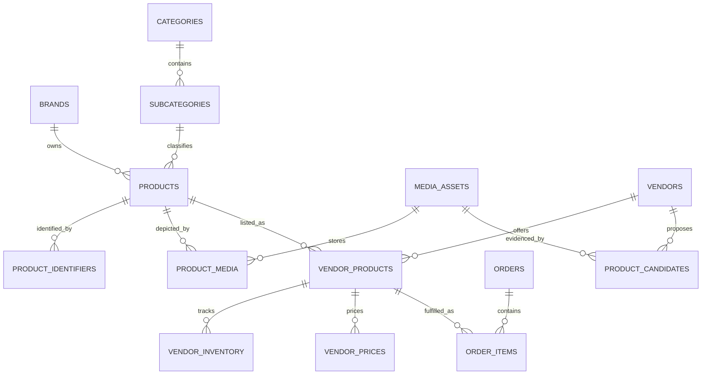

# مدل دامنه و روابط داده‌ای کاتالوگ و کالا (Catalog & Inventory Domain Model)
## پروژه پُل (POL) — B2B FMCG Platform
**شناسه سند:** `DATA-SPEC-010`  
**وضعیت:** مصوب و نهایی (Canonical Catalog Model)  
**نسخه:** ۱.۰  
**مرجع تصمیم‌گیری:** بخش‌های ۱۵، ۹۱، ۱۲۷ و ۱۵۰ مستر پرامپت  
**تاریخ به‌روزرسانی:** سپتامبر ۲۰۲۶  

---

### ۱. نمودار جامع روابط موجودیت‌های کاتالوگ و موجودی (Catalog & Inventory ERD)



---

### ۲. تفکیک لایه‌های داده‌ای کاتالوگ (Architectural Layers)

```
[لایه ۱: کاتالوگ مرجع شبکه (POL Master Catalog - جهانی و تغییرناپذیر)]
├── Brands (برندها: پریل، نیوآ، کاله، ...)
├── Categories & Subcategories (شوینده، بهداشت، خواربار، ...)
├── Products (مستر پروداکت: شناسنامه مستقل و استاندارد فیزیکی کالا)
├── Product Identifiers (بارکدهای EAN13، GTIN14 کارتن، ایران‌کد)
└── Product Media & Media Assets (تصاویر باکیفیت و متادیتاهای استوریج)
                           │
                           ▼ (اتصال از طریق کلید خارجی)
[لایه ۲: کاتالوگ و انبارداری بنکدار (Vendor Listing Layer - محلی و متغیر)]
├── Vendor Products (تعریف کالا در انبار بنکدار، کد حسابداری، سایز کارتن)
├── Vendor Inventory (موجودی فیزیکی کارتن، رزروشده، قابل فروش)
├── Vendor Prices (قیمت فروش به سوپرمارکت به ازای هر کارتن و تاریخچه)
└── Product Candidates (کالاهای جدید ثبت‌شده توسط بنکدار قبل از تایید کانونیکال)
                           │
                           ▼ (ثبت اسنپ‌شات در لحظه سفارش)
[لایه ۳: مبادلات تجاری و سفارشات (Transaction Layer)]
├── Orders & Order Items (فاکتور با ذخیره مشخصات کالا در لحظه خرید)
└── Inventory Audit Log (تاریخچه دقیق تمام تغییرات موجودی و قیمت)
```

---

### ۳. قیود کلیدی یکتایی و یکپارچگی ارجاعی (Integrity Constraints)

1. **یکتایی کد کالا در سطح بنکدار (Vendor SKU Uniqueness):**
   ```sql
   CONSTRAINT uq_vendor_sku UNIQUE (vendor_id, vendor_sku)
   ```
   *دو بنکدار مختلف می‌توانند کد مشابه داشته باشند، اما در انبار یک بنکدار، هر کد باید دقیقاً به یک کالا اشاره کند.*
2. **یکتایی بارکد در سطح بسته‌بندی:**
   ```sql
   CONSTRAINT uq_product_identifier UNIQUE (identifier_type, identifier_value, packaging_scope)
   ```
3. **ممنوعیت حذف فیزیکی کالاهای دارای سابقه تراکنش (`ON DELETE RESTRICT`):**
   اگر کالایی دارای سفارش گذشته یا موجودی انبار فعال باشد، حذف آن از پایگاه داده با خطای پایگاه داده متوقف می‌شود.
