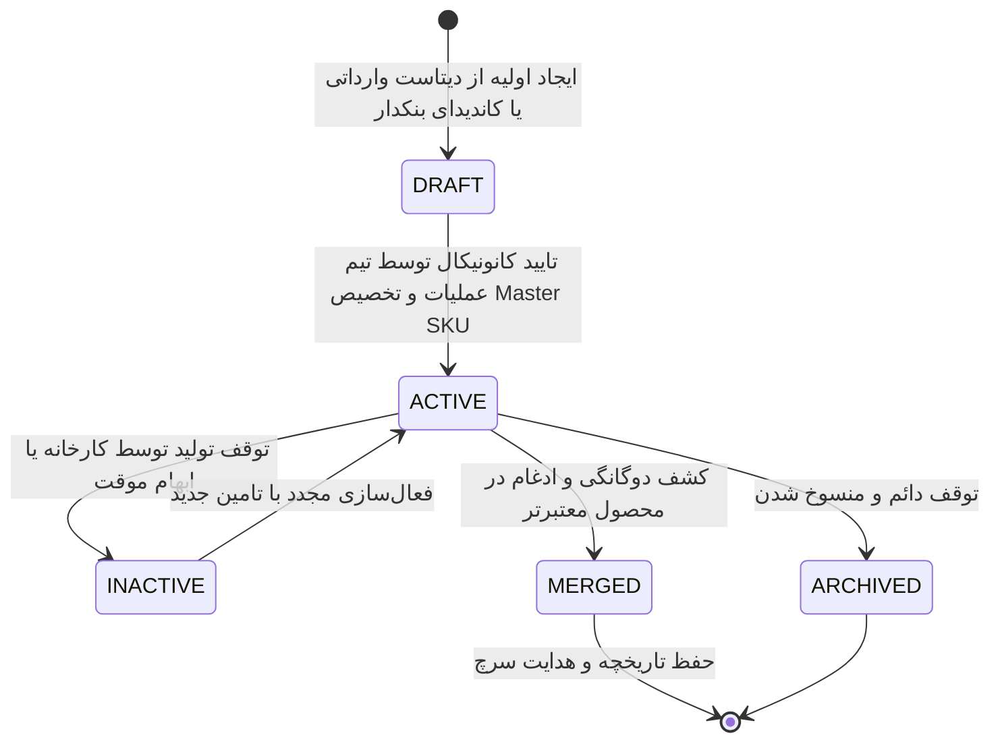

# مشخصات کانونیکال مستر کاتالوگ و هویت محصول (Canonical Product Master Spec)
## پروژه پُل (POL) — B2B FMCG Platform
**شناسه سند:** `DATA-SPEC-005`  
**وضعیت:** مصوب و نهایی (Canonical Catalog Specification)  
**نسخه:** ۱.۰  
**مرجع تصمیم‌گیری:** بخش‌های ۸ تا ۱۸، ۳۳ تا ۳۹، و ۱۴۸ تا ۱۵۴ مستر پرامپت  
**تاریخ به‌روزرسانی:** سپتامبر ۲۰۲۶  

---

### ۱. اصل بنیادین: تفکیک محصول کانونیکال (Master Product) از کد فروشنده (Vendor SKU)
بزرگ‌ترین خطای معماری در پلتفرم‌های عمده‌فروشی، مخلوط کردن «شناسنامه محصول» با «موجودی فروشنده» است.  
در پلتفرم پُل:
* **مستر پروداکت (Master Product):** کالای فیزیکی استاندارد در دنیای واقعی است که مستقل از هر بنکدار وجود دارد (مثلاً: *مایع ظرفشویی پریل لیمویی ۱۰۰۰ میلی‌لیتری*).
* **کد فروشنده (Vendor SKU):** شناسه یا بارکد داخلی است که یک بنکدار خاص در انبار خود به این کالا اختصاص داده است (مثلاً بنکداری الف به آن کد `PR-1000` و بنکداری ب به آن کد `8812` می‌دهد).  
* **رابطه:** رابطه یک-به-چند ($1 \to N$). یک Master Product می‌تواند به بی‌نهایت رکورد Vendor Product و Vendor Inventory از بنکداران مختلف متصل شود.

```
┌──────────────────────────────────────────────────────────────┐
│                    Master Product (POL)                      │
│ ID: prod_a98f12c (UUID)                                      │
│ Master SKU: POL-DET-00412                                    │
│ Canonical Title: مایع ظرفشویی پریل با رایحه لیمو ۱۰۰۰ گرم    │
│ Brand: پریل (Pril) | Category: بهداشت و شوینده              │
└──────────────────────────────────────────────────────────────┘
                               │
       ┌───────────────────────┴───────────────────────┐
       ▼                                               ▼
┌───────────────────────────────┐       ┌───────────────────────────────┐
│ Vendor Product (بنکداری شوشتری)│       │ Vendor Product (بنکداری اهوازی)│
│ Vendor SKU: SH-PRIL-1L        │       │ Vendor SKU: 99401             │
│ Pack Size: کارتن ۱۲ عددی      │       │ Pack Size: کارتن ۱۲ عددی      │
│ Inventory: ۴۰ کارتن           │       │ Inventory: ۱۸ کارتن           │
│ Price: ۱,۴۲۰,۰۰۰ تومان        │       │ Price: ۱,۳۹۵,۰۰۰ تومان        │
└───────────────────────────────┘       └───────────────────────────────┘
```

---

### ۲. ساختار هویت محصول (Product Identity Architecture)

1. **شناسه تغییرناپذیر داخلی (`product_id`):** یک شناسه یکتای UUID v4 غیرقابل تغییر که در تمامی روابط کلید خارجی (Foreign Key) در پایگاه داده استفاده می‌شود.
2. **کد تجاری مستر (`master_sku`):** کد متنی ساختاریافته قابل نمایش برای انسان و مدیران کاتالوگ (مانند `POL-DET-00104`).
3. **تفکیک خانواده محصول از تنوع‌ها (Product Family vs Variant):**
   * *خانواده محصول:* مام رول نیوآ مردانه (Nivea Men Deodorant Roll-on).
   * *محصول کانونیکال (SKU فروش):* درای ایمپکت ۵۰ میلی‌لیتری (Dry Impact 50ml).
4. **سطوح بسته‌بندی و تمایز بسته‌بندی مرجع از آفر فروشنده (Packaging Architecture):**
   * **بسته‌بندی مرجع کاتالوگ (`products.default_pack_*`):** مشخصات پیش‌فرض تولیدکننده یا استاندارد بازار (مانند کارتن مرجع ۲۴ عددی) صرفاً جهت راهنمایی و نرمال‌سازی کاتالوگ است.
   * **آفر بسته‌بندی فروشنده (`vendor_products.packaging_*`):** واحد بسته‌بندی قابل فروش که بنکدار مستقلاً تعریف می‌کند (`packaging_unit`, `items_per_package`).
     > **قابلیت انعطاف مهم:** یک Master Product واحد می‌تواند توسط یک بنکدار با چند نوع بسته‌بندی مجزا عرضه شود (مثلاً بنکدار الف برای محصول پریل، کد عرضه `SH-PRIL-12` با کارتن ۱۲ عددی و کد عرضه `SH-PRIL-24` با کارتن ۲۴ عددی ثبت کند).
   * **واحد شمارش و موجودی ژنریک (Generic Inventory):**
     * موجودی در `vendor_inventories` همیشه به‌صورت **«مقدار + واحد» (`quantity` + `unit_of_measure`)** ذخیره می‌شود.
     * کارتن (`CARTON`) تنها یکی از واحدهای ممکن است؛ سیستم به‌طور کامل از `PIECE` (عدد/بطری)، `BOX` (جعبه)، `PACK` (بسته) و `PALLET` (پالت) پشتیبانی می‌کند (مثلاً: `quantity: 40, unit_of_measure: 'CARTON'` یا `quantity: 240, unit_of_measure: 'PIECE'`).
   * **اسنپ‌شات در سفارش (`order_items`):** در زمان ثبت سفارش، مقادیر ژنریک `quantity`, `unit_of_measure`, `items_per_package` و `total_base_units` ثبت و قفل می‌شوند.

---

### ۳. دیکشنری جامع داده‌های مستر پروداکت (Data Dictionary: `products`)

| نام فیلد | نوع داده | شرح مفهومی | منبع اولیه (Source) | الزامی؟ | نال‌پذیر؟ | یکتا (Unique) | مالک داده |
| :--- | :--- | :--- | :---: | :---: | :---: | :---: | :---: |
| `id` | `UUID` | کلید اصلی سیستم، تغییرناپذیر | سیستم | بله | خیر | بله (PK) | پلتفرم پُل |
| `master_sku` | `VARCHAR(50)` | کد تجاری خوانای کانونیکال | سیستم کاتالوگ | بله | خیر | بله (Global) | پلتفرم پُل |
| `canonical_name` | `VARCHAR(255)` | نام رسمی استاندارد کالا | دیتای نرمال‌شده | بله | خیر | خیر | تیم کاتالوگ |
| `display_name_fa` | `VARCHAR(255)` | عنوان نمایشی برای خریدار | دیتای تمیزشده | بله | خیر | خیر | تیم کاتالوگ |
| `brand_id` | `UUID` | ارجاع به جدول برندهای مرجع | جدول `brands` | بله | خیر | خیر | تیم کاتالوگ |
| `category_id` | `UUID` | ارجاع به دسته کلان | جدول `categories` | بله | خیر | خیر | تیم کاتالوگ |
| `subcategory_id` | `UUID` | ارجاع به زیردسته | جدول `subcategories` | خیر | بله | خیر | تیم کاتالوگ |
| `base_unit` | `VARCHAR(30)` | واحد جزء کالا (PIECE, BOTTLE, ...) | نرمال‌سازی | بله | خیر | خیر | سیستم کاتالوگ |
| `default_pack_qty` | `INTEGER` | تعداد پیش‌فرض در کارتن | مشخصات کالا | خیر | بله | خیر | سیستم کاتالوگ |
| `net_weight_grams` | `INTEGER` | وزن خالص کالا به گرم | استخراج از specs | خیر | بله | خیر | سیستم کاتالوگ |
| `net_volume_ml` | `INTEGER` | حجم خالص مایعات به میلی‌لیتر | استخراج از specs | خیر | بله | خیر | سیستم کاتالوگ |
| `specifications` | `JSONB` | ویژگی‌های تکمیلی و ساختارنیافته | دیتاست ورودی | خیر | بله | خیر | تیم کاتالوگ |
| `status` | `VARCHAR(20)` | وضعیت چرخه حیات کالا | سیستم | بله | خیر | خیر | تیم کاتالوگ |
| `source_type` | `VARCHAR(30)` | خاستگاه اعتبار هویت کالا | لاگ سوابق | بله | خیر | خیر | سیستم حسابرسی |
| `created_at` | `TIMESTAMPTZ` | برچسب زمان ایجاد | سیستم | بله | خیر | خیر | سیستم |
| `updated_at` | `TIMESTAMPTZ` | برچسب زمان آخرین تغییر | سیستم | بله | خیر | خیر | سیستم |

---

### ۴. چرخه حیات محصول و قوانین ادغام و بایگانی (Product Lifecycle & Merge Governance)



#### قواعد تغییرناپذیری سفارش‌های گذشته (Order Snapshot Integrity):
* تغییر نام، ویرایش دسته‌بندی یا ادغام دو محصول **هرگز نباید فاکتورها و تاریخچه سفارش‌های قبلی را مخدوش کند**.
* در جدول اقلام سفارش (`order_items`)، مشخصات متنی کالا در لحظه خرید (`product_name_snapshot`, `pack_snapshot`, `unit_price_snapshot`) ذخیره می‌شود تا با ادغام محصول، گزارش‌های مالی گذشته تغییر نکنند.
* حذف فیزیکی (Hard Delete) در جدول `products` اکیداً **ممنوع** است.


---

## 2026-09-20 Product Architecture Amendment — Master SKU Media Provenance

### ۵. Media identity and provenance

Master Product identity remains independent from Vendor Product / Vendor SKU.

Product media should carry provenance metadata sufficient to answer:

- where the media came from
- who supplied/imported it
- which product it belongs to
- whether the source was manufacturer-provided, vendor-provided or POL-owned
- when the source was last verified
- what internal rights/provenance status is recorded

Recommended conceptual metadata:

- source_url
- source_type
- provenance
- rights_status
- imported_at
- verified_at
- verified_by

### ۶. Manufacturer image import

POL may support an assisted import flow from a manufacturer product page or authorized media source.

Import must:

1. record the source URL
2. record provenance
3. preserve the Master Product relationship
4. normalize the asset into POL-managed media storage where permitted
5. retain the original source metadata
6. prevent duplicated uncontrolled copies
7. allow operations to replace or disable media when provenance is disputed

Direct remote hotlinking should not be treated as the canonical asset strategy because external URLs can change, become unavailable or impose runtime dependencies.

### ۷. Intellectual-property boundary

The product UI and data model must not assert that a product image is free to reuse merely because it is publicly visible on a manufacturer website.

The system records provenance and operational verification status; legal clearance remains a separate operational/legal process where required.

### ۸. Barcode relationship

A scanned global barcode may identify or suggest a Master Product. It does not by itself authorize creation of a new canonical Master Product or establish media rights.

Unknown scans follow:

**Scan → Candidate → Catalog Review → Master Product**

No change to prior order snapshots is permitted when media or Master Product metadata changes.
