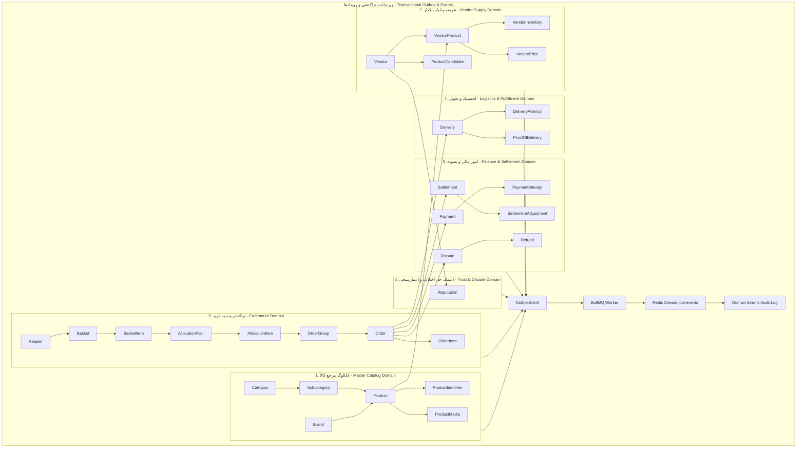

# مدل جامع دامنه پلتفرم پُل (POL Canonical Domain Model)
## معماری مدل‌های کسب‌وکار، مرزهای دامنه و قواعد حاکمیتی
**شناسه سند:** `DOMAIN-SPEC-001`  
**نسخه:** ۱.۰ (تثبیت‌شده)  
**وضعیت:** سند مرجع حاکمیتی مهندسی نرم‌افزار (Canonical Domain Specification)  

---

## ۱. نقشه کلان قلمروهای دامنه (Domain Map & Golden Architecture)

معماری دامنه پلتفرم پُل بر اساس اصول Domain-Driven Design (DDD) به شش زیردامنه (Subdomain) مجزا با مرزهای مشخص (Bounded Contexts) تقسیم شده است:

---

## ۲. مشخصات و انواریانت‌های زیردامنه‌ها (Domain Invariants & Rules)

### ۲.۱. زیردامنه ۱: کاتالوگ مرجع کالا و شناسه‌ها (Master Catalog & Identification Subdomain)
* **انواریانت ۱ (استقلال هویت محصول):** موجودیت `Product` مستقل از بنکداران و انبارهاست. شناسه سراسری آن UUID v4 است و شناسه نمایشی `master_sku` (مانند `POL-PRD-004821`) به عنوان کد پایدار محصول استفاده می‌شود.
* **انواریانت ۲ (تفکیک هویت کالا از بسته‌بندی تجاری قابل فروش):**
  $$\text{Master Product} \longrightarrow \text{Vendor Product (Sellable Offer)} \longrightarrow \text{Packaging Definition} \longrightarrow \text{Price} \longrightarrow \text{Inventory}$$
  هویت فیزیکی محصول با بسته‌بندی تجاری یکسان نیست. یک بنکدار می‌تواند برای یک کالای مرجع واحد، چند پیشنهاد بسته‌بندی متفاوت (مانند کارتن ۱۲ تایی و کارتن ۲۴ تایی) با کدهای انبار مجزا عرضه کند.
* **انواریانت ۳ (حوزه‌بندی بارکدها و شناسه‌ها):** بارکدها در سه حوزه تفکیک می‌شوند:
  1. *بارکد بین‌المللی کالا (Global):* کدهای استاندارد EAN-13, EAN-8, UPC-A که مستقل از بنکدار و در سطح جهانی یکتا هستند (`vendor_id IS NULL`).
  2. *شناسه بسته‌بندی (Packaging):* بارکدهای کارتن مادر (GTIN-14) و ایران‌کد.
  3. *بارکد داخلی انبار بنکدار (Vendor-Scoped Internal):* کدهای `INTERNAL_BARCODE` که به شناسه بنکدار مقید بوده و در سطح بنکدار یکتا هستند (`vendor_id NOT NULL`).
* **انواریانت ۴ (حفظ تاریخچه سوابق و متادیتای مرجع):** ادغام (Merge) محصولات در کاتالوگ ثبت تاریخی می‌شود (`product_merge_history`) و هرگز سوابق فاکتورهای گذشته را تغییر نمی‌دهد. همچنین داده‌های خامی نظیر قیمت و موجودی دیجی‌کالا در جدول ایزوله `product_reference_metadata` نگهداری شده و هرگز به عنوان داده عملیاتی پُل استفاده نمی‌شوند.

### ۲.۲. زیردامنه ۲: عرضه و انبار بنکدار (Vendor Supply & Inventory Subdomain)
* **انواریانت ۵ (یکتایی شناسه بنکدار به عنوان منبع واحد حقیقت):** کد `vendor_products.vendor_sku` تنها منبع رسمی شناسه کالای بنکدار است و قید `UNIQUE(vendor_id, vendor_sku)` تضمین می‌کند بنکداران مختلف می‌توانند کدهای انبار دلخواه خود را بدون تداخل ثبت کنند.
* **انواریانت ۶ (موجودی عمومی چندواحدی و غیروابسته به کارتن):**
  موجودی محدود به کارتن نیست؛ سیستم از مقادیر کمّی عمومی و واحد اندازه‌گیری (`inventory_unit` نظیر CARTON, BOX, PACK, PIECE) پشتیبانی می‌کند:
  $$\text{available\_quantity} = \text{physical\_quantity} - \text{reserved\_quantity}$$
  فقط کالاهایی که `available_quantity >= moq` دارند در نتایج جستجوی معتبر به خریداران عرضه می‌شوند.
* **انواریانت ۷ (لاگ تغییرات انبار):** هرگونه تغییر در موجودی یا قیمت کالا با ذکر عامل، شناسه و مقدار قبل و بعد در `inventory_audit_log` ثبت می‌شود.
* **انواریانت ۸ (ورود پیوسته با اسکن و چرخه کاندیدا):** ماژول Continuous Scan با تارگت عملکردی و UX اولیه (میانه ثبت اقلام منطبق $\le ۱۰$ ثانیه، P95 $\le ۲۰$ ثانیه) طراحی شده است. در صورت اسکن بارکد ناشناخته، رکورد کاندیدا (`product_candidates`) ایجاد شده و کالای بنکدار در وضعیت پیش‌نویس (`listing_status = 'DRAFT_PENDING_CATALOG'`) قرار می‌گیرد و تا زمان تایید تیم کاتالوگ در مارکت‌پلیس عمومی لیست نمی‌شود.

### ۲.۳. زیردامنه ۳: بازرگانی و سبد خرید (Commerce Subdomain)
* **انواریانت ۹ (تفکیک سبد از سفارش):** سبد خرید (`Basket`) صرفاً تقاضای خریدار را ثبت می‌کند. تبدیل سبد به سفارش از طریق برنامه تخصیص (`AllocationPlan`) انجام می‌شود.
* **انواریانت ۱۰ (سبد چندبنکدار هوشمند با سقف باز - D-014 و D-004):** در MVP، سوپرمارکت یک سبد یکپارچه می‌سازد و موتور تخصیص آن را به سفارش‌های فرزند تفکیک می‌کند (`OrderGroup -> Orders`). مدل بر اساس `D-005` بدون سقف هاردکد ($N \ge 1$) عمل کرده و در صورت پوشش کامل و رعایت MOV، تک‌بنکدار ($K=1$) را برای کاهش خردشدگی ترجیح می‌دهد، و در غیر این صورت سفارش را میان حداقل بنکداران واجد شرایط با رعایت مستقل MOV افراز می‌کند (تصمیم `D-014` جایگزین پیش‌نویس تک‌بنکدار اولیه `D-003`).
* **انواریانت ۱۱ (مدیریت اقلام تامین‌نشده در تخصیص):** در صورتی که برای قلمی از سبد خرید، بنکداری یافت نشود یا موجودی کافی نباشد، رکورد آن در `allocation_items` با وضعیت `status = 'UNFULFILLED'` ثبت شده و فیلدهای `vendor_id` و `vendor_product_id` آن تهی (NULL) باقی می‌ماند.
* **انواریانت ۱۲ (تغییرناپذیری اقلام سفارش):** در لحظه ثبت سفارش، اسنپ‌شات کامل نام کالا، برند، نوع بسته‌بندی، قیمت واحد به تومان و شناسه انبار در `order_items` ذخیره شده و هرگز مخدوش نمی‌شود.

### ۲.۴. زیردامنه ۴: لجستیک و تحویل (Logistics Domain)
* **انواریانت ۱۳ (عدم ناوگان ملکی):** جابه‌جایی فیزیکی بار توسط وانت‌های سنتی شهرک بنکداران اهواز انجام می‌شود و پلتفرم هزینه ناوگان ملکی ندارد (`D-008`).
* **انواریانت ۱۴ (تاییدیه تحویل):** وضعیت تحویل توسط سوپرمارکت با کد OTP، امضا یا اسکن ثبت می‌شود (`ProofOfDelivery`).

### ۲.۵. زیردامنه ۵: امور مالی و تسویه (Finance Subdomain)
* **انواریانت ۱۵ (عدم تصاحب وجوه در MVP):** تسویه نقدی یا پوز پای بار مستقیماً بین سوپرمارکت و بنکدار انجام می‌شود (`custody_model = 'NON_CUSTODIAL_DIRECT'`). پلتفرم وضعیت و رسیدها را رصد می‌کند.
* **انواریانت ۱۶ (مدل تسویه و اصلاحات ناشی از دعاوی):** کسری بار و مغایرت‌ها به صورت رکوردهای تعدیل تسویه (`settlement_adjustments`) یا استرداد وجه (`refunds`) با کلید خارجی صریح به پرونده اختلاف (`disputes`) ثبت و حسابرسی می‌شوند.

### ۲.۶. زیردامنه ۶: حل اختلاف و اعتبارسنجی (Trust & Dispute Subdomain)
* **انواریانت ۱۷ (استقلال متعامد ماشین‌های وضعیت):** وضعیت لجستیکی سفارش (`order_status`) کاملاً مستقل از وضعیت ادعا/مغایرت تجاری (`dispute_status`) است. یک سفارش در وضعیت `DELIVERED` می‌تواند دارای `dispute_status = 'OPEN'` باشد. مقدار `DISPUTED` در `order_status` اکیداً ممنوع است.
* **انواریانت ۱۸ (اعتبارسنجی پویا و لاگ اسنپ‌شات):** بنکدار جدید بدون سابقه سفارش امتیاز عددی ۵.۰ دریافت نمی‌کند (`rating_score = NULL` و `reputation_status = 'NEW'`). محاسبات دوره‌ای نمره اعتبار در جدول `reputation_snapshots` بایگانی تاریخی می‌شود.

### ۲.۷. زیرساخت پیام‌رسانی و رویدادهای تضمین‌شده (Transactional Outbox)
* **انواریانت ۱۹ (اتمیک بودن رویدادها):** تمام رویدادهای کسب‌وکار در یک تراکنش ACID در جدول `outbox_events` ذخیره می‌شوند و ورکر BullMQ رویدادها را به Redis Streams ارسال می‌کند. این الگو از ناپدید شدن رویدادها در صورت قطعی شبکه جلوگیری می‌کند.

### ۲.۸. زیردامنه ۷: هویت، سازمان و عضویت (Identity, Organization & Membership Subdomain)
* **انواریانت ۲۰ (سلسله‌مراتب سازمانی و تفکیک مستاجران):**
  $$\text{Organization (Tenant)} \longrightarrow \text{Membership (Role)} \longrightarrow \text{User}$$
  هر واحد تجاری (سوپرمارکت خرده‌فروش یا بنکداری) یک سازمان مستقل است. کاربران اشخاص حقیقی هستند که دارای عضویت مشخص (`OWNER`, `STAFF`, `ACCOUNTANT`) در سازمان می‌باشند. تمام داده‌های تراکنشی به `organization_id` مقید بوده و دسترسی بین‌سازمانی اکیداً مسدود است.
* **انواریانت ۲۱ (مدیریت نشست، دستگاه و مهار سوءاستفاده از OTP):**
  نشست‌های احراز هویت (`user_sessions`) دارای محدوده زمانی معین و مقید به سازمان فعال هستند. چالش‌های ورود پیامکی (`otp_challenges`) دارای سقف حداکثر ۵ تلاش و مهلت انقضای ۱۲۰ ثانیه‌ای هستند و با ابطال نشست، کلیه توکن‌های دسترسی بلافاصله فاقد اعتبار می‌شوند.

### ۲.۹. زیردامنه ۸: پلتفرم اطلاع‌رسانی و صندوق پیام (Notification & User Inbox Subdomain)
* **انواریانت ۲۲ (تراکنش‌ناپذیری اعلان‌ها و منبع حقیقت صندوق پیام):**
  ارسال اعلان‌ها به صورت ناهمگام از طریق Outbox صورت می‌گیرد؛ خطای درگاه‌های پیامک یا پوش‌نوتیفیکیشن هرگز مانع ثبت تراکنش در پایگاه داده نمی‌شود. هر اعلان کاربر به طور پایدار در `user_inbox_items` ذخیره شده و مستقل از وصول فیزیکی پیامک، قابل مشاهده و خواندن است.

### ۲.۱۰. زیردامنه ۹: پشتیبانی مشتریان و تفکیک از دعاوی (Support Cases vs Disputes Subdomain)
* **انواریانت ۲۳ (استقلال کامل تیکت‌های پشتیبانی از پرونده‌های اختلاف مالی):**
  تیکت‌های پشتیبانی (`support_cases`) به عنوان کانال ارتباطی عملیاتی خریدار با تیم عملیات پُل عمل می‌کنند و بر خلاف دعاوی (`disputes`)، هیچ‌گونه قفل مالی، تعلیق تسویه یا تعدیل فاکتور ایجاد نمی‌کنند. در صورت نیاز به تعدیل مالی، تیکت پشتیبانی به صورت رسمی به یک پرونده در دامنه اختلاف ارتقا می‌یابد.

### ۲.۱۱. زیردامنه ۱۰: تضمین جامعیت بازرگانی، رزرو انبار و نسخه‌گذاری سبد (Commerce Integrity Subdomain)
* **انواریانت ۲۴ (چرخه عمر رزرو انبار):**
  تخصیص کالا در انبار به صورت رزرو صریح در جدول `inventory_reservations` با وضعیت‌های `ACTIVE`, `CONSUMED`, `RELEASED`, `EXPIRED` ذخیره می‌شود. لغو سفارش یا اتمام مهلت SLA بنکدار، بلافاصله وضعیت رزرو را به `RELEASED` تغییر داده و موجودی قابل سفارش را بازمی‌گرداند.
* **انواریانت ۲۵ (نسخه‌گذاری سبد خرید و منقضی‌سازی برنامه تخصیص):**
  سبد خرید دارای شناسه نسخه (`version`) است. برنامه تخصیص (`allocation_plans`) به نسخه سبد متصل بوده و در صورتی که کاربر پس از تخصیص تغییری در اقلام سبد ایجاد کند، نسخه سبد افزایش یافته و فرآیند ثبت نهایی (Checkout) با خطای مغایرت نسخه متوقف می‌شود تا تخصیص جدید محاسبه شود.
* **انواریانت ۲۶ (اسنپ‌شات تغییرناپذیر نشانی تحویل و مدل راننده):**
  در لحظه نهایی‌سازی سفارش، نشانی کامل، مختصات جغرافیایی و نام تحویل‌گیرنده در سفارش منجمد می‌شود تا تغییرات بعدی پروفایل کاربر اثری بر سفارش‌های جاری نگذارد. اطلاعات راننده حمل‌کننده در همان سند تحویل (`deliveries`) ثبت شده و برای MVP نیازی به اپلیکیشن اختصاصی راننده نیست (Option A).

### ۲.۱۲. زیردامنه ۱۱: انواریانت‌های عملیاتی، فاکتور، تقویم کاری و حسابرسی (Operations Subdomain)
* **انواریانت ۲۷ (فاکتور رسمی و دسترسی مبتنی بر مستاجر):**
  برای هر سفارش، سند فاکتور ساده‌شده (`invoices`) با اقلام فاکتور صادر می‌شود. جمع مبالغ اقلام فاکتور دقیقاً با سرجمع سفارش منطبق بوده و دسترسی به فاکتور صرفاً به سازمان ذی‌نفع (خرده‌فروش سفارش‌دهنده و بنکدار تامین‌کننده) محدود است.
* **انواریانت ۲۸ (تقویم ساعات کاری در مهلت SLA بنکدار):**
  مهلت پاسخ‌دهی ۲ ساعته بنکدار بر اساس تقویم عملیاتی بازار بنکداران اهواز (شنبه تا پنج‌شنبه از ساعت ۰۸:۰۰ الی ۱۸:۰۰ به استثنای جمعه‌ها و تعطیلات رسمی) محاسبه می‌گردد. سفارشی که در ساعت ۱۷:۳۰ ثبت شود، ۱.۵ ساعت باقیمانده مهلت را در صبح روز کاری بعد خواهد داشت.
