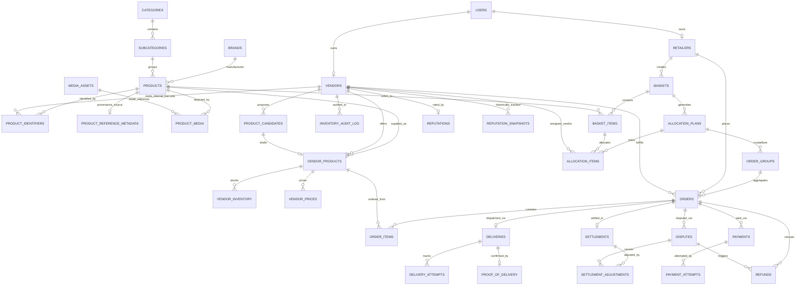

# مدل داده و ساختار پایگاه داده پُل (POL Data Schema & ERD)
## پروژه پُل (POL) — B2B FMCG Platform
**شناسه سند:** `DATA-SPEC-001`  
**وضعیت:** مصوب و نهایی (Canonical Database Specification)  
**نسخه:** ۲.۱ (تطبیق کامل با ساختار بسته‌بندی چندگانه، بارکدهای حوزه‌بندی‌شده، متادیتای مرجع و عدم وابستگی به کارتن)  
**موتور پایگاه داده هدف:** PostgreSQL 18 (با پشتیبانی کامل از JSONB، UUID، Full Text Search و pg_trgm)  
**قانون واحد پولی:** مبالغ در اپلیکیشن و فاکتورها ۱۰۰٪ به «تومان» با ذخیره موازی ریال/سنت در دیتابیس است.  

---

## ۱. نمودار جامع رابطه موجودیت‌ها (Comprehensive ERD)



---

## ۲. جداول پایه کاربران و طرفین تجاری (Identity & Commercial Actors)

### ۲.۱. جدول کاربران (`users`)
```sql
CREATE TABLE IF NOT EXISTS users (
    id UUID PRIMARY KEY DEFAULT gen_random_uuid(),
    phone_number VARCHAR(15) UNIQUE NOT NULL, -- فرمت E.164: +98916xxxxxxx
    role VARCHAR(30) NOT NULL CHECK (role IN (
        'SUPER_ADMIN', 'OPS_ADMIN', 'FIELD_ACTIVATOR', 
        'VENDOR_OWNER', 'VENDOR_STAFF', 
        'RETAILER_OWNER', 'RETAILER_STAFF', 'MANUFACTURER_ANALYST'
    )),
    full_name VARCHAR(100) NOT NULL,
    is_active BOOLEAN NOT NULL DEFAULT TRUE,
    last_login_at TIMESTAMPTZ,
    created_at TIMESTAMPTZ NOT NULL DEFAULT CURRENT_TIMESTAMP,
    updated_at TIMESTAMPTZ NOT NULL DEFAULT CURRENT_TIMESTAMP
);

CREATE INDEX IF NOT EXISTS idx_users_phone ON users(phone_number);
CREATE INDEX IF NOT EXISTS idx_users_role ON users(role);
```

### ۲.۲. جدول سوپرمارکت‌ها (`retailers`)
```sql
CREATE TABLE IF NOT EXISTS retailers (
    id UUID PRIMARY KEY DEFAULT gen_random_uuid(),
    user_id UUID UNIQUE NOT NULL REFERENCES users(id) ON DELETE CASCADE,
    store_name VARCHAR(150) NOT NULL,
    license_number VARCHAR(50),
    city VARCHAR(50) NOT NULL DEFAULT 'Ahvaz',
    neighborhood VARCHAR(100) NOT NULL,
    address TEXT NOT NULL,
    latitude DECIMAL(10, 7),
    longitude DECIMAL(10, 7),
    store_size_sqm INTEGER,
    registered_by_activator_id UUID REFERENCES users(id),
    onboarding_status VARCHAR(30) NOT NULL DEFAULT 'REGISTERED' CHECK (
        onboarding_status IN ('REGISTERED', 'ASSISTED_ORDERED', 'ACTIVE_SELF_SERVICE', 'INACTIVE')
    ),
    created_at TIMESTAMPTZ NOT NULL DEFAULT CURRENT_TIMESTAMP,
    updated_at TIMESTAMPTZ NOT NULL DEFAULT CURRENT_TIMESTAMP
);

CREATE INDEX IF NOT EXISTS idx_retailers_neighborhood ON retailers(neighborhood);
```

### ۲.۳. جدول بنکداران (`vendors`)
```sql
CREATE TABLE IF NOT EXISTS vendors (
    id UUID PRIMARY KEY DEFAULT gen_random_uuid(),
    user_id UUID UNIQUE NOT NULL REFERENCES users(id) ON DELETE CASCADE,
    business_name VARCHAR(150) NOT NULL,
    cluster_location VARCHAR(100) NOT NULL DEFAULT 'شهرک بنکداران اهواز - فاز ۱',
    warehouse_address TEXT NOT NULL,
    latitude DECIMAL(10, 7),
    longitude DECIMAL(10, 7),
    min_order_value_toman BIGINT NOT NULL DEFAULT 5000000, -- حداقل سفارش به تومان
    status VARCHAR(30) NOT NULL DEFAULT 'ACTIVE' CHECK (
        status IN ('PENDING_VERIFICATION', 'ACTIVE', 'SUSPENDED', 'OFFLINE')
    ),
    created_at TIMESTAMPTZ NOT NULL DEFAULT CURRENT_TIMESTAMP,
    updated_at TIMESTAMPTZ NOT NULL DEFAULT CURRENT_TIMESTAMP
);

CREATE INDEX IF NOT EXISTS idx_vendors_cluster ON vendors(cluster_location);
```

---

## ۳. کاتالوگ مستر، متادیتای مرجع و شناسه‌های کالا (Master Catalog & Identifiers)

### ۳.۱. برندها و دسته‌بندی‌ها (`brands`, `categories`, `subcategories`)
```sql
CREATE TABLE IF NOT EXISTS brands (
    id UUID PRIMARY KEY DEFAULT gen_random_uuid(),
    name_fa VARCHAR(100) NOT NULL,
    name_en VARCHAR(100),
    slug VARCHAR(120) UNIQUE NOT NULL,
    is_active BOOLEAN NOT NULL DEFAULT TRUE,
    created_at TIMESTAMPTZ NOT NULL DEFAULT CURRENT_TIMESTAMP
);

CREATE INDEX IF NOT EXISTS idx_brands_name_trgm ON brands USING gin (name_fa gin_trgm_ops);

CREATE TABLE IF NOT EXISTS categories (
    id UUID PRIMARY KEY DEFAULT gen_random_uuid(),
    name_fa VARCHAR(100) NOT NULL,
    slug VARCHAR(120) UNIQUE NOT NULL,
    icon_url VARCHAR(255),
    display_order INTEGER DEFAULT 0,
    created_at TIMESTAMPTZ NOT NULL DEFAULT CURRENT_TIMESTAMP
);

CREATE TABLE IF NOT EXISTS subcategories (
    id UUID PRIMARY KEY DEFAULT gen_random_uuid(),
    category_id UUID NOT NULL REFERENCES categories(id) ON DELETE CASCADE,
    name_fa VARCHAR(100) NOT NULL,
    slug VARCHAR(120) UNIQUE NOT NULL,
    display_order INTEGER DEFAULT 0,
    created_at TIMESTAMPTZ NOT NULL DEFAULT CURRENT_TIMESTAMP
);
```

### ۳.۲. جدول کالای مرجع کاتالوگ (`products`)
```sql
CREATE TABLE IF NOT EXISTS products (
    id UUID PRIMARY KEY DEFAULT gen_random_uuid(),
    master_sku VARCHAR(50) UNIQUE NOT NULL, -- POL-PRD-004821
    canonical_name_fa VARCHAR(255) NOT NULL,
    brand_id UUID NOT NULL REFERENCES brands(id),
    category_id UUID NOT NULL REFERENCES categories(id),
    subcategory_id UUID NOT NULL REFERENCES subcategories(id),
    base_unit VARCHAR(30) NOT NULL DEFAULT 'PIECE', -- PIECE, BOTTLE, PACK
    default_pack_unit VARCHAR(30) NOT NULL DEFAULT 'CARTON',
    default_pack_quantity INTEGER NOT NULL DEFAULT 12,
    net_weight_grams INTEGER,
    volume_ml INTEGER,
    dimensions_cm VARCHAR(50),
    description TEXT,
    is_active BOOLEAN NOT NULL DEFAULT TRUE,
    is_verified BOOLEAN NOT NULL DEFAULT FALSE,
    external_source_id VARCHAR(100), -- e.g. imported dkpId
    external_source_type VARCHAR(50) DEFAULT 'IMPORTED_REFERENCE',
    created_at TIMESTAMPTZ NOT NULL DEFAULT CURRENT_TIMESTAMP,
    updated_at TIMESTAMPTZ NOT NULL DEFAULT CURRENT_TIMESTAMP
);

CREATE INDEX IF NOT EXISTS idx_products_name_trgm ON products USING gin (canonical_name_fa gin_trgm_ops);
CREATE INDEX IF NOT EXISTS idx_products_category ON products(category_id, subcategory_id);
CREATE INDEX IF NOT EXISTS idx_products_brand ON products(brand_id);
CREATE INDEX IF NOT EXISTS idx_products_ext_source ON products(external_source_type, external_source_id);
```

### ۳.۳. متادیتای مرجع و مبدأ داده‌های خام (`product_reference_metadata`)
این جدول داده‌های متفرقه و غیراپراتوری حاصل از اسکرپ یا ایمپورت اولیه را ایزوله می‌کند تا مدل اصلی `products` آلوده نشود:
```sql
CREATE TABLE IF NOT EXISTS product_reference_metadata (
    id UUID PRIMARY KEY DEFAULT gen_random_uuid(),
    product_id UUID NOT NULL REFERENCES products(id) ON DELETE CASCADE,
    source_name VARCHAR(50) NOT NULL DEFAULT 'DIGIKALA_CATALOG_EXPORT',
    external_id VARCHAR(100) NOT NULL,
    raw_observed_price_rials BIGINT,
    raw_stock_count INTEGER,
    raw_rating DECIMAL(5, 2),
    raw_reviews_count INTEGER,
    source_url TEXT,
    scraped_at TIMESTAMPTZ,
    imported_at TIMESTAMPTZ NOT NULL DEFAULT CURRENT_TIMESTAMP,
    CONSTRAINT uq_product_reference_source UNIQUE (product_id, source_name)
);

CREATE INDEX IF NOT EXISTS idx_ref_metadata_ext_id ON product_reference_metadata(source_name, external_id);
```

### ۳.۴. شناسه‌ها و بارکدهای کالا با حوزه‌بندی بنکدار (`product_identifiers`)
```sql
CREATE TABLE IF NOT EXISTS product_identifiers (
    id UUID PRIMARY KEY DEFAULT gen_random_uuid(),
    product_id UUID NOT NULL REFERENCES products(id) ON DELETE CASCADE,
    vendor_id UUID REFERENCES vendors(id) ON DELETE CASCADE, -- NULL برای شناسه‌های عمومی جهانی؛ دارای مقدار برای بارکد داخلی بنکدار
    identifier_scope VARCHAR(30) NOT NULL DEFAULT 'GLOBAL' CHECK (
        identifier_scope IN ('GLOBAL', 'PACKAGING', 'VENDOR_INTERNAL')
    ),
    identifier_type VARCHAR(30) NOT NULL CHECK (
        identifier_type IN ('EAN13', 'EAN8', 'UPC_A', 'GTIN14', 'IRANCODE', 'INTERNAL_BARCODE')
    ),
    identifier_value VARCHAR(64) NOT NULL, -- همیشه به صورت رشته متنی نرمال ذخیره می‌شود
    packaging_scope VARCHAR(30) NOT NULL DEFAULT 'UNIT' CHECK (
        packaging_scope IN ('UNIT', 'CASE', 'CARTON', 'PALLET')
    ),
    source VARCHAR(50) NOT NULL DEFAULT 'OPS_VERIFIED', -- OPS_VERIFIED, VENDOR_SCAN, MANUFACTURER
    confidence_score DECIMAL(3, 2) NOT NULL DEFAULT 1.00,
    is_primary BOOLEAN NOT NULL DEFAULT FALSE,
    created_at TIMESTAMPTZ NOT NULL DEFAULT CURRENT_TIMESTAMP,
    updated_at TIMESTAMPTZ NOT NULL DEFAULT CURRENT_TIMESTAMP,
    CONSTRAINT chk_identifier_vendor_scope CHECK (
        (identifier_scope = 'VENDOR_INTERNAL' AND vendor_id IS NOT NULL) OR
        (identifier_scope IN ('GLOBAL', 'PACKAGING') AND vendor_id IS NULL)
    )
);

-- شناسه‌های جهانی (EAN/GTIN/IRANCODE) به صورت مستقل از بنکدار یکتا هستند
CREATE UNIQUE INDEX IF NOT EXISTS uq_global_product_identifier 
    ON product_identifiers(identifier_type, identifier_value) 
    WHERE vendor_id IS NULL;

-- بارکدهای داخلی انبار بنکدار (INTERNAL_BARCODE) به ازای هر بنکدار یکتا هستند
CREATE UNIQUE INDEX IF NOT EXISTS uq_vendor_product_identifier 
    ON product_identifiers(vendor_id, identifier_type, identifier_value) 
    WHERE vendor_id IS NOT NULL;

CREATE INDEX IF NOT EXISTS idx_identifiers_lookup ON product_identifiers(identifier_value);
```

### ۳.۵. رسانه و تصاویر کالا (`media_assets`, `product_media`)
```sql
CREATE TABLE IF NOT EXISTS media_assets (
    id UUID PRIMARY KEY DEFAULT gen_random_uuid(),
    storage_provider VARCHAR(30) NOT NULL DEFAULT 'S3_COMPATIBLE', -- MINIO / ARVAN_S3
    storage_bucket VARCHAR(64) NOT NULL DEFAULT 'pol-media',
    storage_key VARCHAR(255) UNIQUE NOT NULL, -- products/{product_id}/canonical/{uuid}.webp
    mime_type VARCHAR(50) NOT NULL DEFAULT 'image/webp',
    file_size_bytes INTEGER NOT NULL,
    width INTEGER,
    height INTEGER,
    checksum_sha256 VARCHAR(64),
    status VARCHAR(20) NOT NULL DEFAULT 'READY' CHECK (
        status IN ('UPLOADING', 'PROCESSING', 'READY', 'FAILED', 'DELETED')
    ),
    provenance VARCHAR(50) NOT NULL DEFAULT 'POL_OWNED' CHECK (
        provenance IN ('VENDOR_UPLOADED', 'MANUFACTURER_PROVIDED', 'POL_OWNED', 'IMPORTED_REFERENCE')
    ),
    uploaded_by_user_id UUID REFERENCES users(id),
    created_at TIMESTAMPTZ NOT NULL DEFAULT CURRENT_TIMESTAMP
);

CREATE TABLE IF NOT EXISTS product_media (
    id UUID PRIMARY KEY DEFAULT gen_random_uuid(),
    product_id UUID NOT NULL REFERENCES products(id) ON DELETE CASCADE,
    media_asset_id UUID NOT NULL REFERENCES media_assets(id) ON DELETE CASCADE,
    is_primary BOOLEAN NOT NULL DEFAULT FALSE,
    display_order INTEGER NOT NULL DEFAULT 0,
    created_at TIMESTAMPTZ NOT NULL DEFAULT CURRENT_TIMESTAMP,
    CONSTRAINT uq_product_media_link UNIQUE (product_id, media_asset_id)
);
```

### ۳.۶. کاندیداهای کالا و تاریخچه ادغام (`product_candidates`, `product_merge_history`)
```sql
CREATE TABLE IF NOT EXISTS product_candidates (
    id UUID PRIMARY KEY DEFAULT gen_random_uuid(),
    vendor_id UUID NOT NULL REFERENCES vendors(id) ON DELETE CASCADE,
    proposed_title VARCHAR(255) NOT NULL,
    proposed_brand VARCHAR(100),
    barcode VARCHAR(100),
    vendor_sku VARCHAR(100),
    photo_asset_id UUID REFERENCES media_assets(id),
    status VARCHAR(30) NOT NULL DEFAULT 'PENDING_REVIEW' CHECK (
        status IN ('PENDING_REVIEW', 'APPROVED_CANONICAL', 'MERGED_EXISTING', 'REJECTED')
    ),
    resolved_product_id UUID REFERENCES products(id),
    reviewed_by_user_id UUID REFERENCES users(id),
    review_notes TEXT,
    created_at TIMESTAMPTZ NOT NULL DEFAULT CURRENT_TIMESTAMP,
    resolved_at TIMESTAMPTZ
);

CREATE TABLE IF NOT EXISTS product_merge_history (
    id UUID PRIMARY KEY DEFAULT gen_random_uuid(),
    merged_from_product_id UUID NOT NULL,
    merged_into_product_id UUID NOT NULL REFERENCES products(id),
    reason TEXT NOT NULL,
    performed_by_user_id UUID NOT NULL REFERENCES users(id),
    created_at TIMESTAMPTZ NOT NULL DEFAULT CURRENT_TIMESTAMP
);
```

---

## ۴. عرضه بنکدار، موجودی و جلسات ثبت (`Vendor Inventory Layer`)

### ۴.۱. کالای بنکدار به عنوان پیشنهاد تجاری قابل عرضه (`vendor_products`)
تضمین انعطاف بسته‌بندی: یک بنکدار می‌تواند یک کالا را در چند کارتن با تعداد متفاوت (مثلاً کارتن ۱۲ تایی و کارتن ۲۴ تایی) عرضه کند:
```sql
CREATE TABLE IF NOT EXISTS vendor_products (
    id UUID PRIMARY KEY DEFAULT gen_random_uuid(),
    vendor_id UUID NOT NULL REFERENCES vendors(id) ON DELETE CASCADE,
    product_id UUID REFERENCES products(id) ON DELETE RESTRICT,
    candidate_id UUID REFERENCES product_candidates(id) ON DELETE SET NULL,
    vendor_sku VARCHAR(100) NOT NULL, -- شناسه و بارکد اختصاصی بنکدار (Single Source of Truth)
    packaging_unit VARCHAR(30) NOT NULL DEFAULT 'CARTON',
    pack_quantity INTEGER NOT NULL DEFAULT 12, -- تعداد واحد پایه در کارتن این بنکدار
    sales_unit VARCHAR(30) NOT NULL DEFAULT 'CARTON',
    is_active BOOLEAN NOT NULL DEFAULT TRUE,
    listing_status VARCHAR(30) NOT NULL DEFAULT 'ACTIVE' CHECK (
        listing_status IN ('DRAFT_PENDING_CATALOG', 'ACTIVE', 'INACTIVE', 'SUSPENDED')
    ),
    created_at TIMESTAMPTZ NOT NULL DEFAULT CURRENT_TIMESTAMP,
    updated_at TIMESTAMPTZ NOT NULL DEFAULT CURRENT_TIMESTAMP,
    CONSTRAINT uq_vendor_product_sku UNIQUE (vendor_id, vendor_sku),
    CONSTRAINT uq_vendor_product_packaging UNIQUE (vendor_id, product_id, packaging_unit, pack_quantity),
    CONSTRAINT chk_vendor_product_target CHECK (
        (listing_status = 'DRAFT_PENDING_CATALOG' AND candidate_id IS NOT NULL) OR
        (product_id IS NOT NULL)
    )
);
```

### ۴.۲. جدول موجودی زنده و قیمت روز (`vendor_inventory`, `vendor_prices`)
موجودی با پشتیبانی از واحدهای عمومی (CARTON, BOX, PACK, PIECE):
```sql
CREATE TABLE IF NOT EXISTS vendor_inventory (
    id UUID PRIMARY KEY DEFAULT gen_random_uuid(),
    vendor_product_id UUID UNIQUE NOT NULL REFERENCES vendor_products(id) ON DELETE CASCADE,
    inventory_unit VARCHAR(30) NOT NULL DEFAULT 'CARTON', -- CARTON, BOX, PACK, PIECE
    physical_quantity INTEGER NOT NULL DEFAULT 0 CHECK (physical_quantity >= 0),
    reserved_quantity INTEGER NOT NULL DEFAULT 0 CHECK (reserved_quantity >= 0),
    available_quantity INTEGER GENERATED ALWAYS AS (physical_quantity - reserved_quantity) STORED,
    moq INTEGER NOT NULL DEFAULT 1 CHECK (moq >= 1),
    freshness_status VARCHAR(20) NOT NULL DEFAULT 'FRESH' CHECK (
        freshness_status IN ('FRESH', 'STALE', 'VERY_STALE', 'UNKNOWN')
    ),
    updated_at TIMESTAMPTZ NOT NULL DEFAULT CURRENT_TIMESTAMP
);

CREATE TABLE IF NOT EXISTS vendor_prices (
    id UUID PRIMARY KEY DEFAULT gen_random_uuid(),
    vendor_product_id UUID NOT NULL REFERENCES vendor_products(id) ON DELETE CASCADE,
    price_toman BIGINT NOT NULL CHECK (price_toman > 0),
    consumer_price_per_unit_toman BIGINT, -- قیمت مصرف‌کننده درج‌شده روی کالا
    effective_from TIMESTAMPTZ NOT NULL DEFAULT CURRENT_TIMESTAMP,
    effective_to TIMESTAMPTZ,
    is_current BOOLEAN NOT NULL DEFAULT TRUE
);

-- تضمین قطعی اینکه هر کالای بنکدار در هر لحظه حداکثر یک قیمت جاری (Current Price) دارد
CREATE UNIQUE INDEX IF NOT EXISTS uq_vendor_product_current_price 
    ON vendor_prices(vendor_product_id) 
    WHERE is_current = TRUE;
```

### ۴.۳. لاگ ممیزی تغییرات موجودی و قیمت (`inventory_audit_log`)
```sql
CREATE TABLE IF NOT EXISTS inventory_audit_log (
    id UUID PRIMARY KEY DEFAULT gen_random_uuid(),
    vendor_id UUID NOT NULL REFERENCES vendors(id),
    vendor_product_id UUID NOT NULL REFERENCES vendor_products(id),
    old_quantity INTEGER NOT NULL,
    new_quantity INTEGER NOT NULL,
    old_price_toman BIGINT,
    new_price_toman BIGINT,
    source_trigger VARCHAR(50) NOT NULL, -- 'BARCODE_SCAN', 'ORDER_CHECKOUT', 'MANUAL_EDIT', 'SESSION_PUBLISH'
    reference_id VARCHAR(64),
    actor_user_id UUID NOT NULL REFERENCES users(id),
    created_at TIMESTAMPTZ NOT NULL DEFAULT CURRENT_TIMESTAMP
);
```

---

## ۵. بازرگانی، سبد خرید، تخصیص و سفارشات (Commerce Domain)

### ۵.۱. سبد خرید و اقلام سبد (`baskets`, `basket_items`)
```sql
CREATE TABLE IF NOT EXISTS baskets (
    id UUID PRIMARY KEY DEFAULT gen_random_uuid(),
    retailer_id UUID NOT NULL REFERENCES retailers(id) ON DELETE CASCADE,
    status VARCHAR(20) NOT NULL DEFAULT 'OPEN' CHECK (
        status IN ('OPEN', 'ABANDONED', 'SUBMITTED', 'EXPIRED')
    ),
    created_at TIMESTAMPTZ NOT NULL DEFAULT CURRENT_TIMESTAMP,
    updated_at TIMESTAMPTZ NOT NULL DEFAULT CURRENT_TIMESTAMP
);

CREATE INDEX IF NOT EXISTS idx_baskets_retailer ON baskets(retailer_id, status);

CREATE TABLE IF NOT EXISTS basket_items (
    id UUID PRIMARY KEY DEFAULT gen_random_uuid(),
    basket_id UUID NOT NULL REFERENCES baskets(id) ON DELETE CASCADE,
    product_id UUID NOT NULL REFERENCES products(id) ON DELETE RESTRICT,
    requested_quantity INTEGER NOT NULL CHECK (requested_quantity > 0),
    requested_unit VARCHAR(30) NOT NULL DEFAULT 'CARTON',
    pack_quantity INTEGER NOT NULL DEFAULT 1 CHECK (pack_quantity > 0),
    created_at TIMESTAMPTZ NOT NULL DEFAULT CURRENT_TIMESTAMP,
    updated_at TIMESTAMPTZ NOT NULL DEFAULT CURRENT_TIMESTAMP,
    CONSTRAINT uq_basket_product_packaging UNIQUE (basket_id, product_id, requested_unit, pack_quantity)
);
```

### ۵.۲. برنامه‌ریزی تخصیص و اقلام تخصیص (`allocation_plans`, `allocation_items`)
پشتیبانی کامل از اقلام تامین‌نشده (`UNFULFILLED`) با فیلدهای تهی بنکدار و قیود اعتبارسنجی:
```sql
CREATE TABLE IF NOT EXISTS allocation_plans (
    id UUID PRIMARY KEY DEFAULT gen_random_uuid(),
    basket_id UUID NOT NULL REFERENCES baskets(id) ON DELETE CASCADE,
    status VARCHAR(30) NOT NULL DEFAULT 'PREVIEW' CHECK (
        status IN ('PREVIEW', 'OPTIMIZED', 'CONFIRMED', 'REJECTED', 'EXPIRED')
    ),
    strategy VARCHAR(50) NOT NULL DEFAULT 'MULTI_VENDOR_MIN_FRAGMENTATION',
    vendor_count INTEGER NOT NULL DEFAULT 1 CHECK (vendor_count >= 1), -- فیلد محاسباتی/کش‌شده (Derived/Cached): COUNT(DISTINCT vendor_id) از اقلام معتبر
    total_estimated_toman BIGINT NOT NULL DEFAULT 0,
    created_at TIMESTAMPTZ NOT NULL DEFAULT CURRENT_TIMESTAMP
);

CREATE TABLE IF NOT EXISTS allocation_items (
    id UUID PRIMARY KEY DEFAULT gen_random_uuid(),
    allocation_plan_id UUID NOT NULL REFERENCES allocation_plans(id) ON DELETE CASCADE,
    basket_item_id UUID NOT NULL REFERENCES basket_items(id) ON DELETE CASCADE,
    vendor_id UUID REFERENCES vendors(id) ON DELETE RESTRICT, -- برای اقلام تامین‌نشده (UNFULFILLED) می‌تواند NULL باشد
    vendor_product_id UUID REFERENCES vendor_products(id) ON DELETE RESTRICT,
    allocated_quantity INTEGER NOT NULL DEFAULT 0 CHECK (allocated_quantity >= 0),
    allocated_unit VARCHAR(30) NOT NULL DEFAULT 'CARTON',
    unit_price_snapshot_toman BIGINT NOT NULL DEFAULT 0,
    line_total_toman BIGINT NOT NULL DEFAULT 0,
    status VARCHAR(30) NOT NULL DEFAULT 'ALLOCATED' CHECK (
        status IN ('ALLOCATED', 'PARTIALLY_ALLOCATED', 'UNFULFILLED')
    ),
    created_at TIMESTAMPTZ NOT NULL DEFAULT CURRENT_TIMESTAMP,
    CONSTRAINT chk_allocation_item_fulfillment CHECK (
        (status = 'UNFULFILLED' AND vendor_id IS NULL AND vendor_product_id IS NULL AND allocated_quantity = 0) OR
        (status IN ('ALLOCATED', 'PARTIALLY_ALLOCATED') AND vendor_id IS NOT NULL AND vendor_product_id IS NOT NULL AND allocated_quantity > 0 AND unit_price_snapshot_toman > 0)
    )
);
```

### ۵.۳. گروه‌های سفارش، سفارش‌ها و اقلام سفارش (`order_groups`, `orders`, `order_items`)
```sql
CREATE TABLE IF NOT EXISTS order_groups (
    id UUID PRIMARY KEY DEFAULT gen_random_uuid(),
    basket_id UUID REFERENCES baskets(id),
    allocation_plan_id UUID REFERENCES allocation_plans(id),
    retailer_id UUID NOT NULL REFERENCES retailers(id),
    checkout_idempotency_key VARCHAR(128) UNIQUE,
    group_status VARCHAR(30) NOT NULL DEFAULT 'ACTIVE' CHECK (
        group_status IN ('ACTIVE', 'PARTIALLY_COMPLETED', 'COMPLETED', 'CANCELLED')
    ),
    total_amount_toman BIGINT NOT NULL,
    order_count INTEGER NOT NULL DEFAULT 1 CHECK (order_count >= 1), -- فیلد محاسباتی/کش‌شده (Derived/Cached): تعداد سفارش‌های تولیدشده در گروه
    created_at TIMESTAMPTZ NOT NULL DEFAULT CURRENT_TIMESTAMP
);

CREATE TABLE IF NOT EXISTS orders (
    id UUID PRIMARY KEY DEFAULT gen_random_uuid(),
    order_number VARCHAR(30) UNIQUE NOT NULL, -- POL-1405-09-00123
    order_group_id UUID REFERENCES order_groups(id),
    allocation_plan_id UUID REFERENCES allocation_plans(id),
    retailer_id UUID NOT NULL REFERENCES retailers(id),
    vendor_id UUID NOT NULL REFERENCES vendors(id),
    order_status VARCHAR(30) NOT NULL DEFAULT 'SUBMITTED' CHECK (
        order_status IN (
            'CREATED', 'SUBMITTED', 'ACCEPTED', 'PARTIALLY_ACCEPTED', 
            'REJECTED', 'PREPARING', 'READY', 'DISPATCHED', 'DELIVERED', 'CANCELLED'
        )
    ),
    dispute_status VARCHAR(30) NOT NULL DEFAULT 'NONE' CHECK (
        dispute_status IN ('NONE', 'OPEN', 'UNDER_REVIEW', 'RESOLVED_ADJUSTED', 'RESOLVED_REJECTED', 'CLOSED')
    ),
    rejection_reason TEXT,
    total_amount_toman BIGINT NOT NULL,
    commission_rate DECIMAL(4, 3) NOT NULL DEFAULT 0.000, -- ۰٪ در پایلوت
    commission_amount_toman BIGINT NOT NULL DEFAULT 0,
    carrier_name VARCHAR(100) DEFAULT 'باربری شهرک بنکداران',
    created_at TIMESTAMPTZ NOT NULL DEFAULT CURRENT_TIMESTAMP,
    updated_at TIMESTAMPTZ NOT NULL DEFAULT CURRENT_TIMESTAMP
);

CREATE INDEX IF NOT EXISTS idx_orders_status ON orders(order_status, dispute_status);
CREATE INDEX IF NOT EXISTS idx_orders_vendor ON orders(vendor_id, created_at DESC);
CREATE INDEX IF NOT EXISTS idx_orders_retailer ON orders(retailer_id, created_at DESC);

CREATE TABLE IF NOT EXISTS order_items (
    id UUID PRIMARY KEY DEFAULT gen_random_uuid(),
    order_id UUID NOT NULL REFERENCES orders(id) ON DELETE CASCADE,
    product_id UUID NOT NULL REFERENCES products(id) ON DELETE RESTRICT,
    vendor_product_id UUID NOT NULL REFERENCES vendor_products(id) ON DELETE RESTRICT,
    -- اسنپ‌شات‌های تغییرناپذیر کالا در لحظه خرید
    product_name_snapshot VARCHAR(255) NOT NULL,
    brand_name_snapshot VARCHAR(100) NOT NULL,
    vendor_sku_snapshot VARCHAR(100) NOT NULL,
    packaging_unit_snapshot VARCHAR(30) NOT NULL DEFAULT 'CARTON',
    pack_quantity_snapshot INTEGER NOT NULL DEFAULT 12,
    -- کمیت‌ها و مبالغ (پشتیبانی عمومی از کارتن، بسته، عدد)
    ordered_quantity INTEGER NOT NULL CHECK (ordered_quantity > 0),
    accepted_quantity INTEGER,
    delivered_quantity INTEGER,
    unit_price_toman BIGINT NOT NULL CHECK (unit_price_toman > 0),
    total_line_amount_toman BIGINT NOT NULL CHECK (total_line_amount_toman > 0),
    fulfillment_status VARCHAR(30) NOT NULL DEFAULT 'PENDING' CHECK (
        fulfillment_status IN ('PENDING', 'FULFILLED', 'SHORTAGE', 'REJECTED', 'DAMAGED')
    ),
    dispute_reason VARCHAR(255),
    created_at TIMESTAMPTZ NOT NULL DEFAULT CURRENT_TIMESTAMP
);
```

---

## ۶. لجستیک و تحویل بار (`Logistics Subdomain`)

```sql
CREATE TABLE IF NOT EXISTS deliveries (
    id UUID PRIMARY KEY DEFAULT gen_random_uuid(),
    order_id UUID UNIQUE NOT NULL REFERENCES orders(id) ON DELETE CASCADE,
    vendor_id UUID NOT NULL REFERENCES vendors(id),
    carrier_type VARCHAR(30) NOT NULL DEFAULT 'CLUSTER_LOGISTICS' CHECK (
        carrier_type IN ('VENDOR_FLEET', 'CLUSTER_LOGISTICS', 'THIRD_PARTY_CARRIER')
    ),
    carrier_name VARCHAR(100) NOT NULL DEFAULT 'باربری شهرک بنکداران',
    driver_name VARCHAR(100),
    driver_phone VARCHAR(20),
    vehicle_plate VARCHAR(50),
    delivery_status VARCHAR(30) NOT NULL DEFAULT 'ASSIGNED' CHECK (
        delivery_status IN ('ASSIGNED', 'PICKED_UP', 'IN_TRANSIT', 'ARRIVED', 'DELIVERED', 'FAILED')
    ),
    scheduled_date DATE,
    dispatched_at TIMESTAMPTZ,
    delivered_at TIMESTAMPTZ,
    created_at TIMESTAMPTZ NOT NULL DEFAULT CURRENT_TIMESTAMP
);

CREATE TABLE IF NOT EXISTS delivery_attempts (
    id UUID PRIMARY KEY DEFAULT gen_random_uuid(),
    delivery_id UUID NOT NULL REFERENCES deliveries(id) ON DELETE CASCADE,
    attempt_number INTEGER NOT NULL DEFAULT 1,
    attempted_at TIMESTAMPTZ NOT NULL DEFAULT CURRENT_TIMESTAMP,
    outcome VARCHAR(30) NOT NULL CHECK (
        outcome IN ('SUCCESSFUL', 'STORE_CLOSED', 'REJECTED_AT_DOOR', 'ADDRESS_NOT_FOUND')
    ),
    notes TEXT,
    created_at TIMESTAMPTZ NOT NULL DEFAULT CURRENT_TIMESTAMP
);

CREATE TABLE IF NOT EXISTS proof_of_delivery (
    id UUID PRIMARY KEY DEFAULT gen_random_uuid(),
    delivery_id UUID NOT NULL REFERENCES deliveries(id) ON DELETE CASCADE,
    accepted_by_name VARCHAR(100) NOT NULL,
    accepted_at TIMESTAMPTZ NOT NULL DEFAULT CURRENT_TIMESTAMP,
    proof_type VARCHAR(30) NOT NULL DEFAULT 'OTP_CODE' CHECK (
        proof_type IN ('OTP_CODE', 'PHYSICAL_SIGNATURE', 'STORE_STAMP', 'PHOTO_PROOF')
    ),
    otp_verified BOOLEAN NOT NULL DEFAULT TRUE,
    proof_media_id UUID REFERENCES media_assets(id),
    issue_reported_at_delivery BOOLEAN NOT NULL DEFAULT FALSE,
    created_at TIMESTAMPTZ NOT NULL DEFAULT CURRENT_TIMESTAMP
);
```

---

## ۷. دعاوی، مالی و تسویه (`Disputes, Finance & Settlement Subdomains`)

### ۷.۱. جدول مستقل دعاوی تجاری (`disputes`)
```sql
CREATE TABLE IF NOT EXISTS disputes (
    id UUID PRIMARY KEY DEFAULT gen_random_uuid(),
    order_id UUID NOT NULL REFERENCES orders(id) ON DELETE CASCADE,
    retailer_id UUID NOT NULL REFERENCES retailers(id),
    vendor_id UUID NOT NULL REFERENCES vendors(id),
    dispute_status VARCHAR(30) NOT NULL DEFAULT 'OPEN' CHECK (
        dispute_status IN ('OPEN', 'INVESTIGATING', 'RESOLVED', 'CLOSED')
    ),
    resolution_outcome VARCHAR(30) CHECK (
        resolution_outcome IN ('ADJUSTED_SHORTAGE', 'REPLACEMENT_ORDER', 'REJECTED_CLAIM', 'MUTUAL_AGREEMENT')
    ),
    claimed_amount_toman BIGINT NOT NULL,
    approved_amount_toman BIGINT DEFAULT 0,
    evidence_media_id UUID REFERENCES media_assets(id),
    description TEXT NOT NULL,
    assigned_ops_user_id UUID REFERENCES users(id),
    opened_at TIMESTAMPTZ NOT NULL DEFAULT CURRENT_TIMESTAMP,
    resolved_at TIMESTAMPTZ,
    closed_at TIMESTAMPTZ
);

CREATE INDEX IF NOT EXISTS idx_disputes_order ON disputes(order_id);
CREATE INDEX IF NOT EXISTS idx_disputes_status ON disputes(dispute_status);
CREATE UNIQUE INDEX IF NOT EXISTS uq_dispute_open_per_order ON disputes(order_id) WHERE dispute_status IN ('OPEN', 'INVESTIGATING');
```

### ۷.۲. پرداخت‌های غیرامانی (`payments`, `payment_attempts`)
```sql
CREATE TABLE IF NOT EXISTS payments (
    id UUID PRIMARY KEY DEFAULT gen_random_uuid(),
    order_id UUID NOT NULL REFERENCES orders(id),
    retailer_id UUID NOT NULL REFERENCES retailers(id),
    vendor_id UUID NOT NULL REFERENCES vendors(id),
    amount_toman BIGINT NOT NULL CHECK (amount_toman > 0),
    payment_method VARCHAR(30) NOT NULL CHECK (
        payment_method IN ('CASH_ON_DELIVERY', 'POS_DRIVER', 'DIRECT_BANK_TRANSFER', 'CHEQUE_SAYYAD', 'ONLINE_MOCK')
    ),
    payment_status VARCHAR(30) NOT NULL DEFAULT 'PENDING' CHECK (
        payment_status IN ('PENDING', 'INITIATED', 'SUCCESS', 'FAILED', 'CANCELLED', 'REFUNDED')
    ),
    custody_model VARCHAR(30) NOT NULL DEFAULT 'NON_CUSTODIAL_DIRECT' CHECK (
        custody_model IN ('NON_CUSTODIAL_DIRECT', 'ESCROW_FUTURE')
    ),
    reference_number VARCHAR(100),
    paid_at TIMESTAMPTZ,
    created_at TIMESTAMPTZ NOT NULL DEFAULT CURRENT_TIMESTAMP
);

CREATE TABLE IF NOT EXISTS payment_attempts (
    id UUID PRIMARY KEY DEFAULT gen_random_uuid(),
    payment_id UUID NOT NULL REFERENCES payments(id) ON DELETE CASCADE,
    attempt_number INTEGER NOT NULL DEFAULT 1,
    attempted_at TIMESTAMPTZ NOT NULL DEFAULT CURRENT_TIMESTAMP,
    status VARCHAR(30) NOT NULL CHECK (status IN ('SUCCESS', 'FAILED', 'TIMEOUT')),
    gateway_response JSONB DEFAULT '{}'::jsonb,
    error_code VARCHAR(50),
    created_at TIMESTAMPTZ NOT NULL DEFAULT CURRENT_TIMESTAMP
);
```

### ۷.۳. تسویه حساب، اصلاحات و استرداد (`settlements`, `settlement_adjustments`, `refunds`)
با اتصال مستقیم کلید خارجی `dispute_id` به جدول `disputes`:
```sql
CREATE TABLE IF NOT EXISTS settlements (
    id UUID PRIMARY KEY DEFAULT gen_random_uuid(),
    order_id UUID NOT NULL REFERENCES orders(id),
    vendor_id UUID NOT NULL REFERENCES vendors(id),
    gross_amount_toman BIGINT NOT NULL,
    commission_rate DECIMAL(4, 3) NOT NULL DEFAULT 0.000,
    commission_amount_toman BIGINT NOT NULL DEFAULT 0,
    adjustment_amount_toman BIGINT NOT NULL DEFAULT 0,
    net_vendor_amount_toman BIGINT NOT NULL,
    status VARCHAR(30) NOT NULL DEFAULT 'PENDING' CHECK (
        status IN ('PENDING', 'CALCULATED', 'RECONCILED', 'DISPUTED', 'CLOSED')
    ),
    settled_at TIMESTAMPTZ,
    settlement_batch_id VARCHAR(50),
    created_at TIMESTAMPTZ NOT NULL DEFAULT CURRENT_TIMESTAMP
);

CREATE TABLE IF NOT EXISTS settlement_adjustments (
    id UUID PRIMARY KEY DEFAULT gen_random_uuid(),
    settlement_id UUID NOT NULL REFERENCES settlements(id) ON DELETE CASCADE,
    dispute_id UUID REFERENCES disputes(id) ON DELETE SET NULL, -- کلید خارجی صریح به جدول اختلافات
    adjustment_type VARCHAR(30) NOT NULL CHECK (
        adjustment_type IN ('SHORTAGE_DEDUCTION', 'DAMAGE_COMPENSATION', 'PRICE_CORRECTION', 'SLA_PENALTY', 'PROMOTION_CREDIT')
    ),
    amount_toman BIGINT NOT NULL,
    reason TEXT NOT NULL,
    applied_by_user_id UUID NOT NULL REFERENCES users(id),
    created_at TIMESTAMPTZ NOT NULL DEFAULT CURRENT_TIMESTAMP
);

CREATE TABLE IF NOT EXISTS refunds (
    id UUID PRIMARY KEY DEFAULT gen_random_uuid(),
    order_id UUID NOT NULL REFERENCES orders(id) ON DELETE CASCADE,
    payment_id UUID REFERENCES payments(id) ON DELETE SET NULL,
    dispute_id UUID REFERENCES disputes(id) ON DELETE SET NULL, -- کلید خارجی صریح به جدول اختلافات
    retailer_id UUID NOT NULL REFERENCES retailers(id),
    amount_toman BIGINT NOT NULL CHECK (amount_toman > 0),
    refund_method VARCHAR(30) NOT NULL DEFAULT 'VENDOR_CASH_DIRECT' CHECK (
        refund_method IN ('VENDOR_CASH_DIRECT', 'WALLET_CREDIT', 'BANK_REVERSAL')
    ),
    reason TEXT NOT NULL,
    status VARCHAR(30) NOT NULL DEFAULT 'PENDING' CHECK (
        status IN ('PENDING', 'APPROVED', 'COMPLETED', 'REJECTED')
    ),
    approved_by_user_id UUID REFERENCES users(id),
    completed_at TIMESTAMPTZ,
    created_at TIMESTAMPTZ NOT NULL DEFAULT CURRENT_TIMESTAMP
);

CREATE UNIQUE INDEX IF NOT EXISTS uq_refund_per_dispute ON refunds(dispute_id) WHERE dispute_id IS NOT NULL AND status IN ('PENDING', 'APPROVED', 'COMPLETED');
```

---

## ۸. اعتبار و لاگ تاریخی رتبه‌بندی بنکداران (`reputations`, `reputation_snapshots`)

```sql
CREATE TABLE IF NOT EXISTS reputations (
    id UUID PRIMARY KEY DEFAULT gen_random_uuid(),
    vendor_id UUID UNIQUE NOT NULL REFERENCES vendors(id) ON DELETE CASCADE,
    reputation_status VARCHAR(20) NOT NULL DEFAULT 'NEW' CHECK (
        reputation_status IN ('NEW', 'ESTABLISHED', 'SUSPENDED', 'UNDER_REVIEW')
    ),
    rating_score DECIMAL(3, 2), -- بنکدار بدون سابقه سفارش امتیاز عددی ندارد (NULL است، نه 5.0)
    confidence_score DECIMAL(3, 2) NOT NULL DEFAULT 0.00,
    sample_size INTEGER NOT NULL DEFAULT 0,
    total_completed_orders INTEGER NOT NULL DEFAULT 0,
    total_disputed_orders INTEGER NOT NULL DEFAULT 0,
    fill_rate_score DECIMAL(4, 3) NOT NULL DEFAULT 1.000,
    on_time_delivery_score DECIMAL(4, 3) NOT NULL DEFAULT 1.000,
    window_days INTEGER NOT NULL DEFAULT 30,
    calculation_version VARCHAR(20) NOT NULL DEFAULT '1.0',
    updated_at TIMESTAMPTZ NOT NULL DEFAULT CURRENT_TIMESTAMP
);

CREATE TABLE IF NOT EXISTS reputation_snapshots (
    id UUID PRIMARY KEY DEFAULT gen_random_uuid(),
    vendor_id UUID NOT NULL REFERENCES vendors(id) ON DELETE CASCADE,
    rating_score DECIMAL(3, 2),
    confidence_score DECIMAL(3, 2) NOT NULL DEFAULT 0.00,
    sample_size INTEGER NOT NULL DEFAULT 0,
    window_start TIMESTAMPTZ NOT NULL,
    window_end TIMESTAMPTZ NOT NULL,
    calculation_version VARCHAR(20) NOT NULL DEFAULT '1.0',
    calculated_at TIMESTAMPTZ NOT NULL DEFAULT CURRENT_TIMESTAMP
);
```

---

## ۹. الگوی Transactional Outbox و ثبت رویدادها (`outbox_events`, `domain_events_log`)

```sql
CREATE TABLE IF NOT EXISTS outbox_events (
    id UUID PRIMARY KEY DEFAULT gen_random_uuid(),
    event_id VARCHAR(64) UNIQUE NOT NULL,
    event_name VARCHAR(100) NOT NULL,
    event_version VARCHAR(10) NOT NULL DEFAULT '1.0',
    aggregate_type VARCHAR(50) NOT NULL, -- e.g. 'order', 'basket', 'inventory'
    aggregate_id VARCHAR(64) NOT NULL,
    payload JSONB NOT NULL,
    metadata JSONB DEFAULT '{}'::jsonb,
    status VARCHAR(20) NOT NULL DEFAULT 'PENDING' CHECK (
        status IN ('PENDING', 'PUBLISHED', 'FAILED', 'DEAD_LETTER')
    ),
    retry_count INTEGER NOT NULL DEFAULT 0,
    last_error TEXT,
    created_at TIMESTAMPTZ NOT NULL DEFAULT CURRENT_TIMESTAMP,
    published_at TIMESTAMPTZ
);

CREATE INDEX IF NOT EXISTS idx_outbox_pending ON outbox_events(status, created_at) WHERE status = 'PENDING';

CREATE TABLE IF NOT EXISTS domain_events_log (
    id UUID PRIMARY KEY DEFAULT gen_random_uuid(),
    event_id VARCHAR(64) UNIQUE NOT NULL,
    event_name VARCHAR(100) NOT NULL,
    event_version VARCHAR(10) NOT NULL DEFAULT '1.0',
    occurred_at TIMESTAMPTZ NOT NULL DEFAULT CURRENT_TIMESTAMP,
    actor_id UUID,
    actor_role VARCHAR(50),
    entity_type VARCHAR(50) NOT NULL,
    entity_id VARCHAR(64) NOT NULL,
    payload JSONB NOT NULL,
    metadata JSONB DEFAULT '{}'::jsonb
);

CREATE INDEX IF NOT EXISTS idx_domain_events_entity ON domain_events_log(entity_type, entity_id);
```


---

## ۱۰. ساختار پایگاه‌داده هسته پلتفرم و قابلیت‌های مقطعی (Platform Core Schema)

```sql
-- POL PLATFORM CORE & CROSS-CUTTING DATABASE SCHEMA
-- Migration: 002_platform_core_schema.sql
-- Canonical Database: PostgreSQL 18+ (SSoT per D-015)
-- Description: Adds Identity/Tenancy (Organizations, Memberships, Sessions, Devices, OTP),
--              Notifications & Inbox, Admin Broadcasts, Support Cases, Field Tasks,
--              Inventory Reservations, Invoices, Admin Audit Logs, and Commerce Hardening.
-- =============================================================================

-- 1. Organizations (Tenant Boundary SSoT)
CREATE TABLE IF NOT EXISTS organizations (
    id UUID PRIMARY KEY DEFAULT gen_random_uuid(),
    name VARCHAR(255) NOT NULL,
    org_type VARCHAR(32) NOT NULL CHECK (org_type IN ('RETAILER', 'VENDOR', 'OPERATOR')),
    status VARCHAR(32) NOT NULL DEFAULT 'ACTIVE' CHECK (status IN ('LEAD', 'DOCUMENTS_PENDING', 'UNDER_REVIEW', 'VERIFICATION_PENDING', 'APPROVED', 'ACTIVE', 'REJECTED', 'SUSPENDED')),
    national_id VARCHAR(64),
    created_at TIMESTAMPTZ NOT NULL DEFAULT now(),
    updated_at TIMESTAMPTZ NOT NULL DEFAULT now()
);

-- 2. Organization Memberships (User-to-Tenant Scoping)
CREATE TABLE IF NOT EXISTS organization_memberships (
    id UUID PRIMARY KEY DEFAULT gen_random_uuid(),
    organization_id UUID NOT NULL REFERENCES organizations(id) ON DELETE CASCADE,
    user_id UUID NOT NULL REFERENCES users(id) ON DELETE CASCADE,
    role VARCHAR(32) NOT NULL CHECK (role IN ('RETAILER_OWNER', 'RETAILER_STAFF', 'VENDOR_OWNER', 'VENDOR_STAFF', 'SUPER_ADMIN', 'OPS_ADMIN', 'FIELD_ACTIVATOR')),
    status VARCHAR(32) NOT NULL DEFAULT 'ACTIVE' CHECK (status IN ('INVITED', 'ACTIVE', 'SUSPENDED', 'REVOKED')),
    is_primary BOOLEAN NOT NULL DEFAULT TRUE,
    created_at TIMESTAMPTZ NOT NULL DEFAULT now(),
    updated_at TIMESTAMPTZ NOT NULL DEFAULT now(),
    CONSTRAINT uq_org_user UNIQUE (organization_id, user_id)
);

CREATE UNIQUE INDEX IF NOT EXISTS uq_user_primary_membership 
ON organization_memberships (user_id) WHERE is_primary = TRUE;

-- 3. User Devices (Anti-Fraud & Push Tokens)
CREATE TABLE IF NOT EXISTS user_devices (
    id UUID PRIMARY KEY DEFAULT gen_random_uuid(),
    user_id UUID NOT NULL REFERENCES users(id) ON DELETE CASCADE,
    device_fingerprint VARCHAR(128) NOT NULL,
    device_type VARCHAR(32) NOT NULL CHECK (device_type IN ('ANDROID', 'IOS', 'WEB')),
    push_token TEXT,
    is_active BOOLEAN NOT NULL DEFAULT TRUE,
    created_at TIMESTAMPTZ NOT NULL DEFAULT now(),
    updated_at TIMESTAMPTZ NOT NULL DEFAULT now(),
    CONSTRAINT uq_user_device UNIQUE (user_id, device_fingerprint)
);

-- 4. User Sessions (Bearer Authentication & Context)
CREATE TABLE IF NOT EXISTS user_sessions (
    id UUID PRIMARY KEY DEFAULT gen_random_uuid(),
    user_id UUID NOT NULL REFERENCES users(id) ON DELETE CASCADE,
    active_organization_id UUID REFERENCES organizations(id) ON DELETE SET NULL,
    token_hash VARCHAR(128) NOT NULL UNIQUE,
    refresh_token_hash VARCHAR(128),
    device_id UUID REFERENCES user_devices(id) ON DELETE SET NULL,
    ip_address VARCHAR(45),
    user_agent TEXT,
    status VARCHAR(32) NOT NULL DEFAULT 'ACTIVE' CHECK (status IN ('ACTIVE', 'EXPIRED', 'REVOKED')),
    expires_at TIMESTAMPTZ NOT NULL,
    revoked_at TIMESTAMPTZ,
    created_at TIMESTAMPTZ NOT NULL DEFAULT now(),
    last_activity_at TIMESTAMPTZ NOT NULL DEFAULT now()
);

-- 5. OTP Challenges (Rate-Limiting & Brute Force Defense)
CREATE TABLE IF NOT EXISTS otp_challenges (
    id UUID PRIMARY KEY DEFAULT gen_random_uuid(),
    phone_number VARCHAR(32) NOT NULL,
    code_hash VARCHAR(128) NOT NULL,
    purpose VARCHAR(32) NOT NULL CHECK (purpose IN ('LOGIN', 'REGISTER', 'ORDER_CONFIRMATION', 'DELIVERY_CONFIRM')),
    ip_address VARCHAR(45) NOT NULL DEFAULT '',
    attempts_count INT NOT NULL DEFAULT 0,
    max_attempts INT NOT NULL DEFAULT 5,
    status VARCHAR(32) NOT NULL DEFAULT 'PENDING' CHECK (status IN ('PENDING', 'VERIFIED', 'EXPIRED', 'BLOCKED')),
    expires_at TIMESTAMPTZ NOT NULL,
    blocked_at TIMESTAMPTZ,
    verified_at TIMESTAMPTZ,
    created_at TIMESTAMPTZ NOT NULL DEFAULT now()
);

-- 6. Notifications (Abstract Message Intention)
CREATE TABLE IF NOT EXISTS notifications (
    id UUID PRIMARY KEY DEFAULT gen_random_uuid(),
    user_id UUID NOT NULL REFERENCES users(id) ON DELETE CASCADE,
    organization_id UUID REFERENCES organizations(id) ON DELETE SET NULL,
    event_name VARCHAR(64) NOT NULL,
    title VARCHAR(255) NOT NULL,
    body TEXT NOT NULL,
    data_payload JSONB,
    priority VARCHAR(16) NOT NULL DEFAULT 'NORMAL' CHECK (priority IN ('LOW', 'NORMAL', 'HIGH', 'CRITICAL')),
    created_at TIMESTAMPTZ NOT NULL DEFAULT now()
);

-- 7. Notification Deliveries (Physical Channel Delivery Status)
CREATE TABLE IF NOT EXISTS notification_deliveries (
    id UUID PRIMARY KEY DEFAULT gen_random_uuid(),
    notification_id UUID NOT NULL REFERENCES notifications(id) ON DELETE CASCADE,
    channel VARCHAR(16) NOT NULL CHECK (channel IN ('INBOX', 'PUSH', 'SMS')),
    device_id UUID REFERENCES user_devices(id) ON DELETE SET NULL,
    provider VARCHAR(32),
    provider_message_id VARCHAR(128),
    status VARCHAR(16) NOT NULL DEFAULT 'PENDING' CHECK (status IN ('PENDING', 'SENT', 'DELIVERED', 'FAILED', 'SKIPPED')),
    failure_reason TEXT,
    attempt_count INT NOT NULL DEFAULT 0,
    next_retry_at TIMESTAMPTZ,
    delivered_at TIMESTAMPTZ,
    created_at TIMESTAMPTZ NOT NULL DEFAULT now()
);

-- 8. User Inbox Items (Durable In-App Inbox SSoT with Tenant Context)
CREATE TABLE IF NOT EXISTS user_inbox_items (
    id UUID PRIMARY KEY DEFAULT gen_random_uuid(),
    user_id UUID NOT NULL REFERENCES users(id) ON DELETE CASCADE,
    organization_id UUID REFERENCES organizations(id) ON DELETE SET NULL,
    notification_id UUID REFERENCES notifications(id) ON DELETE SET NULL,
    title VARCHAR(255) NOT NULL,
    body TEXT NOT NULL,
    category VARCHAR(32) NOT NULL DEFAULT 'SYSTEM' CHECK (category IN ('ORDERS', 'DISPUTES', 'PROMOTIONS', 'SYSTEM')),
    deep_link TEXT,
    is_read BOOLEAN NOT NULL DEFAULT FALSE,
    read_at TIMESTAMPTZ,
    is_archived BOOLEAN NOT NULL DEFAULT FALSE,
    expires_at TIMESTAMPTZ,
    created_at TIMESTAMPTZ NOT NULL DEFAULT now()
);

-- 9. Notification Preferences (User Opt-in/Opt-out)
CREATE TABLE IF NOT EXISTS notification_preferences (
    id UUID PRIMARY KEY DEFAULT gen_random_uuid(),
    user_id UUID NOT NULL REFERENCES users(id) ON DELETE CASCADE,
    category VARCHAR(32) NOT NULL,
    push_enabled BOOLEAN NOT NULL DEFAULT TRUE,
    sms_enabled BOOLEAN NOT NULL DEFAULT TRUE,
    created_at TIMESTAMPTZ NOT NULL DEFAULT now(),
    updated_at TIMESTAMPTZ NOT NULL DEFAULT now(),
    CONSTRAINT uq_user_notif_pref UNIQUE (user_id, category)
);

-- 10. Broadcast Messages (Admin Cohort Broadcasts)
CREATE TABLE IF NOT EXISTS broadcast_messages (
    id UUID PRIMARY KEY DEFAULT gen_random_uuid(),
    admin_user_id UUID NOT NULL REFERENCES users(id),
    title VARCHAR(255) NOT NULL,
    body TEXT NOT NULL,
    target_criteria JSONB NOT NULL,
    channel VARCHAR(32) NOT NULL DEFAULT 'IN_APP' CHECK (channel IN ('IN_APP', 'SMS', 'PUSH', 'INBOX_AND_SMS', 'ALL')),
    priority VARCHAR(32) NOT NULL DEFAULT 'NORMAL' CHECK (priority IN ('LOW', 'NORMAL', 'HIGH', 'URGENT')),
    status VARCHAR(32) NOT NULL DEFAULT 'DRAFT' CHECK (status IN ('DRAFT', 'SCHEDULED', 'PROCESSING', 'COMPLETED', 'CANCELLED')),
    recipient_count INT NOT NULL DEFAULT 0,
    estimated_recipient_count INT NOT NULL DEFAULT 0,
    approved_by UUID REFERENCES users(id),
    scheduled_at TIMESTAMPTZ,
    dispatched_at TIMESTAMPTZ,
    completed_at TIMESTAMPTZ,
    created_at TIMESTAMPTZ NOT NULL DEFAULT now()
);

-- 11. Broadcast Recipients (Frozen Snapshot of Target Audience)
CREATE TABLE IF NOT EXISTS broadcast_recipients (
    id UUID PRIMARY KEY DEFAULT gen_random_uuid(),
    broadcast_id UUID NOT NULL REFERENCES broadcast_messages(id) ON DELETE CASCADE,
    user_id UUID NOT NULL REFERENCES users(id),
    organization_id UUID REFERENCES organizations(id),
    notification_id UUID REFERENCES notifications(id),
    status VARCHAR(16) NOT NULL DEFAULT 'PENDING' CHECK (status IN ('PENDING', 'SENT', 'FAILED')),
    created_at TIMESTAMPTZ NOT NULL DEFAULT now(),
    CONSTRAINT uq_broadcast_recipient UNIQUE (broadcast_id, user_id)
);

-- 12. Support Cases (User to Ops Support Tickets - Distinct from Disputes)
CREATE TABLE IF NOT EXISTS support_cases (
    id UUID PRIMARY KEY DEFAULT gen_random_uuid(),
    user_id UUID NOT NULL REFERENCES users(id),
    organization_id UUID NOT NULL REFERENCES organizations(id),
    case_number VARCHAR(32) NOT NULL UNIQUE,
    case_type VARCHAR(32) NOT NULL CHECK (case_type IN ('GENERAL', 'ORDER_INQUIRY', 'PAYMENT_ASSISTANCE', 'DELIVERY_DELAY', 'ACCOUNT_ISSUE', 'CATALOG_SUGGESTION', 'INVOICE_INQUIRY')),
    priority VARCHAR(16) NOT NULL DEFAULT 'NORMAL' CHECK (priority IN ('LOW', 'NORMAL', 'HIGH', 'URGENT')),
    status VARCHAR(32) NOT NULL DEFAULT 'OPEN' CHECK (status IN ('OPEN', 'IN_PROGRESS', 'WAITING_ON_USER', 'RESOLVED', 'CLOSED')),
    related_order_id UUID REFERENCES orders(id),
    subject VARCHAR(255) NOT NULL,
    assigned_at TIMESTAMPTZ,
    first_response_at TIMESTAMPTZ,
    due_at TIMESTAMPTZ,
    resolved_at TIMESTAMPTZ,
    created_at TIMESTAMPTZ NOT NULL DEFAULT now(),
    updated_at TIMESTAMPTZ NOT NULL DEFAULT now()
);

-- 13. Support Case Messages (Threaded Messaging with Attachment Media Support)
CREATE TABLE IF NOT EXISTS support_case_messages (
    id UUID PRIMARY KEY DEFAULT gen_random_uuid(),
    support_case_id UUID NOT NULL REFERENCES support_cases(id) ON DELETE CASCADE,
    sender_user_id UUID NOT NULL REFERENCES users(id),
    sender_type VARCHAR(16) NOT NULL CHECK (sender_type IN ('USER', 'AGENT', 'SYSTEM')),
    message_text TEXT NOT NULL,
    attachment_media_id UUID REFERENCES media_assets(id),
    is_internal BOOLEAN NOT NULL DEFAULT FALSE,
    created_at TIMESTAMPTZ NOT NULL DEFAULT now()
);

-- 14. Support Case Assignments (Ops Triage Tracking with Active Guard)
CREATE TABLE IF NOT EXISTS support_case_assignments (
    id UUID PRIMARY KEY DEFAULT gen_random_uuid(),
    support_case_id UUID NOT NULL REFERENCES support_cases(id) ON DELETE CASCADE,
    assigned_to_user_id UUID NOT NULL REFERENCES users(id),
    assigned_by_user_id UUID NOT NULL REFERENCES users(id),
    is_active BOOLEAN NOT NULL DEFAULT TRUE,
    assigned_at TIMESTAMPTZ NOT NULL DEFAULT now()
);

CREATE UNIQUE INDEX IF NOT EXISTS uq_active_support_assignment 
ON support_case_assignments (support_case_id) WHERE is_active = TRUE;

-- 15. Field Tasks (Visitor / Field Force Tracking)
CREATE TABLE IF NOT EXISTS field_tasks (
    id UUID PRIMARY KEY DEFAULT gen_random_uuid(),
    task_type VARCHAR(32) NOT NULL CHECK (task_type IN ('ONBOARD_RETAILER', 'TRAIN_RETAILER', 'FIRST_ORDER_ASSIST', 'FOLLOW_UP', 'VENDOR_VISIT', 'DISPUTE_VISIT')),
    target_organization_id UUID REFERENCES organizations(id),
    assigned_to_user_id UUID NOT NULL REFERENCES users(id),
    status VARCHAR(32) NOT NULL DEFAULT 'ASSIGNED' CHECK (status IN ('ASSIGNED', 'IN_PROGRESS', 'COMPLETED', 'FAILED', 'CANCELLED')),
    due_date TIMESTAMPTZ,
    completed_at TIMESTAMPTZ,
    notes TEXT,
    created_at TIMESTAMPTZ NOT NULL DEFAULT now(),
    updated_at TIMESTAMPTZ NOT NULL DEFAULT now()
);

-- 16. Inventory Reservations (Explicit Lifecycle Tracking with Idempotency)
CREATE TABLE IF NOT EXISTS inventory_reservations (
    id UUID PRIMARY KEY DEFAULT gen_random_uuid(),
    vendor_product_id UUID NOT NULL REFERENCES vendor_products(id),
    order_id UUID REFERENCES orders(id),
    order_item_id UUID REFERENCES order_items(id),
    idempotency_key VARCHAR(128),
    quantity INT NOT NULL CHECK (quantity > 0),
    status VARCHAR(32) NOT NULL DEFAULT 'ACTIVE' CHECK (status IN ('ACTIVE', 'CONSUMED', 'RELEASED', 'EXPIRED')),
    expires_at TIMESTAMPTZ NOT NULL,
    released_at TIMESTAMPTZ,
    consumed_at TIMESTAMPTZ,
    created_at TIMESTAMPTZ NOT NULL DEFAULT now()
);

-- 17. Invoices (Simplified Official Accounting Records / Commercial Invoice Records)
CREATE TABLE IF NOT EXISTS invoices (
    id UUID PRIMARY KEY DEFAULT gen_random_uuid(),
    invoice_number VARCHAR(64) NOT NULL UNIQUE,
    order_id UUID NOT NULL REFERENCES orders(id),
    retailer_organization_id UUID NOT NULL REFERENCES organizations(id),
    vendor_organization_id UUID NOT NULL REFERENCES organizations(id),
    total_amount BIGINT NOT NULL CHECK (total_amount >= 0),
    currency VARCHAR(16) NOT NULL DEFAULT 'TOMAN',
    status VARCHAR(32) NOT NULL DEFAULT 'ISSUED' CHECK (status IN ('DRAFT', 'ISSUED', 'PAID', 'ADJUSTED', 'CANCELLED')),
    document_media_id UUID REFERENCES media_assets(id),
    issued_at TIMESTAMPTZ NOT NULL DEFAULT now(),
    created_at TIMESTAMPTZ NOT NULL DEFAULT now()
);

-- 18. Invoice Items (Line-Item Financial Consistency)
CREATE TABLE IF NOT EXISTS invoice_items (
    id UUID PRIMARY KEY DEFAULT gen_random_uuid(),
    invoice_id UUID NOT NULL REFERENCES invoices(id) ON DELETE CASCADE,
    order_item_id UUID REFERENCES order_items(id),
    product_name VARCHAR(255) NOT NULL,
    quantity INT NOT NULL CHECK (quantity > 0),
    unit_price BIGINT NOT NULL CHECK (unit_price >= 0),
    total_line_amount BIGINT NOT NULL CHECK (total_line_amount >= 0)
);

-- 19. Admin Audit Logs (Immutable Governance Trail)
CREATE TABLE IF NOT EXISTS admin_audit_logs (
    id UUID PRIMARY KEY DEFAULT gen_random_uuid(),
    actor_user_id UUID NOT NULL REFERENCES users(id),
    action VARCHAR(64) NOT NULL,
    target_entity_type VARCHAR(64) NOT NULL,
    target_entity_id UUID,
    state_before JSONB,
    state_after JSONB,
    reason TEXT,
    ip_address VARCHAR(45),
    correlation_id VARCHAR(128),
    created_at TIMESTAMPTZ NOT NULL DEFAULT now()
);

-- =============================================================================
-- COMMERCE & LOGISTICS ENTITY ENHANCEMENTS
-- =============================================================================

-- Basket Versioning
ALTER TABLE baskets ADD COLUMN IF NOT EXISTS version INT NOT NULL DEFAULT 1;

-- Allocation Plan Basket Versioning, Status Lifecycle & Audit Hash
ALTER TABLE allocation_plans ADD COLUMN IF NOT EXISTS basket_version INT NOT NULL DEFAULT 1;
ALTER TABLE allocation_plans ADD COLUMN IF NOT EXISTS expires_at TIMESTAMPTZ;
ALTER TABLE allocation_plans ADD COLUMN IF NOT EXISTS status VARCHAR(32) NOT NULL DEFAULT 'PREVIEW' CHECK (status IN ('PREVIEW', 'CONFIRMED', 'EXPIRED', 'SUPERSEDED'));
ALTER TABLE allocation_plans ADD COLUMN IF NOT EXISTS input_hash VARCHAR(64);
ALTER TABLE allocation_plans ADD COLUMN IF NOT EXISTS algorithm_version VARCHAR(32) DEFAULT 'v1.0';

-- Orders: Address Snapshot, Correlation ID
ALTER TABLE orders ADD COLUMN IF NOT EXISTS delivery_address_snapshot JSONB;
ALTER TABLE orders ADD COLUMN IF NOT EXISTS correlation_id VARCHAR(128);

-- Payments: Evidence of Direct Settlement (NON_CUSTODIAL_DIRECT)
ALTER TABLE payments ADD COLUMN IF NOT EXISTS payment_proof_media_id UUID REFERENCES media_assets(id);
ALTER TABLE payments ADD COLUMN IF NOT EXISTS verified_by UUID REFERENCES users(id);
ALTER TABLE payments ADD COLUMN IF NOT EXISTS verified_at TIMESTAMPTZ;

-- Retailers & Vendors: Canonical Organization Reference (SSoT)
ALTER TABLE retailers ADD COLUMN IF NOT EXISTS organization_id UUID REFERENCES organizations(id);
ALTER TABLE vendors ADD COLUMN IF NOT EXISTS organization_id UUID REFERENCES organizations(id);

-- Deliveries: Driver Details (Option A: Carrier/Vendor driver info attached to Delivery)
ALTER TABLE deliveries ADD COLUMN IF NOT EXISTS driver_name VARCHAR(128);
ALTER TABLE deliveries ADD COLUMN IF NOT EXISTS driver_phone VARCHAR(32);
ALTER TABLE deliveries ADD COLUMN IF NOT EXISTS vehicle_plate VARCHAR(32);

-- Indexes for Platform Performance & Query Scoping
CREATE INDEX IF NOT EXISTS idx_memberships_user ON organization_memberships(user_id);
CREATE INDEX IF NOT EXISTS idx_memberships_org ON organization_memberships(organization_id);
CREATE INDEX IF NOT EXISTS idx_sessions_user ON user_sessions(user_id);
CREATE INDEX IF NOT EXISTS idx_inbox_user_unread ON user_inbox_items(user_id) WHERE is_read = FALSE;
CREATE INDEX IF NOT EXISTS idx_reservations_active ON inventory_reservations(vendor_product_id) WHERE status = 'ACTIVE';
CREATE INDEX IF NOT EXISTS idx_support_cases_org ON support_cases(organization_id);
CREATE INDEX IF NOT EXISTS idx_audit_logs_actor ON admin_audit_logs(actor_user_id);
CREATE INDEX IF NOT EXISTS idx_retailers_org ON retailers(organization_id);
CREATE INDEX IF NOT EXISTS idx_vendors_org ON vendors(organization_id);

```
