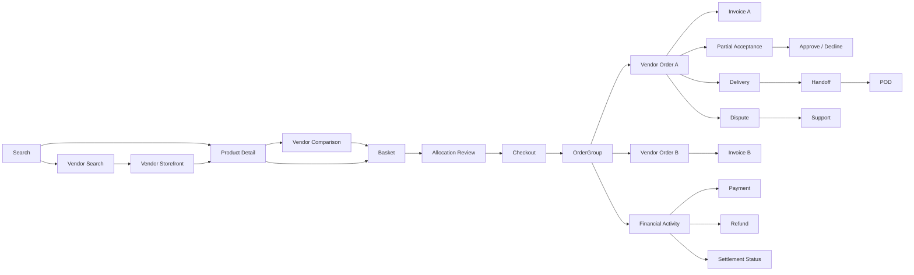

# POL — Master Product / UI / UX Tree & Penpot Build Specification
## Canonical Product Design Tree — GitHub × Penpot × Product Architecture × API × Permissions × Data × States × Dark/Light

**Document ID:** `POL-DESIGN-TREE-001`  
**Version:** `1.0.0`  
**Date:** 2026-09-21  
**Status:** ACTIVE DESIGN BLUEPRINT / PENPOT BUILD SOURCE  
**Repository:** `rrasi90/POL-2.3`  
**Working Branch:** `product-architecture-evolution-2026-09-20`  
**Primary Intent:** تبدیل معماری محصول، مستندات، APIها، مدل داده، نقش‌ها، state machineها و وضعیت فعلی Penpot به یک درخت واحد و قابل‌ردگیری برای ساخت/تکمیل طراحی.

---

# 0. هدف سند

این سند یک فهرست ساده از صفحه‌ها نیست.

این سند باید به‌عنوان **Product Design Tree** برای POL استفاده شود؛ یعنی از ریشه محصول شروع شود و به ترتیب زیر پایین برود:

```
POL
├── Surface / Persona
│   ├── Page / Experience
│   │   ├── Screen / Frame
│   │   │   ├── Section
│   │   │   │   ├── Component
│   │   │   │   ├── Interaction
│   │   │   │   ├── State
│   │   │   │   ├── Data
│   │   │   │   ├── Permission
│   │   │   │   └── API / Domain Contract
│   │   │   └── Navigation / Relationship
│   │   └── Theme / Responsive Variants
│   └── Cross-surface Dependencies
└── Global Design System
    ├── Foundations
    ├── Components
    ├── Shared UX
    ├── States & Patterns
    ├── Prototypes
    └── QA
```

بنابراین «وجود یک Frame» به‌تنهایی به معنی تکمیل شدن capability نیست.

هر capability زمانی درختی کامل است که حداقل این لایه‌ها مشخص باشند:

1. مقصد/Persona
2. Screen
3. هدف صفحه
4. Sections
5. Actions
6. States
7. Data / Entities
8. Permission
9. API / Domain dependency
10. Navigation relationship
11. Light/Dark behavior
12. Mobile/Desktop behavior
13. Prototype coverage
14. QA coverage
15. Missing / Open Decision

---

# 1. SOURCE SNAPSHOT

## 1.1 GitHub

Canonical working repository:

`rrasi90/POL-2.3`

Architecture branch:

`product-architecture-evolution-2026-09-20`

Key architecture wave:

- `POL_00_PROJECT_CONTROL/PRODUCT_EVOLUTION/PRODUCT_ARCHITECTURE_EVOLUTION_WAVE_01_2026-09-20.md`
- GitHub Issue #5 — Product Architecture Wave 01
- GitHub PR #6 — `feat: add product architecture evolution wave 01`

Issue #5 explicitly identifies these P0/P1 design-relevant capabilities:

- Financial Activity read model
- OrderGroup → child Orders → Vendor Invoices UX
- Vendor Search + Vendor Storefront
- Lightweight Delivery Handoff without a full Driver App
- Neutral settlement wording
- Web + Android parity
- Delegated organization permissions
- Permission catalog / grants / revokes / audit
- Delivery handoff token
- Android foundation
- Barcode scanner / continuous scan
- Master SKU / media provenance

P2:

- Stored-value Wallet
- Full Driver App
- Advanced wallet reconciliation
- Rich offline sync

---

## 1.2 Penpot

Current Penpot export inspected:

- File: `New File 1`
- Penpot export version: `penpot/2.18.0-RC5`
- Revision: `116`
- Export modified: `2026-09-20T09:27:01.434350Z`
- 11 design pages

Pages:

1. `00 — Foundations`
2. `01 — Components`
3. `02 — Shared UX`
4. `03 — States & Patterns`
5. `04 — Retailer`
6. `05 — Vendor`
7. `06 — Operations`
8. `07 — Field Activator`
9. `08 — Corporate`
10. `09 — Prototypes & Flows`
11. `10 — Design QA`

The inspected export contains approximately 75 meaningful top-level design frames/boards plus a small number of generic `Text` / `Rectangle` artifacts that should not be treated as canonical screens.

---

# 2. SOURCE-OF-TRUTH RULE

When sources disagree:

**Architecture / adopted Product Evolution > API / data contract > explicit design specification > current Penpot artifact**

But a contradiction must NOT be silently erased.

Every contradiction must be registered under:

**CONFLICT / DECISION REQUIRED**

This prevents old Penpot content from silently becoming product behavior.

---

# 3. MASTER PRODUCT TREE

```mermaid
flowchart TD

  P[POL — B2B Wholesale Operating Platform]

  P --> F[00 Foundations]
  P --> C[01 Components]
  P --> SU[02 Shared UX]
  P --> ST[03 States & Patterns]

  P --> R[Retailer Surface]
  P --> V[Vendor Surface]
  P --> O[Operations Surface]
  P --> FA[Field Activator Surface]
  P --> CP[Corporate / Trust Surface]

  P --> PR[09 Prototypes & Flows]
  P --> QA[10 Design QA]

  R --> R_AUTH[Authentication & Activation]
  R --> R_DISC[Discovery]
  R --> R_COM[Commerce]
  R --> R_ORDER[Orders]
  R --> R_FIN[Financial Activity]
  R --> R_DEL[Delivery]
  R --> R_RET[Returns / Disputes]
  R --> R_SUPPORT[Support]
  R --> R_ACCOUNT[Account / Security]

  V --> V_AUTH[Authentication / Context]
  V --> V_STORE[Storefront]
  V --> V_CAT[Catalog]
  V --> V_INV[Inventory]
  V --> V_ORDER[Order Operations]
  V --> V_DEL[Dispatch / Handoff]
  V --> V_FIN[Finance]
  V --> V_STAFF[Staff / Permissions]
  V --> V_PROFILE[Vendor Profile]

  O --> O_QUEUE[Operational Queues]
  O --> O_CASE[Case / Arbitration]
  O --> O_FIN[Financial Investigation]
  O --> O_PERM[Permission Audit]
  O --> O_CAT[Catalog Governance]
  O --> O_MEDIA[Media Provenance]
  O --> O_DEL[Delivery Exceptions]
  O --> O_SUPPORT[Support]
  O --> O_PILOT[Pilot Analytics]
  O --> O_ADMIN[Admin / Context]

  FA --> FA_TASK[Tasks / Route]
  FA --> FA_ACT[Retailer Activation]
  FA --> FA_ORDER[Assisted Ordering]
  FA --> FA_VISIT[Visit / Follow-up]
  FA --> FA_NET[Weak Network]

  CP --> CP_HOME[Institutional Trust]
  CP --> CP_RETAIL[Retailer Value]
  CP --> CP_VENDOR[Vendor Value]
  CP --> CP_FLOW[How POL Works]
  CP --> CP_PILOT[Ahvaz Pilot]
  CP --> CP_LEGAL[Legal / Privacy / Contact]
```



---

# 4. GLOBAL DESIGN SYSTEM TREE

## 4.1 Foundations

Existing Penpot foundation areas include:

- Brand Identity & Official Logos
- Semantic Color Tokens & Roles
- Persian Typography & Numeric Scales
- Spacing, Elevation & Radius System
- RTL & Commercial Invariants
- Dark Mode Semantic Tokens & Surface Elevation

### Required canonical foundation layers

```
Foundations
├── Brand
│   ├── POL logo
│   ├── wordmark
│   ├── icon treatment
│   └── safe-area rules
├── Color
│   ├── light semantic tokens
│   ├── dark semantic tokens
│   ├── interactive
│   ├── success
│   ├── warning
│   ├── danger
│   ├── info
│   ├── disabled
│   └── focus
├── Typography
│   ├── Vazirmatn
│   ├── headings
│   ├── body
│   ├── labels
│   ├── tabular numerals
│   └── code / ID / SKU / barcode / URL treatment
├── Spacing
│   ├── 4/8pt system
│   ├── page margins
│   ├── section gaps
│   └── density variants
├── Shape
│   ├── radius
│   ├── border
│   └── elevation
├── Layout
│   ├── mobile
│   ├── tablet
│   ├── desktop
│   └── operations desktop
├── Direction
│   ├── RTL
│   ├── LTR
│   └── mixed-direction content
└── Accessibility
    ├── contrast
    ├── touch target
    ├── focus
    ├── error visibility
    └── non-color status indication
```

---

# 5. LIGHT / DARK THEME CONTRACT

Dark mode is not a separate visual product.

It is the same information architecture and component behavior with semantic token substitution.

## 5.1 Required modes

Every production surface must support:

- Light
- Dark

unless explicitly marked:

- `LIGHT_ONLY`
- `DARK_ONLY`
- `SYSTEM_ADAPTIVE`

## 5.2 Theme mapping

| Semantic role | Light | Dark | Rule |
|---|---|---|---|
| Canvas | Light background token | Dark background token | Never hard-code page color |
| Surface | Surface-1 | Dark Surface-1 | Preserve hierarchy |
| Elevated Surface | Surface-2 | Dark Surface-2 | Preserve depth |
| Primary Text | Text-Primary | Dark Text-Primary | Contrast first |
| Secondary Text | Text-Secondary | Dark Text-Secondary | Never use disabled as body text |
| Border | Border-Default | Border-Dark | Maintain structural separation |
| Accent | POL Accent | POL Accent Dark | Same semantic meaning |
| Success | Success | Success-Dark | Color + icon/text |
| Warning | Warning | Warning-Dark | Color + icon/text |
| Danger | Danger | Danger-Dark | Color + icon/text |
| Info | Info | Info-Dark | Color + icon/text |
| Focus | Focus | Focus-Dark | Keyboard/touch visible |

## 5.3 Dark-mode rules

Dark mode must preserve:

- hierarchy
- spacing
- information priority
- status semantics
- CTA order
- interaction patterns
- content density

Dark mode must NOT mean:

- simply inverting colors
- lowering contrast
- replacing all surfaces with one dark gray
- using glow/decorative gradients for status
- hiding secondary text
- changing meaning of state colors

---

# 6. COMPONENT TREE

```
Components
├── Navigation
│   ├── App Bar
│   ├── Side Navigation
│   ├── Bottom Navigation
│   ├── Breadcrumb
│   └── Context Switcher
├── Input
│   ├── Text Input
│   ├── Search
│   ├── Phone
│   ├── OTP
│   ├── Select
│   ├── Date
│   ├── Number
│   └── Quantity Stepper
├── Commerce
│   ├── Product Card
│   ├── Vendor Card
│   ├── Vendor Offer Row
│   ├── Basket Line
│   ├── Order Card
│   ├── OrderGroup Card
│   ├── Invoice Card
│   └── Allocation Group
├── Operational
│   ├── Queue Row
│   ├── SLA Badge
│   ├── Status Chip
│   ├── Exception Banner
│   ├── Timeline
│   ├── Evidence Block
│   └── Audit Event
├── Finance
│   ├── Financial Activity Row
│   ├── Payment Status
│   ├── Invoice Summary
│   ├── Settlement Status
│   └── Reconciliation Row
├── Security
│   ├── Permission Matrix
│   ├── Permission Editor
│   ├── Session Card
│   ├── OTP Input
│   └── Handoff Verification
├── Scanner
│   ├── Scanner Overlay
│   ├── Scan Result
│   ├── Candidate Product
│   ├── Exact Match
│   ├── Ambiguous Match
│   └── No Match
├── Media
│   ├── Media Card
│   ├── Upload
│   ├── Provenance Badge
│   ├── Approval Status
│   └── Evidence Preview
└── Feedback
    ├── Toast
    ├── Alert
    ├── Empty
    ├── Loading
    ├── Skeleton
    └── Network Banner
```

Every component must have:

- default
- hover where applicable
- pressed
- focus
- disabled
- loading
- error
- empty where applicable
- light
- dark
- mobile density
- desktop density where applicable

---

# 7. RETAILER TREE

## Retailer root

```
Retailer
├── Authentication & Activation
│   ├── RT-01 Authentication
│   ├── Shop Context
│   ├── First Use
│   └── Activation Success
├── Home
│   └── RT-02 Home & Operational Hub
├── Discovery
│   ├── RT-06 Search / Catalog / Filters
│   ├── RT-17 Vendor Search [NEW]
│   ├── RT-18 Vendor Storefront [NEW]
│   └── RT-07 Product Detail / Vendor Comparison
├── Commerce
│   ├── RT-03 Multi-Vendor Basket
│   ├── RT-14 Allocation Review
│   └── RT-04 Checkout / Confirmation
├── Orders
│   ├── RT-15 OrderGroup Detail [NEW]
│   ├── RT-08 Child Order Detail
│   ├── RT-10 Order History / Reorder
│   └── RT-20 Partial Acceptance Review [NEW]
├── Financial
│   └── RT-16 Financial Activity [NEW]
├── Delivery
│   ├── RT-05 Tracking & Delivery
│   └── RT-19 Delivery Handoff / Receiver Confirmation [NEW]
├── Returns / Disputes
│   └── RT-09 Returns / Dispute Filing
├── Account
│   ├── RT-12 / RT-13 Account
│   ├── Profile Completion
│   ├── Organization Context
│   └── Session Security
└── Support
    └── RT-12 / RT-13 Support
```

---

## RT-01 — Authentication & Activation

### Purpose
ورود/ثبت‌نام retailer، ایجاد tenant context و آماده‌سازی اولین خرید.

### Sections
1. Brand / identity
2. Phone
3. OTP
4. Shop context
5. Minimal activation guidance
6. Activation success

### Actions
- enter phone
- request OTP
- verify OTP
- resend
- change phone
- establish organization context
- continue to first action

### States
- initial
- submitting
- invalid phone
- invalid OTP
- expired OTP
- rate limited
- network failure
- authenticated
- organization selection

### Data
- user
- phone
- otp_challenge
- session
- organization
- membership

### API
- POST auth/request-otp
- POST auth/verify-otp
- POST auth/refresh
- POST auth/switch-organization

### Permission
Unauthenticated until verification; after login, scope by active membership.

### Theme
Light + Dark.

### Conflict
Technical Architecture currently specifies a **4-digit OTP**. Older retailer design specs/Penpot artifacts contain 6-digit / 5-box variants. Target new canonical design must use the current backend/auth contract; do not preserve an older OTP shape silently.

---

## RT-02 — Home & Operational Hub

### Purpose
به retailer بگو «الان چه کاری باید انجام بدهم؟»

### Sections
1. App bar
2. Active shop context
3. Notification/support
4. Today queue
5. Continue ordering
6. Reorder strip
7. Search
8. Category shortcuts
9. Bottom navigation

### Primary paths
Search / Continue purchase > attention item > reorder.

### States
- new user
- normal
- no history
- open exception
- degraded network

### Data
- recent orders
- pending orders
- notifications
- saved items
- active organization

### Relationships
Home → Search
Home → Order Detail
Home → Reorder
Home → Notifications
Home → Support

---

## RT-06 — Search / Catalog / Filter Drawer

### Purpose
Product-first discovery.

### Sections
1. Search
2. Scanner / SKU action where available
3. Recent searches
4. Category/filter chips
5. Results
6. Active filters
7. No result

### Result fields
- image
- product name
- pack
- MOQ
- price
- availability
- vendor
- quantity

### States
- initial
- suggestions
- loading
- results
- no result
- error
- filtered
- barcode lookup

### APIs
- GET categories
- GET products/search
- POST products/match-barcode
- GET products/{id}/vendors

---

## RT-17 — Vendor Search [NEW]

### Purpose
Vendor-first discovery for retailers with trusted/repeat suppliers.

### Sections
1. Vendor search field
2. Category
3. Location/context
4. Availability/freshness
5. Vendor results
6. Sort/filter
7. Empty state

### Vendor result fields
- vendor identity
- verification/freshness signal
- catalog coverage
- availability
- ordering constraints
- operating context

### Actions
- open storefront
- apply filter
- search again

### Relationship
Vendor Search → Vendor Storefront → Catalog → Product → Basket.

---

## RT-18 — Vendor Storefront [NEW]

### Purpose
یک Vendor را به‌عنوان یک B2B operating storefront نمایش می‌دهد.

### Sections
1. Vendor identity
2. Verification / freshness
3. Business context
4. Category shortcuts
5. Catalog
6. Product rows
7. Packaging
8. Price / availability
9. MOQ/MOV
10. Ordering CTA
11. Support / vendor policy where authorized

### Important rule
Storefront نباید به consumer marketplace تبدیل شود.

### Data
- vendor
- vendor_products
- inventory
- price
- packaging
- MOQ/MOV

### Relationships
Storefront → Product Detail
Storefront → Basket
Storefront → Vendor Profile where applicable

---

## RT-07 — Product Detail / Vendor Comparison

### Purpose
تصمیم خرید روی یک Master Product با چند Vendor Offer.

### Sections
1. Product media
2. Product identity
3. Pack/unit
4. Price
5. MOQ/MOV
6. Availability/freshness
7. Vendor
8. Quantity
9. Add to basket
10. Compare vendors
11. Provenance/media indicator

### Vendor comparison
Neutral comparison only.

Do not show:
«بهترین فروشنده»

unless a canonical ranking algorithm exists.

---

## RT-03 — Multi-Vendor Basket

### Purpose
جمع‌کردن کالاها پیش از allocation.

### Sections
1. Header
2. Basket lines
3. Changed/unavailable warnings
4. Vendor grouping after allocation when known
5. Totals
6. Commercial caveat
7. Continue

### States
- empty
- normal
- stale item
- price changed
- inventory changed
- network degraded
- revalidation required

---

## RT-14 — Allocation Review

### Purpose
نمایش اینکه Basket چگونه میان Vendorها تقسیم شده.

### Sections
1. Explanation
2. Allocation groups
3. Vendor identity
4. Assigned lines
5. Subtotal
6. Constraints
7. Changed line
8. Reason
9. Continue / edit

### Relationship
Basket → Allocation Review → Checkout.

---

## RT-04 — Checkout & Confirmation

### Purpose
آخرین review قبل از commit.

### Sections
1. Delivery/contact
2. Vendor / order groups
3. Direct settlement method
4. Evidence instruction where applicable
5. Final total
6. Important terms
7. Submit

### Rule
The UI must not imply one universal legal/vendor invoice.

### Outcome
POST /orders

---

## RT-15 — OrderGroup Detail [NEW]

### Purpose
نمایش parent purchase به همراه child orderهای مستقل.

### Tree

```
OrderGroup
├── Summary
│   ├── Group ID
│   ├── Overall state
│   ├── Total amount
│   ├── Vendor count
│   ├── Child order count
│   └── Invoice count
├── Vendor Order A
│   ├── Vendor
│   ├── Items
│   ├── Requested / Accepted / Rejected qty
│   ├── Invoice
│   ├── Payment
│   ├── Fulfillment
│   ├── Delivery
│   └── Dispute
└── Vendor Order B
    └── same structure
```

### Critical invariant
Checkout ≠ one universal vendor invoice.

Canonical:
**Checkout → OrderGroup → Vendor Orders → Vendor Invoices**

### Data
order_groups, orders, order_items, invoices, payments, deliveries, disputes, settlements.

---

## RT-08 — Child Order Detail

### Sections
1. Order header
2. Vendor
3. Items
4. Quantity states
5. Invoice
6. Payment state
7. Fulfillment timeline
8. Delivery/POD
9. Financial activity link
10. Issue/support link

### State
Use operational order state and separate dispute projection.

---

## RT-20 — Partial Acceptance Review [NEW]

### Purpose
Retailer proposal review when Vendor cannot fulfill the full requested quantity.

### Sections
1. Original request
2. Proposed acceptance
3. Differences
4. Reason
5. Impact on amount
6. Timeline
7. Approve
8. Decline

### Quantity table
- requested
- available
- accepted
- rejected

### Reasons
- stock shortage
- unavailable
- packaging constraint
- operational issue
- other

### Relationships
Vendor Partial Acceptance Proposal → Notification → RT-20 → Approve/Decline → Order state/timeline.

### API dependency
- GET/POST partial-acceptance-proposals
- approve proposal
- decline proposal

---

## RT-16 — Financial Activity [NEW]

### Purpose
Read-only financial visibility; **not a wallet**.

### Tree

```
Financial Activity
├── Filters
│   ├── Date
│   ├── OrderGroup
│   ├── Order
│   ├── Vendor
│   ├── Invoice
│   ├── Payment status
│   └── Settlement status
├── Activity list
└── Activity detail
    ├── Order
    ├── OrderGroup
    ├── Invoice
    ├── Payment
    ├── Refund
    └── Authorized settlement status
```

### States
- pending
- verified
- failed
- refunded
- disputed
- reconciled
- under review

### Rule
Never display:
- stored wallet balance
- POL customer funds
- POL-owned custody account

---

## RT-05 — Order Tracking / Delivery

### Sections
1. OrderGroup / Child Order context
2. Current state
3. Timeline
4. Vendor
5. Delivery reference
6. ETA/window
7. Exception
8. Handoff entry

### State model
- preparing
- ready
- dispatched
- in transit
- delivered
- exception

---

## RT-19 — Delivery Handoff / Receiver Confirmation [NEW]

### Purpose
Restricted operational handoff surface.

### Sections
1. Delivery reference
2. Store / recipient
3. Driver/carrier identity when applicable
4. Delivery checklist
5. Handoff token / OTP
6. Confirmation
7. POD result
8. Failure / retry

### Security states
- active
- invalid
- expired
- already used
- rate limited
- verified
- exception

### Rules
Token is:
- short-lived
- high entropy
- single-use where possible
- rate-limited
- not an auth session
- cannot independently change financial state

### MVP boundary
No full dedicated Driver App.

---

## RT-09 — Returns / Disputes

### Flow
1. select order
2. issue type
3. items/quantity
4. evidence
5. submit
6. track resolution

### Issue types
- incomplete
- wrong product
- damaged
- quantity mismatch
- other

### Data
dispute, dispute_items, evidence/media.

---

## RT-10 — Order History / Reorder

### Sections
- filters
- order cards
- historical price changes
- reorder diff
- compatible items
- adjustment

### Rule
Show change explicitly when historical price/availability differs.

---

## RT-12/13 — Account / Support / Security

### Account tree
```
Account
├── Personal profile
├── Profile completion
├── Organization context
├── Membership
├── Role
├── Permissions summary
├── Active sessions
│   ├── current
│   ├── other devices
│   └── revoke
├── Logout all
└── Support
```

### APIs
- GET/PUT profile
- GET profile/completion
- GET profile/context
- session revoke
- logout all where available

---

# 8. VENDOR TREE

```
Vendor
├── Dashboard
├── Storefront Management [NEW]
├── Catalog
├── Product / SKU
├── Pricing
├── Inventory
├── Daily Inventory Confirmation
├── Orders
│   ├── Queue
│   ├── Detail
│   └── Partial Acceptance [NEW]
├── Dispatch
├── Delivery Handoff
├── Financial Activity [NEW]
├── Reconciliation
├── Documents / Invoices
├── Staff / Delegated Permissions [NEW]
├── Profile
├── Customers
└── Referral
```

---

## VD-01 — Daily Inventory & Price

### Sections
1. inventory freshness
2. stale warning
3. inventory rows
4. price state
5. bulk actions
6. publish/confirm

### Inventory row
- product
- physical qty
- reserved
- sellable
- freshness
- action

Unknown ≠ zero.

---

## VD-02 — Order Acceptance Queue

### Desktop
Table:

`Order | Retailer | Amount | Age | Status | Exception | Action`

### Filters
- status
- date
- exception
- search

### SLA
Canonical vendor acceptance timeout:
**120 working minutes / 2 hours**, respecting the Ahvaz working calendar.

Any 30-minute Penpot copy is stale and must be corrected.

---

## VD-03 — Loading / Fleet / Delivery

### Sections
1. accepted orders
2. picking/packing
3. ready
4. driver/carrier metadata
5. dispatch
6. handoff
7. POD

### MVP rule
This is vendor-side dispatch orchestration, not a full standalone Driver App.

---

## VD-04 — Shortage / Discrepancy

### Sections
1. order context
2. expected
3. actual
4. difference
5. evidence
6. reason
7. action
8. audit

---

## VD-05 — Catalog / SKU / Packaging / Pricing Engine

### Product row
- master product
- vendor SKU
- pack
- price
- availability
- image
- updated at

### Relationships
Master Product ↔ Vendor Product/SKU.

Do not merge these concepts visually.

---

## VD-06 — Bank Reconciliation / Direct Settlement Audit

### Sections
1. expected
2. observed
3. payment evidence
4. reference
5. invoice
6. settlement status
7. mismatch
8. audit

### Financial rule
Neutral wording only.

---

## VD-07 — Settings / Staff

Existing staff surface is not enough by itself.

It must connect to VD-15.

---

## VD-12 — Vendor Profile & Identity

### Sections
- identity
- business metadata
- address
- operating info
- documents
- contact context

---

## VD-13 — Documents & Invoices

### Tree
```
Documents
├── Invoice List
├── Invoice Detail
├── Supporting Documents
├── Payment Evidence
└── Export/Download where permitted
```

---

## VD-14 — Vendor Storefront Management [NEW]

### Sections
1. vendor identity
2. storefront presentation
3. catalog categories
4. visibility
5. operating information
6. policies
7. contact context
8. preview

### Important
The management surface controls canonical Vendor profile/catalog exposure; it does not create a separate storefront data model.

---

## VD-15 — Staff & Delegated Permissions [NEW]

### Model

**Organization → Membership → Role → Delegated Permissions → Client Surface**

### Staff row
- member
- role
- status
- last activity
- permission summary

### Permission detail
```
Member
├── Base Role
├── Granted Permissions
├── Revoked Permissions / exclusions where supported
├── Effective Access
├── Client Surface
└── Audit History
```

### Example permissions
- catalog.view
- catalog.manage
- inventory.view
- inventory.scan
- inventory.adjust
- price.view
- price.manage
- order.view
- order.accept
- order.fulfillment
- delivery.dispatch
- delivery.handoff
- payment.view
- payment.record
- settlement.view
- membership.manage
- reports.view

### Security invariants
- deny by default
- least privilege
- tenant scoped
- privilege ceiling
- server-side enforcement
- auditability

---

## VD-16 — Barcode Scanner / Continuous Scan [NEW]

### Flow
```
Permission
→ Camera
→ Scan
→ Normalize Barcode
→ Match
├── EXACT
├── HIGH_CONFIDENCE
├── AMBIGUOUS
└── NO_MATCH
```

### Exact
Open matching product/SKU.

### High confidence
Show confidence and confirmation.

### Ambiguous
Show candidate products.

### No match
Manual search + candidate flow.

### Continuous scanning
- scan
- identify
- quantity
- price where authorized
- save & next
- session progress
- failure/retry
- connectivity feedback

### Permission
`inventory.scan` must be independently delegatable.

---

## VD-17 — Financial Activity [NEW]

Vendor-facing read model.

### Filters
- date
- order
- invoice
- payment
- refund
- settlement

### Detail
Financial Activity → Order → Invoice → Payment → Settlement status.

No wallet.

---

## VD-18 — Partial Acceptance Proposal [NEW]

### Flow
Order → inability to fully fulfill → proposal → retailer notification → retailer decision.

### Required
- requested
- available
- accepted
- rejected
- reason
- amount impact
- expiry / SLA context
- audit

---

## VD-08 — Referral

### Sections
- referral code/link
- share
- attribution
- redemption state

No reward wallet.

---

## VD-09 — Customers

### Customer row
- retailer
- recent orders
- relationship
- referral context

---

## VD-10 — Reconciliation

Exception-first.

### States
- matched
- mismatch
- pending evidence
- under review
- resolved

---

# 9. OPERATIONS TREE

```
Operations
├── OP-01 Exceptions
├── OP-02 Arbitration
├── OP-03 Reconciliation
├── OP-04 Ahvaz KPI / Health
├── OP-05 Support
├── OP-07 Risk / Notifications
├── OP-08 Notification Operations
├── OP-10 Admin / Context
├── OP-11 Permission Audit [NEW]
├── OP-12 Financial Activity Investigation [NEW]
├── OP-13 Master SKU / Candidate Review [NEW]
├── OP-14 Media Provenance Review [NEW]
└── OP-15 Delivery Handoff Exceptions [NEW]
```

---

## OP-01 — Exceptions

### Universal queue row
`Severity/State → Reason → Age → Owner → Action`

### Sources
- orders
- delivery
- payment
- support
- RMA
- reconciliation
- system/provider

---

## OP-02 — Arbitration

### Three-pane desktop
1. queue
2. case detail
3. evidence/decision

### Case detail
- entities
- timeline
- evidence
- decision
- audit

---

## OP-03 — Reconciliation

### Sections
- mismatch queue
- evidence
- expected vs observed
- resolution
- audit

---

## OP-04 — Ahvaz KPI / Health

Decision-grade, not decorative dashboard.

### Metrics
- activation
- independent orders
- repeat
- fill rate
- acceptance SLA
- exceptions
- referral attribution

---

## OP-05 — Support

Conversation-first.

### Context panel
- customer
- organization
- order
- order group
- invoice
- delivery
- previous tickets

---

## OP-07/08 — Risk / Notifications

### Risk
- severity
- reason
- evidence
- remediation history

### Notifications
- delivery attempt
- provider
- failure reason
- retry
- final state

---

## OP-10 — Admin / Context

Infrequent high-risk controls should remain separate from daily queues.

---

## OP-11 — Permission Audit [NEW]

### Audit record
- actor
- target membership
- permission
- action (Grant/Revoke)
- timestamp
- reason
- source client
- organization

### Filters
- actor
- permission
- target
- date
- action
- organization

---

## OP-12 — Financial Activity Investigation [NEW]

### Purpose
Cross-entity read-only trace.

### Tree
```
Financial Investigation
├── Activity
├── OrderGroup
├── Child Order
├── Vendor
├── Invoice
├── Payment
├── Refund
├── Settlement
├── Evidence
└── Audit
```

### Rule
No alternate financial source of truth.

---

## OP-13 — Master SKU / Candidate Review [NEW]

### Candidate
- barcode
- name
- brand
- manufacturer
- category
- packaging
- confidence
- source
- duplicate signal
- status

### States
- candidate
- needs review
- verified
- rejected
- duplicate
- merged

### Critical
Unknown barcode must never auto-promote to Master Product.

---

## OP-14 — Media Provenance Review [NEW]

### Canonical provenance
- VENDOR_UPLOADED
- MANUFACTURER_PROVIDED
- POL_OWNED
- USER_UPLOADED

### Additional metadata when applicable
- source_url
- source_type
- rights_status
- import_method
- imported_at
- verified_at
- verified_by

### Review states
- uploading
- active
- pending
- approved
- rejected
- private reference

### Rule
Publicly visible ≠ rights cleared.

---

## OP-15 — Delivery Handoff Exceptions [NEW]

### Exceptions
- token expired
- invalid
- replay/used
- rate limited
- recipient mismatch
- delivery context missing
- verification failed

### Resolution
- retry
- regenerate where authorized
- manual verification
- escalate
- close

---

# 10. FIELD ACTIVATOR TREE

```
Field Activator
├── FA-01 Daily Route & Task List
├── FA-02 In-Store Assisted Order Creation
├── FA-03 Onboarding & Merchant Consent
├── FA-04 Follow-up & Proof of Visit
└── FA-05 Weak Network & Offline Queue
```

## FA-01
`what → where → due → next action`

States:
- scheduled
- in progress
- blocked
- completed
- overdue

## FA-02

Persistent retailer context while searching/building basket.

Reuse retailer commerce components.

## FA-03

### Sections
- identity
- consent
- store context
- minimum data
- confirmation
- receipt

## FA-04

### Timeline
- current state
- note/evidence
- outcome
- next action

## FA-05

### MVP boundary
Current architecture marks rich offline sync as P2.

Therefore MVP design should emphasize:

- connection status
- local unsent state
- retry
- duplicate prevention
- last sync
- preserved input

It must not imply a fully distributed offline transaction engine unless separately adopted.

---

# 11. CORPORATE TREE

```
Corporate
├── CP-01 Institutional Landing & Trust Portal
├── CP-02 Ahvaz Pilot & Asset-Light Operational Model
├── CP-03 Non-Custodial Architecture & Trust Governance
└── CP-04…CP-08 About / Contact / Legal Portal
```

### Rules
Corporate UI must avoid unsupported claims such as:

- 100% guarantee
- guaranteed settlement
- guaranteed delivery
- unsupported market-size claims
- unsupported legal/compliance claims

Preferred framing:

- operational visibility
- documented process
- auditable workflow
- non-custodial architecture
- role-based access
- pilot scope
- evidence-based claims

---

# 12. PROTOTYPE TREE

## FL-01 — End-to-End Transaction

```
Retailer
→ Vendor Search / Product Search
→ Vendor Storefront
→ Product
→ Basket
→ Allocation Review
→ Checkout
→ OrderGroup
→ Vendor Child Orders
→ Vendor Invoices
→ Payment
→ Fulfillment
→ Dispatch
→ Delivery
→ Handoff
→ POD
→ Financial Activity
→ Settlement Status
```

## FL-02 — Failure / Recovery

Must cover:

- vendor rejection
- timeout
- partial acceptance
- payment failure
- delivery exception
- handoff failure
- network degradation
- support escalation

## FL-03 — Failure Branches / Dark Mode

All critical failures must be visible in dark mode without semantic loss.

---

# 13. STATE TREE

```
Global States
├── Loading
├── Empty
├── Error
├── Success
├── Partial
├── Pending
├── Disabled
├── Unauthorized
├── Permission Denied
├── Network Degraded
└── Retryable
```

## Financial States

- PENDING
- VERIFIED
- FAILED
- REFUNDED
- DISPUTED
- RECONCILED
- UNDER_REVIEW

## Order States

- DRAFT
- ACTIVE
- PENDING
- ACCEPTED
- PARTIALLY_ACCEPTED
- PROCESSING / PREPARING
- READY
- SHIPPED / DISPATCHED
- DELIVERED
- CANCELLED
- REJECTED where exposed as distinct source state

## OrderGroup States

- DRAFT
- ACTIVE
- COMPLETED
- PARTIALLY_COMPLETED
- CANCELLED

## Partial Acceptance States

- PROPOSED
- PENDING_REVIEW
- APPROVED
- DECLINED
- EXPIRED

## Scanner States

- CAMERA_PERMISSION_REQUEST
- CAMERA_PERMISSION_DENIED
- SCANNING
- DETECTED
- PROCESSING
- EXACT
- HIGH_CONFIDENCE
- AMBIGUOUS
- NO_MATCH
- NETWORK_ERROR
- RETRY

## Delivery Handoff States

- ACTIVE
- INVALID
- EXPIRED
- USED
- RATE_LIMITED
- VERIFIED
- ESCALATED

## Permission States

- NOT_AUTHORIZED
- GRANTED
- REVOKED
- PENDING_REVIEW

## Media States

- UPLOADING
- ACTIVE
- PENDING
- APPROVED
- REJECTED
- PRIVATE_REFERENCE

## Product Candidate States

- CANDIDATE
- NEEDS_REVIEW
- VERIFIED
- REJECTED
- DUPLICATE
- MERGED

---

# 14. ENTITY RELATIONSHIP TREE

```
User
└── Membership
    ├── Organization
    ├── Role
    └── Delegated Permissions
        └── Client Surface

Product Master
├── Category
├── Brand
├── Barcode
├── Product Media
└── Vendor Product / SKU
    ├── Vendor
    ├── Price
    ├── Inventory
    └── Packaging

Retailer
└── Basket
    └── Allocation Plan
        └── OrderGroup
            ├── Child Order A
            │   ├── Items
            │   ├── Invoice A
            │   ├── Payment A
            │   ├── Delivery A
            │   └── Settlement A
            └── Child Order B
                ├── Items
                ├── Invoice B
                ├── Payment B
                ├── Delivery B
                └── Settlement B

Order
├── Timeline
├── Dispute Projection
└── Support Context

Financial Activity
├── Payment
├── Refund
├── Order Amount
├── Invoice Amount
└── Authorized Settlement Status

Delivery
└── Handoff Token
    └── POD

Media Asset
└── Product Media
    ├── Provenance
    ├── Approval
    └── Source Metadata
```

---

# 15. CRITICAL NAVIGATION GRAPH



---

# 16. WEB / ANDROID PARITY TREE

## Shared

Both clients share:

- identity
- organization context
- role
- permissions
- backend
- domain model
- API contract
- event semantics

## Android emphasis

- barcode scan
- warehouse action
- quick order acceptance
- picking
- dispatch
- delivery confirmation
- exception capture
- field activity

## Web emphasis

- management
- tables
- catalog maintenance
- price history
- reconciliation
- staff permissions
- operations
- analytics
- multi-record work

### Rule
Android is not a reduced Web clone.

Web and Android may use different layouts for the same canonical capability.

---

# 17. PERMISSION TREE

```
Organization
└── Membership
    ├── Base Role
    ├── Delegated Grant
    ├── Delegated Revoke
    ├── Effective Permission Set
    └── Audit
```

## Permission examples

### Catalog
- catalog.view
- catalog.manage

### Inventory
- inventory.view
- inventory.scan
- inventory.adjust

### Pricing
- price.view
- price.manage

### Orders
- order.view
- order.accept
- order.fulfillment

### Delivery
- delivery.dispatch
- delivery.handoff

### Finance
- payment.view
- payment.record
- settlement.view

### People
- membership.manage

### Reporting
- reports.view

## Invariants

- deny by default
- server-side enforcement
- least privilege
- tenant isolation
- privilege ceiling
- auditability
- same authorization boundary on Web + Android

---

# 18. API / UI TRACEABILITY TREE

## Authentication

UI → API

- Request OTP → POST /api/v1/auth/request-otp
- Verify OTP → POST /api/v1/auth/verify-otp
- Refresh → POST /api/v1/auth/refresh
- Switch organization → POST /api/v1/auth/switch-organization
- Revoke current session → DELETE /api/v1/auth/sessions/current
- Revoke specific session → DELETE /api/v1/auth/sessions/{id}
- Logout all where implemented by canonical auth contract

## Catalog

- Search → GET /api/v1/catalog/products/search
- Categories → GET /api/v1/catalog/categories
- Barcode Match → POST /api/v1/catalog/products/match-barcode
- Product Vendors → GET /api/v1/catalog/products/{id}/vendors
- Candidate Create → POST /api/v1/catalog/candidates
- Candidate Approve → POST /api/v1/catalog/candidates/{id}/approve

## Vendor Inventory

- Continuous scan → POST /api/v1/vendor/inventory/continuous-scan
- Update price → PATCH /api/v1/vendor/inventory/{vendor_sku}/price
- Update quantity → PATCH /api/v1/vendor/inventory/{vendor_sku}/quantity
- Publish inventory → POST /api/v1/vendor/inventory/publish

## Media

- Presigned upload → POST /api/v1/media/presigned-url
- Confirm upload → POST /api/v1/media/confirm-upload

## Orders

- Quote → POST /api/v1/orders/quote
- Create → POST /api/v1/orders
- List → GET /api/v1/orders
- Detail → GET /api/v1/orders/{id}
- Status transition → PATCH /api/v1/orders/{id}/status
- Dispute → POST/PATCH canonical dispute routes
- Partial acceptance → canonical partial-acceptance proposal routes
- Timeline → canonical order timeline route where exposed

## Profile

- GET /profile
- PUT /profile
- GET /profile/completion
- GET /profile/context

### Rule
If a UI control has no supporting contract, mark:

`DESIGN DEPENDENCY / CONTRACT GAP`

Do not invent an API solely to justify a button.

---

# 19. MEDIA / PROVENANCE TREE

```
Product Media
├── Media Asset
│   ├── storage provider
│   ├── object key
│   ├── MIME
│   ├── size
│   ├── checksum
│   ├── uploader
│   └── status
├── Product Media
│   ├── media type
│   ├── sort order
│   ├── primary
│   ├── source provenance
│   ├── approval status
│   └── approver
└── External Source Metadata
    ├── source URL
    ├── source type
    ├── rights status
    ├── import method
    ├── imported at
    └── verified at
```

### Canonical provenance
- VENDOR_UPLOADED
- MANUFACTURER_PROVIDED
- POL_OWNED
- USER_UPLOADED

---

# 20. DESIGN QA TREE

```
Design QA
├── Architecture Coverage
├── Screen Coverage
├── Component Coverage
├── State Coverage
├── API Traceability
├── Permission Traceability
├── Data Traceability
├── RTL
├── LTR / Mixed Direction
├── Accessibility
├── Light Mode
├── Dark Mode
├── Responsive
│   ├── Mobile
│   ├── Tablet
│   ├── Desktop
│   └── Ops Desktop
├── Prototype
├── Error Recovery
└── Implementation Readiness
```

A QA result may only be:

- PASS
- OPEN
- BLOCKED
- NEEDS REVIEW
- DEPENDS ON CONTRACT

Never declare 100% PASS merely because frames exist.

---

# 21. PENPOT CURRENT → TARGET DELTA

## Existing and retain

### Retailer
- RT-01 Authentication
- RT-02 Home
- RT-03 Multi-Vendor Basket
- RT-04 Checkout
- RT-05 Tracking/Delivery
- RT-06 Search/Catalog
- RT-07 Product Detail/Vendor Comparison
- RT-08 Child Order
- RT-09 Return/Dispute
- RT-10 Order History/Reorder
- RT-12/13 Account/Support
- RT-14 Allocation Review

### Vendor
- VD-01 Inventory/Price
- VD-02 Order Acceptance
- VD-03 Loading/Delivery
- VD-04 Shortage/Discrepancy
- VD-05 Catalog/SKU/Pricing
- VD-06 Reconciliation/Settlement Audit
- VD-07 Settings/Staff
- VD-12 Vendor Profile
- VD-13 Documents/Invoices

### Operations
- OP-01 Exceptions
- OP-02 Arbitration
- OP-03 Reconciliation
- OP-04 Ahvaz KPI
- OP-05 Support
- OP-07 Risk/Notifications
- OP-08 Notifications/Risk
- OP-10 Admin/Context

### Field
- FA-01 Route/Tasks
- FA-02 Assisted Order
- FA-03 Onboarding/Consent
- FA-04 Follow-up/Proof
- FA-05 Weak Network

### Corporate
- CP-01 Landing/Trust
- CP-02 Ahvaz Pilot
- CP-03 Non-Custodial/Governance
- CP-04…08 Legal/About/Contact

### Prototype
- FL-01 End-to-End
- FL-02 Failure/Recovery
- FL-03 Failure/Edge Cases Dark

### QA
- QA-01 Master Certification
- QA-02 Craft Standards
- QA-03 Dark Mode Audit

---

# 22. REQUIRED NEW PENPOT BOARDS

## P0

### Retailer
- RT-15 — OrderGroup Detail
- RT-16 — Financial Activity
- RT-17 — Vendor Search
- RT-18 — Vendor Storefront
- RT-19 — Delivery Handoff / Receiver Confirmation
- RT-20 — Partial Acceptance Review

### Vendor
- VD-14 — Vendor Storefront Management
- VD-15 — Staff & Delegated Permissions
- VD-16 — Barcode Scanner / Continuous Scan
- VD-17 — Financial Activity
- VD-18 — Partial Acceptance Proposal

### Operations
- OP-11 — Permission Audit
- OP-12 — Financial Activity Investigation
- OP-13 — Master SKU / Candidate Review
- OP-14 — Media Provenance Review
- OP-15 — Delivery Handoff Exceptions

## Shared UX additions

- Permission lifecycle
- Financial Activity patterns
- OrderGroup / Invoice relationship
- Handoff token states
- Scanner lifecycle
- Candidate Product lifecycle
- Media provenance lifecycle
- Session / security patterns
- Partial acceptance patterns

---

# 23. CONTRADICTION REGISTER

| Topic | Existing Source | Current Canonical Direction | Design Action |
|---|---|---|---|
| Vendor acceptance | Penpot contains 30m | 120 working minutes / 2h | Replace all stale 30m references |
| OTP | Older Penpot/spec has 5/6-box OTP | Technical auth contract states 4-digit | Canonicalize design to auth contract; keep conflict recorded until verified |
| Settlement | Penpot contains guarantee-like wording | Neutral settlement visibility | Replace guarantee language |
| Driver | Some older architecture/test references mention Driver App | Wave 01 explicitly says no full Driver App in MVP | Keep lightweight handoff surface only |
| Offline | FA-05 implies richer offline flow | Rich offline sync is P2 | Constrain MVP to preserved input/retry/sync feedback |
| QA | Existing Penpot QA claims all pages passed | New architecture introduces uncovered capabilities | Reopen QA |
| Small text | Many 9–11px samples | Use larger UI text by default | Review and justify exceptions |
| RTL | Many Persian text nodes structurally use LTR paragraph flags | Mixed-direction correctness required | Visual QA all mixed data |

---

# 24. SCREEN RECORD SCHEMA

Every future Penpot screen in this project must be documented with this record:

```
SCREEN
├── ID
├── Name
├── Persona
├── Surface
├── Goal
├── Entry points
├── Exit / destinations
├── Primary action
├── Secondary actions
├── Sections
├── Components
├── Data entities
├── API dependencies
├── Permission dependencies
├── State matrix
├── Validation rules
├── Error / recovery
├── Light theme
├── Dark theme
├── Mobile behavior
├── Desktop behavior
├── Accessibility
├── Prototype coverage
├── Existing Penpot board
├── Required new board
├── Frontend route / contract
├── QA status
├── Dependencies
└── Open decisions
```

---

# 25. COMPONENT RECORD SCHEMA

```
COMPONENT
├── Component ID
├── Semantic purpose
├── Variants
├── Sizes
├── Density
├── Light
├── Dark
├── State model
├── Accessibility
├── RTL/LTR
├── Data contract
├── Events/actions
├── Parent surfaces
└── QA
```

---

# 26. STATE RECORD SCHEMA

```
STATE
├── Domain
├── State ID
├── Trigger
├── Visible content
├── Allowed actions
├── Forbidden actions
├── CTA
├── Recovery
├── Notification
├── Audit event
├── Light behavior
└── Dark behavior
```

---

# 27. RELATIONSHIP TYPES

Every meaningful node relationship should use one of these labels:

- `CONTAINS`
- `NAVIGATES_TO`
- `OPENS`
- `DEPENDS_ON`
- `READS_FROM`
- `WRITES_TO`
- `AUTHORIZED_BY`
- `TRIGGERS`
- `BLOCKED_BY`
- `ESCALATES_TO`
- `REUSES`
- `VARIANT_OF`
- `AUDITED_BY`
- `PROJECTS`
- `DERIVES_FROM`

This makes the tree more useful than a flat sitemap.

---

# 28. IMPLEMENTATION READINESS MATRIX

| Capability | UI | States | API | Permission | Prototype | Dark | Mobile | Desktop | QA |
|---|---|---|---|---|---|---|---|---|---|
| Authentication | Existing | Required | Yes | Yes | Partial | Yes | Yes | Yes | Reopen |
| Product Search | Existing | Yes | Yes | Yes | Yes | Yes | Yes | Yes | Reopen |
| Vendor Search | Missing | Required | Wave 01 | Yes | Missing | Required | Yes | Yes | Open |
| Vendor Storefront | Missing | Required | Wave 01 | Yes | Missing | Required | Yes | Yes | Open |
| OrderGroup | Partial | Required | Yes | Yes | Partial | Required | Yes | Yes | Open |
| Financial Activity | Missing | Required | Read model | Yes | Missing | Required | Yes | Yes | Open |
| Partial Acceptance | Missing | Required | Yes | Yes | Missing | Required | Yes | Yes | Open |
| Scanner | Partial | Required | Yes | Yes | Missing | Required | Android-first | Desktop review | Open |
| Permissions | Partial | Required | Yes | Core | Missing | Required | Yes | Yes | Open |
| Handoff | Partial | Required | Wave 01 | Yes | Missing | Required | Yes | Yes | Open |
| Media Provenance | Partial | Required | Yes | Yes | Missing | Required | Yes | Yes | Open |
| Master SKU Candidate | Missing | Required | Yes | Ops-only | Missing | Required | Limited | Yes | Open |
| Sessions/Security | Partial | Required | Yes | Yes | Partial | Required | Yes | Yes | Open |

---

# 29. WHAT PENPOT MUST NEVER BECOME

Do not let the design accidentally become:

- a consumer marketplace
- a POL wallet
- a custody/escrow product
- a full Driver App in MVP
- a separate mobile business logic stack
- a generic ERP dashboard
- a decorative KPI wall
- a marketplace with unsupported rankings
- an auto-created Master Product system
- an untraceable financial UI
- a role-only client-side security model

---

# 30. FINAL BUILD ORDER FOR PENPOT

## Wave A — Canonicalize existing foundations
1. Foundations
2. Dark semantic tokens
3. RTL/mixed-direction rules
4. Components
5. Shared UX
6. States

## Wave B — P0 capability additions
7. RT-15 OrderGroup
8. RT-16 Financial Activity
9. RT-17 Vendor Search
10. RT-18 Vendor Storefront
11. RT-19 Delivery Handoff
12. RT-20 Partial Acceptance
13. VD-14 Storefront Management
14. VD-15 Permissions
15. VD-16 Scanner
16. VD-17 Financial Activity
17. VD-18 Partial Acceptance
18. OP-11 Permission Audit
19. OP-12 Financial Investigation
20. OP-13 Candidate Review
21. OP-14 Media Provenance
22. OP-15 Handoff Exceptions

## Wave C — Integration
23. update prototypes
24. update navigation
25. update notifications
26. update account/security
27. update delivery state
28. update financial traceability

## Wave D — QA
29. Light QA
30. Dark QA
31. RTL QA
32. Mobile QA
33. Desktop QA
34. API traceability
35. permission traceability
36. prototype QA
37. unresolved contradiction review

---

# 31. DEFINITION OF DONE

این سند و طراحی‌های متناظر فقط زمانی «کامل» تلقی می‌شوند که:

### Product
هر capability واقعی مسیر UX مشخص داشته باشد.

### Screen
هر screen هدف، section، action و destination داشته باشد.

### State
هر action مهم حداقل success/failure/loading/empty/permission state داشته باشد.

### Architecture
UI با domain model و state machine تضاد نداشته باشد.

### Financial
Financial Activity فقط read model باشد.

### Commerce
OrderGroup از child Orders و Vendor Invoices تفکیک شده باشد.

### Security
Permission، Session و Handoff به‌صورت قابل مشاهده و قابل audit طراحی شده باشند.

### Catalog
Master Product، Vendor SKU، barcode matching و candidate governance تفکیک شده باشند.

### Media
Media provenance قابل مشاهده باشد.

### Clients
Web و Android parity در capability داشته باشند، نه الزاماً layout یکسان.

### Theme
Light و Dark از semantic tokens استفاده کنند.

### RTL
Persian و mixed-direction data صحیح باشند.

### Prototype
Core transaction و failure branches قابل تست باشند.

### QA
هیچ ادعای PASS بدون evidence باقی نماند.

---

# 32. FINAL DESIGN PRINCIPLE

این فایل باید به‌عنوان **درخت مادر طراحی POL** در نظر گرفته شود.

Penpot نباید فقط مجموعه‌ای از mockupها باشد.

Penpot باید یک representation بصری از این زنجیره باشد:

**Business Capability → Persona → Surface → Screen → Section → Component → State → Action → Permission → Data → API → Domain Event → Audit → Prototype → QA**

بنابراین، هر چیزی که در این زنجیره وجود دارد اما در Penpot نمایش داده نشده، یک **Design Gap** است.

و هر چیزی که در Penpot وجود دارد اما در این زنجیره جای واقعی ندارد، یک **Unsupported / Unmapped Artifact** است.

---

# 33. OPERATING RULE FOR FUTURE DESIGN WORK

هر بار capability جدیدی به GitHub اضافه شد:

1. capability را به این tree اضافه کن.
2. Persona را تعیین کن.
3. Screen/Frame را مشخص کن.
4. child sections را ثبت کن.
5. stateها را ثبت کن.
6. API dependency را ثبت کن.
7. permission را ثبت کن.
8. relationshipها را ثبت کن.
9. Light/Dark را مشخص کن.
10. mobile/desktop behavior را ثبت کن.
11. prototype را update کن.
12. QA را reopen کن.

هیچ feature جدیدی نباید مستقیماً و بدون به‌روزرسانی این tree وارد Penpot شود.

---

# 34. SOURCE REFERENCES

- `POL_00_PROJECT_CONTROL/PRODUCT_EVOLUTION/PRODUCT_ARCHITECTURE_EVOLUTION_WAVE_01_2026-09-20.md`
- `POL_00_PROJECT_CONTROL/CAPABILITY_COVERAGE_MATRIX.md`
- `POL_00_PROJECT_CONTROL/PLATFORM_COMPLETION_GAP_REGISTER.md`
- `POL_00_PROJECT_CONTROL/PENPOT_COMPLETION_MATRIX.md`
- `13_PRODUCT_DESIGN/17_PENPOT_CANONICAL_BLUEPRINT.md`
- `13_PRODUCT_DESIGN/18_DESIGN_COMPLETION_PLAN.md`
- `13_PRODUCT_DESIGN/21_MVP_DESIGN_AND_FRONTEND_READINESS_GATE_2026-09-16.md`
- `13_PRODUCT_DESIGN/22_UI_UX_PAGE_AND_SECTION_COMPLETION_SPEC_2026-09-16.md`
- `13_PRODUCT_DESIGN/30_RETAILER_SCREEN_BY_SCREEN_SPEC_2026-09-16.md`
- `13_PRODUCT_DESIGN/31_VENDOR_OPS_FIELD_CORPORATE_SCREEN_BY_SCREEN_SPEC_2026-09-16.md`
- `13_PRODUCT_DESIGN/47_PROJECT_WIDE_BUG_AUDIT_2026-09-16.md`
- `06_PRODUCT/Roles_and_Permissions.md`
- `06_PRODUCT/Technical_Architecture_Spec.md`
- `08_DATA/MULTI_VENDOR_ORDERING_MODEL.md`
- `08_DATA/PRODUCT_MEDIA_MODEL.md`

---

# 35. DOCUMENT STATUS

**Status:** Active.

**Interpretation:** This file is the canonical planning and traceability layer for the next Penpot completion wave. It does not claim that all listed screens already exist.

**Primary next action:** Build / update Penpot from this tree, then update the tree with actual Penpot frame IDs and QA evidence.

**Critical unresolved source conflicts:** OTP length representation, historical Driver App references, richer offline implications, and other stale Penpot wording must remain visible until canonicalized by the governing runtime/API contract.
