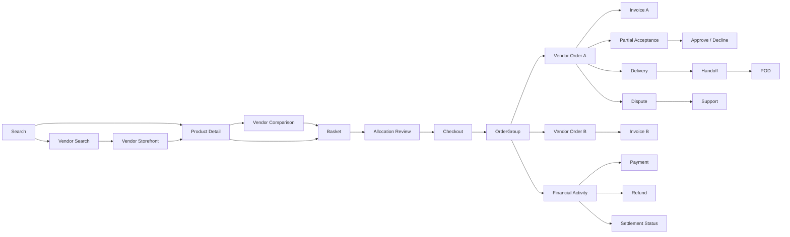

# POL — Master Product / Experience / Delivery Control Tree Specification
## Canonical Master Product / Experience / Service / Domain / System / Delivery Tree — GitHub × Product Architecture × IA × Service Blueprint × API × Data × Permissions × States × Light/Night

**Document ID:** `POL-DESIGN-TREE-001`  
**Version:** `4.3.0`  
**Date:** 2026-09-21  
**Status:** ACTIVE MASTER ARCHITECTURE / CANONICAL REGISTRY KERNEL / TOOL-AGNOSTIC / MULTI-CHANNEL BUILD SOURCE / FEDERATED VIEW MODEL / TRACEABILITY MODEL / DRIFT-CONTROLLED / AGENT-EXECUTION READY  
**Repository:** `rrasi90/POL-2.3`  
**Working Branch:** `product-architecture-evolution-2026-09-20`  
**Primary Intent:** تبدیل حقیقت محصول، معماری، دامنه، تجربه، طراحی، frontend، backend، اپلیکیشن‌ها، ابزارهای اجرا و شواهد را به یک Canonical Node Registry + Federated Views + Traceability Graph؛ به‌گونه‌ای که ابزار اجرایی، محل ساخت یا Agent قابل تعویض باشد اما خروجی، قراردادها، رفتار، کیفیت و معیارهای پذیرش ثابت بماند؛ با Precision Commerce و پوشش هم‌سطح Light + Night.

---

# 0. هدف سند

این سند یک فهرست ساده از صفحه‌ها نیست.

این سند باید به‌عنوان **Product Design Tree** برای POL استفاده شود؛ یعنی از ریشه محصول شروع شود و به ترتیب زیر پایین برود:

```
POL
├── Surface / Persona
│   ├── Page / Experience
│   │   ├── Screen / Frame
│   │   │   ├── Section
│   │   │   │   ├── Component
│   │   │   │   ├── Interaction
│   │   │   │   ├── State
│   │   │   │   ├── Data
│   │   │   │   ├── Permission
│   │   │   │   └── API / Domain Contract
│   │   │   └── Navigation / Relationship
│   │   └── Theme / Responsive Variants
│   └── Cross-surface Dependencies
└── Global Design System
    ├── Foundations
    ├── Components
    ├── Shared UX
    ├── States & Patterns
    ├── Prototypes
    └── QA
```

بنابراین «وجود یک Frame» به‌تنهایی به معنی تکمیل شدن capability نیست.

هر capability زمانی درختی کامل است که حداقل این لایه‌ها مشخص باشند:

1. مقصد/Persona
2. Screen
3. هدف صفحه
4. Sections
5. Actions
6. States
7. Data / Entities
8. Permission
9. API / Domain dependency
10. Navigation relationship
11. Light/Night behavior
12. Mobile/Desktop behavior
13. Prototype coverage
14. QA coverage
15. Missing / Open Decision

---


# 2.0. MASTER TREE v4 KERNEL — REQUIRED INTERPRETATION

Version 4.0 changes the Master Tree from a large narrative tree into a canonical registry with federated views.

The document continues to contain detailed product, screen, state, design and QA views because those views are useful to humans. However, only canonical node records are authoritative.

Core rule:

CANONICAL NODE REGISTRY
  ├── Experience / IA views
  ├── Journey / Flow views
  ├── Domain / API views
  ├── Design System views
  ├── Design Artifact / Frontend Artifact views
  └── Evidence / QA / Pilot views

The same ID may appear in multiple views, but it still represents one node.

Node identity tuple:

NODE_ID + TYPE + CANONICALITY + AUTHORITY + SCOPE + LIFECYCLE

Governance rule:

A screen heading, design artifact, screenshot, frontend route or API endpoint is not automatically a canonical node. It becomes one only when it has an explicit node identity and source authority.

v4 mandatory concepts:

- canonicality
- source health
- alias/supersession
- applicability-aware closure profiles
- many-to-many evidence
- many-to-many relationship edges
- exact artifact bindings
- maturity separate from lifecycle
- change-impact records
- release snapshots
- executable fitness functions
- bounded agent source packets

---

# 0.5. TOOL-AGNOSTIC BUILD MODE — CANONICAL

### Core axiom

**The Master Tree specifies the product truth and the required result, never a mandatory implementation tool.**

The canonical system must remain executable through interchangeable channels such as:
- design tools;
- code editors / IDEs;
- AI agents and coding harnesses;
- frontend frameworks;
- native/mobile stacks;
- documentation systems;
- test/QA systems;
- import/export or migration pipelines.

A tool may accelerate execution, but it MUST NOT become the source of product truth.

### Tool substitution contract

`Required Result = Canonical Specification + Applicable Contracts + Validation Evidence`

Changing the tool MUST NOT change:
- business behavior;
- information architecture;
- domain model;
- permissions;
- state machine;
- API/application contracts;
- data semantics;
- accessibility requirements;
- responsive/platform behavior;
- acceptance criteria;
- release gates.

Only the execution adapter may change.

### Canonical build sequence

`WAVE-00 Environment/Capability Preflight → WAVE-01 Foundations → WAVE-02 Golden Components → WAVE-03 Shared Patterns → WAVE-04 Golden Experiences → WAVE-05 Retailer → WAVE-06 Vendor → WAVE-07 Operations → WAVE-08 Field + Corporate → WAVE-09 Prototypes/Flows → WAVE-10 QA + Release → ENGINEERING IMPLEMENTATION WAVES`

The sequence expresses dependency order, not a mandatory software product.

### Dependency rule

A missing shared foundation, component, pattern, contract, or runtime prerequisite blocks downstream work until the dependency is created and verified centrally. Local invention must not silently compensate for a missing canonical dependency.

### Source precedence for any tool

`Current Product/Architecture Decisions → Domain/API/Data Contracts → Master Tree → Executable Schema → Visual/Interaction System → Active Delivery Contracts → Current Artifact Evidence → Historical Artifacts`

Historical artifacts may inform intent or contradiction discovery, but they cannot become active authority merely because a tool can import or display them.

### Artifact neutrality

A design board, source file, component library, generated screen, screenshot, prototype, code route, notebook, document, or agent output is an **artifact**, not automatically a canonical node.

Canonical identity exists independently of where the artifact is stored.


# 0.6. TOOL-AGNOSTIC RESULT CONTRACT — NEW CANONICAL LAW

## 0.6.1 Canonical truth vs execution tool

The Master Tree has one authoritative responsibility:

> **Define what the product is, what it must do, what evidence is required, and what “done” means.**

It does NOT define:
- which design application must be used;
- which IDE must be used;
- which AI model must be used;
- which agent harness must be used;
- which frontend/mobile implementation tool must be used;
- which documentation or QA product must be used.

## 0.6.2 Canonical implementation chain

`Intent → Requirement → Decision → Capability → Domain Model → Experience → Artifact Contract → Implementation → Verification → Release`

No tool is a canonical layer in this chain.

## 0.6.3 Equivalent-output rule

An implementation produced by Tool A and an implementation produced by Tool B are equivalent when they satisfy the same canonical acceptance profile.

Therefore:
- screenshot equivalence alone is insufficient;
- code equivalence is not required;
- file-format equivalence is not required;
- vendor/tool metadata equivalence is irrelevant.

What matters is semantic, behavioral, structural, visual, accessibility, performance, security, and runtime compliance where applicable.

## 0.6.4 Adapter registry

The Master Tree may register one or more adapters per execution channel:

`ADAPTER_ID → TOOL_TYPE → INPUT_SCHEMA → OUTPUT_ARTIFACTS → CAPABILITIES → LIMITATIONS → VERIFICATION_METHODS`

Adapter records are non-canonical implementation metadata.

## 0.6.5 No single-tool lock-in

No active canonical node may depend on a tool-specific file format, proprietary UI structure, or tool-local state unless:
1. the requirement itself is tool-specific; and
2. the dependency is explicitly classified as an implementation constraint.

A canonical product requirement must always have a tool-independent representation.

## 0.6.6 Migration / replacement rule

When a tool is replaced:
1. canonical nodes remain unchanged;
2. contracts remain unchanged;
3. existing evidence is reclassified as historical where necessary;
4. a new adapter is registered;
5. required artifacts are regenerated or migrated;
6. the same validation suite is rerun;
7. release status is recalculated.

Tool replacement is therefore a controlled implementation change, not a product redesign.

## 0.6.7 Agent portability

Any AI agent/harness may execute a node when its source packet and capability profile satisfy the node contract.

The Master Tree MUST NOT encode one specific agent's internal prompt format as canonical product truth.

# 1. SOURCE SNAPSHOT

## 1.1 GitHub

Canonical working repository:

`rrasi90/POL-2.3`

Architecture branch:

`product-architecture-evolution-2026-09-20`

Key architecture wave:

- `POL_00_PROJECT_CONTROL/PRODUCT_EVOLUTION/PRODUCT_ARCHITECTURE_EVOLUTION_WAVE_01_2026-09-20.md`
- GitHub Issue #5 — Product Architecture Wave 01
- GitHub PR #6 — `feat: add product architecture evolution wave 01`

Issue #5 explicitly identifies these P0/P1 design-relevant capabilities:

- Financial Activity read model
- OrderGroup → child Orders → Vendor Invoices UX
- Vendor Search + Vendor Storefront
- Lightweight Delivery Handoff without a full Driver App
- Neutral settlement wording
- Web + Android parity
- Delegated organization permissions
- Permission catalog / grants / revokes / audit
- Delivery handoff token
- Android foundation
- Barcode scanner / continuous scan
- Master SKU / media provenance

P2:

- Stored-value Wallet
- Full Driver App
- Advanced wallet reconciliation
- Rich offline sync

---

## 1.2 Historical design artifacts

Any previously produced design workspace/export is classified as **HISTORICAL / EVIDENCE ONLY** unless an explicit active artifact binding says otherwise.

Historical artifacts may be used for:
- intent discovery;
- contradiction detection;
- terminology recovery;
- visual research;
- migration planning.

They are NOT:
- the source of product truth;
- the source of domain/API semantics;
- the source of permission logic;
- the source of runtime behavior;
- a mandatory implementation baseline.

The active implementation channel must start from the canonical contracts and produce independently verifiable artifacts.


---

# 2. SOURCE-OF-TRUTH RULE

When sources disagree:

**Architecture / adopted Product Evolution > API / data contract > explicit design specification > current design artifact**

But a contradiction must NOT be silently erased.

Every contradiction must be registered under:

**CONFLICT / DECISION REQUIRED**

This prevents old design tool content from silently becoming product behavior.

---


# 2.5. RESEARCH-BASED MASTER TREE MODEL — VERSION 2

## 2.5.1 Core finding

Research across information architecture, service blueprinting, software architecture, enterprise architecture, design systems, domain-driven design, product discovery, and architecture decision records leads to one important conclusion:

**A complex product should not force all architecture into one literal tree.**

A sitemap is only one part of information architecture; it describes content/page hierarchy, while IA also includes nomenclature and navigation relationships. citeturn246897search13

Service blueprints model relationships between customer actions, frontstage actions, backstage actions, support processes, and touchpoints. citeturn927249search2turn927249search5

C4 explicitly uses hierarchical abstractions, while also providing dynamic and deployment diagrams because one hierarchy cannot explain every architectural relationship. citeturn701494search0

ArchiMate similarly separates architectural concerns across motivation/strategy and core business, application, and technology layers. citeturn701494search2

Atomic Design models UI decomposition from atoms through molecules, organisms, templates, and pages. citeturn701494search10

Opportunity Solution Trees connect desired outcomes to opportunities, solutions, and experiments; they are useful for product discovery but are not a substitute for product architecture. citeturn701494search4

Domain-driven design uses bounded contexts to keep models internally consistent and explicit about relationships between parts of a large domain. citeturn701494search1turn193883search7

Design tokens are now standardized by the Design Tokens Community Group as a cross-tool representation of reusable design decisions and theming. citeturn193883search1turn193883search4

Architecture Decision Records preserve context, decision, status, and consequences instead of silently rewriting history when an architectural decision changes. citeturn246897search0turn246897search4

### Conclusion

POL Master Tree therefore becomes a **Master Tree Federation**:

```
                           POL MASTER ARCHITECTURE
                                      │
             ┌────────────────────────┼────────────────────────┐
             │                        │                        │
        STRATEGY TREE            EXPERIENCE TREE           SERVICE TREE
             │                        │                        │
      Outcome / Capability     Journey / Task / Flow    Frontstage / Backstage
             │                        │                        │
             └────────────────────────┼────────────────────────┘
                                      │
                               PRODUCT TREE
                                      │
                  Persona / Surface / Experience / Screen
                                      │
                               DESIGN SYSTEM TREE
                                      │
                     Tokens / Components / Patterns
                                      │
                                DOMAIN TREE
                                      │
                    Bounded Context / Entity / State
                                      │
                              SYSTEM TREE
                                      │
                   Application / API / Data / Event
                                      │
                              TRACEABILITY TREE
                                      │
             Requirement / Decision / Artifact / Test / Evidence
```

These are **views of one product**, not separate products.

---

## 2.5.2 The nine canonical views

### View 1 — Outcome / Strategy Tree

Answers:

> چرا این capability وجود دارد؟

Hierarchy:

```
Outcome
└── Opportunity / Need
    └── Capability
        └── Product Initiative
            └── Release / Wave
```

For POL:

```
Pilot Success
├── Retailer adoption
├── Vendor participation
├── Order completion
├── Operational reliability
├── Financial transparency
└── Repeat usage
```

This view must never be used to justify a UI screen directly. It explains why the product capability exists.

---

### View 2 — Experience / Information Architecture Tree

Answers:

> کاربر چه چیزی را کجا پیدا می‌کند و چگونه در محصول حرکت می‌کند؟

Hierarchy:

```
Surface
└── Experience
    └── Page / Destination
        └── Screen
            └── Section
```

But it also contains **cross-links**:

- navigates to
- opens
- deep-links to
- returns to
- contextualizes

This is the actual IA/navigation tree.

A tree test can be applied to this layer because tree testing evaluates whether users can find target destinations in a proposed information hierarchy. citeturn246897search12

---

### View 3 — Journey / Flow Tree

Answers:

> کاربر برای رسیدن به یک outcome چه مسیری را طی می‌کند؟

Hierarchy:

```
Journey
├── Phase
│   ├── Goal
│   ├── User action
│   ├── Decision
│   ├── Screen
│   ├── State
│   └── Outcome
```

Journey and Flow must not be merged.

A journey is broader and can span time/channels; a user flow focuses on a specific task inside a product. citeturn927249search0turn927249search8

For POL:

```
Retail Purchase Journey
├── Discover
├── Compare
├── Build Basket
├── Allocate
├── Commit
├── Vendor Fulfillment
├── Delivery
├── Financial Confirmation
└── Reorder / Dispute
```

---

### View 4 — Service Blueprint Tree

Answers:

> پشت این تجربه چه افراد، فرآیندها، سیستم‌ها و عملیات‌هایی لازم هستند؟

Hierarchy:

```
Service Scenario
├── Customer / User Action
├── Frontstage Interaction
├── Backstage Action
├── Support Process
├── System / Tool
├── Evidence
└── Failure / Recovery
```

For POL this is critical because a screen can look correct while the actual service cannot fulfill it.

Example:

```
Retailer confirms Delivery
├── Frontstage
│   └── Handoff Verification
├── Backstage
│   ├── Validate Token
│   ├── Verify Delivery Context
│   ├── Write POD
│   └── Transition Delivery
├── Support
│   └── Delivery Exception Queue
└── Evidence
    └── Delivery Audit Event
```

Service blueprinting is specifically useful for mapping service components, people, processes, and touchpoints and for exposing service weaknesses or redundancies. citeturn927249search2turn927249search6

---

### View 5 — Domain Tree

Answers:

> سیستم از نظر business domain چه مفاهیم و boundaryهایی دارد؟

Hierarchy:

```
Domain
└── Subdomain
    └── Bounded Context
        ├── Aggregate
        ├── Entity
        ├── Value Object
        ├── State
        ├── Command
        ├── Domain Event
        └── Business Rule
```

For POL, candidate bounded contexts include:

- Identity & Membership
- Catalog
- Vendor Catalog
- Inventory
- Basket & Allocation
- Orders
- Billing / Invoices
- Payments
- Settlement / Reconciliation
- Delivery
- Disputes / Returns
- Support
- Notifications
- Media
- Product Identity / Candidate Governance

The model must preserve terminology boundaries; the same business word must not silently mean different things in different contexts. DDD bounded contexts provide the explicit boundary for that consistency. citeturn701494search1turn193883search7

---

### View 6 — System / Architecture Tree

Answers:

> UI چگونه به سیستم واقعی متصل می‌شود؟

Hierarchy:

```
System
├── Client
│   ├── Android
│   ├── Mobile Web
│   ├── Vendor Web
│   └── Ops Web
├── Application Boundary
├── Module
├── API
├── Data Store
├── Worker / Event Processor
├── External Integration
└── Deployment
```

C4 is the primary inspiration for keeping architecture views hierarchical but allowing supporting dynamic/deployment views where necessary. citeturn701494search0

---

### View 7 — Design System Tree

Answers:

> UI از چه building blockهایی ساخته می‌شود؟

Hierarchy:

```
Design System
├── Tokens
│   ├── Color
│   ├── Typography
│   ├── Spacing
│   ├── Radius
│   ├── Elevation
│   └── Motion
├── Primitives
├── Components
├── Patterns / Recipes
├── Templates
└── Screens
```

Atomic Design supports decomposition from atoms to molecules, organisms, templates, and pages. citeturn701494search10

POL should additionally distinguish reusable **design-system components** from product-specific **recipes/compositions**. Brad Frost explicitly distinguishes context-agnostic design-system components from recipes that are consistent product compositions but are too specific to live as universal components. citeturn701494search9

Design tokens should remain semantically named and exportable/interoperable across design tool and code. DTCG defines design tokens as reusable design decisions and provides a vendor-neutral format for sharing them across tools and products. citeturn193883search0turn193883search4

---

### View 8 — State / Event Tree

Answers:

> چه اتفاقی می‌افتد، چه stateای تغییر می‌کند و چه چیزی باید به کاربر نشان داده شود؟

Hierarchy:

```
Capability
├── Command
│   ├── Preconditions
│   ├── Validation
│   ├── Success
│   └── Failure
├── Domain State Transition
├── Domain Event
├── Projection / Read Model
├── Notification
├── Audit Event
└── Recovery
```

This view must distinguish:

- Domain state
- UI state
- Integration state
- Audit state
- Notification state

Never collapse them into a single generic status.

EventStorming is useful as a source technique because it models what is happening in the domain through domain events and creates a shared model between domain experts and engineering. citeturn701494search120

---

### View 9 — Traceability / Governance Tree

Answers:

> هر تصمیم و طراحی از کجا آمده و چگونه اثبات می‌شود؟

Hierarchy:

```
Requirement / Outcome
└── Product Decision
    ├── Context
    ├── Decision
    ├── Consequences
    └── Source
        └── Design Artifact
            ├── design tool Frame
            ├── Component
            ├── Prototype
            ├── Frontend Route
            ├── API Contract
            └── Test / QA Evidence
```

Architectural decisions should retain their context and consequences; later changes should supersede rather than silently erase earlier decisions. citeturn246897search0turn246897search4

---

## 2.5.3 Master Tree is a graph, not only a tree

The **tree** describes containment.

The **graph** describes relationships.

Therefore the canonical representation must support:

```
CONTAINS
BELONGS_TO
NAVIGATES_TO
OPENS
DEPENDS_ON
READS_FROM
WRITES_TO
TRIGGERS
PROJECTS
DERIVES_FROM
AUTHORIZED_BY
AUDITED_BY
NOTIFIES
ESCALATES_TO
RECOVERS_TO
IMPLEMENTS
VALIDATED_BY
SUPERSEDES
```

### Rule

Never add arbitrary visual branches simply because two concepts are related.

Use the appropriate edge.

Example:

```
RT-16 Financial Activity
    ──READS_FROM──> Payment
    ──READS_FROM──> Refund
    ──READS_FROM──> Invoice
    ──READS_FROM──> Settlement Projection

VD-15 Permission Editor
    ──AUTHORIZED_BY──> membership.manage
    ──WRITES_TO──> delegated_permission_grant
    ──AUDITED_BY──> Permission Audit Event
```

---

# 2.5.4 New Master Node Contract

Every canonical node in POL should now have this metadata:

```
NODE
├── ID
├── Type
├── Name
├── Parent
├── View
├── Persona / Actor
├── Role
├── Organization Scope
├── Business Capability
├── User Outcome
├── Goal
├── Preconditions
├── Inputs
├── Outputs
├── Children
├── Relationships
├── Domain Context
├── Entities
├── Commands
├── Domain Events
├── API Contract
├── Permissions
├── UI States
├── Domain States
├── Error States
├── Recovery
├── Notifications
├── Audit
├── Design Tokens
├── Components
├── Visual Direction
├── Theme Coverage
├── Light Theme
├── Night Theme
├── Density Profile
├── Visual Token Refs
├── Mobile
├── Desktop
├── Prototype
├── Frontend Mapping
├── design tool Artifact
├── QA Evidence
├── Source
├── Decision / ADR
├── Priority
├── Lifecycle Status
└── Open Questions
├── Canonicality
├── Authority Status
├── Alias Of
├── Supersedes
├── View Memberships
├── Closure Profile
├── Maturity Level
├── Source Health
├── design tool Artifact Binding
├── Evidence Records
└── Change Impact Records
```

This becomes the atomic record for the Master Tree.

### v4 identity rule

One logical node has exactly one canonical identity record.

All repeated appearances elsewhere in this document MUST be classified as VIEW_PROJECTION, DERIVED_INDEX, EVIDENCE_RECORD or HISTORICAL_REFERENCE.

They are not second canonical definitions.

### Canonical precedence

CANONICAL_NODE > VIEW_PROJECTION > DERIVED_INDEX > EXPLANATORY_TEXT

A lower class can summarize a higher class but cannot override it.

---

# 2.5.5 Capability-to-design tool Traceability

The canonical path is now:

```
Outcome
→ Opportunity
→ Capability
→ Domain
→ Role
→ Experience
→ Journey / Flow
→ Screen
→ Section
→ Component
→ Action
→ API
→ State Transition
→ Event
→ Audit
→ Notification
→ Prototype
→ QA
→ design tool Artifact
→ Frontend Implementation
```

A screen that cannot be traced upward to a capability or downward to a supported runtime contract is:

`UNMAPPED`

A capability that has no screen/interaction where a UI is needed is:

`DESIGN GAP`

A UI action without a supporting runtime contract is:

`CONTRACT GAP`

An architecture decision with no recorded rationale is:

`GOVERNANCE GAP`

---

# 2.5.6 Two independent trees must never be confused

## The Information Tree

Optimizes:

- findability
- navigation
- grouping
- labels
- hierarchy

## The Business/Domain Tree

Optimizes:

- business consistency
- boundaries
- state
- ownership
- rules
- transactions

They overlap but are not identical.

For example:

**Invoice** may live under:

`Retailer → Order → Invoice`

in the information architecture.

But in the domain:

`Order → Billing Context → Invoice Aggregate`

Therefore design tool must follow the user's mental model while the traceability layer preserves the domain model.

This distinction is foundational for POL.

---

# 2.5.7 One screen may belong to multiple views

Example:

`RT-15 OrderGroup Detail`

### IA view
Retailer → Orders → OrderGroup

### Journey view
Checkout → Order Confirmation → Tracking

### Service view
Retailer interaction + Vendor fulfillment + Operations exceptions

### Domain view
OrderGroup → Orders → Invoices

### System view
GET OrderGroup → aggregation/read model → client

### Design-system view
OrderGroup Header + Vendor Order Card + Invoice Card + Timeline

### QA view
Permission + states + responsive + dark + prototype

The screen itself remains one artifact.

---

# 2.5.8 Introduce explicit ownership

Every Master Tree node must declare an owner.

Possible ownership:

- Product
- Design
- Engineering
- Operations
- Security
- Finance
- Catalog
- Field
- Legal/Trust

Example:

```
Financial Activity
Owner:
Product + Finance + Engineering

Permission Audit
Owner:
Security + Operations

Media Provenance
Owner:
Catalog Governance + Operations
```

Ownership clarifies who can change the contract.

---

# 2.5.9 Introduce lifecycle states for design nodes

Every node should have:

```
PROPOSED
→ DISCOVERY
→ SPECIFIED
→ DESIGNING
→ DESIGNED
→ PROTOTYPED
→ QA
→ IMPLEMENTATION_READY
→ IMPLEMENTED
→ VERIFIED
→ DEPRECATED
→ SUPERSEDED
```

A node must not be called COMPLETE if only the design artifact exists.

---

# 2.5.10 Introduce confidence and evidence

Each node should carry:

### Evidence level

- SOURCE_VERIFIED
- RUNTIME_VERIFIED
- DESIGN_VERIFIED
- INFERRED
- OPEN_DECISION

### Evidence references

- GitHub file
- API route
- test
- design artifact
- design review
- product decision
- external research

This prevents accidental promotion of assumptions into canonical behavior.

---

# 2.5.11 Introduce scope dimensions

Every capability/screen must carry independent scopes:

```
MVP
P1
P2
FUTURE
DEFERRED
OUT_OF_SCOPE
```

Do not mix roadmap priority with implementation status.

A feature can be:

`MVP + SPEC_ONLY`

or:

`P2 + PRODUCTION_IMPLEMENTED`

These dimensions must remain separate.

---

# 2.5.12 Introduce invariants

Every major subtree must declare invariants.

Examples for POL:

### Finance
- no MVP custody
- Financial Activity is a read model
- Payment ≠ Settlement
- Invoice ≠ Order

### Security
- deny by default
- server-side authorization
- no client-only security
- handoff token ≠ session

### Catalog
- Master Product ≠ Vendor SKU
- unknown barcode ≠ auto-created Master Product

### Commerce
- OrderGroup ≠ Vendor Invoice
- sibling child orders remain isolated

### Delivery
- no full Driver App in MVP

### Clients
- Web and Android share authorization boundary
Invariants should be visible near each subtree and referenced by QA.

---

# 2.5.13 Introduce ambiguity and contradiction handling

Every conflict must now have:

```
CONFLICT
├── ID
├── Topic
├── Source A
├── Source B
├── Impact
├── Current Working Interpretation
├── Decision Owner
├── Decision Needed By
├── Status
├── Superseding Decision
└── Affected design tool Nodes
```

This is stronger than a simple contradiction table.

---

# 2.5.14 Introduce decision records

For durable architecture choices, record:

- Status
- Context
- Decision
- Consequences
- Supersedes / Superseded by

Do not rewrite history when the decision changes.

---

# 2.5.15 Master Tree quality metrics

The tree itself should be measurable.

## Coverage

`Mapped Capabilities / Total Capabilities`

## Screen Coverage

`Capabilities requiring UI with mapped screens / total`

## State Coverage

`Mapped states / expected states`

## Permission Coverage

`Protected actions with explicit permissions / total protected actions`

## Contract Coverage

`UI actions with verified API/domain contract / total actions`

## Theme Coverage

`Screens with Light + Night / production screens`

## Prototype Coverage

`Critical journeys prototyped / critical journeys`

## QA Coverage

`Artifacts with evidence-backed QA / production artifacts`

## Traceability Integrity

`Nodes with complete upward + downward trace / total canonical nodes`

---

# 2.5.16 New Master Tree scorecard

Never use a subjective “design quality score”.

Use factual coverage indicators:

| Dimension | Measurement |
|---|---|
| IA Coverage | navigation destinations mapped |
| Capability Coverage | capabilities mapped |
| Domain Coverage | contexts/entities mapped |
| Flow Coverage | critical journeys mapped |
| State Coverage | state transitions mapped |
| Permission Coverage | protected actions mapped |
| API Coverage | UI actions mapped to contracts |
| Service Coverage | frontstage/backstage mapped |
| Component Coverage | reusable UI mapped |
| Theme Coverage | Light/Dark mapped |
| Responsive Coverage | mobile/desktop mapped |
| Prototype Coverage | critical journeys mapped |
| QA Coverage | evidence-backed verification |
| Decision Coverage | significant decisions recorded |

---

# 2.5.17 Recommended POL Master Tree visual layers

Do not force these into one unreadable canvas.

design tool should contain separate navigable boards:

### Layer A — Master Overview
One-screen executive tree.

### Layer B — Experience Map
Persona → Journey → Screen.

### Layer C — Information Architecture
Surface → Page → Screen → Section.

### Layer D — Service Blueprint
User → Frontstage → Backstage → Support.

### Layer E — Domain Map
Bounded Context → Entity → State → Event.

### Layer F — System Map
Client → Application → API → Data → Worker → External System.

### Layer G — Design System
Token → Primitive → Component → Recipe → Template → Screen.

### Layer H — Permission Matrix
Role → Permission → Action → Surface.

### Layer I — State Matrix
Domain State → UI State → Event → Recovery.

### Layer J — Traceability
Requirement → Decision → design tool → API → Frontend → QA.

This approach keeps each diagram legible while preserving cross-links between them.

---

# 2.5.18 Why this is a better model for POL

POL is not a simple content website.

It combines:

- marketplace discovery
- organizational permissions
- multi-vendor commerce
- operational workflows
- financial visibility
- delivery operations
- catalog governance
- field operations
- audit/security
- Android + Web clients
- shared design system

Therefore a pure sitemap cannot represent the product adequately.

The upgraded Master Tree becomes a **federated architecture model** whose primary job is traceability.

It tells a designer:

> Where should this exist?

It tells Product:

> Why should this exist?

It tells Operations:

> Who does what?

It tells Engineering:

> Which domain/API/state supports it?

It tells Security:

> Who is authorized?

It tells the service team:

> What happens backstage?

It tells QA:

> What evidence proves it works?

It tells design tool:

> Which artifact must exist?

It tells Frontend:

> What should be implemented from the canonical design?

---

# 2.5.19 Research source catalog

The Master Tree methodology is informed by the following public frameworks and references:

1. Nielsen Norman Group — Information Architecture vs. Sitemaps  
https://www.nngroup.com/articles/information-architecture-sitemaps/

2. Nielsen Norman Group — Site Map Usability / Tree Testing  
https://www.nngroup.com/reports/site-map-usability/  
https://www.nngroup.com/articles/navigation-ia-tests/

3. Nielsen Norman Group — User Journeys vs. User Flows  
https://www.nngroup.com/articles/

4. Nielsen Norman Group — Service Blueprinting  
https://www.nngroup.com/articles/service-blueprints-definition/  
https://www.nngroup.com/articles/service-blueprinting-practice/

5. C4 Model — Software Architecture Visualization  
https://c4model.com/

6. ArchiMate 101 / The Open Group  
https://archimate-community.pages.opengroup.org/workgroups/archimate-101/

7. Martin Fowler — Bounded Context  
https://martinfowler.com/bliki/BoundedContext.html

8. Ubiquitous Language — Why language is per context  
https://www.ubiquitouslanguage.org/understand/language-is-per-context/

9. EventStorming — Domain Event Modeling  
https://en.wikipedia.org/wiki/Event_storming  
(Use the project’s domain documentation for canonical POL event names.)

10. Brad Frost — Atomic Design  
https://atomicdesign.bradfrost.com/chapter-2/

11. Brad Frost — Components, Recipes, Snowflakes  
https://bradfrost.com/blog/post/design-system-components-recipes-and-snowflakes/

12. Design Tokens Community Group / W3C  
https://www.w3.org/community/design-tokens  
https://www.designtokens.org/

13. Teresa Torres — Opportunity Solution Trees  
https://www.producttalk.org/opportunity-solution-tree/

14. Architecture Decision Records / Nygard-style practice  
https://docs.publishing.service.gov.uk/repos/govuk_publishing_components/adr/0001-record-architecture-decisions.html

---

# 2.5.20 New definition of the Master Tree

The Master Tree is now formally defined as:

> **A versioned, evidence-backed, federated hierarchy-and-relationship model that connects product outcomes, information architecture, user journeys, service operations, domain architecture, system architecture, design-system composition, permissions, states, decisions, design artifacts, implementation contracts, prototypes, and QA evidence.**

It is therefore **not**:

- only a sitemap
- only a UX flow
- only a design-system tree
- only an architecture diagram
- only an entity tree
- only a roadmap
- only a design tool page inventory

It is the **traceability spine** connecting all of them.


# 3. MASTER PRODUCT TREE

```mermaid
flowchart TD

  P[POL — B2B Wholesale Operating Platform]

  P --> F[00 Foundations]
  P --> C[01 Components]
  P --> SU[02 Shared UX]
  P --> ST[03 States & Patterns]

  P --> R[Retailer Surface]
  P --> V[Vendor Surface]
  P --> O[Operations Surface]
  P --> FA[Field Activator Surface]
  P --> CP[Corporate / Trust Surface]

  P --> PR[09 Prototypes & Flows]
  P --> QA[10 Design QA]

  R --> R_AUTH[Authentication & Activation]
  R --> R_DISC[Discovery]
  R --> R_COM[Commerce]
  R --> R_ORDER[Orders]
  R --> R_FIN[Financial Activity]
  R --> R_DEL[Delivery]
  R --> R_RET[Returns / Disputes]
  R --> R_SUPPORT[Support]
  R --> R_ACCOUNT[Account / Security]

  V --> V_AUTH[Authentication / Context]
  V --> V_STORE[Storefront]
  V --> V_CAT[Catalog]
  V --> V_INV[Inventory]
  V --> V_ORDER[Order Operations]
  V --> V_DEL[Dispatch / Handoff]
  V --> V_FIN[Finance]
  V --> V_STAFF[Staff / Permissions]
  V --> V_PROFILE[Vendor Profile]

  O --> O_QUEUE[Operational Queues]
  O --> O_CASE[Case / Arbitration]
  O --> O_FIN[Financial Investigation]
  O --> O_PERM[Permission Audit]
  O --> O_CAT[Catalog Governance]
  O --> O_MEDIA[Media Provenance]
  O --> O_DEL[Delivery Exceptions]
  O --> O_SUPPORT[Support]
  O --> O_PILOT[Pilot Analytics]
  O --> O_ADMIN[Admin / Context]

  FA --> FA_TASK[Tasks / Route]
  FA --> FA_ACT[Retailer Activation]
  FA --> FA_ORDER[Assisted Ordering]
  FA --> FA_VISIT[Visit / Follow-up]
  FA --> FA_NET[Weak Network]

  CP --> CP_HOME[Institutional Trust]
  CP --> CP_RETAIL[Retailer Value]
  CP --> CP_VENDOR[Vendor Value]
  CP --> CP_FLOW[How POL Works]
  CP --> CP_PILOT[Ahvaz Pilot]
  CP --> CP_LEGAL[Legal / Privacy / Contact]
```



---

# 4. GLOBAL DESIGN SYSTEM TREE

## 4.1 Foundations

Existing design tool foundation areas include:

- Brand Identity & Official Logos
- Semantic Color Tokens & Roles
- Persian Typography & Numeric Scales
- Spacing, Elevation & Radius System
- RTL & Commercial Invariants
- Night Mode Semantic Tokens & Surface Elevation

### Required canonical foundation layers

```
Foundations
├── Brand
│   ├── POL logo
│   ├── wordmark
│   ├── icon treatment
│   └── safe-area rules
├── Color
│   ├── light semantic tokens
│   ├── dark semantic tokens
│   ├── interactive
│   ├── success
│   ├── warning
│   ├── danger
│   ├── info
│   ├── disabled
│   └── focus
├── Typography
│   ├── Vazirmatn
│   ├── headings
│   ├── body
│   ├── labels
│   ├── tabular numerals
│   └── code / ID / SKU / barcode / URL treatment
├── Spacing
│   ├── 4/8pt system
│   ├── page margins
│   ├── section gaps
│   └── density variants
├── Shape
│   ├── radius
│   ├── border
│   └── elevation
├── Layout
│   ├── mobile
│   ├── tablet
│   ├── desktop
│   └── operations desktop
├── Direction
│   ├── RTL
│   ├── LTR
│   └── mixed-direction content
└── Accessibility
    ├── contrast
    ├── touch target
    ├── focus
    ├── error visibility
    └── non-color status indication
```

---

# 5. LIGHT / NIGHT THEME CONTRACT

Night mode is not a separate visual product.

It is the same information architecture and component behavior with semantic token substitution.

## 5.1 Required modes

Every production surface must support:

- Light
- Dark

unless explicitly marked:

- `LIGHT_ONLY`
- `DARK_ONLY`
- `SYSTEM_ADAPTIVE`

## 5.2 Theme mapping

| Semantic role | Light | Dark | Rule |
|---|---|---|---|
| Canvas | Light background token | Dark background token | Never hard-code page color |
| Surface | Surface-1 | Dark Surface-1 | Preserve hierarchy |
| Elevated Surface | Surface-2 | Dark Surface-2 | Preserve depth |
| Primary Text | Text-Primary | Dark Text-Primary | Contrast first |
| Secondary Text | Text-Secondary | Dark Text-Secondary | Never use disabled as body text |
| Border | Border-Default | Border-Dark | Maintain structural separation |
| Accent | POL Accent | POL Accent Dark | Same semantic meaning |
| Success | Success | Success-Dark | Color + icon/text |
| Warning | Warning | Warning-Dark | Color + icon/text |
| Danger | Danger | Danger-Dark | Color + icon/text |
| Info | Info | Info-Dark | Color + icon/text |
| Focus | Focus | Focus-Dark | Keyboard/touch visible |

## 5.3 Night-mode rules

Night mode must preserve:

- hierarchy
- spacing
- information priority
- status semantics
- CTA order
- interaction patterns
- content density

Night mode must NOT mean:

- simply inverting colors
- lowering contrast
- replacing all surfaces with one dark gray
- using glow/decorative gradients for status
- hiding secondary text
- changing meaning of state colors

---

# 6. COMPONENT TREE

```
Components
├── Navigation
│   ├── App Bar
│   ├── Side Navigation
│   ├── Bottom Navigation
│   ├── Breadcrumb
│   └── Context Switcher
├── Input
│   ├── Text Input
│   ├── Search
│   ├── Phone
│   ├── OTP
│   ├── Select
│   ├── Date
│   ├── Number
│   └── Quantity Stepper
├── Commerce
│   ├── Product Card
│   ├── Vendor Card
│   ├── Vendor Offer Row
│   ├── Basket Line
│   ├── Order Card
│   ├── OrderGroup Card
│   ├── Invoice Card
│   └── Allocation Group
├── Operational
│   ├── Queue Row
│   ├── SLA Badge
│   ├── Status Chip
│   ├── Exception Banner
│   ├── Timeline
│   ├── Evidence Block
│   └── Audit Event
├── Finance
│   ├── Financial Activity Row
│   ├── Payment Status
│   ├── Invoice Summary
│   ├── Settlement Status
│   └── Reconciliation Row
├── Security
│   ├── Permission Matrix
│   ├── Permission Editor
│   ├── Session Card
│   ├── OTP Input
│   └── Handoff Verification
├── Scanner
│   ├── Scanner Overlay
│   ├── Scan Result
│   ├── Candidate Product
│   ├── Exact Match
│   ├── Ambiguous Match
│   └── No Match
├── Media
│   ├── Media Card
│   ├── Upload
│   ├── Provenance Badge
│   ├── Approval Status
│   └── Evidence Preview
└── Feedback
    ├── Toast
    ├── Alert
    ├── Empty
    ├── Loading
    ├── Skeleton
    └── Network Banner
```

Every component must have:

- default
- hover where applicable
- pressed
- focus
- disabled
- loading
- error
- empty where applicable
- light
- dark
- mobile density
- desktop density where applicable

---

# 7. RETAILER TREE

## Retailer root

```
Retailer
├── Authentication & Activation
│   ├── RT-01 Authentication
│   ├── Shop Context
│   ├── First Use
│   └── Activation Success
├── Home
│   └── RT-02 Home & Operational Hub
├── Discovery
│   ├── RT-06 Search / Catalog / Filters
│   ├── RT-17 Vendor Search [NEW]
│   ├── RT-18 Vendor Storefront [NEW]
│   └── RT-07 Product Detail / Vendor Comparison
├── Commerce
│   ├── RT-03 Multi-Vendor Basket
│   ├── RT-14 Allocation Review
│   └── RT-04 Checkout / Confirmation
├── Orders
│   ├── RT-15 OrderGroup Detail [NEW]
│   ├── RT-08 Child Order Detail
│   ├── RT-10 Order History / Reorder
│   └── RT-20 Partial Acceptance Review [NEW]
├── Financial
│   └── RT-16 Financial Activity [NEW]
├── Delivery
│   ├── RT-05 Tracking & Delivery
│   └── RT-19 Delivery Handoff / Receiver Confirmation [NEW]
├── Returns / Disputes
│   └── RT-09 Returns / Dispute Filing
├── Account
│   ├── RT-12 / RT-13 Account
│   ├── Profile Completion
│   ├── Organization Context
│   └── Session Security
└── Support
    └── RT-12 / RT-13 Support
```

---

## RT-01 — Authentication & Activation

### Purpose
ورود/ثبت‌نام retailer، ایجاد tenant context و آماده‌سازی اولین خرید.

### Sections
1. Brand / identity
2. Phone
3. OTP
4. Shop context
5. Minimal activation guidance
6. Activation success

### Actions
- enter phone
- request OTP
- verify OTP
- resend
- change phone
- establish organization context
- continue to first action

### States
- initial
- submitting
- invalid phone
- invalid OTP
- expired OTP
- rate limited
- network failure
- authenticated
- organization selection

### Data
- user
- phone
- otp_challenge
- session
- organization
- membership

### API
- POST auth/request-otp
- POST auth/verify-otp
- POST auth/refresh
- POST auth/switch-organization

### Permission
Unauthenticated until verification; after login, scope by active membership.

### Theme
Light + Night.

### Conflict
Technical Architecture currently specifies a **4-digit OTP**. Older retailer design specs/design artifacts contain 6-digit / 5-box variants. Target new canonical design must use the current backend/auth contract; do not preserve an older OTP shape silently.

---

## RT-02 — Home & Operational Hub

### Purpose
به retailer بگو «الان چه کاری باید انجام بدهم؟»

### Sections
1. App bar
2. Active shop context
3. Notification/support
4. Today queue
5. Continue ordering
6. Reorder strip
7. Search
8. Category shortcuts
9. Bottom navigation

### Primary paths
Search / Continue purchase > attention item > reorder.

### States
- new user
- normal
- no history
- open exception
- degraded network

### Data
- recent orders
- pending orders
- notifications
- saved items
- active organization

### Relationships
Home → Search
Home → Order Detail
Home → Reorder
Home → Notifications
Home → Support

---

## RT-06 — Search / Catalog / Filter Drawer

### Purpose
Product-first discovery.

### Sections
1. Search
2. Scanner / SKU action where available
3. Recent searches
4. Category/filter chips
5. Results
6. Active filters
7. No result

### Result fields
- image
- product name
- pack
- MOQ
- price
- availability
- vendor
- quantity

### States
- initial
- suggestions
- loading
- results
- no result
- error
- filtered
- barcode lookup

### APIs
- GET categories
- GET products/search
- POST products/match-barcode
- GET products/{id}/vendors

---

## RT-17 — Vendor Search [NEW]

### Purpose
Vendor-first discovery for retailers with trusted/repeat suppliers.

### Sections
1. Vendor search field
2. Category
3. Location/context
4. Availability/freshness
5. Vendor results
6. Sort/filter
7. Empty state

### Vendor result fields
- vendor identity
- verification/freshness signal
- catalog coverage
- availability
- ordering constraints
- operating context

### Actions
- open storefront
- apply filter
- search again

### Relationship
Vendor Search → Vendor Storefront → Catalog → Product → Basket.

---

## RT-18 — Vendor Storefront [NEW]

### Purpose
یک Vendor را به‌عنوان یک B2B operating storefront نمایش می‌دهد.

### Sections
1. Vendor identity
2. Verification / freshness
3. Business context
4. Category shortcuts
5. Catalog
6. Product rows
7. Packaging
8. Price / availability
9. MOQ/MOV
10. Ordering CTA
11. Support / vendor policy where authorized

### Important rule
Storefront نباید به consumer marketplace تبدیل شود.

### Data
- vendor
- vendor_products
- inventory
- price
- packaging
- MOQ/MOV

### Relationships
Storefront → Product Detail
Storefront → Basket
Storefront → Vendor Profile where applicable

---

## RT-07 — Product Detail / Vendor Comparison

### Purpose
تصمیم خرید روی یک Master Product با چند Vendor Offer.

### Sections
1. Product media
2. Product identity
3. Pack/unit
4. Price
5. MOQ/MOV
6. Availability/freshness
7. Vendor
8. Quantity
9. Add to basket
10. Compare vendors
11. Provenance/media indicator

### Vendor comparison
Neutral comparison only.

Do not show:
«بهترین فروشنده»

unless a canonical ranking algorithm exists.

---

## RT-03 — Multi-Vendor Basket

### Purpose
جمع‌کردن کالاها پیش از allocation.

### Sections
1. Header
2. Basket lines
3. Changed/unavailable warnings
4. Vendor grouping after allocation when known
5. Totals
6. Commercial caveat
7. Continue

### States
- empty
- normal
- stale item
- price changed
- inventory changed
- network degraded
- revalidation required

---

## RT-14 — Allocation Review

### Purpose
نمایش اینکه Basket چگونه میان Vendorها تقسیم شده.

### Sections
1. Explanation
2. Allocation groups
3. Vendor identity
4. Assigned lines
5. Subtotal
6. Constraints
7. Changed line
8. Reason
9. Continue / edit

### Relationship
Basket → Allocation Review → Checkout.

---

## RT-04 — Checkout & Confirmation

### Purpose
آخرین review قبل از commit.

### Sections
1. Delivery/contact
2. Vendor / order groups
3. Direct settlement method
4. Evidence instruction where applicable
5. Final total
6. Important terms
7. Submit

### Rule
The UI must not imply one universal legal/vendor invoice.

### Outcome
POST /orders

---

## RT-15 — OrderGroup Detail [NEW]

### Purpose
نمایش parent purchase به همراه child orderهای مستقل.

### Tree

```
OrderGroup
├── Summary
│   ├── Group ID
│   ├── Overall state
│   ├── Total amount
│   ├── Vendor count
│   ├── Child order count
│   └── Invoice count
├── Vendor Order A
│   ├── Vendor
│   ├── Items
│   ├── Requested / Accepted / Rejected qty
│   ├── Invoice
│   ├── Payment
│   ├── Fulfillment
│   ├── Delivery
│   └── Dispute
└── Vendor Order B
    └── same structure
```

### Critical invariant
Checkout ≠ one universal vendor invoice.

Canonical:
**Checkout → OrderGroup → Vendor Orders → Vendor Invoices**

### Data
order_groups, orders, order_items, invoices, payments, deliveries, disputes, settlements.

---

## RT-08 — Child Order Detail

### Sections
1. Order header
2. Vendor
3. Items
4. Quantity states
5. Invoice
6. Payment state
7. Fulfillment timeline
8. Delivery/POD
9. Financial activity link
10. Issue/support link

### State
Use operational order state and separate dispute projection.

---

## RT-20 — Partial Acceptance Review [NEW]

### Purpose
Retailer proposal review when Vendor cannot fulfill the full requested quantity.

### Sections
1. Original request
2. Proposed acceptance
3. Differences
4. Reason
5. Impact on amount
6. Timeline
7. Approve
8. Decline

### Quantity table
- requested
- available
- accepted
- rejected

### Reasons
- stock shortage
- unavailable
- packaging constraint
- operational issue
- other

### RelationshipsVendor Partial Acceptance Proposal → Notification → RT-20 → Approve/Decline → Order state/timeline.

### API dependency
- GET/POST partial-acceptance-proposals
- approve proposal
- decline proposal

---

## RT-16 — Financial Activity [NEW]

### Purpose
Read-only financial visibility; **not a wallet**.

### Tree

```
Financial Activity
├── Filters
│   ├── Date
│   ├── OrderGroup
│   ├── Order
│   ├── Vendor
│   ├── Invoice
│   ├── Payment status
│   └── Settlement status
├── Activity list
└── Activity detail
    ├── Order
    ├── OrderGroup
    ├── Invoice
    ├── Payment
    ├── Refund
    └── Authorized settlement status
```

### States
- pending
- verified
- failed
- refunded
- disputed
- reconciled
- under review

### Rule
Never display:
- stored wallet balance
- POL customer funds
- POL-owned custody account

---

## RT-05 — Order Tracking / Delivery

### Sections
1. OrderGroup / Child Order context
2. Current state
3. Timeline
4. Vendor
5. Delivery reference
6. ETA/window
7. Exception
8. Handoff entry

### State model
- preparing
- ready
- dispatched
- in transit
- delivered
- exception

---

## RT-19 — Delivery Handoff / Receiver Confirmation [NEW]

### Purpose
Restricted operational handoff surface.

### Sections
1. Delivery reference
2. Store / recipient
3. Driver/carrier identity when applicable
4. Delivery checklist
5. Handoff token / OTP
6. Confirmation
7. POD result
8. Failure / retry

### Security states
- active
- invalid
- expired
- already used
- rate limited
- verified
- exception

### Rules
Token is:
- short-lived
- high entropy
- single-use where possible
- rate-limited
- not an auth session
- cannot independently change financial state

### MVP boundary
No full dedicated Driver App.

---

## RT-09 — Returns / Disputes

### Flow
1. select order
2. issue type
3. items/quantity
4. evidence
5. submit
6. track resolution

### Issue types
- incomplete
- wrong product
- damaged
- quantity mismatch
- other

### Data
dispute, dispute_items, evidence/media.

---

## RT-10 — Order History / Reorder

### Sections
- filters
- order cards
- historical price changes
- reorder diff
- compatible items
- adjustment

### Rule
Show change explicitly when historical price/availability differs.

---

## RT-12/13 — Account / Support / Security

### Account tree
```
Account
├── Personal profile
├── Profile completion
├── Organization context
├── Membership
├── Role
├── Permissions summary
├── Active sessions
│   ├── current
│   ├── other devices
│   └── revoke
├── Logout all
└── Support
```

### APIs
- GET/PUT profile
- GET profile/completion
- GET profile/context
- session revoke
- logout all where available

---

# 8. VENDOR TREE

```
Vendor
├── Dashboard
├── Storefront Management [NEW]
├── Catalog
├── Product / SKU
├── Pricing
├── Inventory
├── Daily Inventory Confirmation
├── Orders
│   ├── Queue
│   ├── Detail
│   └── Partial Acceptance [NEW]
├── Dispatch
├── Delivery Handoff
├── Financial Activity [NEW]
├── Reconciliation
├── Documents / Invoices
├── Staff / Delegated Permissions [NEW]
├── Profile
├── Customers
└── Referral
```

---

## VD-01 — Daily Inventory & Price

### Sections
1. inventory freshness
2. stale warning
3. inventory rows
4. price state
5. bulk actions
6. publish/confirm

### Inventory row
- product
- physical qty
- reserved
- sellable
- freshness
- action

Unknown ≠ zero.

---

## VD-02 — Order Acceptance Queue

### Desktop
Table:

`Order | Retailer | Amount | Age | Status | Exception | Action`

### Filters
- status
- date
- exception
- search

### SLA
Canonical vendor acceptance timeout:
**120 working minutes / 2 hours**, respecting the Ahvaz working calendar.

Any 30-minute design tool copy is stale and must be corrected.

---

## VD-03 — Loading / Fleet / Delivery

### Sections
1. accepted orders
2. picking/packing
3. ready
4. driver/carrier metadata
5. dispatch
6. handoff
7. POD

### MVP rule
This is vendor-side dispatch orchestration, not a full standalone Driver App.

---

## VD-04 — Shortage / Discrepancy

### Sections
1. order context
2. expected
3. actual
4. difference
5. evidence
6. reason
7. action
8. audit

---

## VD-05 — Catalog / SKU / Packaging / Pricing Engine

### Product row
- master product
- vendor SKU
- pack
- price
- availability
- image
- updated at

### Relationships
Master Product ↔ Vendor Product/SKU.

Do not merge these concepts visually.

---

## VD-06 — Bank Reconciliation / Direct Settlement Audit

### Sections
1. expected
2. observed
3. payment evidence
4. reference
5. invoice
6. settlement status
7. mismatch
8. audit

### Financial rule
Neutral wording only.

---

## VD-07 — Settings / Staff

Existing staff surface is not enough by itself.

It must connect to VD-15.

---

## VD-12 — Vendor Profile & Identity

### Sections
- identity
- business metadata
- address
- operating info
- documents
- contact context

---

## VD-13 — Documents & Invoices

### Tree
```
Documents
├── Invoice List
├── Invoice Detail
├── Supporting Documents
├── Payment Evidence
└── Export/Download where permitted
```

---

## VD-14 — Vendor Storefront Management [NEW]

### Sections
1. vendor identity
2. storefront presentation
3. catalog categories
4. visibility
5. operating information
6. policies
7. contact context
8. preview

### Important
The management surface controls canonical Vendor profile/catalog exposure; it does not create a separate storefront data model.

---

## VD-15 — Staff & Delegated Permissions [NEW]

### Model

**Organization → Membership → Role → Delegated Permissions → Client Surface**

### Staff row
- member
- role
- status
- last activity
- permission summary

### Permission detail
```
Member
├── Base Role
├── Granted Permissions
├── Revoked Permissions / exclusions where supported
├── Effective Access
├── Client Surface
└── Audit History
```

### Example permissions
- catalog.view
- catalog.manage
- inventory.view
- inventory.scan
- inventory.adjust
- price.view
- price.manage
- order.view
- order.accept
- order.fulfillment
- delivery.dispatch
- delivery.handoff
- payment.view
- payment.record
- settlement.view
- membership.manage
- reports.view

### Security invariants
- deny by default
- least privilege
- tenant scoped
- privilege ceiling
- server-side enforcement
- auditability

---

## VD-16 — Barcode Scanner / Continuous Scan [NEW]

### Flow
```
Permission
→ Camera
→ Scan
→ Normalize Barcode
→ Match
├── EXACT
├── HIGH_CONFIDENCE
├── AMBIGUOUS
└── NO_MATCH
```

### Exact
Open matching product/SKU.

### High confidence
Show confidence and confirmation.

### Ambiguous
Show candidate products.

### No match
Manual search + candidate flow.

### Continuous scanning
- scan
- identify
- quantity
- price where authorized
- save & next
- session progress
- failure/retry
- connectivity feedback

### Permission
`inventory.scan` must be independently delegatable.

---

## VD-17 — Financial Activity [NEW]

Vendor-facing read model.

### Filters
- date
- order
- invoice
- payment
- refund
- settlement

### Detail
Financial Activity → Order → Invoice → Payment → Settlement status.

No wallet.

---

## VD-18 — Partial Acceptance Proposal [NEW]

### Flow
Order → inability to fully fulfill → proposal → retailer notification → retailer decision.

### Required
- requested
- available
- accepted
- rejected
- reason
- amount impact
- expiry / SLA context
- audit

---

## VD-08 — Referral

### Sections
- referral code/link
- share
- attribution
- redemption state

No reward wallet.

---

## VD-09 — Customers

### Customer row
- retailer
- recent orders
- relationship
- referral context

---

## VD-10 — Reconciliation

Exception-first.

### States
- matched
- mismatch
- pending evidence
- under review
- resolved

---

# 9. OPERATIONS TREE

```
Operations
├── OP-01 Exceptions
├── OP-02 Arbitration
├── OP-03 Reconciliation
├── OP-04 Ahvaz KPI / Health
├── OP-05 Support
├── OP-07 Risk / Notifications
├── OP-08 Notification Operations
├── OP-10 Admin / Context
├── OP-11 Permission Audit [NEW]
├── OP-12 Financial Activity Investigation [NEW]
├── OP-13 Master SKU / Candidate Review [NEW]
├── OP-14 Media Provenance Review [NEW]
└── OP-15 Delivery Handoff Exceptions [NEW]
```

---

## OP-01 — Exceptions

### Universal queue row
`Severity/State → Reason → Age → Owner → Action`

### Sources
- orders
- delivery
- payment
- support
- RMA
- reconciliation
- system/provider

---

## OP-02 — Arbitration

### Three-pane desktop
1. queue
2. case detail
3. evidence/decision

### Case detail
- entities
- timeline
- evidence
- decision
- audit

---

## OP-03 — Reconciliation

### Sections
- mismatch queue
- evidence
- expected vs observed
- resolution
- audit

---

## OP-04 — Ahvaz KPI / Health

Decision-grade, not decorative dashboard.

### Metrics
- activation
- independent orders
- repeat
- fill rate
- acceptance SLA
- exceptions
- referral attribution

---

## OP-05 — Support

Conversation-first.

### Context panel
- customer
- organization
- order
- order group
- invoice
- delivery
- previous tickets

---

## OP-07/08 — Risk / Notifications

### Risk
- severity
- reason
- evidence
- remediation history

### Notifications
- delivery attempt
- provider
- failure reason
- retry
- final state

---

## OP-10 — Admin / Context

Infrequent high-risk controls should remain separate from daily queues.

---

## OP-11 — Permission Audit [NEW]

### Audit record
- actor
- target membership
- permission
- action (Grant/Revoke)
- timestamp
- reason
- source client
- organization

### Filters
- actor
- permission
- target
- date
- action
- organization

---

## OP-12 — Financial Activity Investigation [NEW]

### Purpose
Cross-entity read-only trace.

### Tree
```
Financial Investigation
├── Activity
├── OrderGroup
├── Child Order
├── Vendor
├── Invoice
├── Payment
├── Refund
├── Settlement
├── Evidence
└── Audit
```

### Rule
No alternate financial source of truth.

---

## OP-13 — Master SKU / Candidate Review [NEW]

### Candidate
- barcode
- name
- brand
- manufacturer
- category
- packaging
- confidence
- source
- duplicate signal
- status

### States
- candidate
- needs review
- verified
- rejected
- duplicate
- merged

### Critical
Unknown barcode must never auto-promote to Master Product.

---

## OP-14 — Media Provenance Review [NEW]

### Canonical provenance
- VENDOR_UPLOADED
- MANUFACTURER_PROVIDED
- POL_OWNED
- USER_UPLOADED

### Additional metadata when applicable
- source_url
- source_type
- rights_status
- import_method
- imported_at
- verified_at
- verified_by

### Review states
- uploading
- active
- pending
- approved
- rejected
- private reference

### Rule
Publicly visible ≠ rights cleared.

---

## OP-15 — Delivery Handoff Exceptions [NEW]

### Exceptions
- token expired
- invalid
- replay/used
- rate limited
- recipient mismatch
- delivery context missing
- verification failed

### Resolution
- retry
- regenerate where authorized
- manual verification
- escalate
- close

---

# 10. FIELD ACTIVATOR TREE

```
Field Activator
├── FA-01 Daily Route & Task List
├── FA-02 In-Store Assisted Order Creation
├── FA-03 Onboarding & Merchant Consent
├── FA-04 Follow-up & Proof of Visit
└── FA-05 Weak Network & Offline Queue
```

## FA-01
`what → where → due → next action`

States:
- scheduled
- in progress
- blocked
- completed
- overdue

## FA-02

Persistent retailer context while searching/building basket.

Reuse retailer commerce components.

## FA-03

### Sections
- identity
- consent
- store context
- minimum data
- confirmation
- receipt

## FA-04

### Timeline
- current state
- note/evidence
- outcome
- next action

## FA-05

### MVP boundary
Current architecture marks rich offline sync as P2.

Therefore MVP design should emphasize:

- connection status
- local unsent state
- retry
- duplicate prevention
- last sync
- preserved input

It must not imply a fully distributed offline transaction engine unless separately adopted.

---

# 11. CORPORATE TREE

```
Corporate
├── CP-01 Institutional Landing & Trust Portal
├── CP-02 Ahvaz Pilot & Asset-Light Operational Model
├── CP-03 Non-Custodial Architecture & Trust Governance
└── CP-04…CP-08 About / Contact / Legal Portal
```

### Rules
Corporate UI must avoid unsupported claims such as:

- 100% guarantee
- guaranteed settlement
- guaranteed delivery
- unsupported market-size claims
- unsupported legal/compliance claims

Preferred framing:

- operational visibility
- documented process
- auditable workflow
- non-custodial architecture
- role-based access
- pilot scope
- evidence-based claims

---

# 12. PROTOTYPE TREE

## FL-01 — End-to-End Transaction

```
Retailer
→ Vendor Search / Product Search
→ Vendor Storefront
→ Product
→ Basket
→ Allocation Review
→ Checkout
→ OrderGroup
→ Vendor Child Orders
→ Vendor Invoices
→ Payment
→ Fulfillment
→ Dispatch
→ Delivery
→ Handoff
→ POD
→ Financial Activity
→ Settlement Status
```

## FL-02 — Failure / Recovery

Must cover:

- vendor rejection
- timeout
- partial acceptance
- payment failure
- delivery exception
- handoff failure
- network degradation
- support escalation

## FL-03 — Failure Branches / Night Mode

All critical failures must be visible in dark mode without semantic loss.

---

# 13. STATE TREE

```
Global States
├── Loading
├── Empty
├── Error
├── Success
├── Partial
├── Pending
├── Disabled
├── Unauthorized
├── Permission Denied
├── Network Degraded
└── Retryable
```

## Financial States

- PENDING
- VERIFIED
- FAILED
- REFUNDED
- DISPUTED
- RECONCILED
- UNDER_REVIEW

## Order States

- DRAFT
- ACTIVE
- PENDING
- ACCEPTED
- PARTIALLY_ACCEPTED
- PROCESSING / PREPARING
- READY
- SHIPPED / DISPATCHED
- DELIVERED
- CANCELLED
- REJECTED where exposed as distinct source state

## OrderGroup States

- DRAFT
- ACTIVE
- COMPLETED
- PARTIALLY_COMPLETED
- CANCELLED

## Partial Acceptance States

- PROPOSED
- PENDING_REVIEW
- APPROVED
- DECLINED
- EXPIRED

## Scanner States

- CAMERA_PERMISSION_REQUEST
- CAMERA_PERMISSION_DENIED
- SCANNING
- DETECTED
- PROCESSING
- EXACT
- HIGH_CONFIDENCE
- AMBIGUOUS
- NO_MATCH
- NETWORK_ERROR
- RETRY

## Delivery Handoff States

- ACTIVE
- INVALID
- EXPIRED
- USED
- RATE_LIMITED
- VERIFIED
- ESCALATED

## Permission States

- NOT_AUTHORIZED
- GRANTED
- REVOKED
- PENDING_REVIEW

## Media States
- UPLOADING
- ACTIVE
- PENDING
- APPROVED
- REJECTED
- PRIVATE_REFERENCE

## Product Candidate States

- CANDIDATE
- NEEDS_REVIEW
- VERIFIED
- REJECTED
- DUPLICATE
- MERGED

---

# 14. ENTITY RELATIONSHIP TREE

```
User
└── Membership
    ├── Organization
    ├── Role
    └── Delegated Permissions
        └── Client Surface

Product Master
├── Category
├── Brand
├── Barcode
├── Product Media
└── Vendor Product / SKU
    ├── Vendor
    ├── Price
    ├── Inventory
    └── Packaging

Retailer
└── Basket
    └── Allocation Plan
        └── OrderGroup
            ├── Child Order A
            │   ├── Items
            │   ├── Invoice A
            │   ├── Payment A
            │   ├── Delivery A
            │   └── Settlement A
            └── Child Order B
                ├── Items
                ├── Invoice B
                ├── Payment B
                ├── Delivery B
                └── Settlement B

Order
├── Timeline
├── Dispute Projection
└── Support Context

Financial Activity
├── Payment
├── Refund
├── Order Amount
├── Invoice Amount
└── Authorized Settlement Status

Delivery
└── Handoff Token
    └── POD

Media Asset
└── Product Media
    ├── Provenance
    ├── Approval
    └── Source Metadata
```

---

# 15. CRITICAL NAVIGATION GRAPH



---

# 16. WEB / ANDROID PARITY TREE

## Shared

Both clients share:

- identity
- organization context
- role
- permissions
- backend
- domain model
- API contract
- event semantics

## Android emphasis

- barcode scan
- warehouse action
- quick order acceptance
- picking
- dispatch
- delivery confirmation
- exception capture
- field activity

## Web emphasis

- management
- tables
- catalog maintenance
- price history
- reconciliation
- staff permissions
- operations
- analytics
- multi-record work

### Rule
Android is not a reduced Web clone.

Web and Android may use different layouts for the same canonical capability.

---

# 17. PERMISSION TREE

```
Organization
└── Membership
    ├── Base Role
    ├── Delegated Grant
    ├── Delegated Revoke
    ├── Effective Permission Set
    └── Audit
```

## Permission examples

### Catalog
- catalog.view
- catalog.manage

### Inventory
- inventory.view
- inventory.scan
- inventory.adjust

### Pricing
- price.view
- price.manage

### Orders
- order.view
- order.accept
- order.fulfillment

### Delivery
- delivery.dispatch
- delivery.handoff

### Finance
- payment.view
- payment.record
- settlement.view

### People
- membership.manage

### Reporting
- reports.view

## Invariants

- deny by default
- server-side enforcement
- least privilege
- tenant isolation
- privilege ceiling
- auditability
- same authorization boundary on Web + Android

---

# 18. API / UI TRACEABILITY TREE

## Authentication

UI → API

- Request OTP → POST /api/v1/auth/request-otp
- Verify OTP → POST /api/v1/auth/verify-otp
- Refresh → POST /api/v1/auth/refresh
- Switch organization → POST /api/v1/auth/switch-organization
- Revoke current session → DELETE /api/v1/auth/sessions/current
- Revoke specific session → DELETE /api/v1/auth/sessions/{id}
- Logout all where implemented by canonical auth contract

## Catalog

- Search → GET /api/v1/catalog/products/search
- Categories → GET /api/v1/catalog/categories
- Barcode Match → POST /api/v1/catalog/products/match-barcode
- Product Vendors → GET /api/v1/catalog/products/{id}/vendors
- Candidate Create → POST /api/v1/catalog/candidates
- Candidate Approve → POST /api/v1/catalog/candidates/{id}/approve

## Vendor Inventory

- Continuous scan → POST /api/v1/vendor/inventory/continuous-scan
- Update price → PATCH /api/v1/vendor/inventory/{vendor_sku}/price
- Update quantity → PATCH /api/v1/vendor/inventory/{vendor_sku}/quantity
- Publish inventory → POST /api/v1/vendor/inventory/publish

## Media

- Presigned upload → POST /api/v1/media/presigned-url
- Confirm upload → POST /api/v1/media/confirm-upload

## Orders

- Quote → POST /api/v1/orders/quote
- Create → POST /api/v1/orders
- List → GET /api/v1/orders
- Detail → GET /api/v1/orders/{id}
- Status transition → PATCH /api/v1/orders/{id}/status
- Dispute → POST/PATCH canonical dispute routes
- Partial acceptance → canonical partial-acceptance proposal routes
- Timeline → canonical order timeline route where exposed

## Profile

- GET /profile
- PUT /profile
- GET /profile/completion
- GET /profile/context

### Rule
If a UI control has no supporting contract, mark:

`DESIGN DEPENDENCY / CONTRACT GAP`

Do not invent an API solely to justify a button.

---

# 19. MEDIA / PROVENANCE TREE

```
Product Media
├── Media Asset
│   ├── storage provider
│   ├── object key
│   ├── MIME
│   ├── size
│   ├── checksum
│   ├── uploader
│   └── status
├── Product Media
│   ├── media type
│   ├── sort order
│   ├── primary
│   ├── source provenance
│   ├── approval status
│   └── approver
└── External Source Metadata
    ├── source URL
    ├── source type
    ├── rights status
    ├── import method
    ├── imported at
    └── verified at
```

### Canonical provenance
- VENDOR_UPLOADED
- MANUFACTURER_PROVIDED
- POL_OWNED
- USER_UPLOADED

---

# 20. DESIGN QA TREE

```
Design QA
├── Architecture Coverage
├── Screen Coverage
├── Component Coverage
├── State Coverage
├── API Traceability
├── Permission Traceability
├── Data Traceability
├── RTL
├── LTR / Mixed Direction
├── Accessibility
├── Light Mode
├── Night Mode
├── Responsive
│   ├── Mobile
│   ├── Tablet
│   ├── Desktop
│   └── Ops Desktop
├── Prototype
├── Error Recovery
└── Implementation Readiness
```

A QA result may only be:

- PASS
- OPEN
- BLOCKED
- NEEDS REVIEW
- DEPENDS ON CONTRACT

Never declare 100% PASS merely because frames exist.

---

# 21. HISTORICAL design tool REFERENCE — NON-CONSTRUCTIONAL

## Historical artifacts to inspect only

### Retailer
- RT-01 Authentication
- RT-02 Home
- RT-03 Multi-Vendor Basket
- RT-04 Checkout
- RT-05 Tracking/Delivery
- RT-06 Search/Catalog
- RT-07 Product Detail/Vendor Comparison
- RT-08 Child Order
- RT-09 Return/Dispute
- RT-10 Order History/Reorder
- RT-12/13 Account/Support
- RT-14 Allocation Review

### Vendor
- VD-01 Inventory/Price
- VD-02 Order Acceptance
- VD-03 Loading/Delivery
- VD-04 Shortage/Discrepancy
- VD-05 Catalog/SKU/Pricing
- VD-06 Reconciliation/Settlement Audit
- VD-07 Settings/Staff
- VD-12 Vendor Profile
- VD-13 Documents/Invoices

### Operations
- OP-01 Exceptions
- OP-02 Arbitration
- OP-03 Reconciliation
- OP-04 Ahvaz KPI
- OP-05 Support
- OP-07 Risk/Notifications
- OP-08 Notifications/Risk
- OP-10 Admin/Context

### Field
- FA-01 Route/Tasks
- FA-02 Assisted Order
- FA-03 Onboarding/Consent
- FA-04 Follow-up/Proof
- FA-05 Weak Network

### Corporate
- CP-01 Landing/Trust
- CP-02 Ahvaz Pilot
- CP-03 Non-Custodial/Governance
- CP-04…08 Legal/About/Contact

### Prototype
- FL-01 End-to-End
- FL-02 Failure/Recovery
- FL-03 Failure/Edge Cases Dark

### QA
- QA-01 Master Certification
- QA-02 Craft Standards
- QA-03 Night Mode Audit

---

# 22. GREENFIELD REQUIRED design tool CONSTRUCTION TARGETS

## P0 — Build Targets

### Retailer
- RT-15 — OrderGroup Detail
- RT-16 — Financial Activity
- RT-17 — Vendor Search
- RT-18 — Vendor Storefront
- RT-19 — Delivery Handoff / Receiver Confirmation
- RT-20 — Partial Acceptance Review

### Vendor
- VD-14 — Vendor Storefront Management
- VD-15 — Staff & Delegated Permissions
- VD-16 — Barcode Scanner / Continuous Scan
- VD-17 — Financial Activity
- VD-18 — Partial Acceptance Proposal

### Operations
- OP-11 — Permission Audit
- OP-12 — Financial Activity Investigation
- OP-13 — Master SKU / Candidate Review
- OP-14 — Media Provenance Review
- OP-15 — Delivery Handoff Exceptions

## Shared UX additions

- Permission lifecycle
- Financial Activity patterns
- OrderGroup / Invoice relationship
- Handoff token states
- Scanner lifecycle
- Candidate Product lifecycle
- Media provenance lifecycle
- Session / security patterns
- Partial acceptance patterns

---

# 23. CONTRADICTION REGISTER

| Topic | Existing Source | Current Canonical Direction | Design Action |
|---|---|---|---|
| Vendor acceptance | design tool contains 30m | 120 working minutes / 2h | Replace all stale 30m references |
| OTP | Older design tool/spec has 5/6-box OTP | Technical auth contract states 4-digit | Canonicalize design to auth contract; keep conflict recorded until verified |
| Settlement | design tool contains guarantee-like wording | Neutral settlement visibility | Replace guarantee language |
| Driver | Some older architecture/test references mention Driver App | Wave 01 explicitly says no full Driver App in MVP | Keep lightweight handoff surface only |
| Offline | FA-05 implies richer offline flow | Rich offline sync is P2 | Constrain MVP to preserved input/retry/sync feedback |
| QA | Existing design tool QA claims all pages passed | New architecture introduces uncovered capabilities | Reopen QA |
| Small text | Many 9–11px samples | Use larger UI text by default | Review and justify exceptions |
| RTL | Many Persian text nodes structurally use LTR paragraph flags | Mixed-direction correctness required | Visual QA all mixed data |

---

# 24. SCREEN RECORD SCHEMA

Every future design tool screen in this project must be documented with this record:

```
SCREEN
├── ID
├── Name
├── Persona
├── Surface
├── Goal
├── Entry points
├── Exit / destinations
├── Primary action
├── Secondary actions
├── Sections
├── Components
├── Data entities
├── API dependencies
├── Permission dependencies
├── State matrix
├── Validation rules
├── Error / recovery
├── Light theme
├── Night theme
├── Mobile behavior
├── Desktop behavior
├── Accessibility
├── Prototype coverage
├── Existing design tool board
├── Required new board
├── Frontend route / contract
├── QA status
├── Dependencies
└── Open decisions
```

---

# 25. COMPONENT RECORD SCHEMA

```
COMPONENT
├── Component ID
├── Semantic purpose
├── Variants
├── Sizes
├── Density
├── Light
├── Dark
├── State model
├── Accessibility
├── RTL/LTR
├── Data contract
├── Events/actions
├── Parent surfaces
└── QA
```

---

# 26. STATE RECORD SCHEMA

```
STATE
├── Domain
├── State ID
├── Trigger
├── Visible content
├── Allowed actions
├── Forbidden actions
├── CTA
├── Recovery
├── Notification
├── Audit event
├── Light behavior
└── Dark behavior
```

---

# 27. RELATIONSHIP TYPES

Every meaningful node relationship should use one of these labels:

- `CONTAINS`
- `NAVIGATES_TO`
- `OPENS`
- `DEPENDS_ON`
- `READS_FROM`
- `WRITES_TO`
- `AUTHORIZED_BY`
- `TRIGGERS`
- `BLOCKED_BY`
- `ESCALATES_TO`
- `REUSES`
- `VARIANT_OF`
- `AUDITED_BY`
- `PROJECTS`
- `DERIVES_FROM`

This makes the tree more useful than a flat sitemap.

---

# 28. IMPLEMENTATION READINESS MATRIX

| Capability | UI | States | API | Permission | Prototype | Dark | Mobile | Desktop | QA |
|---|---|---|---|---|---|---|---|---|---|
| Authentication | Existing | Required | Yes | Yes | Partial | Yes | Yes | Yes | Reopen |
| Product Search | Existing | Yes | Yes | Yes | Yes | Yes | Yes | Yes | Reopen |
| Vendor Search | Missing | Required | Wave 01 | Yes | Missing | Required | Yes | Yes | Open |
| Vendor Storefront | Missing | Required | Wave 01 | Yes | Missing | Required | Yes | Yes | Open |
| OrderGroup | Partial | Required | Yes | Yes | Partial | Required | Yes | Yes | Open |
| Financial Activity | Missing | Required | Read model | Yes | Missing | Required | Yes | Yes | Open |
| Partial Acceptance | Missing | Required | Yes | Yes | Missing | Required | Yes | Yes | Open |
| Scanner | Partial | Required | Yes | Yes | Missing | Required | Android-first | Desktop review | Open |
| Permissions | Partial | Required | Yes | Core | Missing | Required | Yes | Yes | Open |
| Handoff | Partial | Required | Wave 01 | Yes | Missing | Required | Yes | Yes | Open |
| Media Provenance | Partial | Required | Yes | Yes | Missing | Required | Yes | Yes | Open |
| Master SKU Candidate | Missing | Required | Yes | Ops-only | Missing | Required | Limited | Yes | Open |
| Sessions/Security | Partial | Required | Yes | Yes | Partial | Required | Yes | Yes | Open |

---

# 29. WHAT design tool MUST NEVER BECOME

Do not let the design accidentally become:

- a consumer marketplace
- a POL wallet
- a custody/escrow product
- a full Driver App in MVP
- a separate mobile business logic stack
- a generic ERP dashboard
- a decorative KPI wall
- a marketplace with unsupported rankings
- an auto-created Master Product system
- an untraceable financial UI
- a role-only client-side security model

---

# 30. FINAL BUILD ORDER FOR design tool — GREENFIELD

The following is the **construction order for an empty design workspace**. It supersedes any migration-oriented interpretation of the earlier build order.

## WAVE-00 — Empty File Preflight
1. Verify target file identity.
2. Verify actual empty state.
3. Record initial revision and structural counts.
4. Run capability probe.
5. Create RUN_ID / WAVE_ID.
6. Do not build product screens.

## WAVE-01 — Foundations
1. Primitive tokens.
2. Semantic Light tokens.
3. Semantic Night tokens.
4. Typography.
5. Spacing.
6. Radius / borders / elevation.
7. Motion.
8. Density.
9. Grid/layout.
10. Iconography.
11. RTL/Bidi specimens.
12. Content-stress specimens.

## WAVE-02 — Golden Components
Build reusable components and variants before broad screen work.

Priority families:
Button, Input, Search, Filter, Select, Chip, Badge, Card, Row, Table, Navigation, Modal, Bottom Sheet, Alert, Toast, Skeleton, Empty, Error, Confirmation, Timeline, Financial Activity, Permission Matrix, Permission Editor, Scanner, Handoff, Provenance, Candidate, Partial Acceptance, Session and Media.

## WAVE-03 — Shared Patterns
Build shared UX patterns only from approved components.

Required patterns include:
Navigation, context switching, search, filters, list/table, queue, financial activity, audit, permission, candidate review, media provenance, handoff, partial acceptance, notification/inbox, loading, empty/error/recovery.

## WAVE-04 — Golden Screens
Build the minimum reference set before all product surfaces:

- Retailer Home
- Product Search
- Product Detail
- Vendor Storefront
- Basket
- Checkout
- OrderGroup Detail
- Vendor Order Queue
- Operations Exceptions
- Financial Activity
- Permission Editor
- Scanner
- Delivery Handoff
- Corporate Landing

Every applicable Golden Screen requires Light + Night and the appropriate mobile/desktop coverage.

## WAVE-05 — Retailer
Auth → Home → Search → Vendor Search → Vendor Storefront → Product Detail → Basket → Allocation → Checkout → OrderGroup → Partial Acceptance → Financial Activity → Delivery → Handoff → Returns/Disputes → History → Account/Support.

## WAVE-06 — Vendor
Inventory/Price → Order Queue → Partial Acceptance → Loading/Dispatch → Discrepancy → Catalog → Storefront Management → Staff/Permissions → Scanner → Financial Activity → Documents/Invoices → Referral → Customers → Reconciliation.

## WAVE-07 — Operations
Exceptions → Arbitration → Reconciliation → Pilot Analytics → Support → Risk → Notifications → Admin → Permission Audit → Financial Investigation → Candidate Review → Media Provenance → Handoff Exceptions.

## WAVE-08 — Field + Corporate
Field Task/Route → Assisted Order → Merchant Consent → Follow-up/Proof → operational recovery; then Corporate surfaces.

## WAVE-09 — Prototypes & Flows
Build end-to-end walking skeletons plus critical failure/recovery branches only after screens and shared patterns exist.

## WAVE-10 — Design QA + Release
Run semantic, structural, visual, accessibility, RTL, responsive, network, prototype, traceability and persistence checks. Then create the Design Release Snapshot.

### Greenfield anti-pattern

Do not use a "screen-first" strategy and repair the design system afterward.

# 31. DEFINITION OF DONE

این سند و طراحی‌های متناظر فقط زمانی «کامل» تلقی می‌شوند که:

### Product
هر capability واقعی مسیر UX مشخص داشته باشد.

### Screen
هر screen هدف، section، action و destination داشته باشد.

### State
هر action مهم حداقل success/failure/loading/empty/permission state داشته باشد.

### Architecture
UI با domain model و state machine تضاد نداشته باشد.

### Financial
Financial Activity فقط read model باشد.

### Commerce
OrderGroup از child Orders و Vendor Invoices تفکیک شده باشد.

### Security
Permission، Session و Handoff به‌صورت قابل مشاهده و قابل audit طراحی شده باشند.

### Catalog
Master Product، Vendor SKU، barcode matching و candidate governance تفکیک شده باشند.

### Media
Media provenance قابل مشاهده باشد.

### Clients
Web و Android parity در capability داشته باشند، نه الزاماً layout یکسان.

### Theme
Light و Night از semantic tokens استفاده کنند.

### RTL
Persian و mixed-direction data صحیح باشند.

### Prototype
Core transaction و failure branches قابل تست باشند.

### QA
هیچ ادعای PASS بدون evidence باقی نماند.

---

# 32. FINAL DESIGN PRINCIPLE

این فایل باید به‌عنوان **درخت مادر طراحی POL** در نظر گرفته شود.

design tool نباید فقط مجموعه‌ای از mockupها باشد.

design tool باید یک representation بصری از این زنجیره باشد:

**Business Capability → Persona → Surface → Screen → Section → Component → State → Action → Permission → Data → API → Domain Event → Audit → Prototype → QA**

بنابراین، هر چیزی که در این زنجیره وجود دارد اما در design tool نمایش داده نشده، یک **Design Gap** است.

و هر چیزی که در design tool وجود دارد اما در این زنجیره جای واقعی ندارد، یک **Unsupported / Unmapped Artifact** است.

---

# 33. OPERATING RULE FOR FUTURE DESIGN WORK

هر بار capability جدیدی به GitHub اضافه شد:

1. capability را به این tree اضافه کن.
2. Persona را تعیین کن.
3. Screen/Frame را مشخص کن.
4. child sections را ثبت کن.
5. stateها را ثبت کن.
6. API dependency را ثبت کن.
7. permission را ثبت کن.
8. relationshipها را ثبت کن.
9. Light/Dark را مشخص کن.
10. mobile/desktop behavior را ثبت کن.
11. prototype را update کن.
12. QA را reopen کن.

هیچ feature جدیدی نباید مستقیماً و بدون به‌روزرسانی این tree وارد design tool شود.

---

# 34. SOURCE REFERENCES

- `POL_00_PROJECT_CONTROL/PRODUCT_EVOLUTION/PRODUCT_ARCHITECTURE_EVOLUTION_WAVE_01_2026-09-20.md`
- `POL_00_PROJECT_CONTROL/CAPABILITY_COVERAGE_MATRIX.md`
- `POL_00_PROJECT_CONTROL/PLATFORM_COMPLETION_GAP_REGISTER.md`
- `POL_00_PROJECT_CONTROL/PENPOT_COMPLETION_MATRIX.md`
- `13_PRODUCT_DESIGN/17_PENPOT_CANONICAL_BLUEPRINT.md`
- `13_PRODUCT_DESIGN/18_DESIGN_COMPLETION_PLAN.md`
- `13_PRODUCT_DESIGN/21_MVP_DESIGN_AND_FRONTEND_READINESS_GATE_2026-09-16.md`
- `13_PRODUCT_DESIGN/22_UI_UX_PAGE_AND_SECTION_COMPLETION_SPEC_2026-09-16.md`
- `13_PRODUCT_DESIGN/30_RETAILER_SCREEN_BY_SCREEN_SPEC_2026-09-16.md`
- `13_PRODUCT_DESIGN/31_VENDOR_OPS_FIELD_CORPORATE_SCREEN_BY_SCREEN_SPEC_2026-09-16.md`
- `13_PRODUCT_DESIGN/47_PROJECT_WIDE_BUG_AUDIT_2026-09-16.md`
- `06_PRODUCT/Roles_and_Permissions.md`
- `06_PRODUCT/Technical_Architecture_Spec.md`
- `08_DATA/MULTI_VENDOR_ORDERING_MODEL.md`
- `08_DATA/PRODUCT_MEDIA_MODEL.md`

---

# 35.5. GREENFIELD BUILD STATUS

This Master Tree is optimized for a **new, empty design tool file**.

It does not certify that the target design tool file is already built.

The build must begin at WAVE-00 and advance only through persisted, evidenced checkpoints.

Historical design artifacts must remain classified as evidence/historical unless explicitly rebound to a current canonical node after verification.

# 35. DOCUMENT STATUS

**Status:** Active.

**Interpretation:** This file is the canonical planning and traceability layer for the next design tool completion wave. It does not claim that all listed screens already exist.

**Primary next action:** Create the empty target design tool file, run WAVE-00 preflight, then construct it from `58_POL_MASTER_TREE_GREENFIELD_BUILD_PROFILE_2026-09-21.md`; only after new artifacts persist should their exact IDs/revisions be written back into the Master Tree.

**Critical unresolved source conflicts:** OTP length representation, historical Driver App references, richer offline implications, and other stale design tool wording must remain visible until canonicalized by the governing runtime/API contract.


---

# 36. DEEP AUDIT — SEMANTIC MODEL OF THE TREE

## 36.1 نتیجه بازرسی ساختاری

نسخه فعلی Tree از نظر «چه صفحه‌هایی لازم است؟» پایه خوبی دارد، اما برای تبدیل شدن به **Master Design Architecture** باید یک لایه دیگر به آن اضافه شود.

درخت نباید فقط این باشد:

`Surface → Screen → Section`

بلکه باید این ساختار را داشته باشد:

```
POL
└── Business Capability
    ├── Actor / Role
    ├── Surface / Client
    ├── Experience
    │   └── Screen
    │       ├── Section
    │       │   ├── Component
    │       │   ├── Data
    │       │   ├── Action
    │       │   ├── UI State
    │       │   └── Permission
    │       ├── Domain State
    │       ├── API Contract
    │       ├── Domain Event
    │       ├── Audit Event
    │       ├── Notification
    │       ├── Navigation
    │       ├── Light/Dark
    │       ├── Mobile/Desktop
    │       └── QA
    └── Cross-Surface Dependencies
```

این تفکیک ضروری است؛ زیرا یک «Role» با «Persona»، یک «Domain State» با «UI State»، و یک «Permission» با «Visibility» یک مفهوم نیست.

---

# 37. DEFINITIONS — معنی دقیق هر سطح

## 37.1 Business Capability

قابلیتی که سیستم باید برای کسب‌وکار فراهم کند.

مثال:

- Multi-Vendor Ordering
- Financial Visibility
- Vendor Discovery
- Inventory Adjustment
- Delivery Handoff
- Delegated Access

Capability پاسخ می‌دهد:

> سیستم چه مسئله‌ای را حل می‌کند؟

Capability مستقیماً UI نیست.

---

## 37.2 Actor

یک موجودیتی که در یک flow عملیاتی عمل انجام می‌دهد.

Actor می‌تواند باشد:

- human user
- organization member
- operator
- system worker
- external provider

مثال:

`Vendor Owner` یک human actor است.

`Notification Worker` یک system actor است.

---

## 37.3 Role

Role مجموعه‌ای از اختیارات پایه یک Membership است.

Roles canonical:

- ADMIN_SUPER
- OPS_AGENT
- FIELD_ACTIVATOR
- VENDOR_OWNER
- VENDOR_STAFF
- RETAILER_OWNER
- RETAILER_STAFF

Role تعیین می‌کند کاربر «در سازمان چه مسئولیتی دارد».

Role به‌تنهایی نباید به‌عنوان authorization نهایی مدل شود.

---

## 37.4 Persona

Persona از منظر طراحی تجربه تعریف می‌شود.

مثال:

- Retail Buyer
- Vendor Operator
- Operations Agent
- Field Activator
- Corporate Viewer

Persona ممکن است چند Role را شامل شود.

مثال:

`Retailer Experience`

می‌تواند:

- RETAILER_OWNER
- RETAILER_STAFF

را پوشش دهد.

---

## 37.5 Surface

محیط تعامل است.

نمونه:

- Retailer Mobile
- Vendor Web
- Operations Desktop
- Android Field
- Corporate Web

Surface الزاماً معادل Role نیست.

---

## 37.6 Experience

یک goal-oriented journey یا مجموعه flowهای مرتبط.

مثال:

`Vendor Order Acceptance Experience`

ممکن است شامل:

- Queue
- Detail
- Full Accept
- Partial Accept
- Reject
- Timeline

باشد.

---
## 37.7 Screen

یک destination یا stateful interface مستقل.

Screen باید ID یکتا داشته باشد.

مثال:

`VD-02`

---

## 37.8 Section

یک بخش معنایی داخل Screen.

مثال در Order Detail:

- Header
- Items
- Payment
- Invoice
- Delivery
- Timeline

Section نباید صرفاً یک مستطیل بصری باشد.

---

## 37.9 Component

یک building block reusable.

مثال:

- OrderGroup Card
- Financial Activity Row
- Permission Editor

---

## 37.10 Action

یک فرمان کاربر یا system action.

مثال:

- Accept
- Reject
- Grant
- Revoke
- Verify
- Retry
- Approve

هر Action باید:

- actor
- permission
- precondition
- validation
- result
- failure
- audit

داشته باشد.

---

## 37.11 UI State

حالتی که صرفاً نحوه نمایش/تعامل interface را تعریف می‌کند.

مثال:

- Loading
- Empty
- Disabled
- Modal Open
- Validation Error

---

## 37.12 Domain State

وضعیت واقعی موجودیت در business domain.

مثال:

`Order = ACCEPTED`

یا:

`Settlement = PENDING`

UI State و Domain State نباید با هم قاطی شوند.

---

## 37.13 Permission

مجوز اجرای یک capability/action است.

مثال:

`inventory.adjust`

وجود permission به معنی visibility نیست.

ممکن است UI یک action را برای کاربر نشان دهد ولی Backend آن را رد کند؛ طراحی باید این حالت را نیز مشخص کند.

---

## 37.14 Data Contract

تعریف داده‌ای که Screen می‌خواند یا می‌نویسد.

مثال:

Financial Activity:

- order_id
- invoice_id
- payment_status
- refund_status
- settlement_status

---

## 37.15 API Contract

مسیر runtime که interface را به application boundary متصل می‌کند.

باید مشخص شود:

- method
- route
- request
- response
- auth
- permission
- errors
- retryability

---

## 37.16 Domain Event

رخدادی که business state تغییر کرده است.

مثال:

- order_created
- order_accepted
- product_match_confirmed
- payment_verified

---

## 37.17 Audit Event

ثبت امنیتی/حاکمیتی یک عمل.

مثال:

`permission.granted`

با:

- actor
- target
- permission
- timestamp
- reason

---

## 37.18 Notification

پیامی که به actor اطلاع می‌دهد یک event یا change رخ داده است.

مثال:

Vendor partial acceptance proposal

→ Retailer notification

---

## 37.19 Navigation Relationship

نحوه انتقال کاربر بین nodes.

هر رابطه باید type داشته باشد:

- NAVIGATES_TO
- OPENS
- RETURNS_TO
- DEEP_LINKS_TO
- ESCALATES_TO

---

# 38. ROLE CATALOG — نقش دقیق هر Role

## 38.1 ADMIN_SUPER

### مأموریت
Governance سطح پلتفرم.

### مسئولیت
- platform configuration
- admin management
- security audit
- high-risk system actions
- global controls

### نباید
- به‌عنوان نقش روزمره Vendor یا Retailer استفاده شود.
- با delegation عادی سازمانی قابل تفویض باشد.

### Surface
Operations / Admin Web.

### حساسیت
CRITICAL.

### Audit
تمام تغییرات حساس.

---

## 38.2 OPS_AGENT

### مأموریت
اجرای عملیات روزانه POL.

### مسئولیت
- exceptions
- disputes
- support
- catalog review
- candidate product review
- broadcast
- operational intervention
- reconciliation review

### Surface
Operations Web.

### Primary queue
Exception-first.

---

## 38.3 FIELD_ACTIVATOR

### مأموریت
فعال‌سازی و آموزش retailer.

### مسئولیت
- store onboarding
- consent
- assisted order
- visit proof
- follow-up
- field tasks

### عدم اختیار پیش‌فرض
- مدیریت مالی
- تغییر settlement
- تغییر global roles
- promotion of Master Product

### Surface
Android-first Field.

---

## 38.4 VENDOR_OWNER

### مأموریت
مدیریت تجاری و عملیاتی Vendor.

### مسئولیت
- catalog
- price
- inventory
- order acceptance
- fulfillment
- staff
- documents
- settlement visibility

### قابلیت delegation
مدیریت اعضای سازمان و تفویض capabilityهای مجاز.

---

## 38.5 VENDOR_STAFF

### مأموریت
اجرای عملیات انبار و سفارش.

### مسئولیت پایه
- inventory.view
- inventory.scan
- order.view
- order.fulfillment
- delivery.dispatch

### قابلیت‌های حساس
- inventory.adjust
- price.manage
- delivery.handoff

فقط در صورت delegation/authorization.

---

## 38.6 RETAILER_OWNER

### مأموریت
تصمیم‌گیری خرید B2B برای مغازه.

### مسئولیت
- search
- compare
- basket
- checkout
- order review
- payment evidence where relevant
- delivery confirmation
- dispute
- support
- retailer staff management

---

## 38.7 RETAILER_STAFF

### مأموریت
اجرای خرید/تحویل روزمره به نمایندگی از مغازه.

### مسئولیت پایه
- view orders
- follow delivery
- receiver confirmation
- quantity discrepancy reporting

### عدم اختیار پیش‌فرض
- organization-level governance
- high-risk financial changes

---

# 39. GLOBAL FOUNDATIONS — توضیح ریزدانه

## 39.1 Brand

### Logo
مسئول:

- product identity
- navigation anchor
- authentication identity

### Safe area
حداقل فاصله اطراف mark.

### Dark
لوگو باید نسخه مناسب contrast داشته باشد.

---

## 39.2 Color

Color token باید semantic باشد:

```
color.background.canvas
color.surface.1
color.surface.2
color.text.primary
color.text.secondary
color.border.default
color.action.primary
color.status.success
color.status.warning
color.status.danger
color.focus
```

هیچ Screen نباید مستقیماً HEX را در تعریف معنایی خود استفاده کند.

---

## 39.3 Typography

### Vazirmatn
فونت اصلی Persian UI.

### نقش‌های typographic

- Display
- H1
- H2
- H3
- Body
- Body Compact
- Label
- Caption
- Numeric
- Mono-like data

### داده‌های حساس به direction

- SKU
- barcode
- invoice ID
- tracking ID
- phone
- email
- URL
- IBAN

باید direction مستقل داشته باشند.

---

## 39.4 Density

### Retailer
Low/Medium density.

### Vendor
Medium/High density.

### Operations
High density.

### Corporate
Low density.

Density نباید فقط با کوچک کردن font حاصل شود.

---

# 40. COMPONENT SYSTEM — نقش هر خانواده

## Navigation

### App Bar
مسئول:

- identity
- context
- global actions
- back/navigation

### Context Switcher
مسئول:

- organization
- active tenant
- membership context

### Bottom Navigation
Mobile operational navigation.

---

## Input

### Search
مسئول discovery، نه query execution.

### OTP
مسئول authentication verification.

### Quantity Stepper
باید:

- min
- max
- inventory constraint
- MOQ
- unit
- validation

را بشناسد.

---

## Commerce

### Product Card
نمایش:

- master product identity
- pack
- commercial offer
- availability

### Vendor Offer Row
رابط بین:

Master Product → Vendor Product → Offer.

### Basket Line
باید تفاوت:

requested quantity

و

allocated quantity

را تحمل کند.

---

## Operational

### Queue Row

هر Row:

`State → Reason → Age → Owner → Action`

را منتقل می‌کند.

### SLA Badge
نباید صرفاً countdown تزئینی باشد.

باید:

- SLA basis
- elapsed
- remaining
- breach

را در صورت نیاز نشان دهد.

---

## Finance

### Financial Activity Row

هر row باید context داشته باشد:

- type
- amount
- related object
- status
- timestamp

### Settlement Status

نباید به معنی custody یا guarantee باشد.

---

## Security

### Permission Editor

باید Effective Permission را نشان دهد، نه فقط checkbox خام.

### Session Card

باید:

- device
- client
- last active
- current session
- revoke

را داشته باشد.

### Handoff Verification

باید token را به delivery context متصل کند.

---

# 41. SHARED UX — نقش هر Pattern

## SH-01 Navigation
یک navigation grammar مشترک.

## SH-02 Revalidation / Conflict

زمانی استفاده می‌شود که client snapshot با canonical state متفاوت شده:

- price changed
- stock changed
- basket version changed

## SH-03 Notifications

Notification باید:

- source
- severity
- timestamp
- unread
- action

داشته باشد.

## SH-04 Evidence / POD

Evidence باید:

- type
- source
- uploader
- timestamp
- status
- linked object

داشته باشد.

---

# 42. STATE SYSTEM — تفکیک کامل

## 42.1 Product

### Domain states
- active
- inactive
- candidate
- archived

### Availability
- available
- low
- stale
- unknown
- unavailable

این دو state dimension نباید یکی شوند.

---

## 42.2 Order

### Lifecycle
- pending
- accepted
- partially accepted
- processing
- shipped
- delivered
- cancelled

### Dispute projection
- none
- open
- investigating
- resolved
- closed

Dispute state نباید lifecycle order را overwrite کند.

---

## 42.3 Payment

- pending
- initiated
- success
- failed
- cancelled

## 42.4 Settlement

- pending
- authorized
- held
- adjusted
- reconciled

### مهم
Payment state ≠ Settlement state.

---

# 43. DERIVED ROLE / SCREEN SEMANTIC PROJECTION — NON-AUTHORITATIVE

## RT-01 Authentication

### Actor
Unauthenticated user.

### Role transition
No membership → authenticated user → active organization membership.

### Business outcome
User can reach authorized Retailer surface.

### Side effects
- OTP challenge
- session creation
- organization context

---

## RT-02 Home

### Actor
Retailer Owner/Staff.

### Job
تشخیص next best operational action.

### Reads
- open orders
- notifications
- exceptions
- recent purchases

### Writes
Usually none; navigation actions only.

---

## RT-06 Search

### Actor
Retailer Owner/Staff.

### Job
Find canonical product.

### Reads
- categories
- products
- vendor offers
- inventory visibility

### Actions
- search
- filter
- scan
- open product

---

## RT-17 Vendor Search

### Actor
Retailer.

### Job
Find a trusted/desired supplier.

### Reads
- vendor identity
- catalog coverage
- availability signal
- commercial context

### Side effects
None until product selection/basket.

---

## RT-18 Vendor Storefront

### Actor
Retailer.

### Job
Browse one supplier's commercial catalog.

### Reads
- vendor
- vendor products
- price
- inventory
- packaging
- MOQ/MOV

### Critical UX boundary
Do not make “Vendor” look like a social profile; it is a commercial operating surface.

---

## RT-07 Product Detail

### Actor
Retailer.

### Job
Choose a purchasable offer for a Master Product.

### Reads
Master Product + Vendor Offers.

### Writes
Basket mutation.

---

## RT-03 Basket

### Actor
Retailer.

### Job
Build requested purchase.

### Critical logic
Basket quantity is not yet Vendor commitment.

---

## RT-14 Allocation Review

### Actor
Retailer.

### Job
Understand system/vendor allocation before commitment.

### Reads
AllocationPlan.

### Outcome
Approve allocation or return to basket.

---

## RT-04 Checkout

### Actor
Retailer Owner, or authorized Retailer member.

### Job
Commit purchase.

### Critical precondition
Canonical revalidation before create.

### Side effects
OrderGroup + child Orders + downstream events.

---

## RT-15 OrderGroup

### Actor
Retailer.

### Job
Understand one purchase composed of multiple vendor contracts.

### Primary relationship
OrderGroup is aggregation, not vendor invoice.

### Reads
- OrderGroup
- child orders
- invoices
- payments
- deliveries
- disputes
- settlement visibility

---

## RT-08 Child Order

### Actor
Retailer.

### Job
Inspect one vendor contract.

### Information hierarchy
Vendor → Items → Commercial document → Fulfillment → Delivery → Finance → Issues.

---

## RT-20 Partial Acceptance

### Actor
Retailer Owner or authorized staff.

### Job
Approve/decline Vendor proposal.

### Critical distinction
This is not editing the original order silently.

It is a proposal response.

---

## RT-16 Financial Activity

### Actor
Authorized retailer member.

### Job
Answer:

> چه رویداد مالی‌ای برای سفارش من اتفاق افتاده و وضعیت آن چیست؟

### Not allowed
Question like:

> موجودی پول من در POL چقدر است؟

because MVP has no stored-value wallet.

---

## RT-05 Delivery

### Actor
Retailer.

### Job
Track fulfillment/delivery.

### Side effects
No financial mutation through tracking screen.

---

## RT-19 Handoff

### Actor
Authorized receiver.

### Job
Confirm physical handoff.

### Security
Restricted capability.

### Side effect
POD / delivery completion.

---

## RT-09 Returns/Disputes

### Actor
Retailer.

### Job
Open structured commercial case.

### Critical separation
Dispute ≠ order lifecycle state.

---

## RT-10 Reorder

### Actor
Retailer.

### Job
Reuse historical purchase intent without blindly replaying stale commercial values.

---

## RT-12 Account

### Actor
Authenticated member.

### Job
Manage identity/context/security.

---

## RT-13 Support

### Actor
All authorized retailer members.

### Job
Get help with context attached.

---

# 44. VENDOR — SCREEN-BY-SCREEN ROLE SPECIFICATION

## VD-01 Inventory / Price
### Actor
Vendor Owner / authorized staff.

### Job
Keep sellable stock and price current.

### Critical distinction
Physical stock, reserved stock and sellable stock are different values.

---

## VD-02 Order Queue

### Actor
Vendor Owner / order-accept permission.

### Job
Decide within 120 working minutes.

### Primary actions
- accept
- reject
- propose partial acceptance

### SLA
Ahvaz working calendar.

---

## VD-03 Loading / Dispatch

### Actor
Vendor fulfillment staff.

### Job
Move accepted order through physical fulfillment.

### State progression
Accepted → Preparing → Ready → Dispatched.

---

## VD-04 Discrepancy

### Actor
Fulfillment staff.

### Job
Report expected vs actual quantities.

---

## VD-05 Catalog

### Actor
Vendor Owner / catalog.manage.

### Job
Maintain Vendor Product mapping to Master Product.

---

## VD-06 Reconciliation

### Actor
Vendor Owner / authorized finance member.

### Job
Compare commercial/financial evidence without implying POL custody.

---

## VD-07 Settings / Staff

### Actor
Vendor Owner.

### Job
Manage organization-level configuration.

---

## VD-14 Storefront Management

### Actor
Vendor Owner / delegated catalog owner.

### Job
Control public-to-retailer commercial representation.

---

## VD-15 Staff & Delegated Permissions

### Actor
Vendor Owner / membership.manage.

### Job
Configure effective capabilities.

### Critical output
Effective Permission Set.

Not merely raw checkbox state.

---

## VD-16 Scanner

### Actor
Vendor Owner or authorized staff with inventory.scan.

### Job
Fast inventory/catalog interaction.

### Special states
- camera permission denied
- no match
- ambiguous
- network degraded

---

## VD-17 Financial Activity

### Actor
Authorized vendor finance/owner.

### Job
Trace Vendor-side payment/refund/settlement activity.

---

## VD-18 Partial Acceptance

### Actor
Vendor with order acceptance/fulfillment authority.

### Job
Propose what can actually be fulfilled.

### Side effect
Creates proposal, not immediate order mutation until approved by allowed flow.

---

# 45. OPERATIONS — SCREEN-BY-SCREEN ROLE SPECIFICATION

## OP-01 Exceptions

### Actor
OPS_AGENT.

### Job
Find work requiring intervention.

### Universal model
Severity → Reason → Age → Owner → Action.

---

## OP-02 Arbitration

### Actor
OPS_AGENT; restricted high-risk actions may require elevated admin capability.

### Job
Resolve disputes without corrupting underlying order lifecycle.

---

## OP-03 Reconciliation

### Actor
OPS financial/operations authority.

### Job
Resolve mismatches.

---

## OP-04 Pilot Analytics

### Actor
OPS / authorized management.

### Job
Operational decision support.

### Not
Decorative dashboard.

---

## OP-05 Support

### Actor
OPS_AGENT.

### Job
Resolve support cases using contextual evidence.

---

## OP-07 Risk

### Actor
OPS_AGENT / admin depending action.

### Job
See reliability/risk events and remediation.

---

## OP-08 Notifications

### Actor
Operations.

### Job
Inspect delivery status of notification attempts.

---

## OP-10 Admin

### Actor
ADMIN_SUPER / authorized OPS.

### Job
Context/configuration controls.

---

## OP-11 Permission Audit

### Actor
OPS/security-authorized actor.

### Job
Investigate who granted what, to whom, when and why.

### Critical fields
actor, target, permission, action, timestamp, reason, client.

---

## OP-12 Financial Investigation

### Actor
Authorized finance/operations.

### Job
Trace canonical records across domains.

### Rule
Read/trace, not alternate ledger creation.

---

## OP-13 Candidate Review

### Actor
OPS catalog authority.

### Job
Prevent unknown barcodes from becoming Master Product automatically.

---

## OP-14 Media Provenance

### Actor
OPS catalog/media authority.

### Job
Validate source/provenance/approval of images.

---

## OP-15 Handoff Exceptions

### Actor
OPS_AGENT.

### Job
Resolve restricted delivery surface failures.

---

# 46. FIELD ACTIVATOR — DETAILED ROLE

## FA-01

### Actor
FIELD_ACTIVATOR.

### Job
Prioritize today's physical field work.

### Data
- task
- retailer
- location
- due time
- status

---

## FA-02

### Actor
FIELD_ACTIVATOR + Retailer.

### Job
Assist purchase without taking commercial ownership away from retailer.

### Important
The Field Activator is an assistant, not the commercial buyer unless the authorization model explicitly allows the action.

---

## FA-03

### Actor
FIELD_ACTIVATOR.

### Job
Collect only required onboarding data and consent.

### Evidence
Receipt/confirmation.

---

## FA-04

### Actor
FIELD_ACTIVATOR.

### Job
Record visit outcome and next action.

---

## FA-05

### Actor
FIELD_ACTIVATOR.

### Job
Preserve operational continuity during degraded connectivity.

### MVP boundary
No unverified rich offline transactional database.

---

# 47. CORPORATE — DETAILED AUDIENCE MODEL

Corporate screens are not an operational Role.

They are **external trust/audience experiences**.

Possible audiences:

- prospective retailer
- prospective vendor
- partner
- investor
- institutional stakeholder
- legal/privacy reader

Therefore the tree should treat Corporate as:

`Audience Surface`

not:

`User Role`.

---

# 48. PROTOTYPE ROLE

Prototype pages are not production surfaces.

They are **verification artifacts**.

Their job is to prove:

- navigation
- state transitions
- critical interactions
- happy path
- failure path
- role boundary
- theme consistency

A prototype screen can represent several production screens/states.

---

# 49. QA ROLE

QA page is not a design gallery.

It is the evidence layer.

For every certified surface:

```
Capability
→ Artifact
→ Contract
→ State
→ Theme
→ Responsive
→ Permission
→ Prototype
→ Evidence
→ Result
```

---

# 50. CROSS-SURFACE RELATIONSHIP MATRIX

## Product Discovery

Retailer Search
→ Product
→ Vendor Offer
→ Basket

Vendor Search
→ Vendor Storefront
→ Catalog
→ Product
→ Basket

## Order

Basket
→ Allocation
→ Checkout
→ OrderGroup
→ Child Order

## Finance

Child Order
→ Invoice
→ Payment
→ Refund
→ Settlement Status

OrderGroup
→ Financial Activity aggregation

## Delivery

Child Order
→ Delivery
→ Handoff
→ POD

## Exception

Any operational object
→ Exception
→ Support / Arbitration
→ Audit

## Security

Membership
→ Role
→ Delegated Permission
→ Client Capability
→ Audit

---

# 51. SIDE-EFFECT MATRIX

Every important action in the Tree should declare whether it:

| Action | Reads | Writes | Domain Event | Audit | Notification |
|---|---|---|---|---|---|
| Search | Catalog | No | No | No | No |
| Add to Basket | Product/Offer | Basket | Basket Updated | Usually no | No |
| Checkout | Basket/Allocation | OrderGroup/Orders | Order Created | Yes where required | Vendor Order Notification |
| Accept Order | Order | Order | Order Accepted | Yes | Retailer Notification |
| Partial Proposal | Order | Proposal | Proposal Created | Yes | Retailer Notification |
| Approve Partial | Proposal | Order/Proposal | Proposal Approved | Yes | Vendor Notification |
| Grant Permission | Membership | Permission Grant | Permission Granted | Yes | Target Notification |
| Revoke Permission | Membership | Permission Grant | Permission Revoked | Yes | Target Notification |
| Scan | Catalog/Inventory | Depending flow | Barcode Scanned | Optional | No |
| Candidate Approve | Candidate | Master Product | Product Match Confirmed | Yes | Relevant users |
| Handoff Verify | Delivery | Delivery/POD | Delivery Completed | Yes | Retailer/Vendor |
| Payment Evidence | Order/Invoice | Evidence | Payment Evidence Created | Yes | Authorized parties |

This matrix is part of the design contract.

---

# 52. VISIBILITY VS AUTHORIZATION

The Tree must explicitly distinguish:

### Visible
The user can see the UI element.

### Enabled
The user may attempt the action.

### Authorized
Backend permits the action.

### Audited
The action is recorded.

### Irreversible
The action has meaningful one-way consequence.

Example:

A Vendor Staff member may SEE an order.

They may not be ENABLED to reject it.

Or they may be enabled only if:

`order.accept`

is delegated.

Frontend visibility is never sufficient security.

---

# 53. DOMAIN STATE VS UI STATE EXAMPLE

For Vendor Order Queue:

### Domain
`order_status = PENDING`

### UI
- loading
- loaded
- filter active
- modal open

These are different axes.

The design tree must never represent UI loading as a business order state.

---

# 54. design tool AUDIT FINDINGS

## Finding 1 — OTP component conflict

Current design tool contains:

`01 — Components / Form Inputs, Stepper & 5-Digit OTP`

Current Technical Architecture describes 4-digit OTP.

### Required action
Rename/update the component to canonical runtime value after contract verification.

---

## Finding 2 — Existing screen grouping hides semantic boundaries

Examples:

- RT-12 & RT-13 combined
- VD-07 contains Settings & Staff
- CP-04 to CP-08 represented as a combined portal
- OP-07 & OP-08 combined

### Required action
One physical Frame may still be acceptable for related views, but the Tree must map each logical experience separately.

---

## Finding 3 — State library is incomplete

Existing States page contains:

- product lifecycle
- basket/revalidation
- allocation
- order lifecycle
- RMA
- settlement

Missing explicit canonical patterns:

- Financial Activity
- Permission Lifecycle
- Scanner Lifecycle
- Handoff Lifecycle
- Partial Acceptance
- Candidate Product
- Media Provenance
- Session Security

---

## Finding 4 — Component page is incomplete against architecture

Architecture now requires explicit reusable patterns for:

- Financial Activity
- Permission Matrix
- Permission Editor
- Scanner
- Candidate Product
- Provenance Badge
- Handoff Verification
- Session Card
- Partial Acceptance

These should exist as reusable component definitions, not be invented separately on each screen.

---

## Finding 5 — Design QA is stale

Existing QA certification predates the complete Wave 01 delta.

Therefore it must be considered:

`REOPENED`

until the new capabilities are audited.

---

## Finding 6 — Current design tool top-level artifact hygiene

The inspected export contains approximately:

- 69 named top-level frames
- 11 Root Frame placeholders
- 6 generic top-level Text/Rectangle artifacts

The generic artifacts must be reviewed and removed or mapped.

---

# 55. design tool CONSTRUCTION RULES — MICRO LEVEL

When building a new screen:

## Step 1
Create canonical Frame name.

Example:

`RT-16 — Financial Activity`

## Step 2
Create screen shell.

## Step 3
Add information hierarchy.

## Step 4
Attach reusable components.

## Step 5
Add data examples.

## Step 6
Add interaction states.

## Step 7
Add dark variant.

## Step 8
Add mobile variant.

## Step 9
Map permissions.

## Step 10
Map API.

## Step 11
Connect prototype.

## Step 12
Record QA.

A screen is incomplete if Steps 6–12 are missing.

---

# 56. DATA FIDELITY RULE

Mock values in design tool must resemble canonical domain values.

Examples:

### Order
- order ID
- vendor
- status
- amount
- timestamp

### Invoice
- invoice ID
- issuing Vendor
- amount
- state

### Payment
- method
- amount
- status
- reference

### Settlement
- status
- relevant party/context
- adjustments where authorized

Do not fabricate business claims in sample data.

---

# 57. DESIGNING FINANCIAL LANGUAGE

Financial UX should distinguish:

- مبلغ سفارش
- مبلغ فاکتور
- پرداخت
- استرداد
- وضعیت پرداخت
- وضعیت تسویه
- adjustment
- dispute hold

Never collapse all into one generic:

`پرداخت شد`

when the underlying states differ.

---

# 58. DESIGNING ORDER LANGUAGE

Use:

### Parent
سفارش گروهی / OrderGroup

### Child
سفارش بنکداری / Vendor Order

### Document
فاکتور Vendor

### Operational
وضعیت آماده‌سازی / ارسال / تحویل

### Financial
وضعیت پرداخت / تسویه

These are different concepts and deserve separate visual treatment.

---

# 59. DESIGNING PARTIAL ACCEPTANCE LANGUAGE

Avoid presenting it as:

«سفارش شما تغییر کرد»

Prefer a proposal concept:

«بنکدار امکان تأمین کامل این اقلام را ندارد و پیشنهاد پذیرش جزئی ارسال کرده است.»

Then show:

- requested
- proposed
- difference
- reason
- commercial impact
- decision

This preserves agency and traceability.

---

# 60. DESIGNING DELIVERY HANDOFF LANGUAGE

Avoid implying:

«POL مسئول تحویل تضمینی است.»

Use operational wording:

- آماده تحویل
- در حال تأیید تحویل
- تأیید هویت گیرنده
- ثبت رسید تحویل
- خطا در تأیید
- نیاز به بررسی عملیات

No financial guarantee is implied.

---

# 61. DESIGNING PERMISSION LANGUAGE

Permission UX should explain:

### Base Role
The default responsibility.

### Delegated Permission
An additional capability explicitly granted.

### Effective Access
What the user can actually execute now.

### Audit
Who changed it.

This prevents a confusing checkbox-only model.

---

# 62. DESIGNING SCANNER LANGUAGE

### Exact
«کالای متناظر پیدا شد.»

### High Confidence
«احتمال تطابق بالا است — تأیید کنید.»

### Ambiguous
«چند کالای مشابه پیدا شد.»

### No Match
«کالایی با این بارکد پیدا نشد.»

Never say:

«محصول ساخته شد»

for a raw unknown barcode.

---

# 63. DESIGNING MEDIA PROVENANCE

Each canonical image should have a small semantic label where relevant:

- منبع سازنده
- بارگذاری بنکدار
- مالکیت/دارایی پُل
- بارگذاری کاربر

Approval:

- در انتظار بررسی
- تأییدشده
- ردشده
- مرجع خصوصی

---

# 64. RESPONSIVE DESIGN RESPONSIBILITY

## Mobile

Priority:
- one primary action
- compact hierarchy
- touch
- sticky action where necessary
- scanning
- quick confirmation

## Desktop

Priority:
- inspection
- comparison
- tables
- multi-record work
- side context
- audit detail

Responsive behavior must be documented per screen rather than assumed globally.

---

# 65. FINAL SEMANTIC CHECKLIST FOR EVERY SCREEN

Before marking a screen complete, answer all:

### Why
What problem does this screen solve?

### Who
Which actor uses it?

### Role
Which roles can act?

### Scope
Which organization/tenant context?

### Reads
Which data does it read?

### Writes
Which data can it modify?

### Action
What is the primary action?

### Permission
Which permission authorizes it?

### Preconditions
When can action execute?

### Success
What changes?

### Failure
What can fail?

### Recovery
How does user recover?

### Audit
What is logged?

### Notification
Who must be informed?

### Navigation
Where did user come from and where can they go?

### Theme
What changes in Dark?

### Platform
What differs on Android/Web?

### Accessibility
What must remain usable?

### QA
What evidence proves completion?

Only after all are answered should the Screen be marked fully mapped.

---

# 66. NEXT TREE EXPANSION PRIORITY

برای ادامه توسعه این سند، ترتیب پیشنهادی اکنون بر اساس Master Tree Federation است:

1. Master Overview
2. Outcome / Capability map
3. Information Architecture
4. Experience / Journey / Flow
5. Service Blueprint
6. Retailer deep tree
7. Vendor deep tree
8. Operations deep tree
9. Field deep tree
10. Corporate / external audience tree
11. Domain / Bounded Context map
12. State / Event map
13. Permission / Authorization map
14. API / Data map
15. Design System / Token / Component map
16. design artifact-to-tree IDs
17. Prototype coverage
18. QA evidence
19. Architecture Decision / contradiction ledger

The current document now defines the semantic vocabulary and the multi-view methodology needed for these expansions.

---

# 2.6. GITHUB + design tool DEEP AUDIT — VERSION 3 EXPANSION

## 2.6.1 Authority Registry
Version 3 is based on direct comparison with the active POL architecture branch, current design artifact, frontend route/contract map, product/design specifications, and governance decisions.

Mandatory authority classes:
Governance: CURRENT_SOURCE_OF_TRUTH, DECISION_REGISTER, PRODUCT_ARCHITECTURE_EVOLUTION_WAVE_01, BRAND_ARCHITECTURE.
Product: PRD, MVP_Definition, Roles_and_Permissions, USER_PROFILE_UX_SPEC, Technical_Architecture_Spec, API_Contracts, Order_Lifecycle.
Domain/Data: DOMAIN_MODEL, Data_Schema, MULTI_VENDOR_ORDERING_MODEL, CATALOG_PRODUCT_MASTER, INVENTORY_MODEL, PRODUCT_MEDIA_MODEL, IDENTITY_AND_MEMBERSHIP, Master_SKU_Import_Audit, Event_Architecture.
Operations: Fulfillment, Payments_and_Settlement, Support_and_Disputes, notification domain/event matrix, SLA/work-calendar definitions, Vendor Operations.
Design/Implementation: Navigation IA, Vendor UX, Design Decision Register, screen specifications, frontend route contract map, current design artifact.
Pilot/Evidence: Pilot Strategy, KPIs, Success Criteria, research assumptions and evidence register.

Rule: an active source-of-truth domain with no Master Tree mapping is a traceability gap.

## 2.6.2 GitHub audit — overlooked capabilities
| Area | Evidence | Current Tree | Required upgrade |
|---|---|---|---|
| Vendor Referral | D-016, referral service, Ops referral route | Partial | First-class acquisition/attribution capability |
| Universal User Profile | D-017 + profile UX/model | Too shallow | UserProfile → MembershipProfile → Persona Profile |
| Notifications | notification domain + route map | Partial | Inbox, delivery, preference, template and mandatory-event model |
| Broadcasts | GAP-004 | Missing | Admin/Ops broadcast capability |
| Feedback/Suggestions | capability matrix | Missing | Shared feedback + Ops inbox |
| Vendor Reliability | capability matrix | Partial | Vendor health + reliability-event tree |
| Daily Inventory Confirmation | capability matrix + Vendor UX | Partial | First-class operational journey |
| Vendor Customers | Vendor UX/navigation | Partial | Customer relationship/history surface |
| Vendor Onboarding | GAP-014 | Missing | Explicit onboarding state machine |
| Admin Users | frontend route map | Missing | User directory + admin actions |
| Admin Organizations | frontend route map | Missing | Organization/tenant management |
| Ops Vendors/Retailers | Ops navigation | Partial | Operational directories and context |
| Pilot Analytics | PRD + Pilot docs | Partial | KPI/event/cohort/experiment tree |
| SLA Calendar | GAP-009 | Too shallow | Working calendar + timer semantics |
| Payment attempts | Payments spec | Too shallow | Method/attempt/evidence/verification/refund tree |
| Settlement adjustments | Payments spec | Partial | Adjustment lineage and dispute linkage |
| Invoice integrity | data/payments | Partial | Immutable invoice/document lineage |
| Product identity lifecycle | capability matrix/catalog master | Partial | Merge/archive/snapshot governance |
| Multi-barcode identifiers | PRD | Missing detail | Identifier hierarchy and matching semantics |
| Catalog import/quarantine | Master SKU audit | Missing | Reference → quarantine → candidate → canonical |
| Field Task domain | GAP-013 | Partial | Type/owner/territory/due/evidence/outcome |
| Operator personas | profile model | Missing | ADMIN/OPS/SUPPORT/FINANCE/FIELD/ANALYTICS |
| Vendor job functions | profile model | Partial | SALES/WAREHOUSE/OPERATIONS/FINANCE/STAFF |
| Brand family | BRAND_ARCHITECTURE | Missing | Corporate/Market/Vendor product identities |
| External integrations | Technical Architecture | Partial | SMS, Maps, Push, Storage |
| Outbox/worker runtime | source-of-truth docs | Too shallow | Application boundary → outbox → worker |
| Correlation ID | GAP-012 | Missing | End-to-end operational trace |
| Deployment | Technical Architecture | Missing | Environment/deployment view |
| Security/privacy | IAM/security docs | Partial | Dedicated cross-cutting view |
| Accessibility | UX-008/WCAG | Partial | Evidence-backed accessibility tree |
| Localization/i18n | Persian/RTL rules | Partial | Locale/content/date/currency/direction model |
| Content/terminology | Brand/design docs | Partial | Canonical naming and copy registry |
| Release slicing | Product/engineering | Missing | User Story Map / walking skeleton |
| Research/hypotheses | PRD/evidence | Missing | Opportunity/evidence/experiment tree |
| Decision confidence | ADR practice | Partial | Rationale/alternatives/consequences/confidence |
| NFR/resilience | PRD NFR | Partial | Measurable quality-attribute view |

## 2.6.3 Canonical ID separation
Logical product identifiers must be distinct from historical design tool board names.

Use these ID classes:
CAP = Business Capability; EXP = Experience; JRN = Journey; FLOW = Flow; SCR = Logical Screen; SEC = Section; CMP = Component; ACT = Action; STATE = State; PERM = Permission; ENT = Entity; API = Contract; EVT = Domain Event; AUD = Audit Event; NTF = Notification; PEN = design tool Artifact; ROUTE = Frontend Route; ADR = Decision; QA = Evidence; MET = Measurement.

Historical IDs such as RT-15 or VD-07 may remain aliases. They must not be used as the sole canonical identifier.

IMPORTANT CONFLICT: Vendor UX documentation assigns V-07 to Daily Inventory Confirmation, while the historical design tool inventory uses VD-07 for Settings/Staff. The Master Tree must treat these as logical IDs vs artifact IDs and explicitly map the alias.

## 2.6.4 Federated Master Tree — 16 coordinated views
1. Outcome / Strategy / Capability
2. Stakeholder / Ecosystem
3. Information Architecture
4. Experience / Journey / Flow
5. Service Blueprint / Value Stream
6. Domain / Bounded Context
7. Data / Information Governance
8. System / Software / Deployment
9. Design System / Brand / Theme
10. State / Event / Policy
11. IAM / Security / Privacy
12. Content / Localization / Accessibility
13. Measurement / Research / Evidence
14. Release / User Story Map
15. Quality Attributes / NFR / Resilience
16. Traceability / Governance / QA

These are views over one product model, not independent specifications.

## 2.6.5 Stakeholder / Ecosystem view
POL
├── Retailer: Owner, Staff, Receiver
├── Vendor: Owner, Sales, Warehouse, Operations, Finance, Staff
├── POL Operations: Admin, Ops, Support, Finance, Field, Analytics
├── Corporate/Governance
└── External: Carrier/Local Hub, SMS, Map, Push, Object Storage

The C4 system-context approach supports explicitly showing people/actors and external systems around the product boundary.

## 2.6.6 Business capability and value-stream view
Outcome → Capability → Value Stream → Process → Role → Service → Initiative/Wave.

POL value streams:
Acquire Retailer → Activate Retailer → Discover Supply → Build Basket → Allocate → Commit Order → Vendor Fulfill → Dispatch → Deliver → Reconcile → Resolve Exception → Reorder → Retain/Reactivate.

Capability must be distinct from Screen. A capability can exist across several surfaces.

## 2.6.7 Data governance view
Every data node must declare: source of truth, owner, read/write model, freshness, snapshot semantics, mutability, retention, sensitivity/PII, access policy, audit policy and downstream projections.

Core POL data invariants:
Order snapshots are immutable.
Financial Activity is a read model, not a wallet.
Imported reference data is not live vendor truth until verified.
Master Product and Vendor SKU remain separate.
Media provenance is preserved.

## 2.6.8 IAM / Security / Privacy view
User → Authentication → Session/Device → Organization → Membership → Role → Delegated Permission → Effective Authorization → Resource Scope → Audit.

Privacy adds: PII classification, consent, retention, export/deletion policy and sensitive-field handling.

Use OWASP ASVS 5.0 as a technical security verification reference and NIST Privacy Framework as a privacy-risk reference.

## 2.6.9 Content / Localization / Accessibility view
Content nodes:
Naming, terminology, empty/error/success copy, financial copy, trust/legal copy.

Localization nodes:
fa-IR, required English, RTL/LTR, numerals, dates, timezones, Toman/Rial display, units and mixed-direction identifiers.

Accessibility nodes:
Perceivable, Operable, Understandable, Robust, plus focus, target size, status messages, keyboard/touch, screen readers, motion and contrast.

WCAG 2.2 is the baseline reference for the accessibility evidence tree.

## 2.6.10 Measurement / Research / Evidence view
Outcome → KPI → Hypothesis → Assumption → Evidence → Experiment → Result → Decision.

Required POL measurement domains:
Activation, first independent order, repeat order, fill rate, acceptance average, acceptance timeout, partial acceptance, rejection/timeout, delivery completion, dispute rate, referral attribution, support resolution, scan-to-match time, NO_MATCH rate, candidate-review time, notification delivery success, reconciliation mismatch.

KPI ≠ feature completion. Real pilot evidence is a separate maturity level.

## 2.6.11 Release / User Story Map view
Release → User Outcome → Activity → Step → Capability/Story → Design/API/Frontend/Backend/Prototype/QA.

Use end-to-end walking-skeleton slices. Do not define a release as a cluster of unrelated screens.

## 2.6.12 Quality / NFR / Resilience view
Quality dimensions: Performance, Reliability, Network Degradation, Offline Preservation, Security, Privacy, Accessibility, Observability, Data Integrity.

Every NFR must have threshold, measurement method, environment, owner, evidence and failure behavior.

Known POL scanner UX target: matched-item entry median ≤10 seconds and P95 ≤20 seconds.

## 2.6.13 Traceability packet
Every major capability must have a trace packet:
Requirement → Decision/ADR → Capability → Domain → Data → API → Permission → design tool → Prototype → Frontend → Test → QA Evidence → Pilot Evidence.

## 2.6.14 Maturity model
L0 Concept
L1 Specified
L2 Mapped
L3 Designed
L4 Prototyped
L5 Contracted
L6 Implemented
L7 Verified
L8 Pilot Observed
L9 Superseded/Deprecated

A design artifact can prove L3 at most. L7 requires QA/test evidence. L8 requires real pilot evidence.

## 2.6.15 Evidence levels
SOURCE_VERIFIED; RUNTIME_VERIFIED; DESIGN_VERIFIED; TEST_VERIFIED; PILOT_VERIFIED; INFERRED; OPEN_DECISION.

## 2.6.16 SLA semantics
Acceptance KPI and acceptance timeout are different metrics.
PRD target: average acceptance under 45 working minutes.
Canonical hard timeout: 120 working minutes respecting the Ahvaz working calendar.
The Master Tree must never present 45 minutes as a timeout or 120 minutes as the average KPI.

## 2.6.17 POL-specific capability additions
Vendor Referral: source vendor, code/link, redemption, first-touch attribution, timestamp, linked retailer, first order, reporting, audit. MVP excludes reward wallet/credit.
Universal Profile: user profile + membership profile + persona profile + security + notification preferences.
Operator job functions: ADMIN, OPS, SUPPORT, FINANCE, FIELD, ANALYTICS.
Vendor job functions: SALES, WAREHOUSE, OPERATIONS, FINANCE, STAFF.
Vendor Onboarding: LEAD → DOCS_PENDING → UNDER_REVIEW → VERIFY_PENDING → APPROVED → ACTIVE.
Inventory reservation: ACTIVE → CONSUMED / RELEASED / EXPIRED.
Catalog import: IMPORTED_REFERENCE → QUARANTINED → CANDIDATE → REVIEW → VERIFIED → CANONICAL.
Support, Dispute/RMA and Feedback/Suggestion remain distinct domains.
Field task: type, territory, assignee, due, state, evidence, outcome, next action.

## 2.6.18 Notification architecture
Event → Recipient Resolution → Template → Channel → Delivery Attempt → Retry → Failure/Success → Read State.
Channels: INBOX, PUSH, SMS.
Also model preferences, mandatory-event policy, broadcasts and deep links.

## 2.6.19 Financial architecture deepening
Financial Activity → Order Amount → Vendor Invoice → Payment/Attempts/Evidence → Refund → Settlement/Gross/Adjustment/Net → Audit/Event.
Payment ≠ Settlement. Invoice ≠ Order. Financial Activity ≠ Wallet.

## 2.6.20 Master Product deepening
Stable ID, canonical name, category, brand, packaging, identifier set, lifecycle, merge history, archive history, media provenance.
Identifiers include EAN-13, EAN-8, UPC-A, GTIN-14, Iran Code and Vendor SKU/internal barcode.
Historical order snapshots remain immutable after product metadata changes.

## 2.6.21 Navigation/profile additions
Retailer navigation: Home, Buy/Search, Orders, Basket, Account; secondary categories, reorder, saved lists, support, notifications.
Vendor navigation: Dashboard, Orders, Inventory, Catalog & Price, Customers, Daily Inventory Confirmation, Referral, Settlements/Documents, Staff/Access, Profile.
Ops navigation: Overview, Orders, Vendors, Retailers, Fulfillment Exceptions, Support, Returns/RMA, Reconciliation, Risk/Reliability, Notifications, Pilot Analytics.
Field navigation: Today, Customers/Leads, Activation, Assisted Order, Follow-up, Problems, Account.

## 2.6.22 Architecture references used for this upgrade
Information Architecture: https://www.nngroup.com/articles/information-architecture-sitemaps/
User Journeys / Flows: https://www.nngroup.com/articles/user-journeys-vs-user-flows/
Service Blueprint: https://www.ontario.ca/page/service-blueprints
C4: https://c4model.com/
ArchiMate: https://archimate-community.pages.opengroup.org/workgroups/archimate-101/
DDD: https://martinfowler.com/bliki/BoundedContext.html
Atomic Design: https://atomicdesign.bradfrost.com/chapter-2/
Design Tokens: https://www.w3.org/community/design-tokens
ADR: https://martinfowler.com/bliki/ArchitectureDecisionRecord.html
Opportunity Solution Trees: https://www.producttalk.org/opportunity-solution-trees/
Story Mapping: https://jpattonassociates.com/the-new-backlog/
WCAG 2.2: https://www.w3.org/TR/wcag/
OWASP ASVS: https://owasp.org/projects/asvs
NIST Privacy Framework: https://www.nist.gov/privacy-framework

## 2.6.23 Validation questions for every canonical node
1. Which outcome?
2. Which capability?
3. Which value stream?
4. Which actor/persona?
5. Which role?
6. Which organization scope?
7. Where in IA?
8. Which journey/flow?
9. What frontstage experience?
10. What backstage work?
11. Which domain context?
12. Which data?
13. Which API/runtime contract?
14. Which permission?
15. What state transition?
16. What event/audit/notification?
17. Which component/token?
18. Which Light/Dark/Mobile/Desktop rules?
19. How measured?
20. Which release slice?
21. What QA evidence?
22. What pilot evidence?

If an item is not applicable, mark N/A explicitly; never silently omit it.


---

# 2.7. MASTER TREE KPI & HEALTH MODEL — VERSION 3.1

## 2.7.1 Why the Master Tree needs its own KPIs
A healthy Master Tree is not defined by node count or number of screens. It must measure scope coverage, bidirectional traceability, orphan artifacts, findability, hierarchy health, design-system reuse, state/permission completeness, service handoffs, drift, freshness, governance and evidence.
Nasa's bidirectional traceability guidance shows that forward and backward tracing can reveal missing/incomplete functionality and extra/orphan design or software elements. NN/g's tree-testing research uses success rate, directness, time and first-click/path analysis for information architecture. Design-system measurement commonly includes component usage/reuse, adoption, consistency and design-to-code parity. Architecture fitness functions encode architectural intent so drift can be caught continuously.

## 2.7.2 KPI principles
1. Do not use a single composite Master Tree score.
2. Coverage is not correctness.
3. Measure both forward and backward traceability.
4. Separate structural health metrics from user-behavior metrics.
5. Every KPI must lead to a diagnostic or action.

## 2.7.3 KPI CATALOG

### A — Scope & Coverage
**A1 Capability Traceability Coverage** = mapped in-scope capabilities / total in-scope capabilities × 100.
Mapped means the capability has outcome, owner, actor/persona, relevant view, domain relation and required experience/design destination.
Recommended POL operating threshold: Green ≥95%, Amber 85–94%, Red <85%. These are internal operating targets, not universal standards.
**A2 design tool Design Coverage** = UI-requiring capabilities with canonical design artifact / UI-requiring capabilities ×100.
**A3 API/Runtime Contract Coverage** = UI actions with verified API/domain contract / UI actions requiring backend behavior ×100.
**A4 Permission Coverage** = protected actions with explicit permission mapping / protected actions ×100. P0 protected actions target 100%.
**A5 State Coverage** = documented/implemented required states / expected states ×100, reported separately for domain, UI, error and recovery states.

### B — Bidirectional Traceability
**B1 Forward Traceability Coverage** = source nodes with valid downstream artifacts / source nodes in scope ×100.
**B2 Backward Traceability Coverage** = canonical artifacts with valid upstream source / canonical artifacts ×100.
**B3 Orphan Node Rate** = orphan canonical nodes / canonical nodes ×100. Target for critical production nodes: 0%.
**B4 Orphan Edge Rate** = invalid relationship edges / total relationship edges ×100.
**B5 Unmapped Artifact Rate** = production design artifacts without logical IDs / production artifacts ×100.

### C — Freshness & Drift
**C1 Source Freshness** = affected nodes updated after their source-of-truth changed / affected nodes ×100.
**C2 Stale Design Rate** = production design tool nodes whose source changed without design update / production design tool nodes ×100.
**C3 Decision Staleness Rate** = active decisions with overdue review or unresolved downstream conflict / active decisions ×100.
**C4 Architecture Drift Rate** = checked artifacts violating canonical architectural rules / checked artifacts ×100.
**C5 Contradiction Density** = open source/design conflicts per 100 canonical capabilities, segmented by P0/P1/P2.
**C6 Mean Time to Resolve Design Contradiction** = average elapsed time from conflict creation to recorded decision.

### D — Information Architecture / Findability
**D1 Tree-Test Success Rate** = tasks ending at the correct destination / total tree-test tasks ×100.
**D2 Directness Rate** = successful tasks completed without backtracking / successful tasks ×100.
**D3 Time-on-Tree** = median and P95 time to locate the target.
**D4 First-Click Accuracy** = tasks whose first top-level choice is correct / total tasks ×100.
**D5 Navigation Depth** = median, P95 and max depth to critical destinations.
**D6 Polyhierarchy Rate** = important nodes intentionally exposed in more than one valid IA location / important nodes ×100.

### E — Tree / Graph Structural Health
**E1 Maximum Tree Depth** by IA, journey, design-system, domain and permission view.
**E2 Branching Factor** = average and P95 number of children per parent.
**E3 Leaf Concentration** = leaf nodes concentrated at the deepest levels / all leaf nodes ×100.
**E4 Cross-Link Density** = typed cross-view edges / canonical nodes.
**E5 Dependency Cycle Count** = cycles in graphs where cycles violate the intended architecture.
**E6 High Fan-Out Node Count** = nodes whose outgoing dependencies exceed an agreed risk threshold.
**E7 High Fan-In Node Count** = nodes with unusually high downstream dependence; interpret as either valuable shared primitive or blast-radius risk.

### F — Design System Health
**F1 Component Reuse Rate** = eligible UI instances using approved system components / eligible repeated UI instances ×100.
**F2 Token Coverage** = measurable style decisions using approved semantic tokens / measurable style decisions ×100; split into color, type, spacing, radius, elevation and motion.
**F3 Local Component Exception Rate** = local one-off components / total UI components ×100.
**F4 Detach/Override Rate** = component instances detached or heavily overridden / component instances ×100.
**F5 Design-Code Parity** = canonical design components/patterns with verified code counterpart / implemented canonical components ×100.
**F6 Design-System Adoption** = production surfaces using shared system / production surfaces ×100.
**F7 Time to First Use** = median time from token/component publication to first production use.
**F8 Design Debt QA Hours** = time spent correcting visual inconsistencies in QA.

### G — State / Interaction Health
**G1 Critical State Coverage** = critical interactions with complete state matrix / critical interactions ×100.
**G2 Transition Coverage** = valid state transitions documented/tested / expected valid transitions ×100.
**G3 Failure-Path Coverage** = critical flows with tested failure/recovery branch / critical flows ×100.
**G4 Recovery Completion Rate** = failed task attempts successfully recovered / failed attempts ×100.

### H — Service Blueprint Health
**H1 Frontstage/Backstage Coverage** = critical journey stages with mapped backstage/support work / critical journey stages ×100.
**H2 Service Handoff Coverage** = critical handoffs with owner, input, output and SLA / critical handoffs ×100.
**H3 Unowned Handoff Rate** = critical handoffs without responsible owner / critical handoffs ×100. P0 target: 0%.
**H4 Failure-Recovery Coverage** = service stages with failure and recovery mapping / stages requiring recovery ×100.

### I — Security / IAM Health
**I1 Protected Action Permission Coverage** = protected actions with explicit permissions / protected actions ×100.
**I2 Unauthorized Path Coverage** = protected flows with defined 401/403/expired-session/tenant-boundary behavior / protected flows ×100.
**I3 Tenant Isolation Trace Coverage** = tenant-scoped resources with explicit scope mapping / tenant-scoped resources ×100.
**I4 Audit Coverage** = sensitive actions with audit-event mapping / sensitive actions ×100.

### J — Accessibility / Theme / Localization
**J1 Night Theme Coverage** = production screens with validated dark variant / production screens ×100.
**J2 RTL/Mixed-Direction Coverage** = applicable production screens with validated Persian + mixed-direction behavior / applicable screens ×100.
**J3 Accessibility Evidence Coverage** = production screens with current accessibility evidence / production screens ×100.
**J4 Open Accessibility Violation Rate** = open accessibility findings / audited screens. Track automated and human review separately; automated conformance alone is not sufficient.

### K — Governance / Change Management
**K1 Source-of-Truth Coverage** = canonical domains with explicit authoritative source / canonical domains ×100.
**K2 Decision Traceability Coverage** = active decisions linked to affected capabilities/artifacts / active decisions ×100.
**K3 Supersession Integrity** = superseded decisions with explicit replacement and downstream impact map / superseded decisions ×100.
**K4 Review Currency** = active nodes reviewed within required review interval / active nodes ×100.
**K5 Change Impact Coverage** = source changes with identified downstream impact / source changes ×100.
**K6 Mean Change Propagation Time** = median elapsed time from source change to downstream acknowledgment/update.

### L — Content / Terminology Quality
**L1 Terminology Consistency** = canonical terms used correctly / audited terminology usages ×100.
**L2 Copy Contract Coverage** = production states with approved user-facing copy / states requiring copy ×100.
**L3 Unsupported Claim Rate** = user-facing claims without evidence/source / audited claims. Target 0 for financial/legal/guarantee claims.

### M — Measurement / Analytics Readiness
**M1 Critical Capability Instrumentation Coverage** = critical capabilities with defined analytics events/properties / critical capabilities ×100.
**M2 Event-to-KPI Traceability** = KPI definitions linked to measurable events/properties / product KPIs ×100.
**M3 Analytics Orphan Event Rate** = instrumented events with no mapped product KPI/use / instrumented events ×100.

### N — Implementation / Delivery Health
**N1 Design-to-Development Handoff Time** = median time from Design Ready to Frontend Start.
**N2 Design Clarification Rate** = implementation tasks needing clarification after handoff / implementation tasks ×100.
**N3 Design Rework Rate** = design artifacts materially changed after engineering discovery / implemented design artifacts ×100.
**N4 Escaped Design Defect Rate** = production defects attributable to design/specification gaps / releases.
**N5 Change Blast Radius** = median and P95 downstream nodes affected by a source/design change.

## 2.7.4 Core Master Tree Health Set
| KPI | Purpose | Proposed POL operating target |
|---|---|---|
| Capability Traceability Coverage | Scope completeness | ≥95% |
| Backward Traceability Coverage | Prevent extra/orphan artifacts | ≥98% |
| Orphan Node Rate | Structural hygiene | 0% critical |
| Source Freshness | Drift prevention | ≥95% |
| Open P0 Contradictions | Governance | 0 |
| Critical State Coverage | Behavioral completeness | 100% |
| Protected Action Permission Coverage | Security | 100% |
| Critical Failure-Path Coverage | Recovery readiness | 100% |
| Component Reuse Rate | Design-system health | ≥80% eligible UI |
| Token Coverage | Visual consistency | ≥90% measurable values |
| Design-Code Parity | Handoff integrity | ≥95% |
| Night Theme Coverage | Theme completeness | 100% production screens |
| Accessibility Evidence Coverage | Inclusive QA | 100% production screens |
| Analytics Instrumentation Coverage | Measurement readiness | 100% critical capabilities |
| Change Impact Coverage | Change safety | ≥95% |

Targets above are proposed POL operating thresholds, not universal industry standards. They should be baselined after the first real audit and then adjusted by risk.

## 2.7.5 Anti-KPIs — do not use as primary health metrics
- raw number of design artifacts
- raw number of components
- raw GitHub commit count
- number of pages alone
- total design-system components published
- documentation page views without task context
- a single subjective quality score
- NPS as a proxy for architecture health
- completion percentage without an explicit completion definition.

## 2.7.6 KPI ownership
Product owns outcome/capability/measurement metrics; Design owns IA/components/content/theme/accessibility; Engineering owns API/runtime/dependency/drift; Security owns IAM/audit/privacy; Operations owns service/SLA/exception/recovery; QA owns state/accessibility/evidence; Pilot/Analytics owns behavior and outcome evidence.

## 2.7.7 KPI cadence
Continuous/CI: broken edges, orphan IDs, dependency cycles, token violations, component drift, API mapping gaps.
Per design wave: capability, state, permission, dark/RTL, prototype and decision coverage.
Per release: design-code parity, clarification rate, escaped design defects, release-slice traceability.
Pilot/monthly: tree-test success/directness, recovery completion, adoption and operational/user outcome metrics.

## 2.7.8 KPI data contract
KPI → ID → Definition → Formula → Unit → Population → Scope → Source → Owner → Cadence → Target → Alert Threshold → Baseline → Current Value → Trend → Evidence → Segments → Drilldowns → Action Trigger → Last Updated.

## 2.7.9 KPI segmentation
Segment by persona, role, organization type, client, surface, capability, journey, pilot/geography, release/wave, severity and P0/P1/P2. Use device/theme segmentation where technically useful.

## 2.7.10 Monthly Master Tree health review
1. What became stale?
2. What became orphaned?
3. Which new capability lacks design?
4. Which design artifact lacks a source?
5. Which protected action lacks a permission?
6. Which mutation lacks an API/domain command?
7. Which state lacks recovery?
8. Which service handoff lacks ownership/SLA?
9. Which component is being duplicated?
10. Which token is being overridden?
11. Which dark/RTL/accessibility surface is incomplete?
12. Which KPI is not instrumented?
13. Which decision changed but failed to propagate?
14. Which node has growing blast radius?
15. Which research result invalidated a design assumption?

## 2.7.11 Recommended Master Tree fitness functions
1. Every in-scope CAP has an authoritative source.
2. Every production SCR maps to a CAP/requirement.
3. Every protected ACT maps to a PERM.
4. Every UI mutation maps to a canonical API/command.
5. Every P0 workflow has failure and recovery coverage.
6. Every production screen has Light/Dark status.
7. Every applicable Persian screen has RTL/mixed-direction evidence.
8. Every canonical CMP resolves to one governed source component.
9. No canonical relationship references a deleted ID.
10. No prohibited dependency cycle exists.
11. Every superseded ADR references its replacement.
12. No active financial/legal screen contains unsupported guarantee claims.
13. No unknown barcode path auto-creates a canonical Master Product.
14. No MVP design artifact introduces P2-only Wallet, Full Driver App or rich offline transaction behavior.

## 2.7.12 Interpretation
A KPI is a signal, not a verdict. High fan-in can be a healthy shared primitive or a blast-radius risk. Low component reuse can reveal a real product-specific need or a missing library variant. High tree depth can reflect useful hierarchy or poor information architecture. Alerts must create diagnostic queues, not automatic redesign decisions.

---

# 67. REPOSITORY-WIDE CLOSURE PACK — VERSION 3.2

این بخش نتیجه چندمرحله‌ای Repository Audit است که Master Tree را با کنترل‌پلن، Product Architecture، Product Specs، Domain/Data Model، API Contract، Route Inventory، MVP Execution Plan، Pilot Measurement، Operations، User Journeys، Design Specs و Frontend tree تطبیق می‌دهد.

## 67.1. Coverage Contract — تعریف پوشش

برای جلوگیری از «پوشش ۱۰۰٪ ظاهری»، پوشش این سند در چهار لایه سنجیده می‌شود:

1. Semantic Coverage: هر capability، journey، state، actor/role، service handoff، entity، route family، failure scenario، KPI و decision مؤثر بر طراحی باید به یک node یا registry entry نگاشت داشته باشد.
2. Traceability Coverage: هر node باید source، authority، owner، evidence level و lifecycle داشته باشد.
3. Implementation Evidence Coverage: وضعیت Design / Prototype / Route / Runtime / QA مستقل ثبت می‌شود.
4. Historical Containment: هیچ سند تاریخی، target stack یا journey قدیمی نباید بدون برچسب وارد architecture فعال شود.

قاعده نهایی:
Coverage = 100% فقط زمانی اعلام می‌شود که در Pass نهایی هیچ delta قابل‌اقدام جدیدی نسبت به منابع بررسی‌شده پیدا نشود. این به معنی «مصونیت از تغییر آینده» نیست؛ هر commit یا Decision جدید باید Pass بعدی ایجاد کند.

## 67.2. CANONICAL CAPABILITY REGISTRY — رجیستری کامل قابلیت‌ها

منبع پایه: POL_00_PROJECT_CONTROL/CAPABILITY_COVERAGE_MATRIX.md

| Capability | Canonical Tree Node | Scope | Design consequence |
|---|---|---|---|
| IAM & Multi-Org Identity | CAP-IAM-MULTI-ORG | MVP | Auth, Membership, Context |
| Master Catalog Hierarchy | CAP-CATALOG-HIERARCHY | MVP | Category / Brand / Product |
| Vendor Product Listings | CAP-VENDOR-OFFER | MVP | Vendor SKU / packaging / offer |
| Inventory & Stock Locking | CAP-INVENTORY-LOCKING | MVP | availability / reservation / revalidation |
| Daily Inventory Confirmation | CAP-DAILY-INVENTORY | MVP | morning operational routine |
| Pricing & Temporal Versioning | CAP-PRICING-TEMPORAL | MVP | effective price / version conflict |
| Retailer Basket Engine | CAP-BASKET | MVP | versioned basket |
| Multi-Vendor Allocation Engine | CAP-ALLOCATION | MVP | deterministic allocation / MOV / MOQ |
| Pre-Commit Revalidation Checkout | CAP-REVALIDATION-CHECKOUT | MVP | last-mile conflict resolution |
| OrderGroup / Multi-Vendor Splitting | CAP-ORDER-GROUP | MVP | parent → vendor child orders |
| Fulfillment & Dispatch | CAP-FULFILLMENT | MVP | fulfillment / dispatch / delivery |
| Invoice Generation & Access Control | CAP-INVOICE | MVP | vendor-scoped financial visibility |
| Payments & Reconciliation | CAP-PAYMENT-RECON | MVP | direct payment evidence / reconciliation |
| Multi-Vendor Dispute Resolution | CAP-DISPUTE | MVP | orthogonal dispute projection |
| Suggestion & Universal Feedback Box | CAP-FEEDBACK | MVP | feedback submission / admin triage / reply |
| Vendor Reliability Ledger | CAP-VENDOR-RELIABILITY | MVP | reliability history and operational consequences |
| Notifications & Delivery Boundary | CAP-NOTIFICATION | MVP | logical inbox + delivery boundary |
| Broadcast Announcements | CAP-BROADCAST | MVP | admin-created targeted broadcast |
| Support Cases & Ticketing | CAP-SUPPORT | MVP | support case lifecycle separate from dispute |
| SLA Calendar & Delivery Windows | CAP-SLA-CALENDAR | MVP | working-time semantics |
| Admin Authorization & RBAC | CAP-ADMIN-RBAC | MVP | admin role/permission boundary |
| Product Identity Lifecycle & Merge Safety | CAP-PRODUCT-LIFECYCLE | MVP | candidate / merge / archive / snapshot integrity |
| Returns & RMA Management | CAP-RMA | MVP | return lifecycle + refund linkage |
| Universal User Profile & Persona Context | CAP-UNIVERSAL-PROFILE | MVP | user → membership → persona |
| Vendor Referral MVP | CAP-REFERRAL-MVP | MVP | attribution-only acquisition |
| Credit Terms & BNPL Underwriting | CAP-CREDIT-BNPL | POST-MVP | explicitly deferred; never design as MVP |
| Dynamic Route Optimization | CAP-ROUTE-OPTIMIZATION | POST-MVP | explicitly deferred; never design as MVP |

Capability coverage is not route coverage. A capability may be SPECIFIED / DOMAIN_VERIFIED / BOUNDARY_READY / HTTP_IMPLEMENTED / DESIGN_VERIFIED / RUNTIME_VERIFIED independently.

## 67.3. ONBOARDING CAPABILITY — GUIDED FIRST USE

PRD commitment که در Master Tree قبلی به‌صورت first-class نیامده بود:

CAP-GUIDED-ONBOARDING
→ EXP-RET-FIRST-USE
→ JRN-GUIDED-ONBOARDING
→ FLOW-GUIDED-WALKTHROUGH
→ PAT-GUIDED-WALKTHROUGH

Required steps:
1. Welcome / value proposition
2. Search + category discovery
3. Price comparison across vendors
4. Basket + checkout explanation

Behavior:
- first-use eligible
- step active
- step completed
- skipped
- dismissed
- replay from Settings
- completion receipt
- no video dependency

Required measurement events:
EVT-ONBOARDING-STARTED
EVT-ONBOARDING-STEP-VIEWED
EVT-ONBOARDING-STEP-COMPLETED
EVT-ONBOARDING-SKIPPED
EVT-ONBOARDING-REPLAYED
EVT-ONBOARDING-COMPLETED

Guided onboarding must never silently grant permission, mutate business state, or substitute for field/ops verification.

## 67.4. CANONICAL ENTITY REGISTRY — DOMAIN / DATA / DESIGN BRIDGE

### Identity / Organization
users
user_profiles
organizations
organization_memberships
membership_profiles
retailer_profiles
wholesaler_profiles
staff_profiles
user_sessions
user_devices
otp_challenges

### Catalog / Product Identity
brands
categories
subcategories
products
product_reference_metadata
product_identifiers
media_assets
product_media
product_candidates
product_merge_history
product_identity_lifecycle_logs
vendor_products

### Supply / Pricing / Inventory
vendor_inventory
vendor_prices
inventory_reservations
inventory_audit_log
daily_inventory_confirmations
daily_inventory_confirmation_items
vendor_inventory_responsibilities

### Commerce
baskets
basket_items
allocation_plans
allocation_items
order_groups
orders
order_items
order_partial_acceptance_proposals
order_partial_acceptance_proposal_items

### Fulfillment / Delivery
deliveries
proof_of_delivery
delivery_address_snapshot
handoff token / restricted delivery-handoff representation

### Finance / Trust
invoices
invoice_items
payments
payment_attempts
settlements
settlement_adjustments
refunds
reputations
reputation_snapshots
vendor_reliability_events

### Disputes / Support / Feedback
disputes
support_cases
support_case_messages
support_case_assignments
feedback_submissions

### Notifications / Event Runtime
notifications
notification_deliveries
user_inbox_items
notification_preferences
notification_templates
broadcast_messages
broadcast_recipients
outbox_events
domain_events_log

### Operations / Field / Governance
field_tasks
admin_roles
admin_permissions
sla_configurations
calendar_schedules
admin_audit_logs

### Referral
vendor_referral_campaigns
vendor_referrals
vendor_referral_redemptions
vendor_referral_attributions

### Deferred data — explicit future branches
credit_lines
credit_transactions
delivery_routes
waypoints

Registry rule: نام conceptual مثل Barcode یا Financial Activity برای UX کافی است، اما در Traceability باید به entity/table canonical نیز resolve شود.

## 67.5. VENDOR ONBOARDING STATE TREE

CAP-VENDOR-ONBOARDING

LEAD
→ DOCUMENTS_PENDING
→ UNDER_REVIEW
→ VERIFICATION_PENDING
→ APPROVED
→ ACTIVE

Terminal / exception:
REJECTED
SUSPENDED

Required surfaces:
- onboarding lead record
- document checklist
- verification queue
- inspection/evidence
- approval decision
- activation receipt
- suspension/review state

ACTIVE vendor must never be inferred from visual presence in UI; it is the result of authoritative onboarding state.

## 67.6. DAILY INVENTORY CONFIRMATION + OPERATIONAL INTELLIGENCE

State tree:
PENDING
→ CONFIRMED_NO_CHANGES
or
→ CONFIRMED_WITH_CHANGES
or
→ MISSED

Inventory confidence:
CONFIRMED_TODAY
STALE
UNVERIFIED

Required UX:
- 1-tap morning confirmation
- changed-item edit path
- exception path
- confirmation receipt
- reminder state
- stale/unverified warning

DAILY_CONFIRMATION_COMPLETED is reliability evidence.

## 67.7. FIELD TASK / FIELD FORCE REGISTRY

Canonical task types:
- ONBOARD_RETAILER
- TRAIN_RETAILER
- FIRST_ORDER_ASSIST
- FOLLOW_UP
- VENDOR_VISIT
- DISPUTE_VISIT

Task contract:
Task → Territory → Assignee → Due → Evidence → Outcome → Next Action → Attribution

Required states:
- unassigned
- assigned
- due today
- overdue
- in progress
- blocked
- completed
- requires follow-up

Measurement must distinguish ASSISTED ORDER from INDEPENDENT FIRST ORDER.

## 67.8. VENDOR RELIABILITY LEDGER

CAP-VENDOR-RELIABILITY

Evidence sources:
- daily inventory confirmation
- on-time fulfillment
- vendor cancellation/rejection
- timeout / SLA breach
- delivery quality
- dispute outcomes

Vendor
→ Reliability Event
→ Reliability Snapshot
→ Operational Visibility / Queue Priority / Eligibility

Any ranking, badge or prioritization requires an explicit source rule; an opaque score is not a source of truth.

## 67.9. SLA / WORKING-CALENDAR TREE

Canonical semantics:
- Acceptance average target: <45 working minutes
- Acceptance hard timeout: 120 working minutes
- SLA uses the Ahvaz working calendar rather than wall-clock duration.
- Working calendar: Saturday–Thursday, 08:00–18:00; Friday holiday; official exclusions represented by calendar data.

Entities:
sla_configurations
calendar_schedules

Required UX:
- remaining working time
- paused outside working calendar
- overdue
- admin override
- override reason
- audit entry

45 minutes is an outcome KPI. 120 working minutes is a hard operational timeout. They must never be rendered as the same value.

## 67.10. NOTIFICATION / BROADCAST / DELIVERY LINEAGE

Logical lineage:
Domain Event
→ Notification Template
→ Notification
→ Inbox Item
→ Notification Delivery
→ Provider Attempt
→ Delivered / Failed

Broadcast lineage:
Admin
→ Broadcast Message
→ Frozen Recipient Set
→ Broadcast Recipient
→ Delivery

Recipient eligibility is revalidated against active organization membership at canonical worker materialization time.

Notification route coverage must separately report:
- logical notification complete
- in-app inbox complete
- provider delivery complete
- retry/recovery complete

## 67.11. EVENT RUNTIME / OUTBOX / FAILURE GOVERNANCE

Canonical runtime:
Domain Mutation
→ Transactional Outbox
→ Python Worker
→ Provider / Async Consumer
→ Delivery / Projection / Analytics

Required runtime entities:
outbox_events
domain_events_log

Required runtime controls:
- correlation ID
- idempotency key
- producer identity
- event version
- consumer status
- retry count
- retry backoff
- dead-letter handling
- unsupported-event rejection
- provider attempt trace
- replay / recovery policy

X-Correlation-ID must be traceable across request → domain mutation → outbox → worker → provider/downstream effect.

BUG-005 invariant: unsupported outbox events must not remain silently PENDING forever.

Historical BullMQ / Redis Streams references do not override the current PostgreSQL transactional outbox + Python worker authority.

## 67.12. CANONICAL API / ROUTE COVERAGE TREE

Canonical route status:
HTTP_IMPLEMENTED
OPERATIONAL
CONTRACT_ONLY
BOUNDARY_READY / NOT_YET_HTTP
DOMAIN_VERIFIED_ONLY

Current route evidence:
- 21 implemented business HTTP routes
- 2 operational transport routes: /healthz and /readyz
- 50 documented business endpoint specifications in the canonical contract inventory

Implemented business route families:
- Auth: request OTP / verify OTP / refresh / switch organization / session revoke
- Basket: create / add item / allocation preview
- Commerce: checkout from allocation plan
- Order: accept / reject / partial-accept proposal / approve / decline
- Profile: universal profile / completion / context / membership profile

Contract-only or not-yet-HTTP families:
- product search / barcode match / product candidate
- vendor continuous scan / inventory publish
- dispatch / delivery / POD
- payment evidence / payment verification
- disputes / RMA
- support case lifecycle
- inbox read/read-all
- notification preferences
- broadcasts
- invoices
- admin exceptions / SLA override / audit
- categories / category admin
- referral
- feedback
- operational workers

A screen may be designed and prototype-complete while its route remains CONTRACT_ONLY. Preserve both dimensions.

## 67.13. ROUTE → SCREEN → CAPABILITY TRACEABILITY CONTRACT

Every client-facing route family should resolve:

ROUTE
→ CAP
→ SCR
→ ACT
→ PERM
→ API
→ STATE
→ QA
→ Evidence

Example:
ROUTE-ORDER-ACCEPT
→ CAP-ORDER-GROUP
→ VD-02
→ ACT-ORDER-ACCEPT
→ PERM-order.accept
→ /api/v1/orders/{order_id}/accept
→ SUBMITTED → ACCEPTED
→ QA evidence
→ HTTP / runtime status

Partial acceptance:
ROUTE-PARTIAL-ACCEPTANCE
→ CAP-PARTIAL-ACCEPTANCE
→ VD-18 / RT-20
→ proposal / approve / decline
→ permission
→ proposal endpoints
→ proposal state machine
→ outbox + notification evidence

## 67.14. FAILURE SCENARIO REGISTRY — FJ-01…FJ-12

| ID | Failure | Canonical design requirement |
|---|---|---|
| FJ-01 | Vendor SLA timeout | working-calendar timeout, reservation release, reliability event, notification, ops/field follow-up |
| FJ-02 | Partial acceptance | proposal → approve/decline; quantity/amount/reservation reconciliation |
| FJ-03 | Vendor rejection | child order isolated; siblings continue independently |
| FJ-04 | Stale basket | version conflict + revalidation |
| FJ-05 | Expired allocation | expiry block + reservation release + recalculation |
| FJ-06 | Inventory race condition | row locking / no oversell / deterministic error |
| FJ-07 | Delivery refusal | handoff/POD refusal → delivery exception → ops recovery |
| FJ-08 | Invalid delivery OTP attempts | rate limit + lock + invalidation; separate from login OTP |
| FJ-09 | Unverified direct payment proof | payment evidence failure + support escalation |
| FJ-10 | Post-delivery dispute | order remains delivered; dispute projection changes independently |
| FJ-11 | Cross-tenant access | deny + audit + no data disclosure |
| FJ-12 | Off-hours / holiday order | order accepted; SLA clock pauses until working calendar opens |

Historical containment:
- login OTP shown as 6-digit → superseded by D-018 4-digit login OTP
- full Driver App → superseded by D-023 lightweight Delivery Handoff
- EXPIRED_UNRESPONSIVE timeout wording → current timeout semantics are SUBMITTED → CANCELLED with VENDOR_TIMEOUT
- nearest-vendor recommendation after rejection is not a guaranteed MVP requirement unless independently authorized
- commission_rate = 0 in a pilot narrative does not become a permanent settlement promise; D-025 governs settlement copy

## 67.15. ADMIN / RBAC / SECURITY CONTROL TREE

Authorization chain:
Organization
→ Membership
→ Base Role
→ Delegated Permissions
→ Effective Permission Set
→ Client Surface

Admin control plane:
- admin roles
- admin permissions
- ADMIN / OPS / SUPPORT / FINANCE / FIELD / ANALYTICS job functions
- audit logs
- separation of duties
- sensitive-action evidence

Security controls:
- auth
- session lifecycle
- OTP brute-force
- refresh-token policy
- tenant isolation
- permission denial
- file upload restrictions
- PII handling
- secrets
- secure headers
- CORS / CSRF strategy
- sensitive-action audit
- admin separation of duties

Visibility ≠ Enabled ≠ Authorized ≠ Audited ≠ Irreversible.

## 67.16. FRONTEND / DESIGN / RUNTIME EVIDENCE SEPARATION

Current frontend tree contains:
- authentication forms
- notification list
- field task list
- support case list
- retailer catalog / checkout / order views
- vendor inventory / order queue / settlement list
- API client
- direction hook
- shared types

Therefore the canonical evidence ladder is:

DESIGN_DEFINED
→ PENPOT_BUILT
→ PROTOTYPED
→ FRONTEND_ROUTE_DEFINED
→ FRONTEND_CODE_PRESENT
→ HTTP_CONNECTED
→ RUNTIME_VERIFIED
→ PILOT_VERIFIED

Presence of a component file is not proof of complete feature implementation.
Presence of a design artifact is not proof of route readiness.
A route test is not proof of deployed production readiness.

## 67.17. OPERATIONAL READINESS / INFRASTRUCTURE EVIDENCE TREE

Deployment:
- Python runtime/package
- Uvicorn/process model
- reverse proxy / TLS
- environment configuration
- secret management
- PostgreSQL deployment- worker + scheduler
- migrations
- health/readiness/liveness
- staging/pilot environments
- rollback

Security:
- HTTPS
- JWT secret isolation
- OTP provider secret isolation
- rate limiting
- brute-force controls
- session revocation
- refresh policy
- CORS/CSRF strategy
- secure headers
- request/file controls
- tenant isolation
- authorization negative matrix
- PII policy
- dependency/security scanning
- log redaction

Observability:
- structured logs
- correlation ID
- request/order/outbox/worker/provider traces
- API latency/errors
- checkout failures
- order timeout
- outbox backlog
- notification failures
- worker lag
- payment mismatch
- RMA aging
- support SLA
- DB saturation / slow queries
- alert thresholds
- incident runbook

Backup / recovery:
- PostgreSQL backup
- encryption
- restore drill
- PITR if selected
- migration backup/recovery
- rollback
- retention
- audit retention
- provider-response retention
- pilot evidence export
- staging refresh
- data sanitization

Checklist presence is not verification evidence.

## 67.18. ANALYTICS / KPI LINEAGE REGISTRY

New canonical measurement node:
MET-KPI-LINEAGE

Lineage:
User/System Action
→ Domain Event
→ Source Entity/Table
→ Event Properties
→ Persona / Organization / Cohort
→ Metric Calculation
→ Dashboard / Export
→ Evidence

Pilot KPI anchors:
- Activation Rate ≥35%
- Repeat Order Rate >50% with at least 3 repeat orders within 30 days
- Fill Rate >90%
- Acceptance average <45 working minutes
- Scanner inventory entry median ≤10 seconds
- Scanner inventory entry P95 ≤20 seconds
- Items per scan session target ≥50
- Photo-assisted ID acceptable target ≥70%

Additional measurement contract:
- first assisted order
- first independent order
- reorder
- checkout success/failure
- vendor accept/reject
- partial acceptance
- timeout
- delivery
- dispute
- RMA
- support
- referral
- abandonment
- vendor activation
- retailer activation
- catalog quality
- inventory freshness
- self-service
- cost-to-serve
- CAC realized
- vendor continuation intent

Required dimensions:
persona, role, organization, surface, capability, journey, geography/pilot, release/wave, severity, cohort, timezone, device, theme where useful.

## 67.19. RESEARCH / DECISION / BUG EVIDENCE BRIDGE

| Evidence | Master Tree invariant |
|---|---|
| BUG-001 | every child order contains correct OrderItems |
| BUG-002 | allocation line aggregation does not invent a child-order boundary |
| BUG-003 | RMA completion preserves separation of duties |
| BUG-004 | return quantities cannot exceed aggregate purchased/eligible quantity |
| BUG-005 | unsupported events cannot remain silently pending |
| BUG-006 | conflicting trusted payment evidence requires explicit reconciliation path |
| BUG-007 | verification uses current schema / source of truth, never stale table-count assumptions |
| BUG-008 | E2E evidence is tied to canonical application boundary |
| OBS-003 | idempotency key scope includes payload identity |

These are design invariants and QA evidence links, not merely historical notes.

## 67.20. HISTORICAL CONFLICT CONTAINMENT REGISTER

Known conflicts:
- old target stack: NestJS / Next.js / React Native
- current runtime authority: Python + FastAPI
- old login OTP references: 6-digit
- current login OTP: 4-digit
- old full Driver App references
- current MVP: lightweight Delivery Handoff
- old timeout wording: EXPIRED_UNRESPONSIVE
- current hard timeout behavior: SUBMITTED → CANCELLED with VENDOR_TIMEOUT
- older settlement/commission wording that can imply guarantee
- older migration/table-count claims

Each conflict receives:
HISTORICAL
→ SUPERSEDED BY
→ CURRENT AUTHORITY
→ AFFECTED SURFACES
→ QA / MIGRATION ACTION

No historical doc may be used as a design requirement without revalidation.

## 67.21. REPOSITORY SOURCE COVERAGE MAP

| Repository area | Master Tree view(s) |
|---|---|
| 00_PROJECT_OVERVIEW | Outcome / Strategy / Governance |
| 01_RESEARCH | Research / Evidence / Measurement |
| 02_STRATEGY | Outcome / Capability / Value Stream |
| 03_CUSTOMERS | Stakeholder / Actor / Persona |
| 04_VALUE_PROPOSITION | Outcome / Capability / Experience |
| 05_BUSINESS_MODEL | Business Capability / Value Stream / Finance |
| 06_PRODUCT | Product / Experience / Journey / State / Requirements |
| 07_ALGORITHMS | Domain / Decision / Algorithm / NFR |
| 07_ANALYTICS | Measurement / Event Lineage |
| 08_DATA | Domain / Data Governance / Entity |
| 09_OPERATIONS | Service Blueprint / Operations / Recovery |
| 10_GO_TO_MARKET | Onboarding / Field / Growth Experience |
| 11_PILOT | Measurement / Operations / Evidence |
| 12_ROADMAP | Release / Future / Deferred Scope |
| 13_PRODUCT_DESIGN | Design System / IA / Screens / Prototype / QA |
| POL_00_PROJECT_CONTROL | Authority / Traceability / Certification / Readiness |
| migrations | Physical Data / Schema Evidence |
| frontend | Implementation Evidence / Runtime Surface |
| scripts | Verification / Runtime / Contract Evidence |
| .github | CI / Automated Governance Evidence |

## 67.22. MASTER TREE FITNESS FUNCTIONS — REPOSITORY CLOSURE EXTENSION

15. Every canonical capability from the current Coverage Matrix resolves to a CAP node.
16. Every design-relevant schema entity resolves to a canonical entity entry.
17. Every documented HTTP endpoint resolves to a route-family or endpoint contract entry.
18. No CONTRACT_ONLY endpoint is presented as live production route.
19. Every committed PRD capability has at least one journey or screen mapping.
20. Every FJ-01…FJ-12 failure scenario has UI/state/recovery coverage.
21. Guided onboarding is represented as capability + journey + pattern + measurement.
22. Every async side effect resolves to outbox/worker/provider evidence.
23. Every MVP security checklist family resolves to a security/evidence node.
24. Every pilot KPI resolves to an event lineage path and cohort/time policy.
25. Every deferred capability is explicitly outside MVP.
26. Every historical conflict has a superseding authority.
27. Every current frontend feature has independent implementation evidence.
28. Every resolved critical bug maps to a permanent product/design invariant.
29. No documentation count is used as a proxy for system completeness.
30. Coverage Pass cannot close while a new canonical source introduces an unmapped artifact.

## 67.23. FINAL REPOSITORY AUDIT PASS LOG

### Pass A — Authority / Capability / Data
Checked:
- source-of-truth hierarchy
- decision amendments D-021…D-028
- capability coverage matrix
- domain/data schemas
- identity and persona model
- multi-vendor order / finance / catalog / notifications

Result:
DELTA FOUND → §67.2 / §67.4 / §67.5 / §67.9 added

### Pass B — API / Route / Journey / Failure
Checked:
- 50-endpoint contract inventory
- 21 implemented business routes
- route coverage / AMBER semantics
- FJ-01…FJ-12
- partial acceptance / timeout / delivery / payment / dispute
- user journeys and contradictory legacy wording

Result:
DELTA FOUND → §67.12 / §67.13 / §67.14 / §67.20 added

### Pass C — Design / Operations / Analytics / Infrastructure
Checked:
- PRD guided onboarding
- design tool design completeness sources
- daily inventory
- field operations
- vendor reliability
- SLA calendar
- event runtime
- observability
- deployment
- backup/recovery
- analytics/KPI lineage
- frontend implementation tree

Result:
DELTA FOUND → §67.3 / §67.6 / §67.7 / §67.8 / §67.11 / §67.16 / §67.17 / §67.18 added

### Pass D — Structural closure check
Question set:
1. Can every in-scope capability resolve to a CAP node?
2. Can every critical data concept resolve to an entity?
3. Can every route resolve to capability + screen + permission + state?
4. Can every failure scenario resolve to recovery?
5. Can every KPI resolve to event lineage?
6. Can every deferred feature be identified?
7. Can every historical conflict be prevented from becoming active architecture?
8. Can design tool completeness be distinguished from frontend/runtime completeness?
9. Can every resolved critical bug be expressed as an invariant?

Result:
NO NEW ACTIONABLE DIMENSION FOUND IN THE CURRENT REVIEWED SOURCE SET.

### Closure statement
Repository Coverage Gate: CLOSED at the current source snapshot.

This is closure of the audited source set, not a guarantee that future commits, new decisions, new migrations, new routes, new research findings or new design tool changes cannot create new deltas.


## 67.24. EXACT CAPABILITY LABEL RECONCILIATION

To preserve both canonical semantics and source wording, the following exact Capability Coverage Matrix labels are registered as aliases of the CAP nodes already defined:

- "Order Group & Multi-Vendor Splitting" → CAP-ORDER-GROUP
- "Fulfillment & Dispatch Engine" → CAP-FULFILLMENT
- "Dynamic Route Optimization for Dispatches" → CAP-ROUTE-OPTIMIZATION

The last item is explicitly POST-MVP / PLANNED_POST_MVP. Its presence in the tree is a deferred-scope record, not a build requirement.

## 67.25. EXACT 50-ENDPOINT CONTRACT LEDGER

Source authority: POL_00_PROJECT_CONTROL/API_BOUNDARY_ROUTE_INVENTORY_2026-09-18.md.

The endpoint ledger is intentionally exact. Method, normalized path, status and current boundary owner must remain independently traceable. Contract-only does not mean missing product capability; it means the HTTP application boundary is not yet live.

| # | Canonical endpoint | Status | Current owner/path |
|---:|---|---|---|
| 1 | GET `/api/v1/products/search` | CONTRACT_ONLY | catalog applicationization |
| 2 | POST `/api/v1/products/match-barcode` | CONTRACT_ONLY | catalog applicationization |
| 3 | POST `/api/v1/product-candidates` | CONTRACT_ONLY | catalog applicationization |
| 4 | POST `/api/v1/vendors/inventory/continuous-scan` | CONTRACT_ONLY | vendor catalog/inventory |
| 5 | POST `/api/v1/vendors/inventory/publish` | CONTRACT_ONLY | vendor catalog/inventory |
| 6 | POST `/api/v1/baskets` | HTTP_IMPLEMENTED | `basket_create` |
| 7 | POST `/api/v1/baskets/{id}/items` | HTTP_IMPLEMENTED | `basket_add_item` |
| 8 | POST `/api/v1/baskets/{id}/allocation-preview` | HTTP_IMPLEMENTED | `basket_allocation_preview` |
| 9 | POST `/api/v1/orders` | HTTP_IMPLEMENTED | `checkout_from_allocation_plan` |
| 10 | POST `/api/v1/orders/{id}/accept` | HTTP_IMPLEMENTED | `vendor_order_accept` |
| 11 | POST `/api/v1/orders/{id}/reject` | HTTP_IMPLEMENTED | `vendor_order_reject` |
| 12 | POST `/api/v1/orders/{id}/partial-acceptance-proposals` | HTTP_IMPLEMENTED | `vendor_partial_acceptance_propose` |
| 13 | POST `/api/v1/orders/{id}/partial-acceptance-proposals/{proposal_id}/approve` | HTTP_IMPLEMENTED | `retailer_partial_acceptance_approve` |
| 14 | POST `/api/v1/orders/{id}/partial-acceptance-proposals/{proposal_id}/decline` | HTTP_IMPLEMENTED | `retailer_partial_acceptance_decline` |
| 15 | POST `/api/v1/orders/{id}/dispatch` | CONTRACT_ONLY | dispatch/delivery runtime |
| 16 | POST `/api/v1/orders/{id}/deliver` | CONTRACT_ONLY | proof-of-delivery boundary |
| 17 | POST `/api/v1/orders/{id}/payments/direct-transfer` | CONTRACT_ONLY | payment evidence API |
| 18 | POST `/api/v1/orders/{id}/payments/{payment_id}/verify` | CONTRACT_ONLY | payment evidence API |
| 19 | POST `/api/v1/orders/{id}/disputes` | CONTRACT_ONLY | dispute/RMA HTTP |
| 20 | PATCH `/api/v1/disputes/{id}/resolve` | CONTRACT_ONLY | dispute/RMA HTTP |
| 21 | POST `/api/v1/auth/request-otp` | HTTP_IMPLEMENTED | authentication/session layer |
| 22 | POST `/api/v1/auth/verify-otp` | HTTP_IMPLEMENTED | authentication/session layer |
| 23 | POST `/api/v1/auth/refresh` | HTTP_IMPLEMENTED | authentication/session layer |
| 24 | POST `/api/v1/auth/switch-organization` | HTTP_IMPLEMENTED | authentication/session layer |
| 25 | DELETE `/api/v1/auth/sessions/current` | HTTP_IMPLEMENTED | authentication/session layer |
| 26 | DELETE `/api/v1/auth/sessions/{id}` | HTTP_IMPLEMENTED | authentication/session layer |
| 27 | POST `/api/v1/support/cases` | CONTRACT_ONLY | `support_create` exists internal-only |
| 28 | POST `/api/v1/support/cases/{id}/messages` | CONTRACT_ONLY | `support_message` exists internal-only |
| 29 | POST `/api/v1/support/cases/{id}/assign` | CONTRACT_ONLY | `support_assign` exists internal-only |
| 30 | PATCH `/api/v1/support/cases/{id}/status` | CONTRACT_ONLY | `support_transition` exists internal-only |
| 31 | GET `/api/v1/inbox/items` | CONTRACT_ONLY | notification HTTP |
| 32 | PATCH `/api/v1/inbox/items/{id}/read` | CONTRACT_ONLY | notification HTTP |
| 33 | PATCH `/api/v1/inbox/items/read-all` | CONTRACT_ONLY | notification HTTP |
| 34 | GET `/api/v1/notifications/preferences` | CONTRACT_ONLY | notification HTTP |
| 35 | PUT `/api/v1/notifications/preferences` | CONTRACT_ONLY | notification HTTP |
| 36 | POST `/api/v1/admin/broadcasts` | CONTRACT_ONLY | admin/ops HTTP |
| 37 | POST `/api/v1/admin/broadcasts/{id}/dispatch` | CONTRACT_ONLY | admin/ops HTTP |
| 38 | GET `/api/v1/invoices` | CONTRACT_ONLY | invoice/settlement HTTP |
| 39 | GET `/api/v1/invoices/{id}` | CONTRACT_ONLY | invoice/settlement HTTP |
| 40 | GET `/api/v1/admin/exceptions/dashboard` | CONTRACT_ONLY | ops dashboard |
| 41 | POST `/api/v1/admin/sla-overrides` | CONTRACT_ONLY | ops SLA boundary |
| 42 | GET `/api/v1/admin/audit-logs` | CONTRACT_ONLY | audit HTTP |
| 43 | GET `/api/v1/categories` | CONTRACT_ONLY | catalog HTTP |
| 44 | POST `/api/v1/admin/categories` | CONTRACT_ONLY | catalog admin HTTP |
| 45 | PATCH `/api/v1/admin/categories/{id}` | CONTRACT_ONLY | catalog admin HTTP |
| 46 | GET `/api/v1/profile` | HTTP_IMPLEMENTED | `profile_get` |
| 47 | PUT `/api/v1/profile` | HTTP_IMPLEMENTED | `profile_update` |
| 48 | GET `/api/v1/profile/completion` | HTTP_IMPLEMENTED | `profile_completion` |
| 49 | PUT `/api/v1/membership/profile` | HTTP_IMPLEMENTED | `profile_membership_update` |
| 50 | GET `/api/v1/profile/context` | HTTP_IMPLEMENTED / SHARED BOUNDARY | `profile_get` |

Endpoint governance:
- 21 of the 50 business endpoint specifications are currently HTTP_IMPLEMENTED.
- /healthz and /readyz are operational transport routes, not business endpoints.
- BOUNDARY_READY / NOT_YET_HTTP methods are not production HTTP completion.
- Path normalization may reconcile :id and {id}; this does not create a second endpoint.
- Duplicate documentation examples must not create duplicate trace nodes.
- Every endpoint must still resolve to CAP → SCR → ACT → PERM → STATE → QA → Evidence.


## 67.26. STRATEGIC OUTCOME / STAKEHOLDER CLOSURE

The repository-wide review confirms that several strategy concepts are design-relevant even when they are not separate MVP screens.

### Core stakeholder nodes
- Retailer
- Vendor / Wholesaler
- Manufacturer
- Visitor / Field Force
- POL Operations
- 3PL / Delivery actor
- Bank / Financial Partner

### Core strategic outcome nodes
- Visitor → POL substitution
- Retailer self-service
- Price transparency / price comparison
- Frictionless multi-vendor basket assembly
- Supply anchor / vendor density
- Asset-light operating model
- Anti-disintermediation
- Trust network
- Data network
- Transaction network
- Future Manufacturer Intelligence
- Pilot evidence / investor evidence pack

### Design interpretation
These are not automatically pages. They must resolve to one of:
- CAP / Outcome node
- Journey / KPI
- Service Blueprint responsibility
- Future / Deferred capability
- Non-UI evidence artifact

This prevents strategy concepts from being accidentally converted into unsupported MVP screens while ensuring that the reason for each major product surface remains traceable.

## 67.27. NON-UI PRODUCT SURFACE REGISTRY

Some repository artifacts are product-critical but are not application screens:

- Pilot commitment / LOI
- Investor evidence pack
- Research evidence register
- Pilot KPI dashboard/export
- operational SOPs
- field evidence
- deployment/readiness evidence
- audit/certification evidence

These belong in Measurement / Research / Governance / Operations views and must not be forced into the design tool screen tree.


## 67.28. EXACT STRATEGIC TERMINOLOGY + RESILIENCE ALIASES

The following repository terms are canonical aliases and must remain traceable to the existing strategy/outcome nodes:

- Phygital / O2O strategy → Outcome / Experience / Field-Transition view
- Frictionless Basket Assembly → CAP-ALLOCATION + CAP-REVALIDATION-CHECKOUT + Retailer core loop
- Network Effects → Strategy / Measurement / Expansion view
- Financial Network → Finance / Trust / Future infrastructure view
- Data Network → Data / Measurement / Manufacturer Intelligence view
- Trust Network → Reliability / Dispute / Support / Evidence view
- Transaction Network → Commerce / OrderGroup / Analytics view
- Manufacturer Intelligence → deferred/future capability unless separately activated
- Visitor → POL Substitution → primary pilot outcome
- RTO / RPO → Backup / Recovery / Data Operations readiness contract

These aliases do not automatically create additional MVP screens. They create traceable strategy, capability, KPI, service-blueprint or future-scope nodes.


## 67.29. CANONICAL SOURCE-REFERENCE CLOSURE

The repository-wide closure packet explicitly binds the Master Tree to the following source authorities:

- POL_00_PROJECT_CONTROL/DECISION_REGISTER.md
- 06_PRODUCT/MVP_Definition.md
- 06_PRODUCT/PRD.md
- 06_PRODUCT/Roles_and_Permissions.md
- 06_PRODUCT/Order_Lifecycle.md
- 08_DATA/DOMAIN_MODEL.md
- 08_DATA/Data_Schema.md
- 06_PRODUCT/API_Contracts.md
- POL_00_PROJECT_CONTROL/CANONICAL_CONTRACT_MATRIX.md
- POL_00_PROJECT_CONTROL/ROUTE_COVERAGE_MATRIX.md
- POL_00_PROJECT_CONTROL/API_BOUNDARY_ROUTE_INVENTORY_2026-09-18.md
- 06_PRODUCT/User_Journeys.md
- 08_DATA/Event_Architecture.md
- 09_OPERATIONS/Fulfillment.md
- 09_OPERATIONS/Payments_and_Settlement.md
- 09_OPERATIONS/Support_and_Disputes.md
- 10_GO_TO_MARKET/Onboarding.md
- 11_PILOT/KPIs.md

Operational evidence sources additionally include the MVP execution contracts for deployment, security, observability, backup/recovery and analytics measurement.

RTO and RPO are readiness-contract dimensions; they are not assumed values unless an authoritative operational decision supplies them.


## 67.30. AGENTIC design tool DESIGN OPERATING SYSTEM — VERSION 1

Repository and external research identified a missing layer above the screen tree: the operating system for an AI agent that constructs the design.

Canonical protocol:
\`13_PRODUCT_DESIGN/52_POL_PENPOT_AGENTIC_DESIGN_EXECUTION_PROTOCOL_2026-09-21.md\`

### Why this layer is required

A Master Tree can describe WHAT must exist, but it does not by itself control HOW an agent should safely construct and verify it.

The agent layer must control:
- context
- tool discovery
- API capability probing
- mutation size
- approval boundaries
- checkpoints
- visual verification
- structural verification
- state persistence
- resumability
- rollback
- evaluation
- design/code evidence separation

### Canonical agent loop

\`READ → RESTATE → PROBE → PLAN → MUTATE ONE STEP → STRUCTURE VERIFY → VISUAL VERIFY → AUDIT → CHECKPOINT → RECORD → NEXT\`

Failure loop:

\`STOP → CLASSIFY → ROLLBACK/FIX → REVERIFY\`

### Required agent layers

1. Instructions
2. Skills
3. Workflows
4. Policies
5. Evidence / State
6. Evals

### Mandatory execution artifacts

- RUN_ID ledger
- current wave record
- node record
- capability probe report
- golden component evals
- golden screen evals
- visual regression exports
- token audit
- accessibility audit
- RTL audit
- responsive matrix
- drift report
- open-defect queue
- approval checkpoints
- known API limitation registry

### Critical agent safety rules

- Never one-shot a screen, library or whole product.
- One logical mutation per execution call.
- Verify after each mutation.
- Page switching is a separate transaction.
- Never assume API parity with Figma/HTML/CSS.
- Never silently fake linked component instances.
- Never hardcode a governed visual value.
- Never mutate the same design tool file concurrently from multiple agents.
- Never resume from chat memory after context truncation.
- Never interpret a successful tool return as persistence proof.
- Never mark a screen complete without structural + visual evidence.

### NEW REQUIRED QA PAGE

\`99 Agent QA & Golden Evals\`

This page is not a product surface. It is the agent-control and design-verification surface.

Required sections:
- RUN ledger snapshot
- API capability probes
- golden components
- golden screens
- visual regression exports
- token audit
- accessibility audit
- RTL audit
- responsive audit
- drift report
- defects
- approvals
- known API limitations

### Design wave gates

Every wave must have:
- one objective
- bounded scope
- named nodes
- component dependencies
- evidence contract
- exit criteria
- change budget
- rollback path

### Definition of Done extension

A screen is not considered complete merely because it exists in design tool.

The screen must have:
- canonical identity
- requirement source
- capability mapping
- route mapping
- role/persona
- permission
- states
- recovery
- governed tokens
- governed components
- Light/Dark
- RTL where applicable
- responsive behavior
- accessibility evidence
- prototype evidence where required
- structural verification
- visual verification
- evidence record
- lifecycle update

### Agent reliability finding

External research on vibe coding identifies recurring context gaps, asynchronous learning, trust erosion and error-expanding spirals. POL therefore treats context externalization, incremental work and verification as architecture, not prompting style.

tool-specific MCP reports also show real API edge cases around large execute calls, page switching, library component instancing and token/property application. These are represented as operational constraints, not informal advice.
 
## 67.31. WHAT WAS MISSING FROM A "START FROM ZERO" design tool BUILD

The previous Master Tree described the product extremely well, but starting from zero with an agent exposed these missing execution primitives:

### P0
1. Agent Operating System
2. RUN/Resume Ledger
3. Capability Probe Layer
4. Atomic Mutation Rule
5. Structural + Visual Checkpoint
6. Golden Component Evaluation
7. Golden Screen Evaluation
8. Safe-set / Approval Matrix
9. Rollback Contract
10. Mutation Change Budget
11. Concurrent-agent Ownership Lock
12. Known design tool API Limitation Registry

### P1
13. Dedicated Agent QA page
14. Visual regression evidence
15. Design-wave checkpoints
16. Screen Brief contract
17. explicit distinction between tool success and persistence verification
18. Design/code synchronization gate
19. defect classification before redesign
20. research-to-workflow evidence mapping

### P2
21. automated eval corpus
22. repeatable benchmark screens
23. agent performance metrics
24. mutation failure telemetry
25. resume/recovery drills

These are now part of the Master Tree rather than external working notes.

## 67.32. FIRST-BUILD CONTROL TREE

From a blank design tool file, the order is now:

\`WAVE-00 Agent Preflight\`
→ \`WAVE-01 Foundations\`
→ \`WAVE-02 Golden Components\`
→ \`WAVE-03 Shared UX\`
→ \`WAVE-04 Golden Screens\`
→ \`WAVE-05 Retailer\`
→ \`WAVE-06 Vendor\`
→ \`WAVE-07 Operations\`
→ \`WAVE-08 Field\`
→ \`WAVE-09 Corporate\`
→ \`WAVE-10 Prototypes\`
→ \`WAVE-11 QA\`
→ \`WAVE-12 Design-to-Code\`

Starting directly with Retailer Home is prohibited unless WAVE-00 through WAVE-03 are explicitly waived and documented.

## 67.33. AGENT-RESEARCH TRACEABILITY

Research-backed practices incorporated into the POL protocol:

- Layered instructions/skills/workflows/policies/evals
- read-only discovery before mutation
- incremental mutation
- explicit human approval boundary
- persistent run state
- visual self-review
- token-first design
- no parallel mutation on one file
- API signature verification
- explicit brief + measurable acceptance criteria
- workflow resumability

The external evidence is treated as workflow guidance, not as product requirements. Product behavior continues to be governed by the POL repository Source of Truth and Decision Register.

## 67.34. FIVE-PASS DEEP SATURATION — CONTROL-PLANE EXPANSION

External research plus a repository-wide re-read found that the existing tree is already strong in product/domain coverage but still needs a control-plane overlay that makes agent execution, user action semantics, data freshness, evidence and verification mutually traceable.

Canonical audit source:
`13_PRODUCT_DESIGN/53_POL_MASTER_TREE_DEEP_SATURATION_AUDIT_2026-09-21.md`.

Five independent passes were used:
1. Agent reliability / design tool mutation safety
2. Product / IA / Service Blueprint / state execution
3. Human factors / WCAG / Persian RTL / responsive / network resilience
4. Design system / token / component / visual regression engineering
5. Architecture / API / data / security / analytics / governance

Rule: these additions are control and traceability contracts unless an upstream product/domain authority explicitly promotes them to product behavior.

## 67.35. CONTEXT PACKAGE + EXECUTION IDENTITY CONTRACT

The agent context must be externalized as a versioned package rather than relying on the prompt or chat transcript.

Every wave receives a Context Package containing:
- source-of-truth references and precedence order
- relevant decision records
- relevant domain/API/data contracts
- active design node IDs
- current repository branch and HEAD
- design workspace identity and revision
- target page and node scope
- accepted assumptions
- open contradictions
- acceptance criteria
- explicit non-goals
- evidence required to close the wave

Context Package fields:
`context_id`, `context_version`, `created_at`, `source_snapshot`, `repo_head`, `penpot_file_id`, `penpot_revision`, `scope_nodes`, `open_decisions`, `constraints`, `acceptance_contract`, `checksum`.

Execution Identity must additionally record:
`RUN_ID`, `WAVE_ID`, `STEP_SEQ`, `AGENT_RUNTIME_VERSION`, `MODEL_ID`, `SKILL_VERSION`, `WORKFLOW_VERSION`, `MCP_SERVER_ID`, `TOOL_VERSION`.

Never resume a wave from conversational memory alone. Resume from the persisted ledger and revalidate the Context Package against the current repository and design workspace revision.

## 67.36. SOURCE PRECEDENCE + TRUST BOUNDARY CONTRACT

Source authority remains the existing POL hierarchy. The new rule is that every agent input also receives a trust class:

`CANONICAL_AUTHORITY` → `DERIVED_PROJECT_ARTIFACT` → `RESEARCH_INPUT` → `UNTRUSTED_TOOL_OUTPUT` → `USER_CONTENT_OR_EXTERNAL_CONTENT`.

Untrusted text, screenshots, imported design notes, tool-returned prose, external skills and generated suggestions must not silently override canonical decisions.

Every contradiction must be classified before mutation:
- authority conflict
- stale-source conflict
- scope conflict
- terminology conflict
- API capability uncertainty
- design tool runtime uncertainty
- visual disagreement
- product decision missing.

No majority vote between agents resolves a product conflict. The result remains OPEN until the authoritative owner resolves it.

## 67.37. CAPABILITY PROBE + ENVIRONMENT FINGERPRINT

Before the first mutation of a wave, capture an environment fingerprint:
- repository HEAD
- design tool version/revision
- design workspace identity
- active page
- plugin/MCP connection state
- target MCP server
- API/tool versions
- font availability
- current token library identity
- existing component/library availability.

Capability probes must record both:
`DOCUMENTED_BEHAVIOR` and `OBSERVED_BEHAVIOR`.

Observed behavior wins for immediate execution safety, but does not become a product contract. Any deviation remains in the Known API Limitation Registry until verified across a stable tool/runtime version.

## 67.38. MUTATION INTENT + COMMAND CONTRACT

Every mutating agent step must be represented as a command contract, even when the command is a visual edit.

Command structure:

`Intent → Preconditions → Authorization → Validation → Mutation → Expected State Transition → Domain/Design Event → Audit → Notification → Navigation → Postconditions → Evidence`.

Required mutation fields:
`mutation_intent_id`, `step_seq`, `target_nodes`, `preconditions`, `expected_delta`, `postconditions`, `replay_policy`, `rollback_reference`, `approval_required`.

Business actions and design mutations are different command classes, but both must have explicit preconditions and postconditions.

Examples of design postconditions:
- token binding exists
- component instance remains structurally linked where linkage is supported
- child count changes by expected amount
- page identity is correct
- visual export contains the intended state
- no duplicate canonical component was created.

## 67.39. STATE / CONCURRENCY / FRESHNESS CONTRACT

The state tree now gains a fourth dimension beside UI state, domain state and event state: execution freshness.

Every critical stateful view must distinguish:
- current
- stale but viewable
- stale and mutation-blocked
- concurrently changed
- already completed
- expired
- unavailable.

For mutable resources, record a version, revision, timestamp, or equivalent canonical freshness mechanism when the upstream contract provides one.

Required transition classes:
- allowed transition
- forbidden transition
- stale-version rejection
- concurrent-change recovery
- duplicate/replay
- already-applied action
- expired action.

A UI must never imply success merely because a command was locally accepted. Durable success requires the authoritative boundary to confirm the transition.

## 67.40. DATA PROVENANCE + FRESHNESS CONTRACT

Any decision-critical datum should have a provenance packet when the domain supports it:

`value → owner/source → observed_at → valid_until or freshness class → confidence → transformation → stale policy`.

Examples include:
- inventory quantity and freshness
- price and effective time
- payment evidence and verification time
- delivery status and confirmation source
- candidate product identity and review source
- media provenance.

Provenance is not automatically exposed as raw technical metadata to the end user. It is a design contract for choosing the correct label, confidence indicator and recovery behavior.

## 67.41. EVIDENCE / DIFF / BASELINE CONTRACT

Verification must distinguish four evidence dimensions:

1. Semantic diff — did meaning, state, content or rule mapping change?
2. Structural diff — did the design tool object tree, component linkage, tokens or page structure change as intended?
3. Visual diff — did the rendered appearance change as intended?
4. Runtime/design diff — did the frontend/runtime representation diverge from the approved design contract?

Every important checkpoint records:
`BASELINE_ID`, `RUN_ID`, `STEP_SEQ`, `BEFORE_HASH`, `AFTER_HASH`, `STRUCTURAL_EVIDENCE`, `VISUAL_EVIDENCE`, `SEMANTIC_REVIEW`, `APPROVAL_RECEIPT`.

A baseline is immutable for the checkpoint it represents. A revised baseline must be created as a new version rather than silently replacing the evidence.

## 67.42. EVALUATOR INDEPENDENCE + CIRCUIT BREAKER

The agent that mutates the design must not be the only evaluator for high-risk changes.

Critical checkpoints require one of:
- independent evaluator agent
- human reviewer
- automated structural evaluator plus human visual approval.

High-risk changes include:
- shared token changes
- component/variant restructuring
- authorization visibility
- financial language
- delivery handoff security
- state-machine interpretation
- RTL foundation rules
- cross-surface navigation changes.

Circuit-breaker rules:
- repeated identical failure
- repeated rollback
- unexpected object growth
- unexpected page change
- capability probe mismatch
- verification evidence missing
- concurrent mutation detected.

When a circuit breaker opens: STOP → preserve evidence → classify → rollback or decision request → re-probe → resume only from a known-good checkpoint.

## 67.43. TASK / OUTCOME / SERVICE BLUEPRINT CONTRACT

Every high-risk Screen or Journey must define:
- user job
- decision being made
- desired observable outcome
- critical constraints
- failure severity
- maximum acceptable friction
- recovery objective.

Service-blueprint evidence should be linked for critical operational journeys:
`Customer/User Action → Frontstage Evidence → Backstage Action → Support Process → System Dependency → Policy/SLA → Evidence`.

This keeps design tool from becoming only a frontstage illustration of a process whose operational dependencies remain invisible.

## 67.44. DISCOVERY / SEARCH / TABLE / BULK CONTRACT

Search must have explicit states:
- initial
- typing/loading
- recent/history
- exact result
- partial result
- typo correction
- ambiguous result
- zero result
- restricted result
- unavailable result
- pagination/continuation where the canonical API supports it.

Operational tables/queues must define:
- sorting
- filtering
- pagination
- density
- column visibility
- selection
- bulk actions where authorized
- partial success/failure
- mobile transformation
- keyboard behavior.

Bulk mutation must include preview/selection summary and explicit partial-failure semantics. It must never be introduced only because a table contains many rows.

## 67.45. ASYNC OPERATION + DEEP-LINK + NOTIFICATION LIFECYCLE

Any operation whose result can arrive later must support a consistent lifecycle:
`IDLE → SUBMITTING → PENDING → COMPLETED / FAILED / CANCELLED / EXPIRED / STALE`.

User feedback must distinguish local submission from durable completion.

Deep links must define:
- valid target
- invalid/malformed
- expired
- consumed
- unauthorized
- wrong organization/context
- deleted target
- fallback when the client surface is unavailable.

Notification lifecycle must define:
- event source
- template
- eligibility
- dedup/grouping
- channel
- inbox/read state
- delivery attempt
- provider failure/retry
- deep-link target resolution.

## 67.46. ACCESSIBILITY / RTL / RESPONSIVE / NETWORK SEMANTIC CONTRACT

Accessibility is upgraded from checklist to contract.

Every critical component/screen records applicable evidence for:
- programmatic name/role/value
- status-message announcement
- focus order and restoration
- focus visibility / non-obscuration
- keyboard/pointer operation
- target-size behavior
- error summary and field association
- non-color state encoding.

Persian/RTL contract:
- language and direction are separately represented
- RTL is the default product direction where applicable
- SKU/barcode/phone/URL/IDs may use controlled LTR islands
- numeric alignment and icon direction are explicit
- long mixed-direction strings are mandatory test fixtures.

Responsive contract extends beyond width:
- 360/390 mobile
- 768 tablet
- 1024 compact desktop
- 1440 primary desktop
- orientation changes
- text scaling/zoom
- safe areas
- keyboard/system insets
- horizontal overflow policy.

Network capability contract:
- ONLINE
- DEGRADED_READ
- STALE_READ_ONLY
- QUEUED_WRITE where explicitly supported
- OFFLINE_FORBIDDEN.

Never represent a write as queued or successful unless the canonical runtime actually supports durable queue semantics.

## 67.47. TOKEN LIFECYCLE + COMPONENT MATURITY

Design tokens now have an explicit lifecycle:
`PROPOSED → ACTIVE → DEPRECATED → SUPERSEDED → RETIRED`.

Token records should include:
- semantic role
- type
- primitive/alias/composite relationship
- themes
- component usage
- code mapping
- owner
- deprecated_by / superseded_by where applicable.

Component maturity levels:
`DRAFT → STRUCTURED → GOLDEN → SCREEN-USED → VERIFIED → DEPRECATED`.

A Golden Component must have:
- anatomy
- variants
- state matrix
- content constraints
- accessibility contract
- responsive behavior
- RTL/mixed-direction behavior
- usage restrictions
- representative fixtures
- visual baseline
- structural evidence.

## 67.48. ANALYTICS TRACKING PLAN + RUNTIME CORRELATION

Analytics is a separate measurement contract from domain events.

Every critical analytics event should resolve:
`MET → Event Name → Schema Version → Owner → Trigger → Required Properties → Source Client/Server → Privacy Class → Deduplication Rule → Validation → Deprecation State → KPI Lineage`.

Cross-client parity requires the same semantic event even when Web and Android emit through different client implementations.

Runtime evidence chain should support, where the underlying system exposes it:
`Screen Action → Request/Correlation ID → Domain Command → Domain Event → Audit Event → Notification → Provider Attempt`.

These identifiers are tracing/evidence mechanisms and should not be exposed as product UI merely because they exist technically.

## 67.49. ARCHITECTURE / ADR / EXCEPTION / CHANGE-IMPACT CONTROL

The federated tree now distinguishes:
- static context/container/component architecture
- dynamic interaction/runtime flow
- deployment/environment topology
- decision record.
Decision records should capture:
- context/problem
- alternatives considered
- selected direction
- rationale
- tradeoffs/consequences
- confidence
- owner
- re-evaluation trigger.

Exception/Waiver records must capture:
- exception scope
- reason
- owner
- start date
- review/expiry condition
- affected nodes
- residual risk.

Any change to a canonical source should produce a bounded impact set:
`Source Change → Affected Capability/Entity/API/Screen/Component/State/Prototype/QA → Required Re-verification`.

## 67.50. DEEP-SATURATION QUALITY GATE — VERSION 3.4

The previous repository coverage gate remains valid, but it is extended with control-plane closure.

### P0 closure targets
- Context Package reproducible
- execution identity recorded
- capability probe observed
- mutation intent defined
- persistence proof available
- semantic/structural/visual diff available
- command contract mapped for critical actions
- state/concurrency/freshness semantics mapped
- deep-link/security lifecycle mapped
- accessibility semantic contract mapped
- RTL direction contract mapped
- network capability contract mapped
- API/UI contract depth mapped
- critical analytics tracking plan mapped.

### P1 closure targets
- independent evaluator or equivalent high-risk review
- service blueprint evidence
- search/table/bulk contract
- async operation contract
- notification lifecycle
- focus/announcement matrix
- bidi stress corpus
- responsive/device-state matrix
- cache/queue security
- token lifecycle
- component maturity
- field-level lineage
- runtime correlation
- ADR/exception/change-impact governance.

### P2 closure targets
- reusable benchmark screen corpus
- agent performance/mutation telemetry
- resume/recovery drills
- long-term design-system drift reports.

Closure rule:
A control is closed only when its specification, owner, evidence type and lifecycle are explicit. A checklist item without evidence ownership is not considered closed.

## 67.51. REVISED FIRST-BUILD CONTROL TREE

From a blank design tool file, the recommended order is now:

`WAVE-00 Agent Preflight + Context Package`
→ `WAVE-01 Foundations + RTL/A11Y/Network contracts`
→ `WAVE-02 Golden Components + Token lifecycle`
→ `WAVE-03 Shared UX + State/Command/Notification patterns`
→ `WAVE-04 Golden Screens + Service/Task contracts`
→ `WAVE-05 Retailer`
→ `WAVE-06 Vendor`
→ `WAVE-07 Operations`
→ `WAVE-08 Field`
→ `WAVE-09 Corporate`
→ `WAVE-10 Prototypes / failure branches`
→ `WAVE-11 QA / independent evaluation / regression`
→ `WAVE-12 Design-to-Code / runtime evidence`.

Retailer Home remains prohibited as a starting point unless the preceding foundations and controls are explicitly waived with an owner and expiry/review condition.

## 67.52. RESEARCH TRACEABILITY — FIVE-PASS SATURATION

Pass 1: design tool AI Kit, design tool MCP/API issue reports, MCP security and vibe-coding reliability → Agent context, atomic mutation, capability probes, trust boundary, persistence proof, diff/evaluator controls.

Pass 2: Service blueprint and IA research plus POL journeys/states/API → task contracts, command contracts, state concurrency, discovery, async, notification and deep-link lifecycles.

Pass 3: WCAG 2.2 and W3C bidirectional-text guidance plus current POL RTL/network requirements → semantic accessibility, direction metadata, bidi corpus, responsive/device and network capability contracts.

Pass 4: Design Tokens Community Group plus design tool design-system model → token lifecycle, component maturity, golden coverage, visual baseline and design-code token mapping.

Pass 5: API/event/data/security/analytics/governance review plus MCP security and ADR practice → API/UI depth, provenance, correlation, analytics tracking plan, decision lifecycle, waivers and change impact.

Full evidence register:
`13_PRODUCT_DESIGN/53_POL_MASTER_TREE_DEEP_SATURATION_AUDIT_2026-09-21.md`.

## 67.53. CURRENT-SNAPSHOT SATURATION STATEMENT

For the current audited source snapshot, no additional product capability should be created merely to make the Master Tree appear more complete. The remaining additions are primarily control-plane, state, evidence, accessibility, resilience and governance contracts.

This is a saturation statement for the current branch snapshot only. New commits, new product decisions, new APIs, new migrations, new research evidence or new design tool changes must reopen the relevant closure gates through the existing Source of Truth process.
---
## 67.54. CAPABILITY → SCREEN / WORKFLOW CLOSURE — SECOND-ORDER AUDIT

The Capability Coverage Matrix is not by itself proof of a complete user experience. A capability may be registered while its user-facing or operator-facing workflow remains implicit.

### Shared
- SH-05 — Universal Feedback Entry
  - contextual feedback from the current surface
  - friction-minimized required input
  - automatically captured client context
  - tenant-scoped visibility
  - attachment/error states
  - closed-loop notification after response

### Operations / Admin
- OP-16 — Feedback Triage & Reply
- OP-17 — Broadcast Composer & Dispatch
- OP-18 — User & Membership Directory
- OP-19 — Organization / Tenant Directory
- OP-20 — Vendor / Retailer Operational Directory
- OP-21 — Vendor Onboarding & Activation
- OP-22 — Category Administration
- OP-23 — Vendor Reliability Review
- OP-24 — Product Identity Merge / Archive Review
- OP-25 — Payment Evidence / Verification
- OP-26 — Invoice Integrity / Document Review
- OP-27 — SLA Calendar / Override Review
- OP-28 — Notification Preference & Delivery Control

These are closure targets, not a declaration that all are immediately navigational MVP screens. Each must be classified as USER_FACING_SCREEN, SHARED_PATTERN, OPS_WORKFLOW, ADMIN_WORKFLOW or NON_UI_COMMAND before design tool construction.

### Claim / Promise Contract
Public and high-risk operational copy must resolve:
CLAIM_ID → TEXT → SOURCE → AUTHORITY → VALID_TIME → AUDIENCE → SURFACE → RISK → REVIEW_OWNER.

Examples that must not be silently canonicalized from legacy or GTM material:
- cheapest vendor
- absolute reliability ranking
- guaranteed transport coordination
- permanent zero-commission or settlement promises
- unsupported fulfillment guarantees

### Multidimensional closure vector
A capability is not closed merely because it exists in the registry.

CAP → OUTCOME → JOURNEY → SCREEN/PATTERN/NON_UI → STATES → ACT → PERM → DATA → API/BOUNDARY → EVENT/AUDIT/NOTIFICATION → PROTOTYPE → A11Y/RTL/RESP/NETWORK → QA EVIDENCE.

## 67.55. PRESENCE VS CLOSURE RULE

The following are deliberately different statuses:

- CAPABILITY_PRESENT
- SCREEN_DEFINED
- STATE_COMPLETE
- PERMISSION_COMPLETE
- CONTRACT_MAPPED
- PROTOTYPED
- ACCESSIBILITY_VERIFIED
- RTL_VERIFIED
- RESPONSIVE_VERIFIED
- NETWORK_VERIFIED
- VISUAL_VERIFIED
- STRUCTURAL_VERIFIED
- RUNTIME_VERIFIED
- PILOT_VERIFIED.

A node may advance on one axis without falsely advancing the others.

## 67.56. GTM / PLAYBOOK / UI-COPY BOUNDARY

The repository contains operating playbooks and acquisition material that are valuable evidence but are not automatically UI requirements.

Every design source is classified as one of:
- PRODUCT_BEHAVIOR
- ENGINEERING_CONTRACT
- OPERATING_PLAYBOOK
- GTM_PITCH
- RESEARCH_EVIDENCE
- UI_COPY
- HISTORICAL_REFERENCE.

GTM pitch language, pilot negotiation language and historical examples cannot become canonical UI copy without an approved current source and a Claim/Promise Contract.

---

## 67.57. EXECUTABLE MASTER TREE — VERSION 4.0

The human-readable Master Tree is now paired with:

- `13_PRODUCT_DESIGN/54_POL_MASTER_TREE_EXECUTABLE_SCHEMA_2026-09-21.md`
- `13_PRODUCT_DESIGN/55_POL_MASTER_TREE_NODE_SCHEMA_2026-09-21.json`

### Purpose

The schema converts the Master Tree from documentation into a machine-checkable contract.

The validator-facing model is:

`NODE → IDENTITY → AUTHORITY → OWNERSHIP → SCOPE → RELATIONSHIPS → CONTRACTS → STATES → EVIDENCE → CLOSURE`

### Canonical closure vector

`CAPABILITY → OUTCOME → JOURNEY → SCREEN/PATTERN/NON_UI → STATES → ACTION → PERMISSION → DATA → API/BOUNDARY → EVENT/AUDIT/NOTIFICATION → PROTOTYPE → A11Y → RTL → RESPONSIVE → NETWORK → VISUAL → STRUCTURAL → RUNTIME → PILOT`

### Machine validation rules

The validator must fail closure when:

- source authority is missing;
- a protected action has no permission;
- a critical write lacks preconditions/postconditions;
- expected state transition is undefined;
- recovery is missing on a critical failure path;
- design tool persistence is unproven;
- a critical checkpoint lacks semantic/structural/visual evidence;
- a waived dimension lacks a waiver;
- source impact is known but re-verification is not assigned;
- a public claim has no authoritative source;
- a capability is closed while a mandatory closure dimension remains OPEN/BLOCKED;
- CONTRACT_ONLY is represented as runtime verified;
- unsupported offline/queued behavior is represented as available.

The JSON schema is machine-readable governance, not a new product capability specification.

## 67.58. DESIGN RELEASE SNAPSHOT CONTRACT

Every Design Release should produce an immutable snapshot containing:

- Master Tree version
- executable schema version
- repository HEAD
- design workspace/revision
- token/component baseline
- closure matrix summary
- open defects
- waivers
- contradiction register
- evidence manifest
- change-impact summary
- approval record

A release snapshot is the unit of comparison for future design drift.


## 67.65. MASTER TREE v4.3 — CANONICAL REGISTRY KERNEL

### 67.65.1 Canonicality classes

Every node MUST resolve to exactly one canonicality class:

- CANONICAL
- DERIVED
- VIEW_PROJECTION
- ALIAS
- HISTORICAL
- EXPERIMENTAL

Only CANONICAL nodes can serve as active authority.

### 67.65.2 Alias and supersession rules

An ALIAS MUST resolve to exactly one canonical node.

A SUPERSEDED or HISTORICAL node MUST retain the replacement node/decision where one exists, the reason for supersession, the effective date/revision, and downstream impact status.

A historical document may remain in the repository without remaining an active product requirement.

### 67.65.3 View projection rule

Repeated logical screen definitions are projections, not independent nodes.

Example: RT-15 OrderGroup Detail may appear in the Retailer surface tree, semantic role view, journey view, prototype view, QA view and design artifact view. All references resolve to the same canonical node ID.

A projection may add view-specific information but may not redefine canonical behavior.

---

## 67.66. CLOSURE PROFILE SYSTEM

The Master Tree's closure dimensions are the global universe of closure evidence. They are NOT universally applicable to every node type.

Each node MUST declare a closure profile.

Required profiles include:

- CAPABILITY_PROFILE
- SCREEN_PROFILE
- SECTION_PROFILE
- COMPONENT_PROFILE
- PATTERN_PROFILE
- ACTION_PROFILE
- STATE_PROFILE
- PERMISSION_PROFILE
- ENTITY_PROFILE
- API_PROFILE
- EVENT_PROFILE
- ANALYTICS_PROFILE
- QA_PROFILE
- CLAIM_PROFILE
- PENPOT_ARTIFACT_PROFILE
- NON_UI_COMMAND_PROFILE
- RESEARCH_PROFILE
- RELEASE_PROFILE

A closure dimension may be NOT_APPLICABLE, OPEN, DEFINED, VERIFIED, BLOCKED or WAIVED.

The validator must distinguish NOT_APPLICABLE from NOT_DONE.

---

## 67.67. EVIDENCE IS A COLLECTION

Evidence is many-to-many.

A node may have multiple evidence records and one evidence record may support multiple dimensions.

Every evidence record should declare:

- evidence_id
- dimension
- evidence_type
- reference
- captured_revision
- captured_at
- evaluator
- scope
- result
- notes

A screenshot may provide VISUAL evidence. It does not automatically provide API, permission, runtime or pilot evidence.

---

## 67.68. RELATIONSHIPS ARE A GRAPH

Every node may have zero-to-many relationship edges.

Canonical edge types include:

CONTAINS, BELONGS_TO, NAVIGATES_TO, OPENS, DEPENDS_ON, READS_FROM, WRITES_TO, TRIGGERS, PROJECTS, DERIVES_FROM, AUTHORIZED_BY, AUDITED_BY, NOTIFIES, ESCALATES_TO, RECOVERS_TO, IMPLEMENTS, VALIDATED_BY, SUPERSEDES, ALIASES, BINDS_TO_ARTIFACT, VERIFIED_BY.

No relationship is inferred from textual proximity alone.

---

## 67.69. EXACT design tool ARTIFACT BINDING

For a artifact-backed node, the binding record SHOULD resolve:

- design workspace identity
- page identity
- board/frame identity
- component identity where applicable
- variant identity where applicable
- design workspace revision
- export/screenshot reference
- persistence status
- verification status

A tool success response is not persistence proof.

A screenshot without a stable artifact binding is evidence, not identity.

---

## 67.70. SOURCE HEALTH + DRIFT REGISTRY

Every source authority used by an active node should be classified as:

- ACTIVE_CANONICAL
- ACTIVE_SUPPORTING
- REVIEW_REQUIRED
- STALE
- HISTORICAL
- SUPERSEDED
- CONFLICTED
- EXPERIMENTAL

### Current audited drift examples

| Source | Current audit interpretation | Action |
|---|---|---|
| DECISION_REGISTER.md | ACTIVE_CANONICAL | primary decision authority |
| CURRENT_SOURCE_OF_TRUTH.md | ACTIVE_CANONICAL | governance authority |
| 50 Master Tree | ACTIVE_CANONICAL | design registry authority |
| 56 Precision Commerce Visual System | ACTIVE_CANONICAL | visual authority |
| 54/55 executable schema pair | ACTIVE_CANONICAL | structural contract |
| CONTRADICTION_LOG.md | HISTORICAL + ACTIVE CONFLICT LEDGER | preserve history; do not use stale state as active behavior |
| PENPOT_COMPLETION_MATRIX.md | REVIEW_REQUIRED | contains stale visual/SLA assertions identified by current audit |
| FINAL_TRACEABILITY_MATRIX.md | REVIEW_REQUIRED | contains historical runtime/queue wording that must not override current D-019/worker authority |
| 25/28/32/38 visual-token documents | SUPERSEDED_WHERE_CONFLICTED | 56 is current Precision Commerce visual authority |

This table is a governance interpretation, not a deletion instruction. Historical artifacts remain preserved for traceability.

---

## 67.71. NODE MATURITY VS LIFECYCLE

Lifecycle answers: What phase is this node in?

Maturity answers: How much of the intended system truth has actually been demonstrated?

Canonical maturity ladder:

L0_CONCEPT → L1_SPECIFIED → L2_MAPPED → L3_DESIGNED → L4_PROTOTYPED → L5_CONTRACTED → L6_IMPLEMENTED → L7_VERIFIED → L8_PILOT_OBSERVED → L9_SUPERSEDED_OR_DEPRECATED

A design artifact alone cannot establish L7 or L8.

---

## 67.72. RELEASE SNAPSHOT V4

A Design Release Snapshot is mandatory before a major design tool release is called closed.

Required fields:

- Master Tree version
- node schema version
- repository HEAD
- design workspace/revision
- token baseline
- component baseline
- screen registry hash/count
- closure matrix summary
- open P0/P1 defects
- waivers
- contradiction ledger status
- source-health summary
- evidence manifest
- change-impact summary
- approval record

The snapshot is immutable after approval.

---

## 67.73. EXECUTABLE FITNESS FUNCTIONS

The following checks should become CI/agent validators:

1. FT-01 Orphan Node — active canonical node lacks an authority path.
2. FT-02 Orphan Artifact — design artifact cannot resolve to a classified node.
3. FT-03 Protected Action — protected action lacks permission mapping.
4. FT-04 Theme Parity — applicable production visual node lacks Night.
5. FT-05 Stale Source — active source changed without re-verification set.
6. FT-06 Contract Drift — UI action maturity is incompatible with API route status.
7. FT-07 State Drift — UI state lacks canonical domain/integration interpretation.
8. FT-08 Alias Collision — alias resolves to multiple active canonical nodes.
9. FT-09 Token Violation — raw undeclared visual values bypass semantic tokens.
10. FT-10 Historical Leakage — superseded/historical source is sole active authority.
11. FT-11 Claim Without Authority — financial/legal/guarantee copy lacks current claim source.
12. FT-12 Unsupported Offline — persistent offline write behavior lacks canonical runtime support.

A fitness function should produce a diagnostic failure record, not silently mutate the design.

---

## 67.74. AGENT SOURCE PACKET V4

Agent context MUST be bounded.

For one node, the preferred packet is:

1. authority source
2. active decisions
3. node record
4. applicable domain/API/data sources
5. current design artifact binding
6. known contradictions
7. closure profile
8. acceptance criteria
9. evidence required
10. change-impact set

The full 8,000+ line Master Tree must not be loaded by default for a small mutation.

---

## 67.75. CANONICAL SCREEN IDENTITY RULE

Current audit found that 47 of approximately 58 screen IDs appear more than once in the Master Tree.

This is now classified as projection duplication, not as multiple canonical screens.

For all screen IDs:

- first canonical identity is resolved from the active surface tree / registry
- repeated references are projections
- conflicting repeated definitions create a validation failure
- screen IDs cannot be repurposed silently
- aliases must use explicit ALIAS_OF relationships

Historical IDs remain queryable for traceability.

---

## 67.76. VISUAL SYSTEM V4 INTEGRATION

Precision Commerce is a first-class design-system authority.

Visual closure now resolves:

Visual Direction → Primitive Token → Semantic Token → Component Token → Pattern → Screen → Theme Variant → Evidence

Canonical themes:

- LIGHT
- NIGHT

Legacy textual references to DARK are treated as aliases and must not create a second theme system.

Density remains contextual:

- D1_SPACIOUS_COMMERCE
- D2_BALANCED_OPERATIONS
- D3_DENSE_COMMAND
- CORPORATE_EDITORIAL
- FIELD_PRACTICAL

---

## 67.77. NEW CANONICAL NODE TYPES — V4

The machine-readable registry may use these additional types where applicable:

- ANL — Analytics Event
- NFR — Non-Functional Requirement
- HYP — Hypothesis
- EVIDENCE — Evidence Node
- RELEASE — Release Slice
- STORY — Implementation/User Story Slice
- TERM — Canonical Terminology Node
- COPY — UI Copy Contract
- CHANGE — Source/Architecture Change
- WAIVER — Temporary Controlled Deviation

These types do not automatically create product capabilities.

---

## 67.78. V4 DEFINITION OF DONE

The Master Tree itself is considered v4-complete only when:

- canonicality is explicit
- all repeated screen entries are classified as projections or aliases
- closure profiles exist
- evidence is multidimensional
- relationship cardinality is modeled
- design artifact identity is explicit
- source health exists
- release snapshot exists
- fitness functions are defined
- schema validation reflects these contracts
- agent source packets can be generated deterministically
- Light/Night Precision Commerce is integrated as a first-class visual authority

This is a governance closure, not a claim that all product screens are already built.

---

## 67.60. PRECISION COMMERCE VISUAL DIRECTION — CANONICAL

The canonical POL visual direction is now:

**A — Precision Commerce**

Full visual authority:

- `13_PRODUCT_DESIGN/56_POL_PRECISION_COMMERCE_VISUAL_DESIGN_SYSTEM_2026-09-21.md`

The direction governs the presentation layer only. It may not change product/domain/API/permission/financial/MVP truth.

### Required visual DNA

- Professional
- Precise
- Reliable
- Modern
- Clear
- Calm
- Commerce-native

### Required system layers

`Color → Typography → Spacing → Shape → Border → Elevation → Iconography → Imagery → Density → Motion → Responsive → RTL → Theme → QA`

### Explicitly disallowed as default POL language

- arbitrary per-screen colors;
- mixed-radius systems;
- strong decorative shadows;
- uncontrolled gradients;
- glass-heavy UI;
- pill-shaped containers used as a default layout primitive;
- decorative illustration that competes with product/price/action hierarchy.

---

## 67.61. LIGHT + NIGHT THEME CLOSURE

Light and Night are equal first-class design variants.

For every canonical UI node of type:

`SCR | SEC | CMP | PATTERN | PEN`

Theme coverage MUST resolve to one of:

- `LIGHT_AND_NIGHT`
- `THEME_NOT_APPLICABLE` with an explicit documented reason.

A screen/component cannot be marked `VISUAL_VERIFIED` when the applicable Night variant is missing.

Night is a semantic theme, not a color inversion. Components retain the same anatomy, semantics, states, interactions, permissions and content hierarchy while consuming Night semantic tokens.

### Required coverage across the design tool page model

1. 00 — Foundations
2. 01 — Components
3. 02 — Shared UX
4. 03 — States & Patterns
5. 04 — Retailer
6. 05 — Vendor
7. 06 — Operations
8. 07 — Field Activator
9. 08 — Corporate
10. 09 — Prototypes & Flows
11. 10 — Design QA

Every applicable page must contain or reference both theme variants.

---

## 67.62. VISUAL DENSITY CONTRACT

POL uses one visual language with context-sensitive density:

- `D1_SPACIOUS_COMMERCE` — Retailer
- `D2_BALANCED_OPERATIONS` — Vendor / general Web
- `D3_DENSE_COMMAND` — Operations
- `CORPORATE_EDITORIAL` — Corporate
- `FIELD_PRACTICAL` — Field Activator

Density may change whitespace, row height and information-per-viewport, but may not change core color semantics, typography family, icon language, radius philosophy or brand identity.

---

## 67.63. GOLDEN VISUAL REFERENCE SET

The Precision Commerce reference set is:

- Retailer Home
- Product Search / Results
- Product Detail
- Vendor Storefront
- Basket
- Checkout
- OrderGroup Detail
- Financial Activity
- Vendor Dashboard
- Vendor Catalog
- Operations Queue
- Operations Financial Investigation
- Delivery Handoff
- Permission Editor
- Scanner
- Corporate Landing

Each golden screen requires, where applicable:

- Light
- Night
- Mobile
- Desktop
- critical UI states
- visual evidence
- structural evidence

These golden screens are reference implementations for future screen construction and visual QA; they do not create new business capabilities.

---

## 67.64. VISUAL-TOKEN CONSUMPTION RULE

Canonical components should consume semantic design tokens rather than raw color/spacing/radius values.

Theme aliases MUST resolve through:

`pol.theme.light.*`
`pol.theme.night.*`

while foundations remain shared.

Raw values belong at the primitive/token layer only.

Any component that bypasses semantic tokens requires an explicit visual waiver and a bounded migration target.

---

## 67.59. AGENT-CONSUMABLE SOURCE PACKET

A design agent should consume a bounded source packet, not the entire repository by default.

Packet order:

1. Source of Truth
2. applicable decisions
3. node-specific product/domain/API/data sources
4. Master Tree node contract
5. current current artifact structure
6. known API limitations
7. current open contradictions
8. acceptance criteria
9. executable node schema
10. evidence required for closure

This reduces context overload and makes source precedence explicit.


## 67.79. TOOL-AGNOSTIC EMPTY-WORKSPACE BUILD CONTRACT — VERSION 4.3

### 67.79.1 Build mode

`BUILD_MODE = TOOL_AGNOSTIC_GREENFIELD`

The default execution mode is a clean implementation workspace unless an explicit migration profile is registered.

### 67.79.2 Workspace baseline policy

Every execution channel MUST establish its initial state before mutation:
- workspace/project identity;
- current revision or commit;
- observable artifact counts;
- available libraries/dependencies;
- tool/agent capability probe;
- repository HEAD;
- Master Tree version;
- executable schema version;
- applicable acceptance profile.

A historical artifact is evidence, not the target baseline.

### 67.79.3 Canonical workspace outputs

The implementation channel must converge to the canonical product outputs:
- Foundations;
- Components;
- Shared UX;
- States & Patterns;
- Product surfaces;
- Prototypes / Flows;
- QA evidence;
- Release snapshot.

These are logical outputs, not mandatory pages, files, or frames.

### 67.79.4 Dependency-first construction

The build graph is:

`Foundations → Components → Patterns → Golden Experiences → Product Surfaces → Prototypes/Flows → QA → Release`

A downstream output cannot be declared complete when it invents an unregistered global dependency.

### 67.79.5 Artifact maturity

Every implementation artifact advances independently through:

`PLANNED → CREATED → PERSISTED → STRUCTURALLY_VERIFIED → BEHAVIORALLY_VERIFIED → VISUALLY_VERIFIED → RELEASE_BOUND`

For non-visual artifacts, only applicable stages are required.

### 67.79.6 Tool capability probe

Before mutation, the agent/operator MUST determine whether the chosen channel supports:
- deterministic creation/editing;
- reusable components or code abstractions;
- variants/state modeling;
- token/variable management;
- export/import;
- persistence;
- revision history;
- structural inspection;
- automated or semi-automated validation.

Unsupported capabilities must be recorded as explicit gaps; they must not be simulated as completed.

### 67.79.7 Tool adapter principle

Each execution channel SHALL expose an adapter contract:

`Tool Input → Canonical Artifact Model → Deterministic Mutation → Verification Evidence`

The adapter is disposable. The canonical artifact model is not.

### 67.79.8 Interchangeability gate

Two different tools are equivalent for a given task only when both can satisfy the same:
- canonical node bindings;
- component/variant contracts;
- token semantics;
- states and transitions;
- responsive/platform rules;
- accessibility/RTL requirements;
- evidence requirements;
- release acceptance criteria.

Similarity of screenshots or source files is not sufficient.


## 67.80. DESIGN APPROVAL → ENGINEERING HANDOFF CONTROL PLANE

Design approval is a product-design milestone, not an implementation milestone.

The Master Tree now distinguishes:

DESIGN_DEFINED
→ PENPOT_BUILT
→ DESIGN_REVIEWED
→ DESIGN_APPROVED
→ ENGINEERING_MAPPED
→ ENGINEERING_READY
→ IMPLEMENTATION_IN_PROGRESS
→ IMPLEMENTED
→ RUNTIME_VERIFIED
→ PILOT_VERIFIED

### Engineering-ready rule

A Screen/Pattern/Component cannot be marked ENGINEERING_READY unless the applicable handoff contract exists for:

- identity and user outcome;
- layout/responsive rules;
- Precision Commerce token references;
- Light + Night;
- component/variant mapping;
- actions;
- permissions;
- UI/domain state transitions;
- data source/freshness/tenant scope;
- API/ApplicationBoundary status;
- request/response/error behavior;
- navigation/deep-link behavior;
- analytics;
- platform mapping;
- accessibility/RTL;
- network/recovery behavior;
- test expectations.

### Runtime-status integrity

The Master Tree MUST preserve the distinction between:

- HTTP_IMPLEMENTED;
- BOUNDARY_READY / NOT_YET_HTTP;
- CONTRACT_ONLY;
- DOMAIN_VERIFIED_ONLY.

A design artifact must never upgrade an API or runtime status.

### Component-to-code rule

Canonical visual components must resolve:

Design Component Artifact → Component Contract → Frontend Component → Test Fixture

### Token-to-code rule

Canonical visual tokens must resolve:

Primitive → Semantic → Component Token → Web/Android Token Implementation

### Full-app readiness rule

The product is not application-ready until the approved Design Release has corresponding Web + Android implementation, runtime verification and applicable pilot evidence.

Authoritative handoff contract:

13_PRODUCT_DESIGN/59_POL_DESIGN_TO_ENGINEERING_HANDOFF_AND_BUILD_READINESS_2026-09-21.md

Final audit:

13_PRODUCT_DESIGN/60_POL_FINAL_DESIGN_TO_BUILD_READINESS_AUDIT_2026-09-21.md
