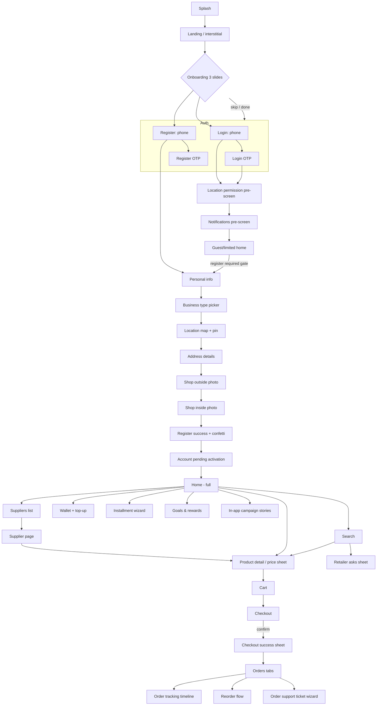

# 01 — Master Flow Map

Screen inventory reconstructed from 248 `newapp_*` analytics events (each `*_viewed` event = a real screen; each `*_clicked` = a real control), matched against Play Store screenshots and tutorial-video frames.

## Navigation shell

- **Single-activity Flutter app.** All routing inside Flutter.
- **Bottom navigation — 5 tabs** (seen in video frames): `الرئيسية` (Home) · `الموردين` (Suppliers) · center order/cart action (blue, raised) · `طلباتي` (My Orders) · `الإشعارات` (Notifications) · `الملف الشخصي`/المزيد (Profile/More). Events confirm: `bottom_navigation_cart_clicked`, `bottom_navigation_profile_clicked`, `bottom_navigation_legacy_installment_clicked`.
- Logged-out users land in a limited guest home; **post-login home is a different composition** (`postlogin_home_viewed2` vs `home_viewed`).

## Full flow graph

## Screen inventory (events → screens)

| # | Screen / surface | Proof events |
|---|---|---|
| 1 | Splash | `splash_completed`, `startup_completed`, `session_started` |
| 2 | Landing (marketing interstitial) | `landing_viewed`, `landing_cta_clicked` |
| 3 | Onboarding (3 slides) | `onboarding_screen_viewed`, `onboarding_slide_swiped`, `onboarding_skipped`, `onboarding_completed` |
| 4 | Login — phone | `login_screen_viewed`, `login_phone_entered`, `login_next_clicked`, `login_error_displayed2`, `login_failed`, `login_contact_call_clicked`, `login_contact_chat_clicked` |
| 5 | Login — OTP | `login_otp_screen_viewed`, `login_otp_entered`, `login_otp_resend_clicked`, `login_otp_verification_result2` |
| 6 | Registration — phone + start | `registration_screen_viewed`, `registration_phone_entered`, `registration_next_clicked`, `registration_error_displayed` |
| 7 | Registration — OTP | `registration_otp_viewed`, `registration_otp_entered`, `registration_otp_submitted`, `registration_otp_verification_result` |
| 8 | Registration — personal info | `register_personal_info_viewed2`, `register_personal_info_changed`, `register_personal_info_error`, `reg_personal_info_next_clicked` |
| 9 | Registration — business type | `register_business_type_viewed2`, `register_business_type_selected`, `reg_business_type_search_used2`, `reg_business_type_next_clicked` |
| 10 | Registration — location map | `register_location_map_viewed`, `register_location_pin_moved`, `register_location_search_used2`, `reg_location_auto_position_used`, `register_location_next_clicked` |
| 11 | Registration — address details | `register_address_details_viewed`, `register_address_details_changed`, `register_address_details_error`, `reg_address_details_next_clicked` |
| 12 | Registration — shop outside photo | `reg_outside_photo_viewed/take_clicked/captured/upload_started/upload_result/help_clicked/help_viewed/help_closed/skipped/next_clicked`, `reg_out_photo_help_viewed` |
| 13 | Registration — shop inside photo | same set with `inside` |
| 14 | Registration — success | `register_success_screen_viewed`, `register_success_cta_clicked`, `registration_success` |
| 15 | Post-login registration gate | `postlogin_register_required`, `postlogin_register_action_clicked` |
| 16 | Post-reg existing account conflict | `postreg_existing_account`, `postreg_existing_action_clicked` |
| 17 | Location permission pre-screen | `location_permission_screen_viewed`, `location_permission_cta_clicked`, `location_perm_option_selected2`, `location_permission_result` |
| 18 | Notifications pre-screen | `notifications_permission_screen_viewed`, `notifications_permission_cta_clicked`, `notifications_permission_result`, `notifications_system_prompt_shown` |
| 19 | Forced update | `forced_update_screen_viewed`, `forced_update_cta_clicked`, `update_install_detected`, `update_redirect_result` |
| 20 | Home (guest + full) | `home_viewed`, `postlogin_home_viewed2`, sections below |
| 21 | Home — banners | `banner_impression`, `banner_clicked`, `banner_swiped2`, `home_page_default_banner` flag |
| 22 | Home — categories section | `home_categories_section_viewed`, `home_category_clicked2`, `home_all_categories_clicked`, `home_supplier_categories_scrolled` |
| 23 | Home — offers section | `home_offers_section_viewed`, `home_all_offers_clicked`, `home_product_offer_clicked` |
| 24 | Home — orders widget | `home_orders_section_viewed`, `home_all_orders_clicked` |
| 25 | Home — sponsored suppliers | `sponsored_suppliers_section_viewed`, `sponsored_supplier_card_clicked`, `sponsored_suppliers_view_all_clicked` |
| 26 | In-app campaign story (full-screen) | `communication_campaign_in_app_story_viewed`, `..._slide_viewed`, `..._cta_tapped`, `..._dismissed2` |
| 27 | Announcement screen | `announcement_screen_viewed`, `announcement_cta_clicked` |
| 28 | Search | `search_field_tapped`, `search_executed`, `search_result_clicked2` |
| 29 | Suppliers list | `suppliers_list_viewed2`, `suppliers_search_clicked/executed/result_clicked`, `suppliers_filter_selected` |
| 30 | Supplier page (tabs/categories/brands) | `supplier_page_viewed`, `supplier_offers_tab_clicked`, `supplier_category_viewed`, `supplier_root_category_dropdown_opened/switched`, `supplier_brand_filter_clicked2/scrolled`, `supplier_all_brands_clicked`, `supplier_all_products_clicked2`, `supplier_page_pagination_loaded`, `supplier_favorite_toggled`, `supplier_search_tapped`, `supplier_offer_carousel_viewed`, `supplier_max_discount_card_viewed/clicked` |
| 31 | Product card / detail | `product_info_impression`, `product_info_clicked` |
| 32 | Product price sheet (multi-supplier price) | `product_price_sheet_viewed`, `product_price_sheet_closed` |
| 33 | Product suppliers screen | `product_suppliers_viewed`, class `ProductSuppliersScreen` |
| 34 | Cart | `cart_initiated`, `cart_item_added`, `cart_item_quantity_updated`, `cart_item_removed`, `cart_first_supplier_added`, `cart_price_change_seen`, `cart_price_change_action`, `cart_auto_adjustment_applied/clicked`, `cart_unavailable_item_viewed/removed2`, `cart_requirements_status_changed`, `cart_abandoned` (+`ABANDONED_CART_TIMEOUT_DURATION_HOURS`), `cart_cashback_banner_viewed` |
| 35 | Same-product unit conflict dialog | `same_product_unit_conflict_viewed/replace_clicked/dismissed` |
| 36 | Checkout | `checkout_viewed`, `checkout_summary_viewed`, `checkout_address_viewed`, `checkout_payment_block_viewed2`, `checkout_payment_method_selected`, `checkout_wallet_toggled`, `checkout_wallet_amount_edited2`, `checkout_preferred_date_block_viewed/opened/selected`, `checkout_products_details_expanded/collapsed`, `checkout_notes_submitted`, `checkout_confirm_order_clicked`, `checkout_success`, `checkout_blocked` |
| 37 | Orders (tabs: current/confirmed/past) | order list + `reorder_*`, `ost_*`; tabs seen in ps5 |
| 38 | Order tracking timeline | `timeline_list` package + "متابعة الطلبية" strip in ps5 |
| 39 | Reorder flow | `reorder_cta_clicked`, `reorder_confirmation_sheet_viewed`, `reorder_product_selection_toggled`, `reorder_results_viewed`, `reorder_supplier_selected` + `OrderReorderScreen` |
| 40 | Order support ticket (OST wizard) | `ost_sheet_viewed`, `ost_type_selected`, `ost_step1_next_clicked`, `ost_step2_viewed`, `ost_photo_added`, `ost_submit_clicked`, `ost_submitted2`, `ost_failed`, `ost_cooldown_shown`, `ost_expired_window_shown`, `ost_success_dismissed2`, `ost_already_submitted2` |
| 41 | Retailer asks (request missing product) | `retailer_asks_sheet_opened`, `retailer_asks_submitted`, `retailer_asks_shortcut_from_no_results` (+ overlay flags: `RETAILER_ASKS_OVERLAY_VERSION`, `RETAILER_ASKS_BANNER_MIN_QUERY_LENGTH`, `RETAILER_ASKS_OVERLAY_REGISTRATION_DELAY_DAYS`) |
| 42 | Wallet | `wallet_clicked`, `viewWallet`, `legacyWalletTopUp` + strings (شحن المحفظة، تاريخ معاملات المحفظة، حدود استخدام المحفظة) |
| 43 | Installments / BNPL wizard | `installment_wizard_step_viewed`, `installment_activation_requested`, `installment_activation_request_failed2`, `installment_activation_pending_viewed2` + strings (ادفع على دفعات، اختر خطة الدفع، تأكيد التقسيط، طلب تقسيط الآن) |
| 44 | Payments section | `payments_section_viewed` |
| 45 | Rewards / goals | `goals_widget_clicked` + strings (برافو! وصلت لأول مكافأة، تم الوصول للهدف، لا توجد أهداف منتهية الصلاحية) |
| 46 | Ramadan quiz | `rmdn_quiz_home_banner_click/impression`, `rmdn_quiz_screen_view2`, `rmdn_quiz_screen_answer_correct/wrong2`, `rmdn_quiz_screen_day_click`, `rmdn_quiz_profile_cta_click` |
| 47 | Eid campaigns | `eid_al_adha_banner_tapped`, `eid_al_adha_scratch_opened`, `eid_al_adha_box_picked`, `eid_al_adha_gift_redeemed`, `eid_al_fetr_story_*` |
| 48 | Notifications center | "لا توجد إشعارات"، "ستظهر إشعاراتك هنا عند وصولها" |
| 49 | Profile | `bottom_navigation_profile_clicked` |
| 50 | Empty states | `empty_placement` |
| 51 | Cashback banner (cart) | `cart_cashback_banner_viewed` + "كاش باك" strings |
| 52 | Supplier showcase (home) | `SupplierShowcaseCard2`, `SupplierShowcaseCartCTA`, `SUPPLIER_SHOWCASE_*` flags |

## Global behaviors

- **Auth-gated everything beyond home; registration-gated ordering.** `postlogin_register_required` shows the full funnel can be browsed first, then gated at order time ("register to continue").
- **Abandoned-cart recovery** with configurable timeout hours + cart sync interval (multi-device cart sync via `CARTS_SYNC_INTERVAL_SECONDS`).
- **Forced/soft update system** (`LATEST_APP_VERSION`, `MINIMUM_APP_VERSION`, `UPDATE_CHECK_INTERVAL_MINUTES`) with its own screen.
- **Contact-support always one tap away** on login and registration screens (`login_contact_call/chat`, `register_contact_call/chat`) — a call button and a Freshchat chat button.
- **Session expiry** handled with a dedicated message ("انتهت صلاحية الجلسة").
- **Offline state**: "أنت غير متصل بالإنترنت" banner.
