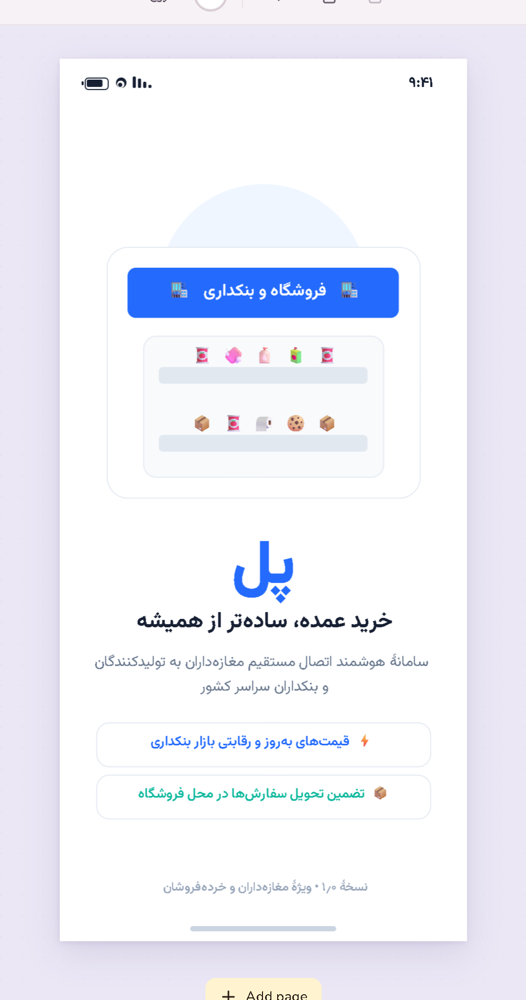
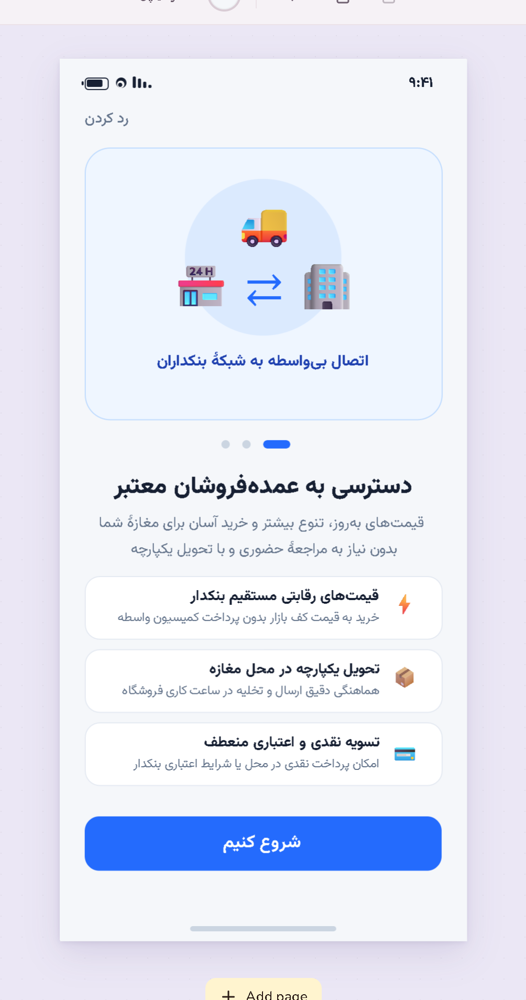
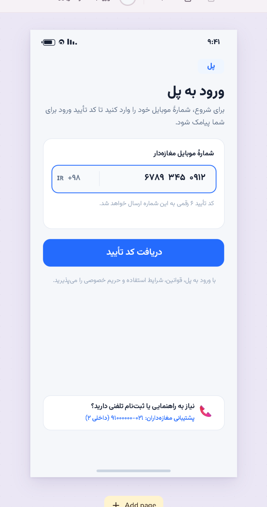
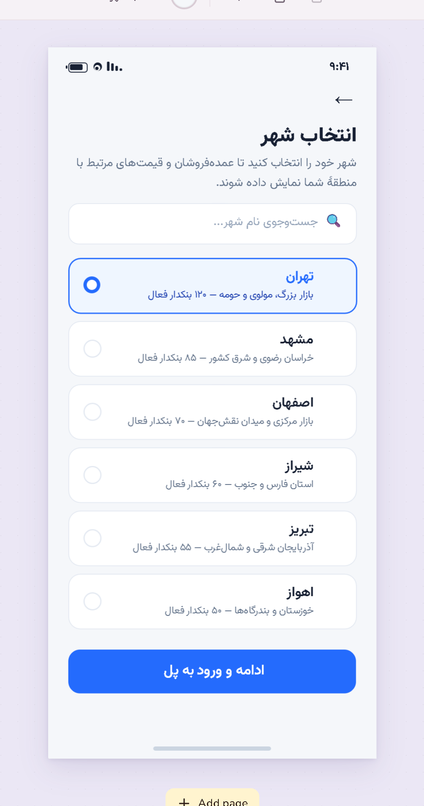
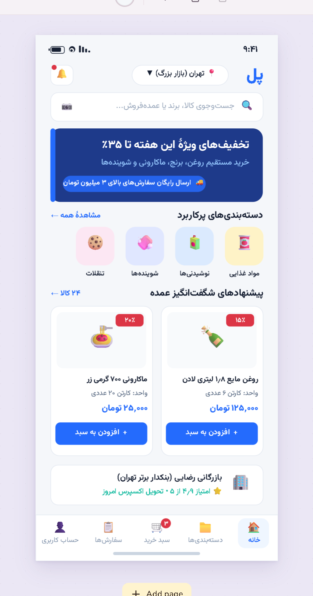
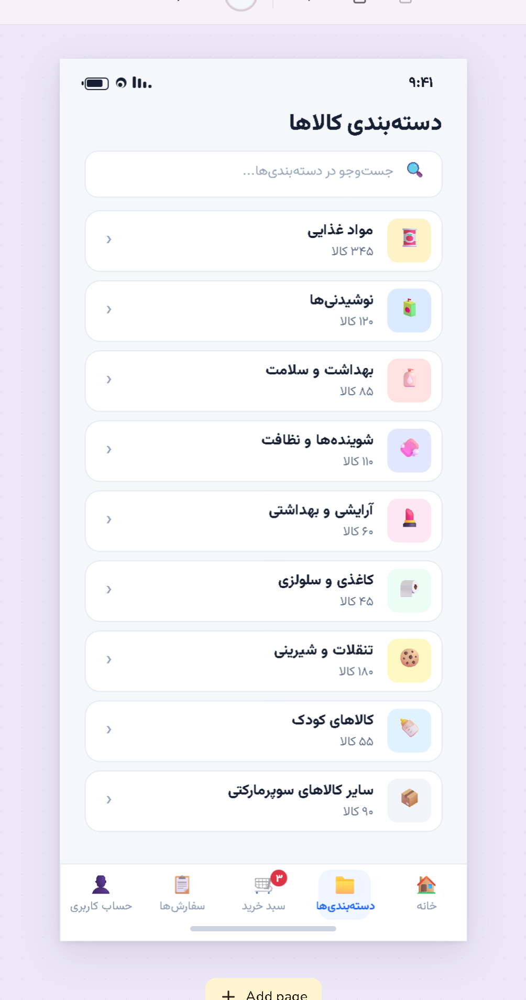

# طراحی رابط کاربری اپلیکیشن مغازه‌داران «پل» — نسخهٔ ۰۱
## Pol Retailer B2B FMCG Mobile Application — Design System & Screen Deliverables

این پوشه شامل کلیهٔ مستندات، فایل‌های داده‌ای لایه‌بندی‌شده (JSON)، کدهای اتوماسیون و خروجی‌های تصویری باکیفیت بالا از **۱۰ صفحهٔ اصلی اپلیکیشن مغازه‌داران «پل»** است که با ابزار محلی Doory پیاده‌سازی شده است.

---

## 🖼️ پیش‌نمایش تابلوی ارائه‌ای ۱۰ صفحه (Overview Board)


---

## 📱 گالری تصویری ۱۰ صفحهٔ اصلی

| ۱. شروع (Splash) | ۲. معرفی اپلیکیشن (Onboarding) | ۳. ورود با موبایل (Login OTP) | ۴. تأیید شماره (OTP Verify) | ۵. انتخاب شهر (City Select) |
|:---:|:---:|:---:|:---:|:---:|
|  |  |  |  |  |

| ۶. صفحهٔ اصلی (Home) | ۷. دسته‌بندی‌ها (Categories) | ۸. فهرست محصولات (Product List) | ۹. جزئیات محصول (Product Detail) | ۱۰. سبد خرید (Cart) |
|:---:|:---:|:---:|:---:|:---:|
|  |  |  |  |  |

---

## 🎨 پالت رنگی و استانداردهای طراحی (Design Tokens)

- **آبی اصلی برند (Primary):** `#246BFD` (کنتراست ۵٫۲:۱ با سفید)
- **سطح کارت‌ها (Surface):** `#FFFFFF`
- **پس‌زمینه عمومی (Background):** `#F5F7FA`
- **متن اصلی (Text Primary):** `#172033` (کنتراست ۱۲٫۸:۱)
- **متن ثانویه (Text Secondary):** `#64748B`
- **حاشیه‌ها و جداکننده‌ها (Border):** `#E5EAF2`
- **موفقیت و موجودی (Success):** `#0DB89D`
- **خطا و حذف (Danger):** `#DC3545`
- **تایپوگرافی:** قلم استاندارد **وزیرمتن (Vazirmatn)**، جهت ۱۰۰٪ راست‌به‌چپ (`RTL`)، ارقام فارسی (`۰۱۲۳۴۵۶۷۸۹`) و رعایت دقیق نیم‌فاصله.
- **ابعاد بوم مبنا:** `390 × 844` پیکسل (مبنای استاندارد موبایل مدرن).

---

## 📂 ساختار فایل‌ها در این دایرکتوری

```text
POL_RETAILER_APP_DOORY_DESIGN_V01/
├── README.md                          # همین راهنما و گالری پرزنتیشن
├── docs/                              # مستندات و گزارش‌های تفصیلی
│   ├── 01_گزارش_جامع_طراحی.md         # گزارش کامل مراحل، لاگ‌ها و وضعیت صفحات
│   ├── 02_راهنمای_سیستم_طراحی_پل.md   # سند مهندسی توکن‌ها، پالت رنگ و تایپوگرافی
│   ├── 03_راهنمای_استفاده_از_الگو.md  # دستورالعمل تکثیر و ساخت صفحات تازه
│   ├── 04_فهرست_اسکیلهای_پروژه.md     # گزارش ارزیابی اسکیل‌ها و ابزارها
│   └── 05_گزارش_کنترل_کیفی_فارسی_RTL.md # کارنامهٔ آزمون لِینتر فارسی (صفر خطا)
├── images/                            # تصاویر PNG رتینا با کیفیت بالا
│   ├── 01_صفحه_شروع_Splash.png
│   ├── ...
│   ├── 10_سبد_خرید_Cart.png
│   └── نمای_کلی_ده_صفحه_Overview_Board.png
├── json/                              # سورس داده‌ای لایه‌ها (قابل ایمپورت به ادیتور)
│   ├── پروژه_اصلی_اپلیکیشن_پل.json     # مستر ۱۲ صفحه‌ای
│   ├── نمای_کلی_ده_صفحه.json          # بوم پرزنتیشن ۲۲۰۰x۱۴۵۰
│   └── الگوی_پایه_پروژه_پل.json       # قالب گالری Templates
└── scripts/                           # اسکریپت‌های اتوماسیون پایتون
    ├── design_builder_tokens.py       # تعاریف هندسی و توکن‌ها
    ├── build_pol_pages.py             # بیلدر ۱۰ صفحهٔ موبایل
    ├── build_pol_system_pages.py      # بیلدر صفحات دیزاین‌سیستم و کامپوننت‌ها
    ├── build_pol_overview_board.py    # بیلدر پوستر پرزنتیشن
    ├── generate_all_pol_deliverables.py # جنریتور مستر در دیتابیس Doory
    ├── export_all_pages_png.py        # اکسپورتر اسکرین‌شات با Playwright
    └── qa_checker.py                  # لِینتر اعتبارسنجی فارسی و RTL
```

---

## 🛠️ راهنمای اعضای تیم برای بازگشایی و ویرایش در Doory

اعضای تیم فنی و طراحی می‌توانند با روش‌های زیر به طرح‌ها دسترسی داشته باشند:

### ۱. دسترسی مستقیم از طریق مرورگر (در محیط لوکال با سرویس فعال Doory)
- **پروژهٔ مستر ۱۲ صفحه‌ای:** `http://localhost:5173/design/e0000000-0000-4000-8000-000000000001`
- **بوم نمای کلی ده صفحه:** `http://localhost:5173/design/e0000000-0000-4000-8000-000000000002`
- **صفحات مستقل ۱ تا ۱۰:** با شناسه‌های `d1000000-0000-4000-8000-000000000001` تا `d1000000-0000-4000-8000-000000000010`.

### ۲. واردسازی فایل‌های JSON به محیط Doory دیگر
هر یک از فایل‌های موجود در پوشهٔ `json/` را می‌توان با دستور زیر در بک‌اند Doory بارگذاری کرد:
```powershell
python manage.py import_template "path/to/الگوی_پایه_پروژه_پل.json" --publish --create-categories
```

### ۳. اجرای مجدد اسکریپت‌های تولید و کنترل کیفیت
```powershell
# بررسی خودکار کیفیت متن‌های فارسی و عدم نشت لاتین
python scripts/qa_checker.py json/پروژه_اصلی_اپلیکیشن_پل.json

# ساخت مجدد تمام خروجی‌ها در دیتابیس
python scripts/generate_all_pol_deliverables.py
```
