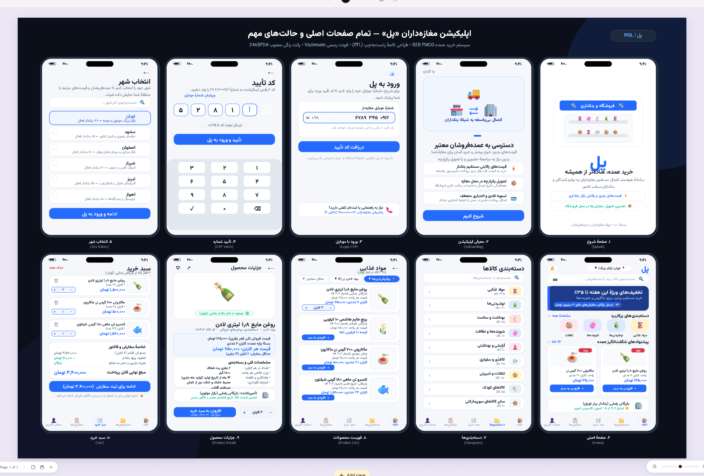
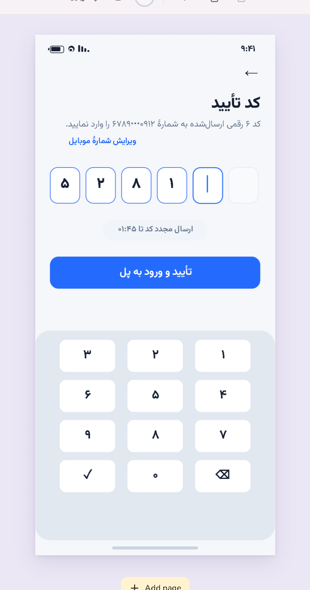
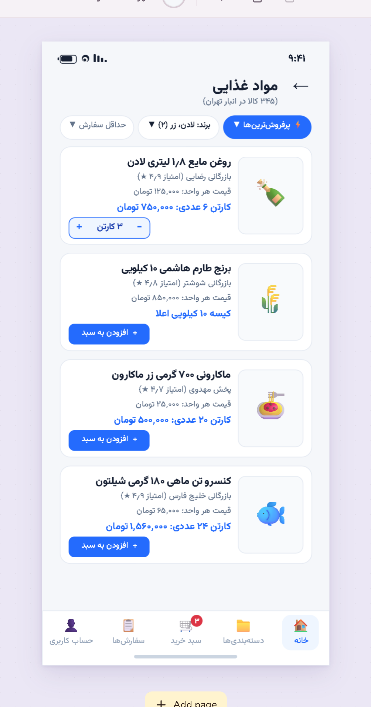
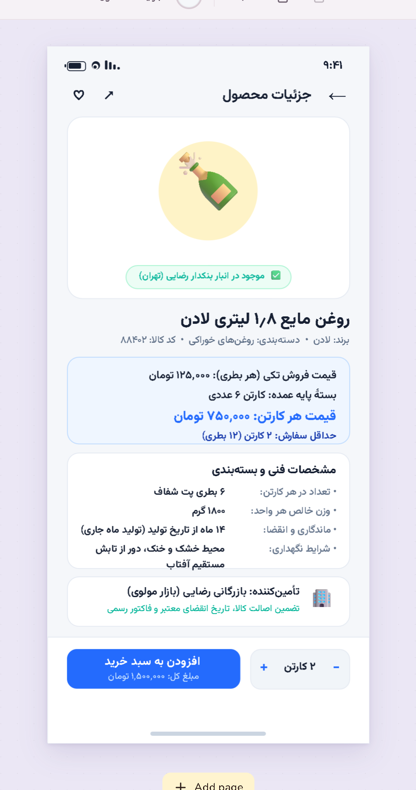
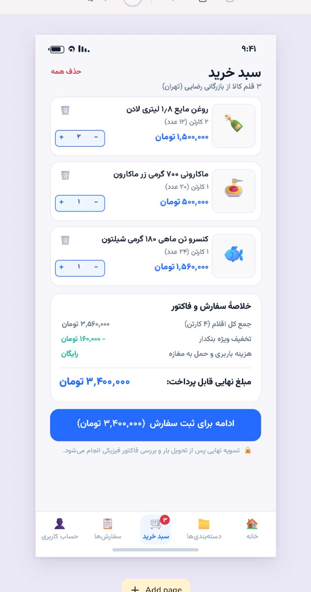

# طراحی رابط کاربری اپلیکیشن مغازه‌داران «پل» — نسخهٔ ۰۱
## Pol Retailer B2B FMCG Mobile Application — Design System & Screen Deliverables

این پوشه شامل کلیهٔ مستندات، فایل‌های داده‌ای لایه‌بندی‌شده (JSON)، کدهای اتوماسیون، شواهد آزمون و خروجی‌های تصویری باکیفیت بالا از **۱۰ صفحهٔ اصلی اپلیکیشن مغازه‌داران «پل»** است که منطبق بر طراحی مرجع محلی سیستم تدوین شده است.

---

## 🖼️ پیش‌نمایش تابلوی ارائه‌ای ۱۰ صفحه (Overview Board)


*(تصویر بوم پرزنتیشن ۲۲۰۰×۱۴۵۰ پیکسل با پس‌زمینه تیره و چیدمان شکیل ده صفحه کنار یکدیگر)*

---

## 📱 گالری تصویری ۱۰ صفحهٔ اصلی اپلیکیشن مغازه‌داران

| ۱. شروع (Splash) | ۲. معرفی اپلیکیشن (Onboarding) | ۳. ورود با موبایل (Login OTP) | ۴. تأیید شماره (OTP Verify) | ۵. انتخاب شهر (City Select) |
|:---:|:---:|:---:|:---:|:---:|
|  |  |  |  |  |
| [مشاهده با کیفیت کامل](images/01_صفحه_شروع_Splash.png) | [مشاهده با کیفیت کامل](images/02_معرفی_پل_Onboarding.png) | [مشاهده با کیفیت کامل](images/03_ورود_با_موبایل_Login.png) | [مشاهده با کیفیت کامل](images/04_تأیید_شماره_OTP.png) | [مشاهده با کیفیت کامل](images/05_انتخاب_شهر_City.png) |

| ۶. صفحهٔ اصلی (Home) | ۷. دسته‌بندی‌ها (Categories) | ۸. فهرست محصولات (Product List) | ۹. جزئیات محصول (Product Detail) | ۱۰. سبد خرید (Cart) |
|:---:|:---:|:---:|:---:|:---:|
|  |  |  |  |  |
| [مشاهده با کیفیت کامل](images/06_صفحه_اصلی_Home.png) | [مشاهده با کیفیت کامل](images/07_دسته‌بندی_کالاها_Categories.png) | [مشاهده با کیفیت کامل](images/08_فهرست_محصولات_Products.png) | [مشاهده با کیفیت کامل](images/09_جزئیات_محصول_Detail.png) | [مشاهده با کیفیت کامل](images/10_سبد_خرید_Cart.png) |

---

## 🎨 پالت رنگی و استانداردهای طراحی (Design Tokens)

- **آبی اصلی برند (Primary):** `#246BFD` (کنتراست عالی با سفید)
- **سطح کارت‌ها (Surface):** `#FFFFFF`
- **پس‌زمینه عمومی (Background):** `#F5F7FA`
- **متن اصلی (Text Primary):** `#172033` (کنتراست ۱۲٫۸:۱)
- **متن ثانویه (Text Secondary):** `#64748B`
- **حاشیه‌ها و جداکننده‌ها (Border):** `#E5EAF2`
- **موفقیت و موجودی انبار (Success):** `#0DB89D`
- **تخفیف ویژه و پله‌های قیمتی (Warning/Promo):** `#F59E0B`
- **خطا و حذف (Danger):** `#DC3545`
- **تایپوگرافی:** قلم استاندارد **وزیرمتن (Vazirmatn)**، جهت ۱۰۰٪ راست‌به‌چپ (`RTL`)، ارقام فارسی (`۰۱۲۳۴۵۶۷۸۹`) و رعایت دقیق نیم‌فاصله.
- **ابعاد بوم مبنا:** `390 × 844` پیکسل (مبنای استاندارد موبایل مدرن).

---

## 📂 ساختار فایل‌های منطبق با مرجع محلی

```text
POL_RETAILER_APP_DOORY_DESIGN_V01/
├── README.md                          # معرفی کامل و گالری پرزنتیشن
├── TEAM_HANDOFF_GUIDE.md              # راهنمای جامع دسترسی و تحویل تیم
├── docs/                              # مستندات و گزارش‌های تفصیلی مرجع محلی
│   ├── گزارش اجرای طراحی.md           # گزارش جامع روند اجرا، لاگ‌ها و تصمیمات فنی
│   ├── راهنمای سیستم طراحی پل.md      # سند مهندسی توکن‌ها، پالت رنگ و تایپوگرافی
│   ├── راهنمای استفاده از الگو.md     # دستورالعمل استفاده از تمپلیت در Doory
│   ├── فهرست اسکیل‌های پروژه.md       # فهرست کامل و قابلیت‌های اسکیل‌های محلی
│   └── گزارش_کنترل_کیفی_فارسی_RTL.md  # کارنامهٔ رسمی آزمون لینتر فارسی (صفر خطا)
├── images/                            # تصاویر PNG رتینا با کیفیت بالا (نام‌های محلی و نام‌های مکمل)
│   ├── 01_صفحه_شروع_Splash.png (و page_01_splash_welcome.png)
│   ├── ...
│   ├── 10_سبد_خرید_Cart.png (و page_10_cart_checkout.png)
│   └── نمای_کلی_ده_صفحه_Overview_Board.png (و pol_retailer_app_overview_10_screens.png)
├── json/                              # سورس داده‌ای لایه‌ها (قابل بارگذاری در ادیتور Doory)
│   ├── پروژه_اصلی_اپلیکیشن_پل.json     # سند مستر ۱۲ صفحه‌ای
│   ├── نمای_کلی_ده_صفحه.json          # بوم پرزنتیشن ۲۲۰۰x۱۴۵۰
│   └── الگوی_پایه_پروژه_پل.json       # قالب گالری Templates
├── scripts/                           # اسکریپت‌های اتوماسیون، اعتبارسنجی و ایمپورت
│   ├── design_builder_tokens.py       # تعاریف هندسی و توکن‌ها
│   ├── build_pol_pages.py             # بیلدر ۱۰ صفحهٔ موبایل
│   ├── build_pol_system_pages.py      # بیلدر صفحات دیزاین‌سیستم و کامپوننت‌ها
│   ├── build_pol_overview_board.py    # بیلدر پوستر پرزنتیشن
│   ├── generate_all_pol_deliverables.py # جنریتور مستر در دیتابیس Doory
│   ├── export_all_pages_png.py        # اکسپورتر اسکرین‌شات با Playwright
│   └── qa_checker.py                  # لِینتر اعتبارسنجی فارسی و RTL
└── شواهد-آزمون-فارسی/                 # شواهد مستند آزمون تعاملی مرورگر زنده
    ├── ۱-نمایش-اولیه-متن-فارسی.png
    ├── ۲-انتخاب-کادر-متن.png
    ├── ۳-ویرایش-و-درج-متن.png
    ├── ۴-ماندگاری-پس-از-بارگذاری-مجدد.png
    ├── ۵-دکمه-با-پس‌زمینه-آبی-کنتراست-4.57.png
    ├── گزارش-کنترل-فارسی.txt
    ├── متن‌های-استخراجی.json
    └── snapshot-original.json
```

---

## 🛠️ راهنمای اعضای تیم برای بازگشایی و ویرایش در Doory

اعضای تیم فنی و طراحی می‌توانند با روش‌های زیر به طرح‌ها دسترسی داشته باشند:

### ۱. دسترسی مستقیم از طریق مرورگر (در محیط لوکال با سرویس فعال Doory)
- **پروژهٔ مستر ۱۲ صفحه‌ای:** `http://localhost:5173/design/e0000000-0000-4000-8000-000000000001`
- **بوم نمای کلی ده صفحه:** `http://localhost:5173/design/e0000000-0000-4000-8000-000000000002`
- **صفحات مستقل ۱ تا ۱۰:** با شناسه‌های `d1000000-0000-4000-8000-000000000001` تا `d1000000-0000-4000-8000-000000000010`.

### ۲. واردسازی فایل‌های JSON به محیط Doory دیگر
هر یک از فایل‌های موجود در پوشهٔ `json/` را می‌توان با اسکریپت یا دستور زیر در بک‌اند Doory بارگذاری کرد:
```powershell
python scripts/generate_all_pol_deliverables.py
```
یا از طریق دستور مدیریت جنگو:
```powershell
python manage.py import_template "json/الگوی_پایه_پروژه_پل.json" --publish --create-categories
```

### ۳. بررسی خودکار کیفیت زبان فارسی و RTL
```powershell
python scripts/qa_checker.py json/پروژه_اصلی_اپلیکیشن_پل.json
```
*(نتیجه آزمون: ۰ خطا، کاملاً منطبق با اصول نگارش فارسی ایران و استانداردهای RTL)*
