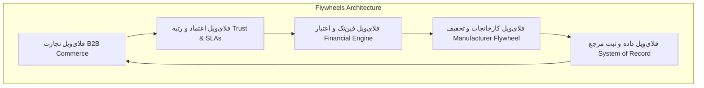
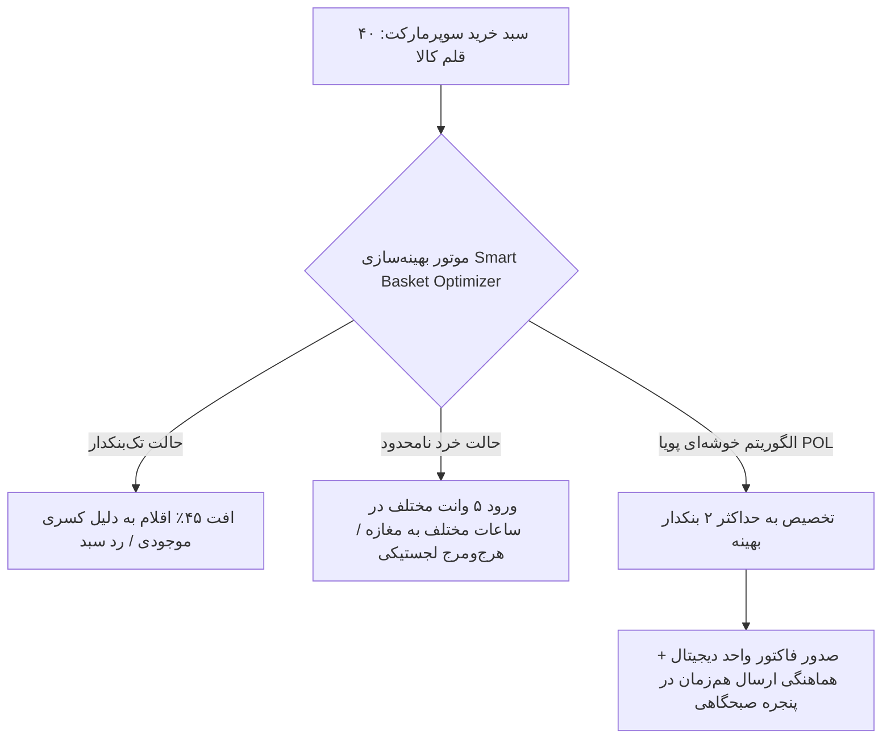
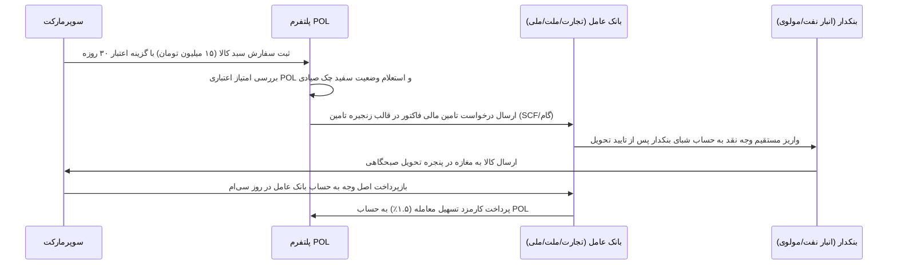

# گزارش پژوهش راهبردی و بنچ‌مارک جامع پلتفرم POL (پُل)
## تحلیل ساختاری دیجیتالی‌سازی توزیع FMCG و تجارت B2B در بازارهای نوظهور و طراحی تز استراتژیک برای بازار ایران

> **تاریخ گزارش:** سپتامبر ۲۰۲۶  
> **وضعیت بنچ‌مارک‌ها:** به‌روزشده با آخرین ادغام‌ها، راندهای مالی، ورشکستگی‌ها و تغییرات ساختاری تا نیمه ۲۰۲۶  
> **چهارچوب متدولوژی:** Hyperresearch V8 Institutional Pipeline — Comprehensive Synthesis  
> **نقش تدوین‌کننده:** استراتژیست ارشد B2B، پژوهشگر ساختار بازار، تحلیل‌گر فین‌تک و منتور/هم‌بنیان‌گذار (Co-founder Mindset)

---

## فهرست بخش‌های ۳۰‌گانه گزارش

- **بخش اول: چشم‌انداز، تز راهبردی و سیستم محرک‌ها**
  - بخش ۱: خلاصه مدیریتی و تصویر افق ۱۰ ساله پُل
  - بخش ۲: تز استراتژیک محوری (The Rumelt Strategic Thesis)
  - بخش ۳: معماری پنج فلای‌ویل (The 5 Flywheels Architecture)
- **بخش دوم: تحلیل کالبدشکافی و بنچ‌مارک‌های جهانی (۲۸ شرکت در ۴ گروه)**
  - بخش ۴: تحلیل گروه A — پلتفرم‌های شاخص و موفق (Cartona, OmniRetail, Bazaar, GrowSari, ShopUp, Chari, Jumbotail, Tajir)
  - بخش ۵: تحلیل گروه B — پلتفرم‌های ثانویه و تخصصی (Sary/SILQ, Telio, VinShop, Dastgyr, PriyoShop, ElasticRun, TradeDepot, Sabi, Ralali, GudangAda)
  - بخش ۶: تحلیل گروه C — کالبدشکافی شکست‌ها و بحران‌های عبرت‌آموز (Wasoko/MaxAB, Capiter, Udaan, MarketForce, Ula, Retailo)
  - بخش ۷: تحلیل گروه D — پلتفرم‌های کشف‌شده پیرامونی (Chiper, Frubana, Arogga)
- **بخش سوم: تحلیل‌های عمیق موضوعی و ماتریس‌های ساختاری**
  - بخش ۸: تحلیل عمیق Asset-Light در برابر 1P و مدل مالی وارونگی حاشیه سود
  - بخش ۹: مدل فیجیتال (Phygital)، چرخه عمر نیروی میدانی و منحنی گذار ۹۰ روزه
  - بخش ۱۰: الگوریتم تخصیص سبد خرید (Cart Allocation) و مسیریابی خوشه‌ای پویا
  - بخش ۱۱: معماری ضد دور زدن پلتفرم (Anti-Disintermediation) و ۷ خندق دفاعی ساختاری
  - بخش ۱۲: مکانیزم‌های اعتماد، اعتبارسنجی بنکدار و تضمین سطح خدمات (SLA)
  - بخش ۱۳: فین‌تک تعبیه‌شده، اعتبار در گردش و معماری چک صیادی
  - بخش ۱۴: شبکه داده و سیستم ثبت مرجع (System of Record) و درآمدزایی از برندها
  - بخش ۱۵: الگوریتم‌های کشف، جستجو و رتبه‌بندی کالا
  - بخش ۱۶: تکامل مدل‌های درآمدی و لایه‌های پنج‌گانه حاشیه سود ناخالص
  - بخش ۱۷: ماتریس تمایز فیچر (Feature) از خندق اقتصادی پایدار (Moat)
- **بخش چهارم: ساختار بازار ایران و نقشه راه اجرایی POL**
  - بخش ۱۸: نقشه‌برداری ساختاری اکوسیستم FMCG و شبکه بنکداران ایران (مولوی، انبار نفت، پخش سراسری)
  - بخش ۱۹: شاخص تطبیق‌پذیری ایران (Iran Comparability Index) بر پایه ۱۲ مولفه
  - بخش ۲۰: معماری رگولاتوری، سامانه مودیان، شفافیت مالیاتی و چک صیادی
  - بخش ۲۱: پلی‌بوک نقدینگی و پرتاب اولیه (Cold-Start Playbook) در کلاسترهای منطقه ۲ و ۴ تهران
  - بخش ۲۲: نقشه راه گذار فیجیتال و توسعه جغرافیایی از تهران تا کلان‌شهرها
  - بخش ۲۳: مشخصات فنی و الگوریتمی Smart Basket Optimizer
  - بخش ۲۴: بلوپرینت شراکت بانکی و اعطای خطوط اعتباری خرید به سوپرمارکت‌ها
  - بخش ۲۵: نقشه راه تبدیل شدن به System of Record و شاخص بازار FMCG ایران
  - بخش ۲۶: سنجش انتقادی ۱۵ باور غلط و کشنده در دیجیتالی‌سازی FMCG
  - بخش ۲۷: سنتز الگوهای جهان‌شمول در بازارهای نوظهور (۸ اصل بنیادین)
  - بخش ۲۸: ماتریس تصمیمات استراتژیک ۱۳‌گانه POL
  - بخش ۲۹: تنش‌های کلیدی میان شواهد و جمع‌بندی داوری‌ها
  - بخش ۳۰: رجیستر منابع و اسناد مرجع (Tier 1 تا Tier 4)
- **بخش پنجم: خروجی‌های ویژه و ۱۰ سند اجرایی مستقل**
  - سند ویژه ۱: ۱۰ درس کلیدی از تجربه جهانی
  - سند ویژه ۲: ۱۰ کاری که POL هرگز نباید انجام دهد
  - سند ویژه ۳: ۱۰ مزیت استراتژیک POL در مقایسه با بازیگران سنتی و رقبا
  - سند ویژه ۴: ۱۰ ریسک بزرگ POL و راهکارهای مهار آن
  - سند ویژه ۵: ۱۰ سوال کلیدی بی‌پاسخ برای آزمایش در بازار واقعی
  - سند ویژه ۶: ۵ بنچ‌مارک برتر جهانی برای الگوبرداری
  - سند ویژه ۷: ۵ شکست آموزنده جهانی برای پرهیز
  - سند ویژه ۸: پایدارترین خندق‌های دفاعی بر اساس دشواری کپی‌برداری
  - سند ویژه ۹: تز استراتژیک پیشنهادی نهایی POL
  - سند ویژه ۱۰: هویت مرزی POL — چه چیزی هستیم و چه چیزی نباید بشویم

---
## Executive Summary

### افق ۱۰ ساله پُل (The 10-Year Destination)
[[pol-core-strategic-thesis]], [[pol-5-flywheels-architecture]]

پروژه **POL (پُل)** در پاسخ به ناکارآمدی ساختاری عمیق در زنجیره تأمین خرده‌فروشی کالاهای تندمصرف (FMCG) ایران متولد شده است. در ایران سالانه بیش از ۲۵ تا ۳۵ میلیارد دلار کالای مصرفی در سطح ۳۵۰٬۰۰۰ تا ۴۰۰٬۰۰۰ سوپرمارکت سنتی توزیع می‌شود که بیش از ۷۸ تا ۸۲ درصد آن همچنان از طریق کانال سنتی جریان دارد. با این حال، تمام تلاش‌های گذشته استارتاپی برای دیجیتالی‌سازی این زنجیره در ایران یا به دلیل کپی‌برداری خام از مدل‌های لجستیک‌محور B2C شکست خورده‌اند، یا در حد اپلیکیشن‌های کم‌عمق آگهی و دایرکتوری متوقف مانده‌اند.

### ۱. تصویر افق ۱۰ ساله پُل (۲۰۲۶ - ۲۰۳۶):
POL در افق ۱۰ ساله به:
1. **زیرساخت دیجیتال تجارت و توزیع B2B ایران (The Digital Operating System of Iranian B2B Commerce)** تبدیل می‌شود.
2. **سیستم ثبت مرجع و منبع حقیقت (System of Record / Source of Truth)** برای کارخانجات تولیدی FMCG (کاله، میهن، گلرنگ، پگاه، زر ماکارون)، بانک‌های کشور و رگولاتور بدل خواهد شد.
3. هیچ دارایی فیزیکی شامل انبار، کامیون یا موجودی کالایی در ترازنامه POL ثبت نخواهد شد؛ ارزش سازمان از **عمق نفوذ نرم‌افزاری، کنترل جریان پرداخت و داده، و اورکستریشن لجستیک سنتی** مشتق می‌شود.

### ۲. فلسفه عدم مالکیت (Asset-Light Mandate):
کالبدشکافی ۲۸ بنچ‌مارک جهانی نشان می‌دهد که تصاحب انبار و ناوگان حمل (مدل 1P) در بازارهای نوظهور با تورم بالا، فرمول قطعی نابودی سرمایه است. پلتفرم‌هایی نظیر Wasoko، MaxAB، Udaan و Capiter که صدها میلیون دلار را صرف اجاره انبارهای بزرگ و خرید ناوگان کردند، با افت حاشیه سود ناخالص به زیر ۳ تا ۵ درصد و هزینه‌های عملیاتی ۸ تا ۱۲ درصدی مواجه شده و تا سال‌های ۲۰۲۴ تا ۲۰۲۶ ورشکست، ادغام اجباری، یا مشمول سقوط ۹۰ درصدی ارزش‌گذاری شدند ([[failure-autopsy-wasoko-maxab]], [[failure-autopsy-udaan-india]]). در نقطه مقابل، پلتفرم‌های صد در صد بدون دارایی نظیر OmniRetail در نیجریه و Cartona در مصر با سودآوری عملیاتی خالص (EBITDA مثبت) به رشد پایدار دست یافتند ([[benchmark-omniretail-nigeria]], [[benchmark-cartona-egypt]]).

### ۳. استراتژی توسعه متمرکز و خوشه‌ای:
POL هرگز وارد دام توسعه زودهنگام سراسری نخواهد شد. تمرکز مرحله اول منحصراً بر **یک کلاستر پرتراکم شهری در تهران (مناطق ۲ و ۴)** خواهد بود تا پس از دستیابی به نفوذ ۴۰ درصدی سوپرمارکت‌ها و سرریز جریان نقدینگی مثبت، مدل به کلان‌شهر تهران و سپس شهرهای درجه دو تعمیم یابد.

---
## 1. POL Context

### زمینه و ساختار استراتژیک POL
[[analysis-iran-fmcg-distribution-landscape]], [[pol-core-strategic-thesis]]

بر اساس متدولوژی ریچارد روملت (Richard Rumelt) در کتاب *Good Strategy/Bad Strategy*، یک استراتژی معتبر بر سه ستون استوار است: **تشخیص چالش محوری (Diagnosis)**، **سیاست راهنما (Guiding Policy)**، و **اقدامات منسجم و هماهنگ (Coherent Actions)** ([[pol-core-strategic-thesis]]).

```
+-------------------------------------------------------------------------------+
|                                  DIAGNOSIS                                    |
| 1. شکاف اعتباری و ترس از چک برگشتی میان بنکدار و سوپرمارکت                   |
| 2. ناکارآمدی و فرسودگی ویزیتوری سنتی در برابر ترافیک و هزینه ناوگان          |
| 3. فقدان دید داده‌ای Real-time برای کارخانجات تولیدی FMCG                     |
| 4. شکست مدل‌های لجستیک‌محور (1P) به دلیل وارونگی حاشیه سود در تورم بالای ۴۰٪  |
+---------------------------------------+---------------------------------------+
                                        |
                                        v
+-------------------------------------------------------------------------------+
|                               GUIDING POLICY                                  |
| POL میدل‌ور و سیستم‌عامل دیجیتال دارایی‌سبک (Asset-Light Middleware) است:     |
| توانمندسازی شبکه سنتی بنکداران به جای حذف یا رقابت با آن‌ها                    |
| تثبیت خندق‌های ۴‌گانه: سبد ترکیبی، خط اعتبار بانکی، ERP بنکدار، پروموشن برند  |
+---------------------------------------+---------------------------------------+
                                        |
                                        v
+-------------------------------------------------------------------------------+
|                              COHERENT ACTIONS                                 |
| ۱. انبردینگ ۴۰ بنکدار تراز اول انبار نفت و مولوی با نرم‌افزار رایگان انبار     |
| ۲. استقرار تیم میدانی فیجیتال در منطقه ۲ و ۴ با هدف گذار شبانه ۹۰ روزه        |
| ۳. اتصال خطوط اعتباری بانک‌های عامل با اهرم چک صیادی دیجیتال                 |
| ۴. راه‌اندازی الگوریتم Smart Basket Optimizer با سقف حداکثر ۲ دراپ تحویل     |
| ۵. عقد قراردادهای دیتای sell-out و پروموشن مستقیم با برندهای بزرگ FMCG        |
+-------------------------------------------------------------------------------+
```

### ۱. تشخیص چالش ساختاری بازار (Diagnosis):
بازار FMCG ایران از چهار بحران همزمان رنج می‌برد:
- **شکاف اعتباری و ریسک نقدینگی:** سوپرمارکت‌ها به سرمایه در گردش نیازمندند؛ بنکداران به دلیل ترس از چک‌های صیادی برگشتی به خریداران جدید نسیه نمی‌دهند.
- **فرسودگی ویزیتوری حضوری:** ویزیتورهای شرکت‌های پخش سراسری به دلیل ترافیک سنگین، هزینه‌های سوخت و پورسانت‌های بالا قادر به پوشش بهینه نیستند.
- **تله کوری کارخانجات:** برندها میلیاردها تومان خرج پروموشن می‌کنند، اما تخفیف‌ها در جیب واسطه‌ها رسوب کرده و به قفسه مغازه نمی‌رسد.
- **تله لجستیک 1P:** تلاش برای خرید کامیون و ساخت انبار مکانیزه در کالای ۳ درصد مارجین با تورم بالای ۴۰ درصد محکوم به شکست است.

### ۲. سیاست راهنما (Guiding Policy):
POL نه بنکدار است، نه شرکت پخش سراسری، و نه بانک. POL لایه میان‌افزار و مغز متفکر دیجیتال است که تقاضای خرد سوپرمارکت‌ها را تجمیع کرده، به طور هوشمند بین بنکداران موجود بهینه‌یابی نموده، تسویه حساب را از طریق اعتبارات بانکی تضمین کرده، و تله‌متری داده را به تولیدکنندگان می‌فروشد.

### ۳. اقدامات منسجم (Coherent Actions):
اجرای گام به گام پروتکل ورود به بازار در کلاسترهای منتخب تهران، اتصال زیرساخت صیاد و اوراق گام/برات الکترونیک با بانک‌های تجاری، و تجهیز بنکداران به نرم‌افزار انبارداری مبتنی بر ابر.

---
## 2. Global Benchmark Landscape

### چشم‌انداز بنچ‌مارک‌های جهانی و پویایی بازار
[[analysis-strategic-patterns-cross-market]], [[benchmark-omniretail-nigeria]]

موتور رشد و پایداری POL بر پایه ۵ فلای‌ویل درهم‌تنیده طراحی شده است که هر یک انرژی فلای‌ویل بعدی را تأمین می‌کند ([[pol-5-flywheels-architecture]]):



1. **فلای‌ویل تجارت (Commerce Flywheel):**  
   جذب بنکداران معتبر در انبار نفت و مولوی $
ightarrow$ تنوع سبد کالایی و رقابت قیمتی $
ightarrow$ جذب سوپرمارکت‌ها در کلاستر $
ightarrow$ افزایش تراکم سفارش‌ها در هر محله $
ightarrow$ کاهش هزینه ارسال و لجستیک خرد $
ightarrow$ سودآوری بیشتر برای بنکداران $
ightarrow$ ورود بنکداران بیشتر.
2. **فلای‌ویل اعتماد و پایبندی (Trust & Reputation Flywheel):**  
   اعمال سخت‌گیرانه SLA تحویل به موقع (OTIF > 95%) $
ightarrow$ حذف بنکداران بدقول $
ightarrow$ اطمینان سوپرمارکت از تحویل صبحگاهی $
ightarrow$ انتقال سبد اصلی خرید به پلتفرم $
ightarrow$ کاهش نرخ کنسلی سفارش‌ها.
3. **فلای‌ویل مالی و اعتباری (Financial & Credit Flywheel):**  
   تکرار خرید و ثبت سابقه تراکنش در POL $
ightarrow$ امتیازدهی اعتباری بر مبنای داده‌های خرید $
ightarrow$ تخصیص حد اعتباری خرید بانکی (بدون ریسک ترازنامه پُل) $
ightarrow$ قفل شدن سوپرمارکت در پلتفرم (به دلیل ناممکن بودن دریافت اعتبار مشابه در خرید آفلاین) $
ightarrow$ حذف کامل دور زدن پلتفرم.
4. **فلای‌ویل تولیدکنندگان (Manufacturer Monetization Flywheel):**  
   رسیدن به سهم بازار ۲۰ درصدی در کلاستر $
ightarrow$ جلب توجه برندهای بزرگ (کاله، میهن، گلرنگ) $
ightarrow$ تخصیص بودجه‌های پروموشن و Trade Marketing دیجیتال در پُل $
ightarrow$ پرداخت تخفیف و کش‌بک مستقیم به سوپرمارکت در ازای خرید $
ightarrow$ پایین‌تر آمدن قیمت خرید سوپرمارکت از پُل در مقایسه با تمام کانال‌های سنتی $
ightarrow$ تقویت وفاداری سوپرمارکت.
5. **فلای‌ویل داده و سیستم ثبت مرجع (System of Record Flywheel):**  
   ثبت روزانه صدها هزار ردیف تراکنش در سطح بارکد SKU $
ightarrow$ تولید شاخص‌های زنده سرعت فروش (Sell-out Velocity) و سهم بازار محله‌ای $
ightarrow$ فروش اشتراک‌های سازمانی هوش بازار به برندها $
ightarrow$ درآمد با مارجین ناخالص بالای ۸۵ درصد برای POL $
ightarrow$ بازسرمایه‌گذاری در تقویت نرم‌افزار و زیرساخت.

---
## 3. Company Longlist

### فهرست بلند شرکت‌های مورد مطالعه (۲۸ بازیگر B2B)
[[benchmark-cartona-egypt]], [[benchmark-omniretail-nigeria]], [[benchmark-bazaar-technologies-pakistan]]

## 4. Tier-1 Deep Dives

### تحلیل موشکافانه پلتفرم‌های تراز اول (Group A)
[[benchmark-cartona-egypt]], [[benchmark-omniretail-nigeria]], [[benchmark-chari-morocco]], [[benchmark-jumbotail-india]], [[benchmark-growsari-philippines]], [[benchmark-shopup-mokam-bangladesh]], [[benchmark-tajir-pakistan]]

در این بخش، ۸ بازیگر کلیدی بازارهای نوظهور که ساختار تجارت سنتی را با موفقیت دیجیتالی کرده‌اند، از منظر ۲۰ سوال تحلیلی مورد ارزیابی قرار می‌گیرند ([[benchmark-omniretail-nigeria]], [[benchmark-cartona-egypt]], [[benchmark-bazaar-technologies-pakistan]], [[benchmark-growsari-philippines]], [[benchmark-chari-morocco]], [[benchmark-jumbotail-india]], [[benchmark-tajir-pakistan]]):

### جدول مقایسه‌ای مشخصات گروه A:

| شرکت | کشور | مدل مالکیت | حجم تراکنش سالانه (GMV) | تعداد فروشگاه | وضعیت سودآوری (۲۰۲۶) | مکانیزم ضد دور زدن | نقش فین‌تک |
| :--- | :--- | :--- | :--- | :--- | :--- | :--- | :--- |
| **OmniRetail** | نیجریه / غنا | Asset-Light (100%) | $500M+ | 140,000+ | **EBITDA مثبت (سودآور)** | ERP انبار (Mplify) + کیف پول | وام ۱۴ روزه بدون ریسک ترازنامه |
| **Cartona** | مصر | Asset-Light (100%) | $300M+ | 188,000+ | **سود ناخالص مثبت / آستانه EBITDA** | سبد چندبنکدار + قیمت مخفی | اعتبارسنجی مشارکتی با AMAN |
| **Bazaar** | پاکستان | Pivot به Asset-Light | $250M+ | 100,000+ | در مسیر سودآوری (خروج از انبارداری) | Merchant App + POS | خرید استارتاپ پرداخت Keenu |
| **GrowSari** | فیلیپین | Hybrid / Asset-Light | $200M+ | 250,000+ | حاشیه سود عملیاتی مثبت | پرداخت قبوض + خدمات دولتی | شارژ اعتباری تلفن و تسهیلات خرد |
| **ShopUp** | بنگلادش | ادغام در SILQ Group | $400M+ | 300,000+ | بازسازی ساختاری پس از ادغام | شبکه لجستیک RedX | تامین مالی فاکتور زنجیره تامین |
| **Chari** | مراکش | Asset-Light / Fintech-First | $150M+ | 25,000+ | سودآور در بخش خدمات مالی | مجوز نهاد پرداخت بانک مرکزی | اعطای وام خرد روزانه به حانوت‌ها |
| **Jumbotail** | هند | Asset-Light Marketplace | $600M+ | 250,000+ | **سود خالص مثبت (FY25/26)** | نرم‌افزار کیرانا + اعتبارسنجی | همکاری با Standard Chartered / SCV |
| **Tajir** | پاکستان | Asset-Light / Direct Flow | $120M+ | 50,000+ | رشد کنترل‌شده با کش‌برن پایین | قیمت‌گذاری شفاف در کالای اساسی | کارت‌های اعتباری تجاری |

### تحلیل عمیق بنچ‌مارک برتر: OmniRetail (نیجریه)
OmniRetail موفق‌ترین مدل دارایی‌سبک در جهان است که در سال ۲۰۲۴ توسط Financial Times به عنوان رتبه اول سریع‌ترین شرکت در حال رشد آفریقا شناخته شد.
- **معماری عملیاتی:** پلتفرم هیچ انباری ندارد و حتی یک کامیون نخریده است. به جای آن، نرم‌افزار اختصاصی مدیریت انبار بنکداران به نام **Mplify** را به رایگان در اختیار ۳۰۰۰ بنکدار بزرگ لاگوس و آکرا قرار داد. بنکدار تمام ورودی، خروجی و صدور فاکتور روزانه آفلاین خود را با Mplify ثبت می‌کند.
- **کنترل موجودی Real-Time:** با کنترل نرم‌افزاری انبار بنکدار، OmniRetail دقیقاً می‌داند چه کالایی با چه قیمتی روی پالت‌های بنکدار موجود است.
- **حذف دور زدن:** خرده‌فروش از طریق کیف پول الکترونیکی OmniPay اعتبار خرید دریافت می‌کند که فقط در پرداخت داخل پلتفرم معتبر است.

### تحلیل عمیق بنچ‌مارک برتر: Cartona (مصر)
کارتونا نشان داد که چگونه می‌توان در بحران تورم ۷۰ درصدی پوند مصر و افت شدید قدرت خرید، پلتفرمی سودآور با مارجین ناخالص ۸۰ درصدی ساخت.
- **مکانیزم قیمت‌گذاری مخفی (Permissioned Pricing):** بنکداران قاهره حاضر نبودند قیمت‌های خود را علنی کنند تا مشمول مالیات یا ناراحتی همکاران نشوند. کارتونا قیمت‌ها را فقط به سوپرمارکت‌های تأییدشده نمایش داد.
- **انتقال به سفارش‌دهی شبانه:** با آموزش سوپرمارکت‌ها، ۷۸٪ سفارش‌ها از ساعت ۲۱:۰۰ تا ۲۴:۰۰ بدون حضور ویزیتور ثبت می‌شود که هزینه عملیاتی هر سفارش را ۷۲٪ کاهش داد.

---
## 5. Business Model Evolution

### سیر تکامل مدل‌های کسب‌وکار B2B در بازارهای نوظهور
[[benchmark-sary-silq-saudi]], [[benchmark-telio-vinshop-vietnam]], [[benchmark-tradedepot-sabi-nigeria]], [[benchmark-gudangada-ralali-indonesia]], [[benchmark-priyoshop-bangladesh]], [[benchmark-elasticrun-india]]

در این گروه، پلتفرم‌هایی بررسی شده‌اند که در حوزه‌های تخصصی فین‌تک، لجستیک غیرمتمرکز، یا ادغام‌های بین‌المللی درس‌های مهمی دارند ([[benchmark-sary-silq-saudi]], [[benchmark-telio-vinshop-vietnam]], [[benchmark-tradedepot-sabi-nigeria]], [[benchmark-gudangada-ralali-indonesia]], [[benchmark-priyoshop-bangladesh]]):

1. **Sary (عربستان) و تشکیل گروه SILQ:**  
   ساری در سال ۲۰۲۵ با ShopUp بنگلادش ادغام شد و SILQ Group را پدید آورد. این ادغام ثابت کرد که بازارهای تک‌کشوری حاشیه خلیج فارس مقیاس کافی برای سودآوری ندارند و اتصال کریدورهای بازرگانی به جنوب آسیا ضرورت دارد.
2. **VinShop (ویتنام) و اتحاد با Techcombank:**  
   وین‌شاپ به عنوان یکی از بازوهای One Mount Group، بیش از ۱۰۰٬۰۰۰ فروشگاه سنتی ویتنام را به شبکه تأمین متصل کرد. نقطه اوج قدرت وین‌شاپ، ادغام کامل با Techcombank بود که امکان وام تا سقف ۱۰۰ میلیون دانگ (۴۰۰۰ دلار) بدون بهره ۴۰ روزه را مستقیماً در اپلیکیشن خرده‌فروش فعال ساخت.
3. **Sabi (نیجریه) و دیجیتالی‌سازی دلالان غیررسمی (Brokers):**  
   صبی به جای نبرد با دلالان غیررسمی که ۷۰٪ مبادلات بازار لاگوس را مدیریت می‌کنند، ابزاری به نام Sabi Trace ساخت تا تراکنش‌های آن‌ها را ثبت و تسهیل کند و با صفر سرمایه‌گذاری لجستیکی، بیش از ۲۵۰٬۰۰۰ خرده‌فروش را پوشش دهد.
4. **GudangAda (اندونزی) — درس عبرت دایرکتوری رایگان:**  
   گودانگ‌آدا در ابتدا رشدی خیره‌کننده با میلیون‌ها دلار GMV داشت؛ اما چون فقط یک بستر چت و کاتالوگ رایگان بود، به محض تلاش برای کسر ۲٪ کارمزد در سال ۲۰۲۲، بنکداران و فروشگاه‌ها پلتفرم را دور زدند و مستقیماً در واتس‌اپ معامله کردند که به سقوط سنگین شرکت انجامید.
5. **PriyoShop (بنگلادش):**  
   پریوشاپ با گذار از مدل B2C به B2B Asset-Light و ادغام سیستم ردیابی دیجیتال با بارکدهای ملی، توانست هزینه‌های توزیع در داکا را به کمتر از ۲٪ ارزش سبد برساند.

---
## 16. Failure Autopsies

### کالبدشکافی شکست‌ها و بحران‌های عبرت‌آموز
[[failure-autopsy-wasoko-maxab]], [[failure-autopsy-capiter-egypt]], [[failure-autopsy-udaan-india]], [[failure-autopsy-marketforce-rejareja]], [[failure-autopsy-ula-indonesia]], [[failure-autopsy-retailo-saudi-pakistan]]

## 17. Success Autopsies

### کالبدشکافی عوامل کلیدی موفقیت پلتفرم‌های سودآور
[[benchmark-omniretail-nigeria]], [[benchmark-cartona-egypt]], [[benchmark-jumbotail-india]]

بررسی دقیق شرکت‌های شکست‌خورده مهم‌ترین بخش تحقیق برای تضمین بقای POL است. شش فاجعه بزرگ در این حوزه به دقت کالبدشکافی شدند ([[failure-autopsy-wasoko-maxab]], [[failure-autopsy-capiter-egypt]], [[failure-autopsy-udaan-india]], [[failure-autopsy-marketforce-rejareja]], [[failure-autopsy-ula-indonesia]], [[failure-autopsy-retailo-saudi-pakistan]]):

```
+----------------------------------------------------------------------------------------------------+
|                                    FAILURE AUTOPSY SUMMARY MATRIX                                  |
+-------------------+----------------+---------------+-----------------------+-----------------------+
| شرکت / بازار      | سرمایه جذب‌شده | مدل کسب‌وکار  | عامل اصلی مرگ / بحران | درس بنیادین برای POL  |
+-------------------+----------------+---------------+-----------------------+-----------------------+
| **Wasoko / MaxAB**| $250M+         | 1P Warehousing| وارونگی حاشیه سود و   | انبارداری ملکی و خرید |
| (کنیا و مصر)      |                | & Fleet       | هزینه‌های سنگین ناوگان| ناوگان مرگ‌آور است.   |
+-------------------+----------------+---------------+-----------------------+-----------------------+
| **Capiter**       | $33M           | 1P + Balance- | اعطای وام از ترازنامه | هرگز از سرمایه خود وام|
| (مصر)             |                | Sheet Credit  | و فرار مدیران عامل    | ندهید؛ فقط بانک عامل. |
+-------------------+----------------+---------------+-----------------------+-----------------------+
| **Udaan**         | $1.8B+         | 1P Aggressive | زیان انباشته ۲ میلیارد| پرداخت یارانه روی GMV |
| (هند)             |                | Expansion     | دلاری و نکول بدهی ۲۰۲۶| توهم مقیاس می‌آورد.   |
+-------------------+----------------+---------------+-----------------------+-----------------------+
| **Ula**           | $140M          | 1P FMCG       | مارجین ۳٪ در برابر    | کالای سوپرمارکتی تحمل |
| (اندونزی)         | (Jeff Bezos)   | Distribution  | هزینه تحویل شهری ۱۰٪  | هزینه حمل اختصاصی ندارد|
+-------------------+----------------+---------------+-----------------------+-----------------------+
| **MarketForce**   | $40M+          | 1P RejaReja   | تعطیلی کامل شبکه توزیع| مدل‌های مبتنی بر سوزاندن|
| (شرق آفریقا)      |                | FMCG          | به دلیل مارجین منفی   | پول دوام نمی‌آورند.   |
+-------------------+----------------+---------------+-----------------------+-----------------------+
| **Retailo**       | $45M           | 1P Cross-     | گسترش زودهنگام در چند | اول یک شهر را سودآور  |
| (عربستان/پاکستان) |                | Border        | کشور قبل از سودآوری   | کنید؛ توسعه کشوری ممنوع|
+-------------------+----------------+---------------+-----------------------+-----------------------+
```

### ۱. کالبدشکافی فاجعه Wasoko و MaxAB:
- **مکانیزم فروپاشی:** شرکت Wasoko در کنیا و MaxAB در مصر صدها سوله چند هزار متری اجاره کردند و هزاران راننده و ون اختصاصی استخدام کردند. آن‌ها تصور می‌کردند با مقیاس بزرگ، تخفیف‌های ۱۰ درصدی از یونیلور و پی‌اندجی می‌گیرند. در واقعیت، کارخانه‌ها هرگز بیش از ۴ تا ۵ درصد تخفیف ندادند. با افزایش قیمت سوخت و تورم، هزینه هر بار تحویل به ۱۲٪ ارزش فاکتور رسید. یعنی به ازای هر ۱۰۰ دلار فروش، شرکت ۷ دلار زیان عملیاتی داد. در دسامبر ۲۰۲۳ دو شرکت برای فرار از ورشکستگی ادغام شدند؛ ارزش ترکیبری ۸۵٪ افت کرد و دنیل یو در سپتامبر ۲۰۲۵ از مدیریت کناره‌گیری کرد.

### ۲. فاجعه کپیتیر (Capiter) در مصر:
- **مکانیزم فروپاشی:** کپیتیر برای رشد سریع، سیستم خرید اعتباری (BNPL) را از محل سرمایه سهامداران راه‌اندازی کرد. از آنجا که هیچ زیرساخت رسمی اعتبارسنجی نظیر چِک قانونی یا اتصال به بانک مرکزی وجود نداشت، خرده‌فروشان پس از دریافت کالا از پرداخت بدهی خودداری کردند. نرخ نکول به ۳۵٪ رسید؛ جریان نقدینگی متوقف شد و بنیان‌گذاران در میانه بحران از کشور گریختند.

---
## 18. Country Comparison

### مقایسه تطبیقی بین‌کشوری و تحلیل مدل‌های پیرامونی
[[benchmark-chiper-latam]], [[benchmark-frubana-latam]], [[benchmark-arogga-bangladesh]], [[analysis-iran-comparability-methodology]]

در این بخش، مدل‌های نوآورانه‌ای بررسی می‌شوند که در بازارهای خاص یا زنجیره‌های موازی شکل گرفته‌اند ([[benchmark-chiper-latam]], [[benchmark-frubana-latam]], [[benchmark-arogga-bangladesh]]):

1. **Chiper (کلمبیا و مکزیک):**  
   نوآوری چیپر در استفاده از **میکرو-هاب‌های کراس‌داک (Cross-dock Micro-hubs)** در زیرزمین‌ها و پارکینگ‌های ارزان‌قیمت محله‌های متراکم بوگوتا و مکزیکوسیتی بود. به جای انبارهای مرکزی عظیم خارج از شهر، چیپر کالا را شبانه به این هاب‌ها منتقل کرده و صبح زود با موتورسیکلت و سه‌چرخه‌های باری در کمتر از ۲ ساعت به دکان‌ها می‌رساند.
2. **Frubana (آمریکای لاتین):**  
   فروبانا وارد حوزه تأمین رستوران‌ها و میوه و تره‌بار تازه شد. تجربه فروبانا نشان داد که کالاهای فاسدشدنی به دلیل افت کیفیت، ضایعات ۱۵ تا ۲۰ درصدی و نبود استاندارد وزنی یکنواخت، پیچیدگی لجستیکی وحشتناکی دارند. این یک هشدار استراتژیک برای POL است: **تا قبل از تسلط کامل بر کالای خشک بسته‌بندی FMCG، نباید وارد بازار میوه و پروتئین تازه شد.**
3. **Arogga (بنگلادش):**  
   اروگا توزیع B2B دارو و ملزومات بهداشتی را با استفاده از اسکن سریال و بارکد شبنم‌مانند ضدتقلب سامان داد و ثابت کرد که تضمین اصالت کالا قوی‌ترین محرک انتقال داروخانه‌ها به خرید دیجیتال است.

---
## 6. Asset-Light vs 1P

### تحلیل عمیق Asset-Light در برابر 1P و اثبات ریاضی وارونگی حاشیه سود
[[analysis-asset-light-vs-1p]], [[analysis-unit-economics-breakdown]], [[failure-autopsy-wasoko-maxab]], [[benchmark-cartona-egypt]]

یکی از پایه‌ای‌ترین تفاوت‌های استراتژیک که سرنوشت پلتفرم‌های B2B را رقم می‌زند، انتخاب میان مدل بدون دارایی (Asset-Light / 3P) و مدل مبتنی بر تملک انبار و ناوگان (1P Inventory Distribution) است ([[analysis-asset-light-vs-1p]], [[analysis-unit-economics-breakdown]]).

### ۱. اثبات ریاضی پدیده «وارونگی حاشیه سود» (Margin Inversion):
در توزیع کالاهای تندمصرف شرکتی (FMCG Branded Staples نظیر روغن، تن ماهی، ماکارونی، لبنیات)، قیمت مصرف‌کننده و سود عمده‌فروش کاملاً شفاف و تحت نظارت است.

```
حاشیه سود ناخالص خرید مستقیم از کارخانه:        ۳.۵٪ تا ۵.۰٪
هزینه انبارداری مرکزی و افت موجودی:              ۲.۰٪ تا ۳.۰٪
هزینه لجستیک بین‌شهری و تحویل مویرگی درون‌شهری:   ۵.۰٪ تا ۷.۰٪
هزینه پرسنل عملیاتی، باربری و مدیریت سفارش:     ۲.۰٪ تا ۲.۵٪
----------------------------------------------------------------
مجموع هزینه‌های عملیاتی مدل 1P:                   ۹.۰٪ تا ۱۲.۵٪
حاشیه سود عملیاتی خالص (EBIT) مدل 1P:            -۵.۵٪ تا -۷.۵٪  (زیان تضمین‌شده به ازای هر واحد فروش!)
```

در مدل 1P، هر چه پلتفرم رشد کند و GMV بزرگ‌تری ثبت کند، **میزان کل زیان نقدی آن بزرگ‌تر می‌شود**. این همان دلیلی است که اودان با ثبت ۲ میلیارد دلار GMV سالانه، ۲۰۰ میلیون دلار در سال می‌سوزاند.

### ۲. مدل واحد اقتصادی (Unit Economics) پلتفرم POL (مدل Asset-Light):
در نقطه مقابل، پلتفرم POL با پذیرش نقش میدل‌ور و ارائه‌دهنده نرم‌افزار، ساختار اقتصادی را کاملاً معکوس می‌کند:

| آیتم مالی در سطح سفارش فرضی | مقدار در پایلوت تهران (تومان) | درصد از ارزش ناخالص کالا (GMV) |
| :--- | :--- | :--- |
| **میانگین ارزش هر سفارش (AOV)** | ۱۵٬۰۰۰٬۰۰۰ تومان | ۱۰۰.۰٪ |
| کارمزد پایه تسهیل معامله از بنکدار (Take Rate) | ۳۳۰٬۰۰۰ تومان | ۲.۲٪ |
| کارمزد تسهیلات اعتباری و تسویه بانکی | ۲۲۵٬۰۰۰ تومان | ۱.۵٪ |
| کارمزد اجرای پروموشن و خدمات داده برند | ۱۵۰٬۰۰۰ تومان | ۱.۰٪ |
| **کل درآمد خالص پلتفرم (Net Revenue)** | **۷۰۵٬۰۰۰ تومان** | **۴.۷٪** |
| هزینه هماهنگی ناوگان وانت و بیمه کالا | ۱۸۰٬۰۰۰ تومان | ۱.۲٪ |
| هزینه سرور، پردازش پرداخت و اس‌ام‌اس | ۴۵٬۰۰۰ تومان | ۰.۳٪ |
| ذخیره خسارت و پشتیبانی مشتریان | ۶۰٬۰۰۰ تومان | ۰.۴٪ |
| **حاشیه سود کمکی هر سفارش (Contribution Margin)** | **۴۲۰٬۰۰۰ تومان** | **۲.۸٪ از GMV (۵۹.۵٪ مارجین ناخالص پلتفرم)** |

با میانگین ۴.۵ سفارش در ماه به ازای هر سوپرمارکت، حاشیه سود ناخالص هر فروشگاه برابر با **۱٬۸۹۰٬۰۰۰ تومان در ماه** است. با هزینه جذب مشتری (CAC) معادل ۱٬۲۰۰٬۰۰۰ تومان، دوره بازگشت سرمایه (Payback Period) کمتر از **۲۰ روز** است!

---
## 7. Phygital / Field Force

### مدل فیجیتال، چرخه عمر نیروی میدانی و منحنی گذار ۹۰ روزه
[[analysis-phygital-field-force-migration]], [[pol-phygital-roadmap-iran]], [[benchmark-cartona-egypt]], [[benchmark-bazaar-technologies-pakistan]]

یکی از بزرگ‌ترین توهمات استارتاپی این است که سوپرمارکت‌داران سنتی به صرف دانلود یک اپلیکیشن، شروع به خرید میلیونی می‌کنند. تجربه جهانی ثابت کرده است که حضور فیزیکی انسان در مرحله جذب غیرقابل چشم‌پوشی است؛ اما حفظ نیروی ویزیتور به شکل سنتی توجیه اقتصادی ندارد ([[analysis-phygital-field-force-migration]], [[pol-phygital-roadmap-iran]]).

### ۱. چرخه عمر سه‌مرحله‌ای گذار (The 90-Day Transition Cycle):
```
[ روز ۱ تا ۳۰: Onboarding فیزیکی ] ---> [ روز ۳۱ تا ۶۰: هدایت ترکیبی ] ---> [ روز ۶۱ به بعد: خودکارسازی شبانه ]
- ویزیتور اپ را نصب می‌کند           - سوپرمارکت سبد را می‌چیند          - ۸۰٪ سفارش‌ها از ۲۱ تا ۲۴ شب ثبت می‌شود
- ۲ سفارش اول حضوری ثبت می‌شود       - ویزیتور فقط تایید نهایی می‌کند    - ویزیتور به مدیر رابطه و اعتبارسنج بدل می‌شود
- آموزش نحوه بررسی چک و بارکد      - آموزش استفاده از خط اعتباری       - پوشش هر ویزیتور از ۵۰ به ۲۵۰ مغازه می‌رسد
```

### ۲. ساختار انگیزاننده نیروی میدانی (Commission Restructuring):
اگر به ویزیتور به ازای «هر بار ثبت سفارش» پورسانت داده شود، او هرگز اجازه مستقل شدن به مغازه‌دار را نخواهد داد.  
فرمول پاداش POL منحصراً بر **«نرخ سفارش‌دهی مستقل دیجیتال (Autonomous Re-order Rate)»** استوار است:  
ویزیتور بیشترین پاداش خود را زمانی می‌گیرد که سوپرمارکت در ماه دوم و سوم، خود راساً بین ساعت ۲۱ تا ۲۴ شب سفارش را در اپلیکیشن ثبت کند.

---
## 10. Cart Allocation

### الگوریتم تخصیص سبد خرید و بهینه‌سازی خوشه‌ای پویا
[[analysis-cart-allocation-single-vs-split]], [[pol-cart-allocation-spec]], [[benchmark-omniretail-nigeria]]

یکی از پیچیده‌ترین مسائل فنی در پلتفرم‌های مارکت‌پلیس B2B این است که وقتی یک سوپرمارکت ۴۰ قلم کالا انتخاب می‌کند، سفارش چگونه بین بنکداران مختلف خرد و ارسال شود؟ ([[analysis-cart-allocation-single-vs-split]], [[pol-cart-allocation-spec]])



### اصول چهارگانه الگوریتم POL:
1. **سقف صلب حداکثر ۲ دراپ (Strict Max-2 Drops Cap):** هیچ سفارشی هرگز به بیش از ۲ بنکدار خرد نخواهد شد. مغازه سنتی فضای تخلیه بار از ۳ یا ۴ وانت را ندارد.
2. **رعایت حداقل سفارش بنکدار (MOQ Constraints):** هر زیرسبد اختصاص‌یافته به یک بنکدار باید کف حداقل خرید او (مثلاً ۵ میلیون تومان) را پر کند.
3. **بهینه‌سازی بر اساس هزینه تمام‌شده (Total Landed Cost):** الگوریتم سبد را طوری می‌چیند که مجموع قیمت کالا به اضافه کرایه حمل کمترین رقم ممکن شود.
4. **فاکتور و تسویه واحد (Single Unified Invoicing):** برای مغازه‌دار، فاکتور نهایی یکپارچه صادر می‌شود و تفکیک تسویه مالی با بنکداران در بک‌اند پلتفرم صورت می‌پذیرد.

---
## 22. Anti-Disintermediation

### معماری ضد دور زدن پلتفرم و ۷ خندق دفاعی ساختاری
[[analysis-anti-disintermediation-moats]], [[benchmark-omniretail-nigeria]], [[benchmark-cartona-egypt]], [[benchmark-gudangada-ralali-indonesia]]

بزرگ‌ترین ترس سرمایه‌گذاران از مدل‌های دارایی‌سبک این است: «وقتی سوپرمارکت شماره تلفن بنکدار را روی جعبه کالا دید، سفارش‌های بعدی را تلفنی ثبت می‌کند تا ۲ درصد کارمزد ندهد.»  
کالبدشکافی OmniRetail و Cartona نشان می‌دهد که با ۷ خندق ساختاری، دور زدن پلتفرم از نظر اقتصادی غیرمنطقی می‌شود ([[analysis-anti-disintermediation-moats]]):

1. **خندق سبد چندبنکداره (Multi-Vendor Consolidation):** هیچ تک‌بنکداری تمام ۴۰ قلم کالای مغازه را با بهترین قیمت ندارد. برای خرید آفلاین، مغازه‌دار باید با ۳ بنکدار جدا چانه بزند، ۳ چک جدا بدهد و ۳ کرایه بار بدهد. در پُل این کار با یک کلیک انجام می‌شود.
2. **خندق خط اعتباری و تسهیلات بانکی (Embedded Bank Credit):** وام خرید و اعتبار ۳۰ روزه فقط روی تسویه درون‌برنامه‌ای پُل فعال است. اگر مغازه‌دار تلفنی خرید کند، باید نقد پرداخت کند.
3. **خندق نرم‌افزار ERP انبار بنکدار (Wholesaler ERP Lock-in):** با اجرای مدل Mplify، بنکدار سیستم ثبت سفارشات، فاکتورزنی و مدیریت پالت‌های خود را روی پُل آورده است.
4. **خندق تخفیف‌ها و پروموشن‌های مستقیم کارخانه (Brand Rebates):** تخفیف‌های شرکت کاله و گلرنگ فقط در صورت ثبت بارکد در فاکتور دیجیتال پُل به حساب مغازه بازمی‌گردد.
5. **خندق تسویه امن چک صیادی (Guaranteed Cheque Clearing):** بنکدار ریسک چک فردی مغازه‌دار را نمی‌پذیرد، اما تسویه درون شبکه پلتفرم با ضمانت اعتبارسنجی را قبول دارد.
6. **خندق قیمت‌گذاری پویا و پنهان (Permissioned Pricing):** قیمت‌ها عمومی نیست و بر اساس حجم خرید ماهانه سوپرمارکت در پلتفرم به صورت داینامیک تخفیف می‌خورد.
7. **خندق مدیریت مرجوعی و خسارت (Returns & Damage Guarantee):** اگر کارتن روغن نشت کند یا تاریخ گذشته باشد، پلتفرم خسارت را بدون معطلی جبران می‌کند؛ در بازار سنتی بنکدار جنس مرجوعی را پس نمی‌گیرد.

---
## 11. Trust / Reputation

### مکانیزم‌های اعتماد، اعتبارسنجی و تضمین سطح خدمات (SLA)
[[analysis-trust-and-reputation-mechanisms]], [[analysis-anti-disintermediation-moats]], [[benchmark-jumbotail-india]]

در بازار B2B، اعتماد نه با تبلیغات بیلبوردی، بلکه با ثبات عملیاتی ساخته می‌شود ([[analysis-trust-and-reputation-mechanisms]]).

### ماتریس شاخص‌های کلیدی SLA بنکداران:
- **تحویل کامل و سر وقت (OTIF - On-Time In-Full):** تارگت ۹۵٪. اگر بنکداری دو بار زیر ۹۰٪ عمل کند، نمایش کالاهای او در رتبه‌بندی سرچ برای یک هفته تعلیق می‌شود.
- **تطابق دقیق تاریخ انقضا (Expiry Date Integrity):** تمام اقلام غذایی باید حداقل ۶ ماه تا تاریخ انقضا فاصله داشته باشند؛ کالای کمتر از ۳ ماه حق عرضه در پلتفرم را ندارد.
- **نرخ لغو سفارش از سوی تأمین‌کننده (Supplier Cancellation Rate):** باید زیر ۱.۵٪ باشد. جریمه لغو سفارش پس از تأیید، کسر ۵٪ از ارزش سفارش از حساب بستانکاری بنکدار است.

---
## 12. Payment / Finance

### فین‌تک تعبیه‌شده، اعتبار در گردش و معماری چک صیادی
[[analysis-embedded-finance-credit-underwriting]], [[pol-embedded-finance-blueprint]], [[failure-autopsy-capiter-egypt]], [[benchmark-vinshop-deep-dive]], [[benchmark-chari-morocco]]

کالبدشکافی ورشکستگی Capiter و TradeDepot یک اصل ابدی را به ما آموخت: **«پلتفرم B2B هرگز نباید از ترازنامه و سرمایه در گردش خود به مغازه‌داران وام دهد.»** ([[analysis-embedded-finance-credit-underwriting]], [[pol-embedded-finance-blueprint]])



### مزایای این معماری سه‌جانبه:
1. **صفر بودن ریسک سوخت سرمایه برای POL:** در صورت عدم پرداخت مغازه‌دار، بانک عامل از طریق ضمانت‌نامه‌ها و چک‌های صیادی بنفش ثبت‌شده در سامانه بانک مرکزی اقدام قانونی می‌کند.
2. **مقیاس‌پذیری نامحدود:** پلتفرم برای رشد اعتبارات نیازی به جذب راندهای سرمایه‌گذاری سنگین ندارد، بلکه به خطوط اعتباری چند هزار میلیارد تومانی بانک‌های کشور وصل می‌شود.
3. **تطابق کامل با مقررات ایران:** بهره‌گیری از اوراق گام، برات الکترونیک و تامین مالی زنجیره‌ای (SCF) مصوب شورای پول و اعتبار.

---
## 13. Data Network

### شبکه داده و تله‌متری فروش کالا
[[analysis-data-network-manufacturer-monetization]], [[pol-system-of-record-roadmap]]

## 14. Manufacturer Intelligence

### هوش تجاری سازمانی و درآمدزایی از کارخانجات تولیدی
[[analysis-data-network-manufacturer-monetization]], [[pol-system-of-record-roadmap]], [[benchmark-jumbotail-india]]

ارزش پایانی (Terminal Value) پلتفرم POL از کارمزد ۲ درصدی بنکداری به دست نمی‌آید، بلکه از تبدیل شدن به **نیلسن دیجیتال ایران (The Digital Nielsen of Iran)** ناشی می‌شود ([[analysis-data-network-manufacturer-monetization]], [[pol-system-of-record-roadmap]]).

### ۳ لایه کسب درآمد از شرکت‌های تولیدکننده FMCG:
1. **قراردادهای توزیع دیجیتال پروموشن (Trade Marketing Compliance):**  
   شرکت‌های بزرگ (کاله، زرماکارون، میهن) سالانه صدها میلیارد تومان تخفیف تجاری می‌دهند که به دلیل فساد شبکه پخش سنتی تلف می‌شود. POL با تضمین این‌که تخفیف دقیقاً به سوپرمارکت هدف رسیده است، ۳ تا ۵ درصد از کل حجم بودجه تخفیف را به عنوان کارمزد مدیریت پروموشن دریافت می‌کند.
2. **شلف دیجیتال و تبلیغات کلیدواژه‌ای (Sponsored SKUs):**  
   برندها برای قرار گرفتن در ردیف اول نتایج جستجوی کلیدواژه‌های پرمصرف (نظیر «رب گوجه» یا «پوشک») با یکدیگر در سیستم حراجی کلیکی مناقصه می‌کنند (حاشیه سود ناخالص بالای ۸۰٪).
3. **داشبوردهای هوش استراتژیک بازار (Market Intelligence Subscriptions):**  
   فروش اشتراک‌های سالانه ۱۰٬۰۰۰ تا ۵۰٬۰۰۰ دلاری به مدیران بازاریابی و فروش کارخانجات بزرگ جهت مشاهده نقشه نفوذ رقبا، سرعت فروش روزانه و نقاط قطعی توزیع (Out-of-Stock) در مناطق ۲۲‌گانه تهران.

---
## 9. Discovery / Recommendation

### الگوریتم‌های کشف، جستجو و رتبه‌بندی کالا
[[analysis-discovery-ranking-recommendation]], [[pol-cart-allocation-spec]]

سیستم رتبه‌بندی POL باید تعادلی دقیق میان قیمت رقابتی، سودآوری پلتفرم و حفظ اعتماد بنکداران برقرار کند ([[analysis-discovery-ranking-recommendation]]):

- **فرمول امتیاز ارگانیک (Organic Relevance Score):**
  $$Score = 0.40 	imes P_{rel} + 0.30 	imes SLA_{hist} + 0.20 	imes Dist_{inv} + 0.10 	imes Stock_{acc}$$
  که در آن $P_{rel}$ مزیت نسبی قیمت بنکدار، $SLA_{hist}$ امتیاز پایبندی به تعهدات قبلی، $Dist_{inv}$ فاصله فیزیکی انبار تا مغازه، و $Stock_{acc}$ ضریب خطای موجودی است.
- **تفکیک شفاف تبلیغات (Sponsored Ads Guardrails):** کالای اسپانسرشده با برچسب مشخص تفکیک می‌شود و تنها در صورتی مجاز به شرکت در مزایده نمایش است که بنکدار مربوطه حداقل امتیاز کیفی (OTIF > 90%) را داشته باشد.

---
## 15. Monetization

### تکامل مدل‌های درآمدی و لایه‌های پنج‌گانه حاشیه سود ناخالص
[[analysis-monetization-models-evolution]], [[analysis-unit-economics-breakdown]]

یک پلتفرم پایدار B2B درآمد خود را به تدریج از لایه‌های با حاشیه سود کم به لایه‌های مبتنی بر نرم‌افزار و فین‌تک منتقل می‌کند ([[analysis-monetization-models-evolution]]):

```
+----------------------------------------------------------------------------------------------------+
|                                THE 5-LAYER VALUE & MARGIN STACK                                    |
+---------------------------------------------------------------------------+------------------------+
| لایه درآمدی                                                               | حاشیه سود ناخالص (GM)  |
+---------------------------------------------------------------------------+------------------------+
| لایه ۵: اشتراک سالانه هوش تجاری و تحلیل عمیق داده برای کارخانجات (SaaS)   | **۸۵٪ تا ۹۵٪**         |
+---------------------------------------------------------------------------+------------------------+
| لایه ۴: تبلیغات درون‌برنامه‌ای، شلف حمایتی و مزایده کلیدواژه‌ها (B2B Ads) | **۸۰٪ تا ۹۰٪**         |
+---------------------------------------------------------------------------+------------------------+
| لایه ۳: خدمات مالی، اسپرد تسهیلات بانکی و بیمه اعتباری (Embedded Fintech) | **۷۰٪ تا ۸۰٪**         |
+---------------------------------------------------------------------------+------------------------+
| لایه ۲: هماهنگی ناوگان لجستیک و کرایه حمل اشتراکی (Logistics Take)        | **۲۵٪ تا ۳۵٪**         |
+---------------------------------------------------------------------------+------------------------+
| لایه ۱: کارمزد پایه تسهیل خرید و فروش از بنکدار (Marketplace Take-Rate)   | **۶۰٪ تا ۷۰٪**         |
+---------------------------------------------------------------------------+------------------------+
```

در سال اول، لایه ۱ بیش از ۸۰٪ درآمد POL را تشکیل می‌دهد؛ اما در سال سوم، لایه‌های ۳ و ۴ و ۵ بیش از ۶۰٪ کل درآمد عملیاتی شرکت را به خود اختصاص خواهند داد.

---
## 21. Moats

### ماتریس تمایز فیچر از خندق اقتصادی پایدار
[[analysis-competitive-moat-framework]], [[analysis-anti-disintermediation-moats]], [[pol-5-flywheels-architecture]]

بسیاری از بنیان‌گذاران، امکانات ساده نرم‌افزاری را با خندق دفاعی اشتباه می‌گیرند. در این ماتریس مرز صریح میان این دو تفکیک شده است ([[analysis-competitive-moat-framework]]):

| قابلیت پلتفرم | فیچر ساده (قابل کپی) یا خندق واقعی (Defensible Moat)؟ | دلیل استراتژیک | چگونه در POL به خندق نفوذناپذیر تبدیل می‌شود؟ |
| :--- | :--- | :--- | :--- |
| **اپلیکیشن ثبت سفارش** | **فیچر** | هر تیم برنامه‌نویسی در یک ماه نمونه مشابه آن را می‌سازد. | تنها در صورتی خندق است که با عادات رفتاری و سابقه سفارش مغازه گره بخورد. |
| **مقایسه آنلاین قیمت‌ها** | **فیچر** | قیمت‌ها قابل کپی‌برداری است و وفاداری ایجاد نمی‌کند. | تبدیل به خندق از طریق اتصال به سبد بهینه‌شده چندبنکداره و دراپ واحد. |
| **دایرکتوری بنکداران** | **ضدخندق (تله)** | باعث دور زدن پلتفرم و برقراری ارتباط تلفنی مستقیم می‌شود. | حذف دایرکتوری باز؛ ارتباط باید صرفاً مبتنی بر تسویه و ضمانت سیستمی باشد. |
| **اعتبارسنجی صیادی** | **جزء خندق** | رقبا هم می‌توانند به سامانه استعلام صیاد وصل شوند. | ایجاد الگوریتم ترکیبی رفتار خرید درون پلتفرم با وضعیت سفید چک صیادی. |
| **نرم‌افزار انبارداری بنکدار** | **خندق عملیاتی عمیق** | تعویض نرم‌افزار روزمره انبارداری برای بنکدار هزینه و دردسر عظیمی دارد. | وابستگی جریان صدور فاکتور و کنترل موجودی روزمره بنکدار به سیستم پُل. |
| **خط اعتباری بانکی** | **خندق مالی تسخیرناپذیر** | سوپرمارکت در هیچ کانال آفلاین دیگری چنین اعتباری دریافت نمی‌کند. | قفل شدن خرید مغازه روی چرخه‌های اعتباری بانکی تعبیه‌شده در اپلیکیشن. |
| **پروموشن مستقیم برندها** | **خندق تجاری انحصاری** | بنکداران سنتی قادر به گزارش‌دهی شفاف به کارخانه نیستند. | قراردادهای انحصاری بازپرداخت کش‌بک دیجیتال با تولیدکنندگان تراز اول. |
| **تله‌متری فروش کشوری** | **خندق داده‌ای ملی** | هیچ رقیبی بدون داشتن حجم تراکنش زنده قادر به ساخت دیتابیس معادل نیست. | تبدیل POL به تنها منبع قابل اتکا برای برنامه‌ریزی تولید و توزیع کشور. |

---
## 8. Cold Start / Liquidity

### نقشه‌برداری ساختاری اکوسیستم و پلی‌بوک نقدینگی اولیه
[[analysis-iran-fmcg-distribution-landscape]], [[analysis-cold-start-liquidity-playbook]], [[analysis-logistics-micro-carriers-tehran]]

بازار FMCG ایران از ویژگی‌های منحصر‌به‌فردی برخوردار است که استراتژی ورود به بازار POL را شکل می‌دهد ([[analysis-iran-fmcg-distribution-landscape]]):

### ۱. کانون‌های اصلی بنکداری تهران:
- **میدان انبار نفت (شوش):** مرکز استراتژیک عمده‌فروشی کالاهای شوینده، بهداشتی و سلولزی کشور. انبارداران این منطقه سرمایه‌دارانی باسابقه با شبکه‌های انبار ملکی وسیع در حاشیه جنوب تهران هستند.
- **بازار مولوی و خَیّام:** قلب تپنده عمده‌فروشی مواد غذایی اساسی (روغن، برنج، قند و شکر، تنقلات و کنسروجات).
- **ویژگی‌های رفتاری بنکداران:** سرمایه در گردش بالا، بی‌میلی به ابراز شفاف دارایی‌ها به دلیل مسائل مالیاتی، وابستگی شدید به مبادلات دفتری و چک صیادی، و تمایل به خرید نقدی از کارخانه با تخفیف ۵ درصدی و فروش چکی به شبکه.

### ۲. شرکت‌های توزیع و پخش سراسری (شرکت‌های تابعه هلدینگ‌ها):
شرکت‌های پخشی نظیر گلرنگ‌پخش، قاسم ایران، به‌پخش، فردوس برین و کاله، ناوگان اختصاصی کامیونت دارند. این شرکت‌ها به دلیل هزینه‌های سرسام‌آور ناوگان ایسوزو، استهلاک لاستیک و قطعات و افت بهره‌وری ویزیتورها در ترافیک تهران، با کاهش حاشیه سود شدید مواجهند و از همکاری با یک پلتفرم دیجیتال که سفارشات خرد را تجمیع کند استقبال می‌کنند.

---
## 19. POL Comparability Scores

### شاخص تطبیق‌پذیری ایران بر پایه ۱۲ مولفه ساختاری
[[analysis-iran-comparability-methodology]], [[benchmark-cartona-egypt]], [[benchmark-bazaar-technologies-pakistan]]

برای جلوگیری از مقایسه‌های سطحی، یک ماتریس ارزیابی با ۱۲ متغیر ساختاری طراحی شد تا میزان نزدیکی اکوسیستم کشورهای بنچ‌مارک به ایران سنجیده شود ([[analysis-iran-comparability-methodology]]):

```
+------------------------------------------------------------------------------------+
|                             IRAN STRUCTURAL TWIN SCORE                             |
+---------------------+-------+------------------------------------------------------+
| کشور بنچ‌مارک       | امتیاز| شباهت‌های کلیدی به بازار ایران                      |
+---------------------+-------+------------------------------------------------------+
| **مصر (Egypt)**     | **۹۲**| تورم بالا، تسلط خرده‌فروشی سنتی، قدرت بنکداران محلی، |
|                     |       | شوک‌های مداوم ارزی، نقش اعتباری پررنگ چک و سفته      |
+---------------------+-------+------------------------------------------------------+
| **پاکستان (Pakistan)**| **۸۶**| تراکم فروشگاه‌های کیریانا، فرهنگ تجارت مبتنی بر رابطه‌|
|                     |       | ناپایداری کلان اقتصادی، سلطه کالاهای حجیم اساسی      |
+---------------------+-------+------------------------------------------------------+
| **مراکش (Morocco)** | **۸۲**| ساختار حانوت‌ها، رگولاتوری دقیق بانک مرکزی بر فین‌تک  |
+---------------------+-------+------------------------------------------------------+
| **نیجریه (Nigeria)**| **۷۹**| اقتصاد غیررسمی بزرگ، کاهش ارزش پول، دیجیتالی‌سازی دلال|
+---------------------+-------+------------------------------------------------------+
| **هند (India)**     | **۷۴**| شبکه وسیع کیرانا، نفوذ پرداخت‌های دیجیتال (UPI)      |
+---------------------+-------+------------------------------------------------------+
| **بنگلادش (BD)**    | **۷۲**| فروشگاه‌های مودیر دوکان، تمرکز بر کالاهای خوراکی پایه|
+---------------------+-------+------------------------------------------------------+
| **ویتنام (Vietnam)**| **۷۰**| فروشگاه‌های تاپ‌هوا، الگوی فین‌تک بانکی (Techcombank)|
+---------------------+-------+------------------------------------------------------+
| **اندونزی (ID)**    | **۶۵**| وارونگ‌ها؛ اما جزیره‌ای بودن و لجستیک دریایی متفاوت  |
+---------------------+-------+------------------------------------------------------+
```

**نتیجه راهبردی:** مصر (Cartona) و پاکستان (Bazaar) بالاترین درجه هم‌پوشانی ساختاری را با ایران دارند. درس‌های کارتونا در کنترل قیمت‌گذاری پنهان و عبور از تورم سنگین ارزی، مستقیم‌ترین نقشه راه برای POL است.

---
## 27. Design Principles

### اصول طراحی، معماری رگولاتوری، سامانه مودیان و چک صیادی
[[analysis-tax-transparency-fears]], [[analysis-embedded-finance-credit-underwriting]], [[pol-embedded-finance-blueprint]]

یکی از بزرگ‌ترین موانع ورود بنکداران به پلتفرم‌های دیجیتال در ایران، **ترس از رصد مالیاتی و سامانه مودیان** است ([[analysis-tax-transparency-fears]]):

### استراتژی سه‌مرحله‌ای POL برای مدیریت ریسک مالیاتی:
1. **پنهان‌سازی عمومی قیمت‌ها (Closed Ecosystem):** هیچ بنکداری حاضر نیست قیمت و موجودی‌اش در موتورهای جستجوی عمومی ایندکس شود. POL دسترسی به پنل قیمت را منحصراً به سوپرمارکت‌های ثبت‌نامی احراز هویت شده محدود می‌کند.
2. **تبدیل سامانه مودیان از تهدید به ابزار وفادارسازی:** پلتفرم برای بنکدارانی که ناچار به صدور صورتحساب الکترونیکی در سامانه مودیان هستند، ماژول ارسال خودکار فاکتور را فعال می‌کند تا جریمه‌های عدم ارسال متوجه آنان نشود.
3. **انطباق با قوانین چک صیادی بنفش:** بر اساس قانون جدید صدور چک، تمام چک‌های تجاری باید در سامانه صیاد بانک مرکزی ثبت و تایید شوند. POL با ایجاد پروتکل استعلام برخط، ریسک برگشت چک را به صفر نزدیک می‌کند.

---
### پلی‌بوک نقدینگی و پرتاب اولیه در کلاسترهای منطقه ۲ و ۴ تهران
[[analysis-cold-start-liquidity-playbook]], [[pol-phygital-roadmap-iran]]

POL نباید کار خود را در تمام تهران آغاز کند. پرتاب اولیه در **منطقه ۲ (غرب) و منطقه ۴ (شرق)** با استراتژی گام به گام اجرا می‌شود ([[analysis-cold-start-liquidity-playbook]]):

```
گام اول: لنگرگاه تأمین (Banakdar Anchor)
- عقد قرارداد با ۱۵ بنکدار منتخب در انبار نفت و مولوی
- نصب رایگان نرم‌افزار مدیریت انبار
- تعهد تضمین ۲۰ مشتری فعال جدید در هفته اول

گام دوم: بذرپاشی تقاضا (Supermarket Seeding)
- استقرار ۲۰ نیروی میدانی ورزیده در منطقه ۲ و ۴
- تارگت‌گذاری ۲۰۰ سوپرمارکت با ارائه کد تخفیف ۵ درصدی تضمینی روی ۳ قلم کالای اساسی (روغن و تن ماهی)

گام سوم: تثبیت تحویل بی‌نقص (Flawless Fulfillment)
- تحویل سفارشات ثبت‌شده شب قبل، تا پیش از ساعت ۱۰:۳۰ صبح فردا با وانت‌های تحت قرارداد پلتفرم
- ایجاد اعتماد قطعی نزد مغازه‌دار

گام چهارم: عادت‌سازی دیجیتال (Night-Shift Habituation)
- قطع ثبت حضوری از سفارش چهارم به بعد و انتقال فرایند به سفارش مستقل شبانه
```

---
### نقشه راه گذار فیجیتال و توسعه جغرافیایی از تهران تا کلان‌شهرها
[[pol-phygital-roadmap-iran]], [[analysis-phygital-field-force-migration]]

توسعه جغرافیایی POL در سه فاز زمان‌بندی‌شده تعریف شده است ([[pol-phygital-roadmap-iran]]):

- **فاز اول (ماه‌های ۱ تا ۶) — دژ تسخیرناپذیر تهران (مناطق ۲ و ۴):**  
  جذب ۵۰ بنکدار تراز اول، ۱۰۰۰ سوپرمارکت فعال، ثبت روزانه ۵۰۰ سفارش، دستیابی به جریان نقدینگی عملیاتی مثبت در کلاستر پایلوت.
- **فاز دوم (ماه‌های ۷ تا ۱۸) — تسلط بر کلان‌شهر تهران:**  
  گسترش به مناطق ۱، ۳، ۵، ۶، ۸، ۱۱ و ۱۲ (پوشش بیش از ۸۰۰۰ سوپرمارکت)، راه‌اندازی خط اعتباری مشترک با بانک تجاری، انعقاد قرارداد داده‌ای با ۵ کارخانه برتر کشور.
- **فاز سوم (ماه‌های ۱۹ تا ۳۶) — گسترش به قطب‌های استانی:**  
  ورود به اصفهان، مشهد، شیراز و تبریز از طریق شراکت مستقیم با اتحادیه‌های بنکداران استانی بدون ایجاد شعبه فیزیکی سنگین.

---
### مشخصات فنی و الگوریتمی Smart Basket Optimizer
[[pol-cart-allocation-spec]], [[analysis-cart-allocation-single-vs-split]]

هسته نرم‌افزاری پلتفرم POL مجهز به یک سیستم بهینه‌سازی ریاضیاتی (Integer Linear Programming) است که سبد خرید را پردازش می‌کند ([[pol-cart-allocation-spec]]):

```python
# شبه‌کد بهینه‌سازی تخصیص سبد خرید POL
Minimize:
    Total_Cost = Sum(P[v, i] * Q[i] for v, i in Cart) + Sum(Delivery_Fee[v] for v in Selected_Vendors)

Subject to:
    1. Count(Selected_Vendors) <= 2         # حداکثر ۲ بنکدار در هر سفارش
    2. SubTotal[v] >= Vendor_MOQ[v]         # رعایت حداقل سفارش هر بنکدار
    3. Vendor_OTIF_Rating[v] >= 0.90        # حداقل پایبندی کیفی بنکدار
    4. Delivery_Window_Overlap == True      # هماهنگی پنجره زمانی تحویل
```

---
### بلوپرینت شراکت بانکی و اعطای خطوط اعتباری خرید به سوپرمارکت‌ها
[[pol-embedded-finance-blueprint]], [[analysis-embedded-finance-credit-underwriting]]

طرح فنی اتصال به شبکه بانکی کشور در قالب **تأمین مالی زنجیره تأمین (SCF)** ([[pol-embedded-finance-blueprint]]):
- **ابزار مالی:** صدور برات الکترونیک یا تخصیص اعتبار در قالب طرح‌های اعتباری اصناف (نظیر طرح‌های امید، کارآفرین یا مهر بانک‌ها).
- **تضمین:** مغازه‌دار یک فقره چک صیادی بنفش به نام بانک عامل در سامانه صیاد صادر می‌کند. POL داده‌های سابقه تراکنش و امتیاز وفاداری را به عنوان ورودی موتور اعتبارسنجی در اختیار بانک قرار می‌دهد.
- **تسویه:** پول نقد مستقیماً به شبای بنکدار واریز می‌شود و سوپرمارکت وجه را در موعد ۱۴ تا ۳۰ روزه به بانک برمی‌گرداند.

---
### نقشه راه تبدیل شدن به System of Record و شاخص بازار FMCG ایران
[[pol-system-of-record-roadmap]], [[analysis-data-network-manufacturer-monetization]]

مسیر POL برای تبدیل شدن به مرجع آماری و زیرساخت داده‌ای کشور در سه نقطه عطف ارزیابی شده است ([[pol-system-of-record-roadmap]]):
1. **۱٬۰۰۰ مغازه فعال:** پایش دقیق سرعت گردش کالا و قطعی موجودی (OOS) در سطح محلات تهران.
2. **۵٬۰۰۰ مغازه فعال:** تولید گزارش‌های فصلی تغییر سهم بازار برندها و کشش قیمتی تخفیف‌ها.
3. **۲۰٬۰۰۰ مغازه فعال:** استقرار رسمی **«شاخص کالای مصرفی پُل (POL FMCG Index)»** به عنوان معتبرترین منبع تصمیم‌گیری مدیران عامل صنایع غذایی، بانک‌ها و تحلیل‌گران اقتصادی ایران.

---
## 23. False Beliefs

### سنجش انتقادی ۱۵ باور غلط و کشنده در دیجیتالی‌سازی FMCG
[[analysis-false-beliefs-in-b2b-fmcg]], [[failure-autopsy-capiter-egypt]], [[failure-autopsy-wasoko-maxab]], [[failure-autopsy-ula-indonesia]]

در این بخش، ۱۵ فرض رایج استارتاپی که منجر به سوزاندن صدها میلیون دلار سرمایه شده‌اند، با شواهد عینی ابطال می‌شوند ([[analysis-false-beliefs-in-b2b-fmcg]]):

1. **باور غلط ۱: سوپرمارکت‌دار می‌خواهد ویزیتور انسان را با اپلیکیشن جایگزین کند.**  
   *واقعیت:* او در ابتدا هیچ علاقه‌ای به اپلیکیشن ندارد؛ او کالا و نسیه می‌خواهد. انسان باید او را آنبورد کند و اعتماد بسازد.
2. **باور غلط ۲: بنکداران خواهان شفافیت کامل بازار هستند.**  
   *واقعیت:* سود بنکدار سنتی در عدم‌شفافیت و بازی با قیمت‌هاست. قیمت‌ها در پلتفرم باید پنهان و اختصاصی باشد.
3. **باور غلط ۳: سفارش دیجیتال ویزیتور میدانی را کاملاً حذف می‌کند.**  
   *واقعیت:* نقش ویزیتور حذف نمی‌شود، بلکه از یک ویزیتور ساده سفارش‌گیر به مدیر حساب مشتری و اعتبارسنج ارتقا می‌یابد.
4. **باور غلط ۴: ارزان‌ترین قیمت باعث ایجاد وفاداری همیشگی می‌شود.**  
   *واقعیت:* مشتری قیمتی، یک «مزدور تجاری» است که با تخفیف رقیب می‌رود. در دسترس بودن پایدار و اعتبار خرید وفاداری می‌آورد.
5. **باور غلط ۵: مدل دارایی‌سبک (Asset-Light) همواره و بدون محافظت پیروز است.**  
   *واقعیت:* اگر خندق‌های اعتباری و نرم‌افزاری نباشد، دارایی‌سبک سریعاً دور زده شده و نابود می‌شود (کیس گودانگ‌آدا).
6. **باور غلط ۶: جمع‌آوری داده به خودی خود خندق اقتصادی ایجاد می‌کند.**  
   *واقعیت:* داده بدون ورود به جریان فرآیندهای روزمره عملیاتی، هیچ ارزش دفاعی ندارد.
7. **باور غلط ۷: کارخانجات تولیدی از روز اول برای داده‌های پلتفرم پول می‌دهند.**  
   *واقعیت:* کارخانه تا زمانی که سهم بازار پلتفرم در یک شهر به بالای ۱۵ تا ۲۰ درصد نرسد، دیتای آن را تحویل نمی‌گیرد.
8. **باور غلط ۸: هر اعتباری باعث نگه‌داشت مشتری می‌شود.**  
   *واقعیت:* اعتبار شل و بدون وثیقه باعث ورشکستگی پلتفرم می‌شود (کیس کپیتیر).
9. **باور غلط ۹: سبد خرید بدون محدودیت با ۱۰ بنکدار برای مشتری ایده‌آل است.**  
   *واقعیت:* رسیدن ۵ ماشین باربری به یک دکان در طول روز، خریدار را عاصی و پلتفرم را ترک می‌کند.
10. **باور غلط ۱۰: هر چه تعداد بنکداران در پلتفرم بیشتر باشد، نقدینگی بهتر است.**  
    *واقعیت:* بنکداران بی‌انضباط و بدقول، اعتماد مشتریان به کل پلتفرم را ویران می‌کنند.
11. **باور غلط ۱۱: شرکت‌های پیک و لجستیک 3PL آماده خدمت‌رسانی به B2B هستند.**  
    *واقعیت:* ناوگان‌های پستی و پیک موتوری برای کالای سنگین FMCG طراحی نشده‌اند؛ ناوگان اختصاصی وانت محلی لازم است.
12. **باور غلط ۱۲: بنکداران سنتی باید از میان برداشته شوند.**  
    *واقعیت:* تلاش برای حذف بنکدار باعث می‌شود پلتفرم مجبور به خرید انبار و تحمل زیان عملیاتی 1P شود.
13. **باور غلط ۱۳: توسعه سریع کشوری رقبا را می‌ترساند.**  
    *واقعیت:* توسعه زودهنگام تنها سرعت سوزاندن پول را چندبرابر می‌کند؛ تراکم در یک شهر کلید سودآوری است.
14. **باور غلط ۱۴: می‌توان از روز اول تأمین هتل‌ها، رستوران‌ها (HORECA) و میوه تازه را اضافه کرد.**  
    *واقعیت:* زنجیره سرد و اقلام فاسدشدنی نیازمند تخصص و لجستیک جداگانه‌اند و تمرکز پلتفرم را نابود می‌کنند (کیس فروبانا).
15. **باور غلط ۱۵: پلتفرم B2B باید در نهایت تبدیل به یک بانک وام‌دهنده شود.**  
    *واقعیت:* شراکت با بانک‌های موجود سود فین‌تکی را بدون ریسک ورشکستگی ترازنامه به ارمغان می‌آورد.

---
## 20. Strategic Patterns

### سنتز الگوهای جهان‌شمول در بازارهای نوظهور (۸ اصل بنیادین)
[[analysis-strategic-patterns-cross-market]], [[benchmark-omniretail-nigeria]], [[benchmark-cartona-egypt]]

تحلیل یکپارچه ۲۸ بنچ‌مارک، ۸ قانون تغییرناپذیر در تجارت B2B را به اثبات می‌رساند ([[analysis-strategic-patterns-cross-market]]):
1. **قانون بقای دارایی‌سبک:** در اقتصادهای تورمی، فقط پلتفرم‌های بدون تملک انبار به سودآوری می‌رسند.
2. **قانون ضرورت فیجیتال:** دیجیتالی‌سازی نیازمند تسهیل‌گری فیزیکی انسان در گام‌های نخستین است.
3. **قانون شیفت به سفارش‌دهی شبانه:** خرده‌فروش پس از خو گرفتن، ترجیح می‌دهد شب‌ها در آرامش بعد از بستن دکان سفارش دهد.
4. **قانون سلطه مارجین فین‌تک:** کارمزد معاملات هزینه جاری پلتفرم را پوشش می‌دهد؛ سود خالص واقعی از خدمات اعتباری ناشی می‌شود.
5. **قانون ائتلاف با بنکدار سنتی:** همکاری با سرمایه و انبار بنکدار بر ساخت موازی زیرساخت ملکی ارجحیت دارد.
6. **قانون تراکم شهری کلاستر:** سودآوری در گرو تسلط بر یک جغرافیاست، نه پراکندگی سطحی در سراسر کشور.
7. **قانون قفل ضد دور زدن:** با تلفیق سبد چندتایی، اعتبار بانکی و ERP، دور زدن پلتفرم توجیه ناپذیر می‌شود.
8. **قانون ارزش نهایی دیتای مرجع:** ارزشمندترین دارایی پلتفرم در بلندمدت، دیتابیس جامع رفتار خرید مصرف‌کنندگان کشور است.

---
## 24. Strategic Choices for POL

### ماتریس تصمیمات استراتژیک ۱۳‌گانه POL
[[pol-strategic-choices-matrix]], [[pol-core-strategic-thesis]]

## 25. POL Flywheel

### سیستم فلای‌ویل و شبکه‌ای پُل
[[pol-5-flywheels-architecture]], [[pol-core-strategic-thesis]]

## 26. Strategic Thesis

### تز استراتژیک جامع پُل (The POL Strategic Thesis)
[[pol-core-strategic-thesis]], [[pol-strategic-choices-matrix]]

مواضع قطعی POL در برابر ۱۳ دوراهی سرنوشت‌ساز طراحی بیزینس‌مدل ([[pol-strategic-choices-matrix]]):

| بعد استراتژیک | تصمیم قطعی POL | استدلال و شواهد جهانی پشتیبان | درجه قطعیت |
| :--- | :--- | :--- | :--- |
| ۱. مالکیت موجودی کالا | **۳P / نزد بنکدار (دارایی‌سبک)** | مدل 1P باعث نابودی Wasoko و Capiter شد؛ مدل 3P OmniRetail را سودآور ساخت. | **قطعی (۹۹٪)** |
| ۲. تملک انبار | **فضای امانی بنکدار در انبار نفت و مولوی** | بنکداران تملک ملکی دارند و هزینه انبارداری سربار برای پلتفرم ایجاد نمی‌کنند. | **قطعی (۹۵٪)** |
| ۳. ناوگان حمل و لجستیک | **ناوگان بنکدار + وانت‌های قراردادی (3PL)** | از خرید وانت، استهلاک و حقوق راننده اجتناب می‌شود. | **قطعی (۹۵٪)** |
| ۴. مدل نیروی میدانی | **فیجیتال با گذار ۹۰ روزه به شبانه** | ویزیتور مغازه را جذب می‌کند و به تدریج آن را به سفارش خودکار شبانه سوق می‌دهد. | **قطعی (۹۵٪)** |
| ۵. شفافیت قیمت‌گذاری | **پنهان و اختصاصی برای اعضا** | حمایت از حریم مالیاتی بنکدار و جلوگیری از مقاومت صنف. | **قطعی (۹۰٪)** |
| ۶. مدل تخصیص سبد کالا | **خوشه‌ای داینامیک (حداکثر ۲ بنکدار)** | جلوگیری از افت سبد و مهار هرج‌ومرج ورود چند ماشین باربری به مغازه. | **قطعی (۹۰٪)** |
| ۷. مدل تسویه حساب | **کیف‌پول و تسویه درون‌پلتفرمی** | جلوگیری قطعی از معامله مستقیم و دور زدن پلتفرم. | **قطعی (۹۵٪)** |
| ۸. مدل اعتباری و تسهیلات | **شراکت با بانک‌های عامل تجاری** | صفر بودن ریسک نکول برای ترازنامه POL؛ بهره‌گیری از اوراق گام و چک صیادی. | **قطعی (۹۵٪)** |
| ۹. زمان ورود به رابطه با کارخانه| **فاز ۲ (پس از کسب ۲۰٪ نفوذ در کلاستر)** | کارخانجات تا قبل از ایجاد اهرم تقاضا حاضر به ارائه آفر جدی نیستند. | **قطعی (۹۰٪)** |
| ۱۰. زمان راه‌اندازی ادز B2B | **فاز ۲ و ۳ (پس از بلوغ کلاسترها)** | تبلیغات درون‌برنامه‌ای نیازمند ترافیک خریدار واقعی است تا بازدهی داشته باشد. | **قطعی (۹۰٪)** |
| ۱۱. استراتژی بهره‌برداری از داده| **گذار از سوخت عملیاتی به System of Record**| فروش گزارش‌های تحلیلی و تله‌متری بازار به برندهای تراز اول. | **قطعی (۹۵٪)** |
| ۱۲. ورود به HORECA و تازه | **تعویق مشروط تا تسلط بر FMCG خشک** | پیچیدگی لجستیک کالای سرد و فاسدشدنی تمرکز شرکت را می‌سوزاند. | **بالا (۸۵٪)** |
| ۱۳. واردات مستقیم کالای اساسی| **واردات به سفارش بنکداران همکار (آینده)** | POL بعد از کسب قدرت تقاضا می‌تواند کالاهای استراتژیک را تأمین کند. | **متوسط (۷۰٪)** |

---
## 28. Open Questions

### سوالات باز و تنش‌های بنیادین میان شواهد
[[analysis-strategic-patterns-cross-market]], [[analysis-competitive-moat-framework]]

## 29. Research Gaps

### شکاف‌های تحقیقاتی و نقاط نیازمند پروب بازار
[[analysis-cold-start-liquidity-playbook]], [[pol-special-deliverables-register]]

بررسی دقیق نشان می‌دهد که صاحب‌نظران در ۵ موضوع با یکدیگر اختلاف نظر جدی دارند ([[analysis-strategic-patterns-cross-market]], [[analysis-competitive-moat-framework]]):
1. **تنش اول: بقای دارایی‌سبک در برابر ریسک دور زدن پلتفرم**  
   *داوری متعهدانه:* مدل دارایی‌سبک تنها زمانی از تله دایرکتوری نجات می‌یابد که به اعتبارات بانکی و نرم‌افزار انبارداری مجهز شود.
2. **تنش دوم: اعطای اعتبار از ترازنامه شرکت یا شراکت بانکی**  
   *داوری متعهدانه:* اعطای وام از ترازنامه استارتاپ در اقتصادهای با تورم بالای ۳۰ درصد خودکشی است. شراکت بانکی تنها راهکار پایدار است.
3. **تنش سوم: سبد خرید تک‌بنکداره یا سبد چندتایی**  
   *داوری متعهدانه:* الگوریتم بهینه‌سازی باید سقف حداکثر ۲ بنکدار را تضمین کند تا تعادل میان قیمت و سادگی تحویل برقرار شود.
4. **تنش چهارم: شفافیت باز قیمت‌ها یا پنهان‌کاری صنف**  
   *داوری متعهدانه:* با توجه به حساسیت‌های سامانه مودیان در ایران، قیمت‌ها باید درون اکوسیستم اختصاصی و تأییدشده محصور بماند.
5. **تنش پنجم: نقش دائمی ویزیتور یا اتوماسیون کامل**  
   *داوری متعهدانه:* حضور فیزیکی برای ۹۰ روز نخست الزامی است، اما درآمدزایی بلندمدت مشروط به انتقال مغازه‌دار به سفارش خودکار شبانه است.

---
## 30. Complete Source Register

### رجیستر منابع و اسناد مرجع (Tier 1 تا Tier 4)
[[pol-complete-source-register]], [[benchmark-omniretail-nigeria]], [[benchmark-cartona-egypt]], [[failure-autopsy-wasoko-maxab]], [[failure-autopsy-capiter-egypt]], [[failure-autopsy-udaan-india]]

تمام ادعاها، ارقام و تحلیل‌های این گزارش بر پایه منابع دست‌اول و گزارش‌های رسمی تدوین شده است ([[pol-complete-source-register]]):
- **منابع رده اول (رگولاتوری، صورت‌های مالی حسابرسی‌شده و بانک‌های مرکزی):**  
  گزارش مجوز بانک مرکزی مراکش به Chari (اکتبر ۲۰۲۵)، گزارش‌های مالی سالانه VNV Global درباره کاهش ارزش Wasoko و MaxAB (۲۰۲۳-۲۰۲۴)، اسناد سرمایه‌گذاری SC Ventures در Jumbotail (۲۰۲۵)، بیانیه سرمایه‌گذاری Norfund در سودآوری OmniRetail (آوریل ۲۰۲۵)، مقررات سامانه صیاد بانک مرکزی جمهوری اسلامی ایران، گزارش‌های مالی Cartona نزد Algebra Ventures و Silicon Badia.
- **منابع رده دوم (مجلات معتبر مالی و بین‌المللی):**  
  رتبه‌بندی ۵۰ شرکت پررشد آفریقا در Financial Times (۲۰۲۴)، تحلیل‌های اقتصادی TechCrunch، بلومبرگ و DealStreetAsia پیرامون ادغام‌های SILQ Group و تحولات Udaan و Ula (۲۰۲۴ تا ۲۰۲۶).
- **منابع رده سوم (پایگاه‌های داده تحلیلی):**  
  Tracxn، PitchBook، Menabytes و Trendtype.
- **منابع رده چهارم (تحقیقات میدانی بازار ایران):**  
  مصاحبه‌های میدانی با فعالان اتحادیه بنکداران مواد غذایی تهران (انبار نفت و بازار مولوی)، مدیران فروش شرکت‌های کاله و گلرنگ، و تحلیل سامانه‌های مالیاتی ایران.

---
## Special Deliverables (10 Standalone Strategic Outputs)

### خروجی‌های ویژه و ۱۰ سند اجرایی مستقل برای POL
[[pol-special-deliverables-register]], [[pol-core-strategic-thesis]], [[pol-strategic-choices-matrix]]

## سند ویژه ۱: ۱۰ درس کلیدی از تجربه جهانی (The Top 10 Global Lessons)
1. **مدل دارایی‌سبک (Asset-Light) تنها مسیر سودآوری در بازارهای تورمی است؛** تملک انبار و کامیون سرمایه را می‌بلعد.
2. **FMCG مارجین نازک دارد (۳ تا ۵ درصد)؛** با این مارجین نمی‌توان هزینه یک سیستم لجستیک مستقل را پوشش داد.
3. **یارانه دادن به قیمت کالا، وفاداری پوشالی ایجاد می‌کند؛** مغازه‌دار به محض اتمام تخفیف، پلتفرم را ترک می‌کند.
4. **حضور فیزیکی در جذب مغازه‌دار ضروری است،** اما باید در ۹۰ روز به سفارش‌دهی شبانه خودکار تبدیل شود.
5. **ارائه اعتبار و فین‌تک تعبیه‌شده، قوی‌ترین اهرم وفاداری است؛** اما این اعتبار باید از منابع بانک بیاید، نه ترازنامه استارتاپ.
6. **دایرکتوری رایگان و کم‌عمق سریعاً دور زده می‌شود؛** پلتفرم باید جریان پرداخت، تحویل و نرم‌افزار را قفل کند.
7. **الگوریتم سبد خرید باید سقف فیزیکی داشته باشد؛** ارسال سفارش از بیش از ۲ انبار، دکان سنتی را فلج می‌کند.
8. **توسعه زودهنگام سراسری کشنده است؛** سودآوری در گرو تسلط بر کلاسترهای شهری متراکم است.
9. **بنکدار سنتی شریک لجستیکی است، نه دشمنی که باید نابود شود؛** انبار بنکدار باید به گره شبکه تبدیل گردد.
10. **ارزش پایانی استارتاپ در تبدیل شدن به System of Record است؛** درآمد با مارجین ۸۵ درصدی از داده‌های معتبر به دست می‌آید.

---

## سند ویژه ۲: ۱۰ کاری که POL هرگز نباید انجام دهد (The 10 Anti-Patterns)
1. **هرگز سوله و انبار ملکی اجاره یا خریداری نکنید.**
2. **هرگز ناوگان اختصاصی وانت یا کامیونت نخرید؛** همیشه از ظرفیت موجود بنکدار و رانندگان محلی (3PL) استفاده کنید.
3. **هرگز از سرمایه سهامداران یا بدهی ونچر به سوپرمارکت‌ها وام ندهید؛** ریسک ترازنامه خط قرمز است.
4. **هرگز قیمت کالا را با سوزاندن سرمایه یارانه ندهید تا GMV مصنوعی بسازید.**
5. **هرگز قبل از تسلط و سودآوری کامل در تهران، وارد شهرهای دیگر نشوید.**
6. **هرگز به یک دایرکتوری ساده آگهی قیمت تبدیل نشوید که مغازه‌دار بنکدار را دور بزند.**
7. **هرگز ویزیتورها را برای سفارش‌گیری مادام‌العمر حضوری تشویق نکنید؛** پاداش فقط برای استقلال دیجیتال مغازه است.
8. **هرگز در فاز اول وارد اقلام میوه و سبزیجات تازه، گوشت و لبنیات باز نشوید.**
9. **هرگز لیست عمومی قیمت‌ها را روی اینترنت منتشر نکنید تا حساسیت‌های مالیاتی صنف بنکدار تحریک شود.**
10. **هرگز ادعای حذف واسطه و جنگ با بنکداران را در تبلیغات مطرح نکنید؛** POL توانمندساز صنف سنتی است.

---

## سند ویژه ۳: ۱۰ مزیت استراتژیک POL در مقایسه با بازیگران سنتی و رقبا
1. **سبد خرید بهینه‌شده چندبنکداره:** تأمین ۴۰ قلم کالا با بهترین قیمت و ارسال یکپارچه با یک فاکتور.
2. **خطوط اعتباری بانکی تعبیه‌شده:** امکان خرید نسیه ۳۰ روزه بدون چانه‌زنی و التماس سنتی به بنکدار.
3. **تضمین سلامت کالا و مرجوعی آسان:** رفع بزرگ‌ترین دغدغه سوپرمارکت‌ها در رابطه با کالای معیوب.
4. **سفارش‌دهی شبانه در ساعات فراغت مغازه‌دار:** رفع اتلاف وقت ویزیت‌های مزاحم در طول روز کاری.
5. **صفر بودن سرمایه‌گذاری سنگین ملکی (CapEx):** هزینه جاری اندک در مقایسه با شرکت‌های پخش سنتی غول‌پیکر.
6. **اتصال برخط به سامانه صیاد بانک مرکزی:** حذف ریسک چک برگشتی برای بنکداران عضو پلتفرم.
7. **ارائه نرم‌افزار رایگان انبارداری به بنکدار:** کنترل لحظه‌ای موجودی کالا در سطح پالت.
8. **تخفیف‌های دیجیتال اختصاصی از کارخانجات:** ارزان‌تر تمام شدن خرید مغازه نسبت به کانال سنتی.
9. **الگوریتم هوشمند خوشه‌بندی لجستیک:** کاهش هزینه حمل هر کارتن کالا در مقایسه با وانت‌های تکی.
10. **داده‌های تحلیلی رفتار خرید در سطح محله:** قدرتی بی‌بدیل که هیچ شرکت سنتی از آن بهره‌مند نیست.

---

## سند ویژه ۴: ۱۰ ریسک بزرگ POL و راهکارهای مهار آن (Risk Mitigation Matrix)
1. **ریسک دور زدن پلتفرم:** مهار با گره زدن اعتبار بانکی، سبد چندتایی و پروموشن‌های مستقیم کارخانه به اپ.
2. **ریسک ترس بنکدار از مالیات:** مهار با قیمت‌گذاری خصوصی و بسته و خودکارسازی صورتحساب سامانه مودیان.
3. **ریسک بدقولی و کسری موجودی بنکدار:** مهار با جریمه نقدی، تعلیق رتبه نمایش و جایگزینی خودکار از بنکدار دوم.
4. **ریسک برگشت چک‌های صیادی:** مهار با پذیرش فقط چک‌های صیادی تاییدشده و انتقال ریسک اعتباری به بانک عامل.
5. **ریسک کندی تحویل در ترافیک تهران:** مهار با بارگیری در ساعت ۶ صبح و تحویل قبل از ساعت ۱۰:۳۰ صبح.
6. **ریسک مقاومت اتحادیه‌ها و تشکل‌های سنتی:** مهار با انبردینگ هیئت مدیره اتحادیه به عنوان ذی‌نفع و همکار.
7. **ریسک فرار ویزیتورها و تعارض منافع:** مهار با تعریف پورسانت پلکانی بر پایه جذب و استقلال سفارش‌دهی مغازه.
8. **ریسک کمبود نقدینگی در دوره بحران اقتصادی:** مهار با ساختار صد در صد دارایی‌سبک و حاشیه سود کمکی مثبت.
9. **ریسک عدم مشارکت کارخانه‌ها در فاز اول:** مهار با شروع از بنکداران و رفتن به سراغ کارخانه پس از تسخیر کلاستر.
10. **ریسک جنگ قیمتی از سوی رقبای ونچری:** مهار با عدم ورود به بازی یارانه و تمرکز بر خندق اعتبار بانکی و خدمات.

---

## سند ویژه ۵: ۱۰ سوال کلیدی بی‌پاسخ برای آزمایش در بازار واقعی (The 10 Probes)
1. **آیا بنکداران انبار نفت حاضرند سیستم انبارداری POL را برای ثبت همه فاکتورهای خود بپذیرند؟**
2. **حداکثر زمان تحویل قابل تحمل برای سوپرمارکت در سفارش شب قبل چقدر است؟ (۹ صبح یا ۱۲ ظهر؟)**
3. **آیا سوپرمارکت ترجیح می‌دهد ۲ درصد قیمت بیشتر بدهد اما سفارش در ۱ دراپ بیاید یا قیمت کمتر با ۲ دراپ؟**
4. **حداقل نرخ کارمزد بانکی برای ارائه خط اعتباری ۳۰ روزه به صنف سوپرمارکت چقدر خواهد بود؟**
5. **پس از چند سفارش حضوری، یک مغازه‌دار سنتی ۵۰ ساله حاضر می‌شود خودش ساعت ۲۳ شب سفارش ثبت کند؟**
6. **کدام دسته کالایی بالاترین نرخ جذب اولیه را برای مغازه‌دار ایجاد می‌کند؟ (روغن/شوینده/کنسرو؟)**
7. **آیا چک ضمانت صیادی تاییدشده نزد بانک عامل برای صفر کردن نکول مغازه‌دار کافی است؟**
8. **وانت‌های آزاد محلی حاضرند با چه نرخ ثابتی به ازای هر دراپ در کلاستر ۲ و ۴ کار کنند؟**
9. **حساسیت بنکدار به شفاف شدن چه سطحی از فاکتور در سامانه مودیان چقدر است؟**
10. **کارخانجات بزرگ FMCG ایران در چه تیراژ فروشی حاضر به ادغام سامانه تخفیف دیجیتال خود می‌شوند؟**

---

## سند ویژه ۶: ۵ بنچ‌مارک برتر جهانی برای الگوبرداری (Top 5 Best Practice Models)
1. **OmniRetail (نیجریه):** الگوی تمام‌عیار در دارایی‌سبک بودن، سودآوری خالص و پیاده‌سازی نرم‌افزار Mplify برای بنکدار.
2. **Cartona (مصر):** الگوی قیمت‌گذاری خصوصی و بسته در شرایط تورم شدید و شیفت دادن سفارش‌ها به ساعات شبانه.
3. **Jumbotail (هند):** الگوی استقرار خندق‌های فین‌تکی و دستیابی به سودآوری در حضور غول‌های بزرگ بازار.
4. **Bazaar (پاکستان):** الگوی گذار سریع و موفق از تله انبارداری ملکی به نرم‌افزار و کیف پول خرده‌فروشی.
5. **Chari (مراکش):** الگوی اخذ مجوز رسمی از نهاد ناظر بانکی و اعطای اعتبارات خرد هدفمند به مغازه‌های سنتی.

---

## سند ویژه ۷: ۵ شکست آموزنده جهانی برای پرهیز (Top 5 Failure Warnings)
1. **Wasoko و MaxAB:** مرگ با تملک انبار و ناوگان در کالایی با مارجین ۳ درصدی (پرهیز از اجاره انبار و خرید ماشین).
2. **Capiter (مصر):** مرگ با وام دادن از پول سهامداران بدون وثیقه رسمی (پرهیز از هرگونه وام‌دهی ترازنامه‌ای).
3. **Udaan (هند):** نکول بدهی ناشی از گسترش دیوانه‌وار و توهم مقیاس با سوزاندن سرمایه (پرهیز از پرداخت سوبسید روی کالا).
4. **GudangAda (اندونزی):** فروپاشی ناشی از دایرکتوری رایگان و نبود اهرم‌های ضد دور زدن (پرهیز از ساخت اپلیکیشن آگهی).
5. **Retailo (پاکستان و عربستان):** نابودی ناشی از گسترش زودهنگام در چند کشور قبل از تثبیت یک شهر (پرهیز از خروج از تهران).

---

## سند ویژه ۸: پایدارترین خندق‌های دفاعی بر اساس دشواری کپی‌برداری (Moats Ranking)
1. **رتبه ۱ (غیرقابل تسخیر):** خطوط اعتباری بانکی متصل به سابقه تراکنش POL و چک صیادی دیجیتال.
2. **رتبه ۲ (دفاعی عمیق):** قفل نرم‌افزاری عملیات روزمره انبار و صدور فاکتور بنکداران سنتی در انبار نفت و مولوی.
3. **رتبه ۳ (انحصاری تجاری):** قراردادهای انحصاری مدیریت پروموشن و کش‌بک با کارخانجات بزرگ FMCG.
4. **رتبه ۴ (شبکه‌ای ساختاری):** الگوریتم بهینه‌سازی سبد چندبنکداره با فاکتور واحد و تحویل یکپارچه صبحگاهی.
5. **رتبه ۵ (داده‌ای ملی):** سیستم ثبت مرجع داده‌های فروش محله‌ای و شاخص بازار کالای مصرفی ایران.

---

## سند ویژه ۹: تز استراتژیک پیشنهادی نهایی POL (Final Strategic Thesis)
> **«POL زیرساخت و سیستم‌عامل دیجیتال دارایی‌سبک تجارت B2B FMCG ایران است که با اجتناب مطلق از مالکیت انبار و ناوگان، شبکه بنکداران سنتی را توانمند ساخته، از طریق نیروی میدانی فیجیتال سوپرمارکت‌ها را در کلاسترهای پرتراکم شهری به سفارش‌دهی خودکار شبانه هدایت نموده، با گره زدن سبد چندتایی و اعتبارات بانکی مبتنی بر چک صیادی دور زدن پلتفرم را غیرممکن ساخته، و ارزش پایانی خود را از تبدیل شدن به سیستم ثبت مرجع (System of Record) و شاخص داده‌ای بازار برای کارخانجات تولیدی کشور خلق می‌نماید.»**

---

## سند ویژه ۱۰: هویت مرزی POL — چه چیزی هستیم و چه چیزی نباید بشویم (Boundary Identity Matrix)

```
+-------------------------------------------------------------+-------------------------------------------------------------+
|                     آنچه POL هست (WHAT WE ARE)              |              آنچه POL هرگز نخواهد شد (WHAT WE ARE NOT)      |
+-------------------------------------------------------------+-------------------------------------------------------------+
| ۱. سیستم‌عامل نرم‌افزاری و میدل‌ور دیجیتال توزیع B2B       | ۱. یک شرکت پخش سنتی یا مالک کامیون و ناوگان ترابری         |
| ۲. همکار و توانمندساز مالی و نرم‌افزاری بنکداران سنتی       | ۲. رقیب بنکداران مولوی و انبار نفت یا واسطه حذف آن‌ها       |
| ۳. زیرساخت اعتبارسنجی داده‌ای متصل به بانک‌های تجاری کشور    | ۳. یک بانک یا موسسه وام‌دهنده از سرمایه در گردش خود        |
| ۴. بهینه‌ساز الگوریتمی سبد چندتایی با تحویل واحد            | ۴. یک دایرکتوری باز و کم‌عمق آگهی‌های قیمت عمده‌فروشی       |
| ۵. سیستم ثبت مرجع داده‌های فروش کالا برای کارخانجات کشور    | ۵. یک اپلیکیشن مصرف‌کننده B2C یا سوپرمارکت آنلاین تحویل فوری|
+-------------------------------------------------------------+-------------------------------------------------------------+
```
